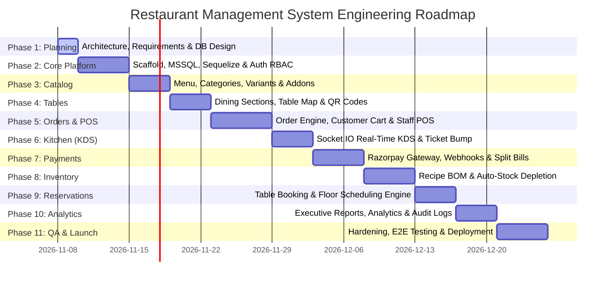

# Restaurant Management System (RMS)
## Development Roadmap, Phased Execution Plan & Risk Management

---

### 1. Phased Implementation Roadmap

The project is structured into **11 sequential, test-driven phases**. Each phase contains clearly demarcated deliverables, acceptance criteria, and quality gates.



---

### 2. Milestone Breakdown & Deliverables

#### Phase 1: System Architecture, Requirements & Database Modeling (CURRENT PHASE)
- **Status**: Completed (Awaiting User Sign-off).
- **Core Deliverables**:
  - `documentation/PROJECT_OVERVIEW.md`
  - `documentation/REQUIREMENTS.md`
  - `documentation/SYSTEM_ARCHITECTURE.md`
  - `documentation/DEVELOPMENT_ROADMAP.md`
  - `DEVELOPMENT_PROGRESS.md`
- **Quality Gate**: Senior Architect review, database design verification, user approval before code generation.

#### Phase 2: Project Scaffolding, MSSQL Setup, Sequelize Models & Authentication Engine
- **Objectives**: Initialize backend and frontend codebases, establish robust MSSQL database connectivity, create Sequelize migrations/models, and implement JWT authentication with Role-Based Access Control (RBAC).
- **Backend Deliverables**:
  - Express server scaffold with modular folder structure (`src/modules/*`).
  - Database connection pool using `sequelize` and `tedious` pointing to MS SQL Server.
  - Sequelize models & migrations: `Users`, `Roles`, `UserRoles`, `AuditLogs`.
  - Password hashing with `bcrypt` and JWT authentication utilities (access + refresh token pattern).
  - RBAC authorization middleware (`requireRole(['ADMIN', 'MANAGER'])`).
  - Fast 4-digit PIN login endpoint for floor staff.
- **Frontend Deliverables**:
  - React.js app scaffold initialized with Ant Design (AntD v5) theme configuration.
  - React Router v6 tree with public, protected, and role-guarded routes.
  - Authentication context, login screens (Customer & Staff PIN keypad).
- **Acceptance Criteria**:
  - All DB tables created via migrations with foreign keys and unique constraints.
  - Login returns valid JWT and role claims; protected routes reject unauthorized access with HTTP 403.

#### Phase 3: Menu & Category Management Module
- **Objectives**: Build the full-featured catalog system supporting hierarchical categories, menu items, variants, and customizable add-on groups.
- **Backend Deliverables**:
  - CRUD endpoints for `Categories`, `MenuItems`, `MenuItemVariants`, `AddonGroups`, `AddonItems`.
  - Image upload handler (local static storage or cloud upload).
  - Real-time "86" toggle endpoint (`PATCH /api/v1/menu-items/:id/availability`).
- **Frontend Deliverables**:
  - Admin Menu Management console using Ant Design `Table`, `Drawer`, and form modals.
  - Variant matrix builder (Regular/Medium/Large) and Add-on attachment modal.
  - Quick availability toggle switch with instant UI feedback.
- **Acceptance Criteria**:
  - Items can be created with multiple variants and dynamic add-on groups.
  - Toggling availability reflects immediately across customer and POS views.

#### Phase 4: Dining Floor & Table Management Engine
- **Objectives**: Represent physical restaurant layouts, generate table QR codes, and maintain live table states.
- **Backend Deliverables**:
  - CRUD for `DiningSections` and `RestaurantTables`.
  - Unique QR code hash generation and URL binding per table.
  - Table status update API (`AVAILABLE`, `OCCUPIED`, `RESERVED`, `BILLED`, `CLEANING`).
- **Frontend Deliverables**:
  - Admin Table Layout Designer (drag-and-drop or coordinate-based canvas).
  - Staff Floor Plan View with color-coded status badges and party size indicators.
  - QR Code export modal for printing table decals.
- **Acceptance Criteria**:
  - Scanning a table QR code properly decodes table metadata and binds the guest session.

#### Phase 5: Ordering & Cart Engine (Customer & POS)
- **Objectives**: Unify order ingestion from customer QR web apps and staff POS terminals with complete cart calculations.
- **Backend Deliverables**:
  - Pricing calculation engine (subtotal, CGST, SGST, service charges, discounts).
  - Order creation endpoint supporting `DINE_IN` and `TAKEAWAY`.
  - Order status state machine enforcement (`PLACED` -> `ACCEPTED` -> `PREPARING` -> `READY` -> `SERVED` -> `COMPLETED`).
- **Frontend Deliverables**:
  - Customer mobile-friendly menu explorer with search, dietary tags, and variant selector modal.
  - Customer cart drawer with itemized summary and cooking instructions input.
  - Waitstaff Quick POS order pad with category tabs, dish buttons, and live order tab.
- **Acceptance Criteria**:
  - Taxes and totals calculate with mathematical precision without rounding errors.
  - Multiple orders can be simultaneously submitted without database deadlocks.

#### Phase 6: Kitchen Display System (KDS) & Socket.IO Real-Time Dispatch
- **Objectives**: Implement paperless kitchen communication with automated ticket routing and color-coded urgency tracking.
- **Backend Deliverables**:
  - Socket.IO server initialization with room segmentation (`role:kitchen`, `role:pos`, `table:{id}`).
  - KOT generator service creating tickets and items in database on order submission.
  - Real-time event emitters (`kot:new`, `kot:bump`, `order:status_update`).
- **Frontend Deliverables**:
  - Kitchen Display System (KDS) full-screen dark mode interface.
  - Kanban card components with item checklists, table badges, and cooking duration timers.
  - Audio chime alerting kitchen of new incoming tickets.
- **Acceptance Criteria**:
  - Placing an order updates the KDS screen in less than 400ms without browser reload.
  - Marking a ticket as bumped updates the floor waiter and customer tracking screen in real time.

#### Phase 7: Razorpay Payment Gateway, Webhooks & Split Billing
- **Objectives**: Provide automated digital checkout, offline cash/card settlement, and flexible split billing.
- **Backend Deliverables**:
  - Razorpay order creation and payment verification with HMAC SHA256 signature checking.
  - Razorpay webhook handler for asynchronous payment capture and failure notices.
  - Split billing calculation engine (Equal division, item-by-item assignment, custom amounts).
  - Offline payment settlement endpoint for cash and card with receipt generation.
- **Frontend Deliverables**:
  - Razorpay Standard Checkout SDK integration modal on customer checkout.
  - POS Split Billing modal with interactive guest check assignment.
  - Printable and downloadable tax invoice view.
- **Acceptance Criteria**:
  - Successful Razorpay payment updates order to `PAID` and triggers KOT automatically.
  - Split bill shares sum exactly to 100% of the invoice balance.

#### Phase 8: Inventory Management & Bill of Materials (BOM)
- **Objectives**: Track raw ingredient stocks and automate deduction when orders are prepared.
- **Backend Deliverables**:
  - Master catalog for `InventoryIngredients` and `Suppliers`.
  - Recipe (BOM) linkage connecting menu items to ingredient quantities.
  - Automated stock depletion transaction hook triggered when an order is accepted.
  - Spoilage and wastage recording endpoint.
- **Frontend Deliverables**:
  - Inventory dashboard showing stock levels, units of measure, and reorder warning tags.
  - Recipe builder interface for attaching ingredients to dishes.
  - Spoilage logging modal with mandatory reason categorization.
- **Acceptance Criteria**:
  - Preparing an order automatically decrements ingredients accurately.
  - Low stock warning triggered immediately when current stock drops below reorder threshold.

#### Phase 9: Table Reservation & Floor Scheduling
- **Objectives**: Enable online and hostess-assisted advance table reservations with conflict prevention.
- **Backend Deliverables**:
  - Table availability search query checking date, time window, and party size capacity.
  - Reservation creation, check-in, and auto-release logic.
- **Frontend Deliverables**:
  - Customer reservation form with slot selector.
  - Hostess calendar / reservation book with search and status tags.
- **Acceptance Criteria**:
  - Double booking a table during an active reservation window is strictly rejected.

#### Phase 10: Reports, Business Intelligence & Financial Analytics
- **Objectives**: Provide restaurant executives with real-time operational insights, revenue charts, and audit trails.
- **Backend Deliverables**:
  - Aggregation queries for hourly sales, category performance, staff sales, and profit margins.
  - Excel (XLSX) and PDF export generation services.
  - Audit log query endpoints for compliance monitoring.
- **Frontend Deliverables**:
  - Executive analytics dashboard featuring Ant Design charts, KPI metric cards, and date range filters.
  - Printable sales summary reports.
- **Acceptance Criteria**:
  - Revenue reports accurately reconcile against settled payment records.

#### Phase 11: End-to-End Testing, Security Hardening & Launch Readiness
- **Objectives**: Ensure high availability, verify test coverage, perform security audits, and prepare deployment containers.
- **Deliverables**:
  - Automated integration test suite covering order-to-payment and inventory flows.
  - Security audit: Rate limiting, SQL injection defense, CORS verification, and helmet checks.
  - Docker containerization / production run scripts.

---

### 3. Dependencies & Technology Matrix

| Package / Dependency | Scope | Target Version | Justification |
| :--- | :--- | :--- | :--- |
| `react` & `react-dom` | Frontend | `^18.2.0` | Declarative UI rendering |
| `antd` | Frontend | `^5.14.0` | Enterprise UI components (Tables, Modals, Forms) |
| `@ant-design/icons` | Frontend | `^5.2.0` | Comprehensive iconography |
| `react-router-dom` | Frontend | `^6.22.0` | Client-side routing and protected route guards |
| `zustand` | Frontend | `^4.5.0` | Lightweight, scalable global state |
| `@tanstack/react-query` | Frontend | `^5.20.0` | Server state caching, background refetching |
| `socket.io-client` | Frontend | `^4.7.0` | WebSocket client for real-time KDS and notifications |
| `axios` | Frontend | `^1.6.0` | HTTP client with request/response interceptors |
| `express` | Backend | `^4.18.2` | Minimalist Node.js web framework |
| `sequelize` | Backend | `^6.37.0` | ORM for MSSQL database modeling & transactions |
| `tedious` | Backend | `^16.6.0` | Official MSSQL TDS protocol driver for Node.js |
| `socket.io` | Backend | `^4.7.0` | Event-driven WebSocket server |
| `jsonwebtoken` | Backend | `^9.0.2` | Stateless authentication tokens |
| `bcryptjs` | Backend | `^2.4.3` | Secure password & PIN hashing |
| `razorpay` | Backend | `^2.9.2` | Official Razorpay payment gateway SDK |
| `zod` | Backend | `^3.22.0` | TypeScript-first runtime schema validation |
| `winston` & `morgan` | Backend | Latest | Structured application and access logging |
| `cors` & `helmet` | Backend | Latest | HTTP security and origin control |
| `express-rate-limit` | Backend | `^7.1.0` | Denial-of-service and brute force mitigation |

---

### 4. Technical Risks & Mitigation Strategies

```
+-----------------------------------------------------------------------------------------+
|                               RISK MANAGEMENT MATRIX                                    |
+---------------------+-------------+----------+------------------------------------------+
| Risk Description    | Probability | Impact   | Architectural Mitigation                 |
+---------------------+-------------+----------+------------------------------------------+
| 1. MSSQL Deadlocks  | Medium      | High     | Wrap checkout and stock updates in strict|
|    on High Volume   |             |          | Sequelize managed transactions with row- |
|                     |             |          | level locks and proper indexing.         |
+---------------------+-------------+----------+------------------------------------------+
| 2. Razorpay Webhook | Medium      | Critical | Implement idempotent webhook processor   |
|    Duplicates       |             |          | checking GatewayPaymentId before applying|
|                     |             |          | any balance adjustments.                 |
+---------------------+-------------+----------+------------------------------------------+
| 3. Socket Drops on  | High        | High     | Client implements automatic reconnect    |
|    Kitchen Tablets  |             |          | with exponential backoff & missed-ticket |
|                     |             |          | sync on reconnection.                    |
+---------------------+-------------+----------+------------------------------------------+
| 4. Inventory BOM    | Medium      | Medium   | Allow manual wastage & variance logs     |
|    Portion Variance |             |          | with audit reasons to balance physical  |
|                     |             |          | stock vs calculated theoretical stock.   |
+---------------------+-------------+----------+------------------------------------------+
| 5. Double Table     | Low         | High     | Database unique reservation slot constraint|
|    Booking Conflict |             |          | and serialized capacity check query.     |
+---------------------+-------------+----------+------------------------------------------+
```

---

### 5. Quality Assurance & Phase Gate Checklist

Before advancing between phases, each milestone must satisfy:
1. **Zero High/Critical Vulnerabilities**: Static analysis clean.
2. **Schema Integrity**: Sequelize models matching MSSQL tables with explicit data types and foreign key cascading rules.
3. **API Contract Verification**: All endpoints adhere to standard `{ success, data, message, meta }` response formats.
4. **Error Handling**: Graceful error catching with meaningful HTTP status codes (400, 401, 403, 404, 409, 500).
5. **Stakeholder Approval**: Formal review and explicit go-ahead from the project lead.

