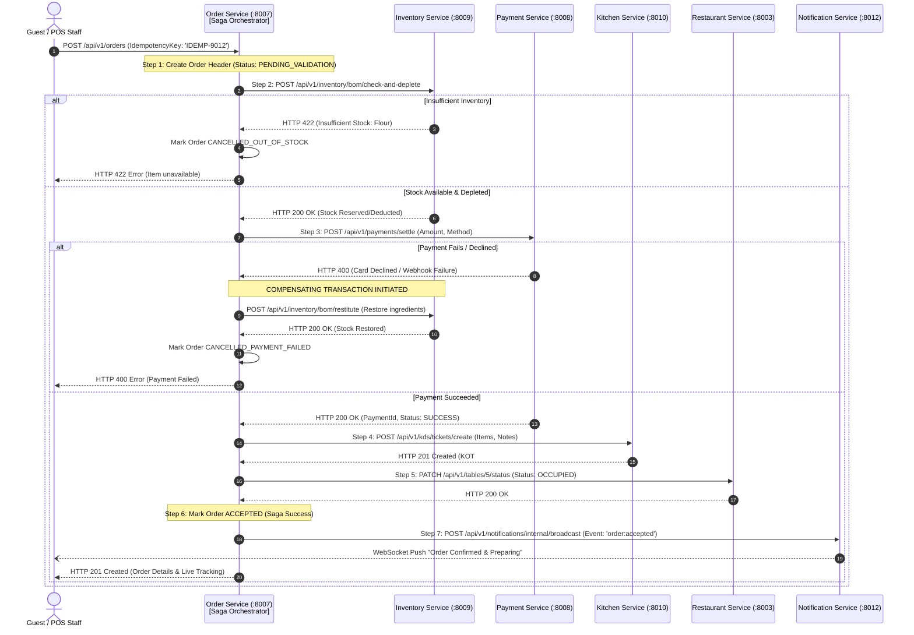

# Restaurant Management System (RMS)
## Distributed Transaction Design & REST-Based Saga Orchestration

---

### 1. The Distributed Transaction Challenge

In our Microservices Architecture, business transactions frequently cross service boundaries:
- Creating an order involves **Order Service** (order record), **Inventory Service** (raw material recipe deduction), **Payment Service** (financial charge), **Kitchen Service** (KOT ticket generation), **Restaurant Service** (table status transition), and **Notification Service** (real-time push).
- Because services communicate strictly via **HTTP REST** without a message broker or distributed two-phase commit (2PC), standard database transactions cannot span across HTTP boundaries.
- **Solution**: We implement an **Orchestration-Based Saga Pattern** with **Compensating Transactions** and **Strict Idempotency Keys**.

---

### 2. Orchestration-Based Saga Architecture

The **Order Service** acts as the central **Saga Orchestrator** for order lifecycles. It coordinates forward execution steps through synchronous REST calls and executes backward compensating operations if any intermediate step fails.

---

### 3. Forward Actions vs Compensating Operations Matrix

Every step in a multi-service Saga defines an explicit, tested compensating endpoint:

| Step # | Service Involved | Forward Action (REST) | State Change | Compensating Action (On Downstream Failure) | Compensating State |
| :---: | :--- | :--- | :--- | :--- | :--- |
| **1** | `order-service` | `INSERT dbo.Orders` | Status: `PENDING_VALIDATION` | Update `Orders` to `CANCELLED` | Status: `CANCELLED` |
| **2** | `inventory-service` | `POST /api/v1/inventory/bom/check-and-deplete` | Stock decremented; `CONSUMPTION` transaction recorded | `POST /api/v1/inventory/bom/restitute` | Stock replenished; `RESTITUTION` transaction recorded |
| **3** | `payment-service` | `POST /api/v1/payments/settle` | Payment captured; Status: `SUCCESS` | `POST /api/v1/payments/refund` | Refund processed via Razorpay/Card |
| **4** | `kitchen-service` | `POST /api/v1/kds/tickets/create` | KOT created; Status: `NEW` | `POST /api/v1/kds/tickets/:id/void` | Ticket flagged `VOIDED` |
| **5** | `restaurant-service`| `PATCH /api/v1/tables/:id/status` | Table status: `OCCUPIED` | `PATCH /api/v1/tables/:id/status` | Revert table to `AVAILABLE` |

---

### 4. Idempotency Framework (Preventing Duplicate Transactions)

Network timeouts often cause clients to retry requests, which risks double-billing or duplicate orders without idempotency guards.

#### 4.1 Idempotency Key Handling
1. **Client Header**: The client sends a unique header: `X-Idempotency-Key: <UUID>`.
2. **Redis Lock & Cache**:
   - The handling service checks Redis for key: `idemp:<service>:<key>`.
   - If key exists with status `PROCESSING`: Reject duplicate concurrent request with HTTP 409 Conflict.
   - If key exists with status `COMPLETED`: Return the previously saved JSON response directly from Redis without re-executing any business logic.
   - If key does not exist: Write key with status `PROCESSING` and TTL 300 seconds (5 minutes).
3. **Completion**: Upon successful commit, update Redis key status to `COMPLETED` and store response payload with a 24-hour TTL.

---

### 5. Asynchronous Payment Webhook Reconciliation

When a customer pays via Razorpay modal:
1. Razorpay delivers an asynchronous webhook event: `payment.captured` to `/api/v1/payments/razorpay/webhook`.
2. **Signature Verification**: `payment-service` validates the HMAC SHA256 signature against `RAZORPAY_WEBHOOK_SECRET`.
3. **Idempotency Check**: Queries `dbo.Payments` for `GatewayPaymentId`. If already recorded, returns HTTP 200 OK immediately (idempotent response).
4. **Order State Update**: `payment-service` makes an internal HTTP call to `order-service`: `PATCH /api/v1/orders/:id/mark-paid`.
5. **KOT Generation**: `order-service` calls `kitchen-service` to trigger the kitchen order ticket.
6. **Notification**: `order-service` calls `notification-service` to emit real-time Socket.IO alerts to kitchen and customer screens.

