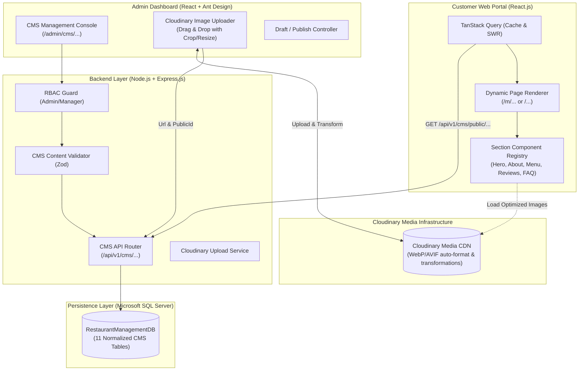
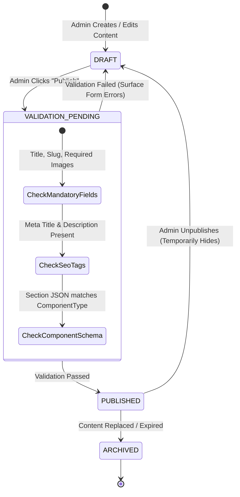

# Restaurant Management System (RMS)
## Dynamic Website Content Management System (CMS) Architecture & Technical Specification

---

### 1. Executive Summary & Vision

The **Dynamic Content Management System (CMS)** module transforms the customer-facing restaurant web application into a fully configurable, data-driven digital storefront. Rather than hardcoding promotional copy, banners, chef profiles, navigation links, or SEO meta tags inside React components, **100% of public customer-facing content is served from Microsoft SQL Server via backend REST APIs and managed in real time through the Admin Dashboard**.

This enables restaurant owners, marketing directors, and general managers to update branding, launch seasonal menus, swap out hero banners, announce holiday hours, publish FAQs, feature press reviews, and optimize search engine metadata without touching code or redeploying the application.

---

### 2. Architecture & Data Flow



---

### 3. CMS Database Tables & Schema Design

The CMS domain is implemented through **11 normalized tables** strictly linked to the core `Restaurants` and `Branches` tenant hierarchy:

| # | Table Name | Business Role & Purpose | Key Attributes |
| :---: | :--- | :--- | :--- |
| **1** | `WebsiteSettings` | Global site branding, logos, color tokens, and contact coordinates | `HeaderLogoUrl`, `HeaderLogoPublicId`, `PrimaryColor`, `ContactPhone` |
| **2** | `SEOSettings` | Search engine metadata, Open Graph, Twitter cards, and Schema.org | `MetaTitle`, `MetaDescription`, `OgImageUrl`, `StructuredDataJson` |
| **3** | `WebsitePages` | Master registry of pages (`Home`, `About Us`, `Private Dining`) | `PageSlug`, `PageType`, `Status` (Draft/Published), `HeroBannerTitle` |
| **4** | `WebsitePageSections`| Dynamic modular blocks composing each page with flexible JSON data | `ComponentType`, `SectionKey`, `ContentDataJson`, `DisplayOrder` |
| **5** | `WebsiteBanners` | Hero carousel slides, seasonal announcements, and promotional bars | `BannerLocation`, `ImageUrl`, `ButtonLink`, `StartDate`, `EndDate` |
| **6** | `NavigationMenus` | Header and mobile navigation links with multi-level dropdowns | `MenuLocation`, `Title`, `TargetUrl`, `ParentMenuId`, `DisplayOrder` |
| **7** | `FooterSections` | Multi-column footer layout (About, Links, Operating Hours, Form) | `SectionTitle`, `ContentType`, `ContentHtml`, `DisplayOrder` |
| **8** | `FAQs` | Frequently asked questions grouped by customer inquiry categories | `Category`, `Question`, `Answer`, `DisplayOrder`, `IsActive` |
| **9** | `Testimonials` | Curated customer reviews, food critic quotes, and press reviews | `AuthorName`, `AuthorRole`, `Rating`, `ReviewContent`, `IsFeatured` |
| **10**| `SocialMediaLinks` | Social platform profiles and icon links | `PlatformName`, `PlatformUrl`, `IconKey`, `DisplayOrder` |
| **11**| `ContactMessages` | Inbound guest inquiries and private event booking requests | `SenderName`, `SenderEmail`, `InquiryType`, `MessageBody`, `Status` |

---

### 4. Modular Section Component Registry (Frontend Architecture)

To ensure zero hardcoded copy in React while preserving high aesthetic polish, the frontend uses a **Section Component Registry pattern**. When a page is requested (e.g., `GET /api/v1/cms/public/pages/home`), the backend returns an ordered array of sections. The frontend dynamically instantiates the corresponding UI component:

```javascript
// Section Component Registry Map (React + Ant Design)
const SectionRegistry = {
  HERO_SLIDER: HeroSliderSection,           // Multi-banner carousel with primary/secondary CTAs
  ABOUT_STORY: AboutStorySection,           // Split layout: Chef story text + image gallery
  FEATURED_MENU: FeaturedMenuSection,       // Highlights dynamic star items from MenuItems DB
  CHEF_FEATURE: ChefShowcaseSection,        // Executive chef bio, awards, culinary philosophy
  SERVICES_LIST: ServicesGridSection,       // Dine-in, Catering, Private Dining, Online Delivery
  STATS_COUNTER: StatisticsCounterSection,  // Animated counters (Years, Awards, Dishes, Guests)
  TESTIMONIALS_GRID: TestimonialsSection,   // Carousel / Masonry of verified diners & critics
  FAQ_ACCORDION: FaqAccordionSection,       // Ant Design Collapse accordion by category
  RESERVATION_CTA: ReservationCtaSection,   // Sticky / Highlight banner driving table bookings
  NEWSLETTER_FORM: NewsletterSection,       // Email capture for weekly tasting announcements
  MAP_CONTACT: MapContactSection,           // Leaflet/Google Map embed + contact info cards
  CUSTOM_HTML: CustomHtmlSection            // Sanitized rich HTML block for arbitrary announcements
};
```

---

### 5. Cloudinary Image Upload & Asset Pipeline

To prevent slow load times and bloated local storage, all CMS images (logos, hero slides, chef photos, dish highlights) are stored and delivered via **Cloudinary**:

1. **Upload Pipeline**:
   - Admin selects an image in the CMS UI.
   - Admin frontend requests a secure signed upload signature from backend (`POST /api/v1/cms/media/signature`).
   - Image uploads directly from browser to Cloudinary via multipart form data.
   - Cloudinary returns the permanent secure URL and unique `public_id`.
   - Admin saves the record to SQL Server, persisting both `ImageUrl` and `ImagePublicId`.
2. **Dynamic Delivery Transformations**:
   - The React client loads images with auto-format and auto-quality query tags (`f_auto,q_auto`), serving next-gen WebP/AVIF formats based on browser support.
   - Responsive widths are automatically requested (e.g., `w_1920` for desktop hero, `w_768` for tablet, `w_400` for mobile thumbnails).
3. **Clean Asset Deletion**:
   - When an admin deletes a banner or replaces a logo in the Admin Dashboard, the backend invokes `cloudinary.v2.uploader.destroy(public_id)` to prevent orphaned assets and storage waste.

---

### 6. Content Publishing Lifecycle & Validation Rules



#### Validation Rules:
1. **Public Guard**: The public customer API (`/api/v1/cms/public/*`) strictly filters with `WHERE Status = 'PUBLISHED' AND IsActive = 1 AND IsDeleted = 0`. Draft content is completely invisible to guests.
2. **Preview Mode**: Authenticated admins can view drafts using `GET /api/v1/cms/public/pages/:slug?preview=true` with a valid JWT bearer token.
3. **Structured Data (Schema.org)**: The CMS automatically constructs valid JSON-LD `Restaurant` schema containing the restaurant's name, address, telephone, price range, geo-coordinates, opening hours, and menu link, boosting Google Local Search rankings.

---

### 7. Complete CMS RESTful API Specifications

#### Public Customer Endpoints (Read-Only, High-Speed Cached)
- `GET /api/v1/cms/public/settings` — Returns global site settings, branding, header/footer logos, colors, and active branches.
- `GET /api/v1/cms/public/navigation` — Returns header, quick links, and mobile drawer navigation trees.
- `GET /api/v1/cms/public/pages/:slug` — Returns full page content with all ordered active sections and parsed JSON payloads.
- `GET /api/v1/cms/public/banners?location=HOME_HERO` — Returns active hero carousel banners filtered by current date/time.
- `GET /api/v1/cms/public/testimonials?featured=true` — Returns curated customer and critic testimonials.
- `GET /api/v1/cms/public/faqs?category=ALL` — Returns categorized FAQs.
- `GET /api/v1/cms/public/footer` — Returns footer columns and social media links.
- `POST /api/v1/cms/public/contact` — Submits guest contact form / private event inquiry into `ContactMessages`.

#### Admin Protected Endpoints (RBAC: `SUPER_ADMIN`, `RESTAURANT_MANAGER`)
- `PUT /api/v1/cms/admin/settings` — Updates website branding, color tokens, and contact info.
- `PUT /api/v1/cms/admin/seo` — Updates global and page-specific SEO meta tags and structured data.
- `GET /api/v1/cms/admin/pages` — Lists all pages with Draft/Published statuses.
- `POST /api/v1/cms/admin/pages` — Creates a new custom or landing page.
- `PUT /api/v1/cms/admin/pages/:id` — Updates page title, slug, hero banner, and rich text.
- `PATCH /api/v1/cms/admin/pages/:id/status` — Toggles page status (`DRAFT`, `PUBLISHED`, `ARCHIVED`).
- `POST /api/v1/cms/admin/pages/:id/sections` — Adds a new section block to a page.
- `PUT /api/v1/cms/admin/sections/:id` — Updates section title, subtitle, component type, and content JSON.
- `PUT /api/v1/cms/admin/sections/reorder` — Reorders sections via drag-and-drop (`DisplayOrder` batch update).
- `DELETE /api/v1/cms/admin/sections/:id` — Removes a section block.
- `POST /api/v1/cms/admin/banners` — Creates a new hero slider banner with Cloudinary metadata.
- `PUT /api/v1/cms/admin/banners/:id` — Updates banner copy, button links, schedule, and image.
- `DELETE /api/v1/cms/admin/banners/:id` — Soft-deletes a banner and purges Cloudinary image.
- `POST /api/v1/cms/admin/navigation` — Creates/edits navigation menu items.
- `POST /api/v1/cms/admin/testimonials` — Adds curated testimonials with ratings and avatars.
- `POST /api/v1/cms/admin/faqs` — Adds/edits FAQs.
- `GET /api/v1/cms/admin/contact-messages` — Lists customer inquiries with status filter (`UNREAD`, `REPLIED`).
- `PATCH /api/v1/cms/admin/contact-messages/:id/reply` — Records administrative reply notes and marks message as `REPLIED`.
- `POST /api/v1/cms/admin/media/sign-upload` — Generates signed Cloudinary upload credentials.

