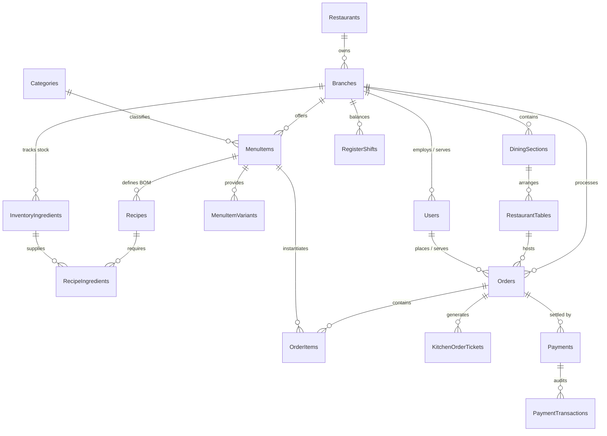
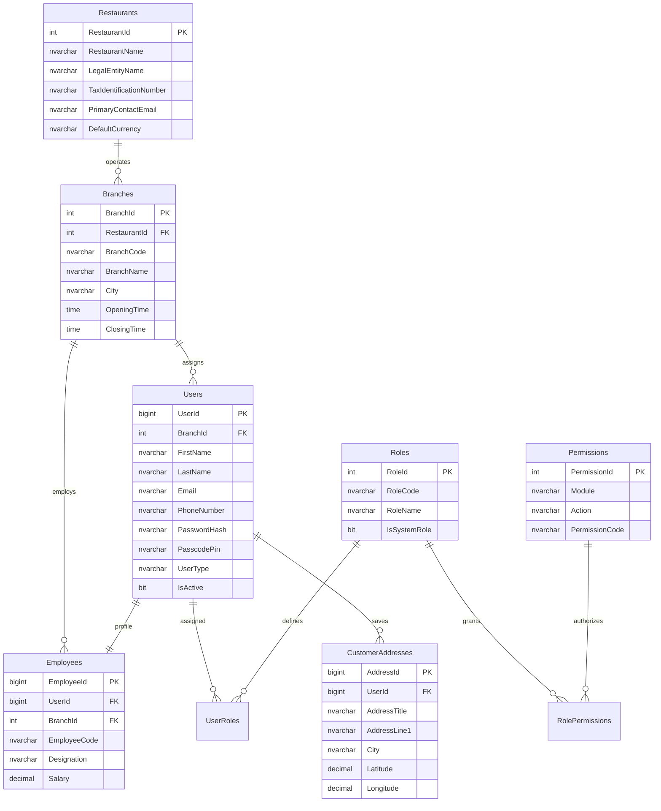
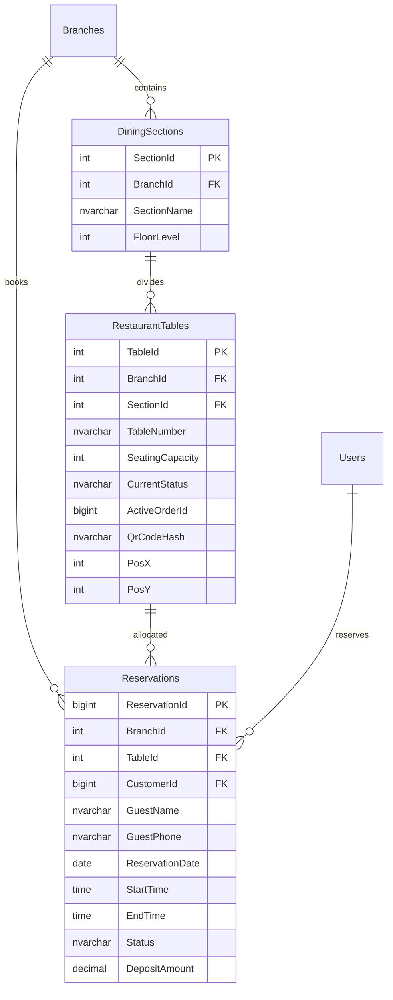
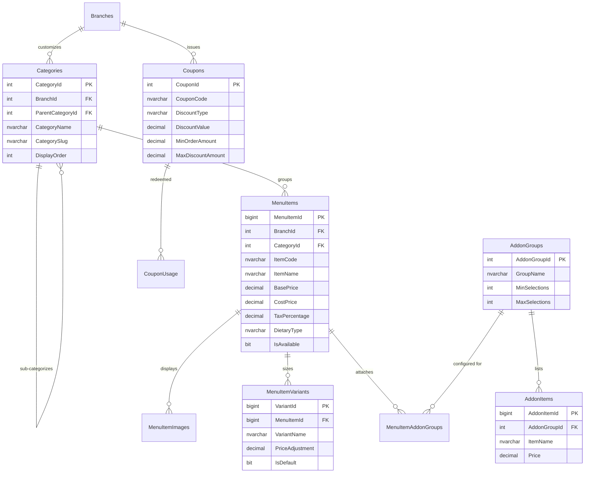
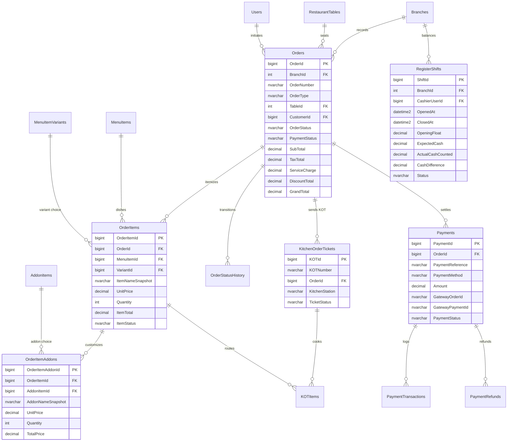
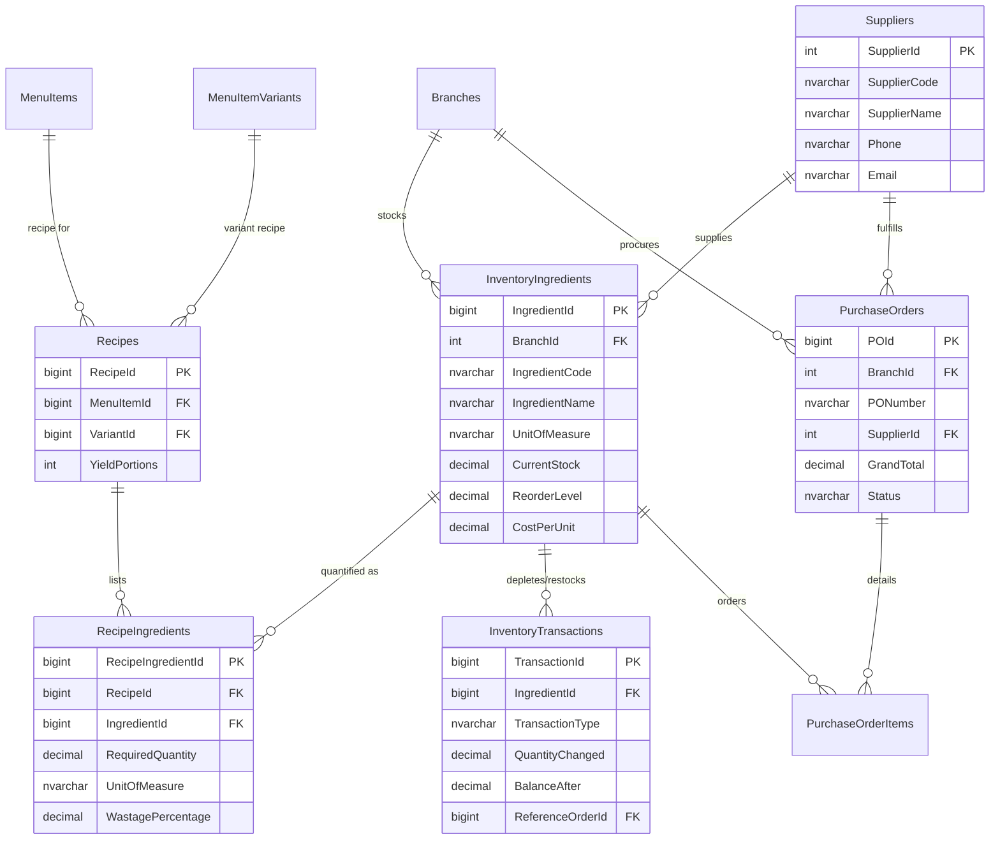

# Restaurant Management System (RMS)
## Master Entity-Relationship Diagrams (ERD)

---

### 1. Global Core Domain Architecture

---

### 2. Module 1: Identity, Roles, Employees & Branches

---

### 3. Module 2: Dining Floor, Tables & Reservations

---

### 4. Module 3: Menu Catalog, Variants, Addons & Coupons

---

### 5. Module 4: Order Lifecycle, KOT & Billing

---

### 6. Module 5: Inventory, Recipe (BOM) & Purchasing

---

### 7. Module 6: Dynamic Website CMS & Digital Storefront

```mermaid
erDiagram
    Restaurants ||--o{ WebsiteSettings : "configures branding"
    Restaurants ||--o{ SEOSettings : "configures SEO"
    Restaurants ||--o{ WebsitePages : "manages pages"
    WebsitePages ||--o{ WebsitePageSections : "structures"
    WebsitePages ||--o{ SEOSettings : "page metadata"
    Restaurants ||--o{ WebsiteBanners : "displays"
    Restaurants ||--o{ NavigationMenus : "navigates"
    NavigationMenus ||--o{ NavigationMenus : "dropdown sub-menus"
    Restaurants ||--o{ FooterSections : "footers"
    Restaurants ||--o{ FAQs : "answers"
    Restaurants ||--o{ Testimonials : "features"
    Restaurants ||--o{ SocialMediaLinks : "links"
    Branches ||--o{ ContactMessages : "receives"
    Users ||--o{ ContactMessages : "replies to"

    WebsiteSettings {
        int SettingId PK
        int RestaurantId FK
        int BranchId FK
        nvarchar SiteTitle
        nvarchar HeaderLogoUrl
        nvarchar PrimaryColor
        nvarchar ContactEmail
        nvarchar ContactPhone
    }

    SEOSettings {
        int SEOId PK
        int RestaurantId FK
        bigint PageId FK
        nvarchar MetaTitle
        nvarchar MetaDescription
        nvarchar OgImageUrl
        nvarchar StructuredDataJson
    }

    WebsitePages {
        bigint PageId PK
        int RestaurantId FK
        nvarchar PageTitle
        nvarchar PageSlug
        nvarchar PageType
        nvarchar Status
        int DisplayOrder
    }

    WebsitePageSections {
        bigint SectionId PK
        bigint PageId FK
        nvarchar SectionKey
        nvarchar ComponentType
        nvarchar ContentDataJson
        int DisplayOrder
        bit IsActive
    }

    WebsiteBanners {
        bigint BannerId PK
        int RestaurantId FK
        nvarchar BannerTitle
        nvarchar ButtonText
        nvarchar ButtonLink
        nvarchar ImageUrl
        nvarchar BannerLocation
        int DisplayOrder
    }

    NavigationMenus {
        int MenuId PK
        int RestaurantId FK
        int ParentMenuId FK
        nvarchar MenuLocation
        nvarchar Title
        nvarchar TargetUrl
        int DisplayOrder
    }

    FooterSections {
        int FooterSectionId PK
        int RestaurantId FK
        nvarchar SectionTitle
        nvarchar ContentType
        nvarchar ContentHtml
        int DisplayOrder
    }

    FAQs {
        int FAQId PK
        int RestaurantId FK
        nvarchar Category
        nvarchar Question
        nvarchar Answer
        int DisplayOrder
    }

    Testimonials {
        bigint TestimonialId PK
        int RestaurantId FK
        nvarchar AuthorName
        nvarchar AuthorRole
        int Rating
        nvarchar ReviewContent
        bit IsFeatured
    }

    SocialMediaLinks {
        int SocialLinkId PK
        int RestaurantId FK
        nvarchar PlatformName
        nvarchar PlatformUrl
        nvarchar IconKey
        int DisplayOrder
    }

    ContactMessages {
        bigint MessageId PK
        int BranchId FK
        nvarchar SenderName
        nvarchar SenderEmail
        nvarchar Subject
        nvarchar InquiryType
        nvarchar Status
        bigint RepliedByUserId FK
    }
```

