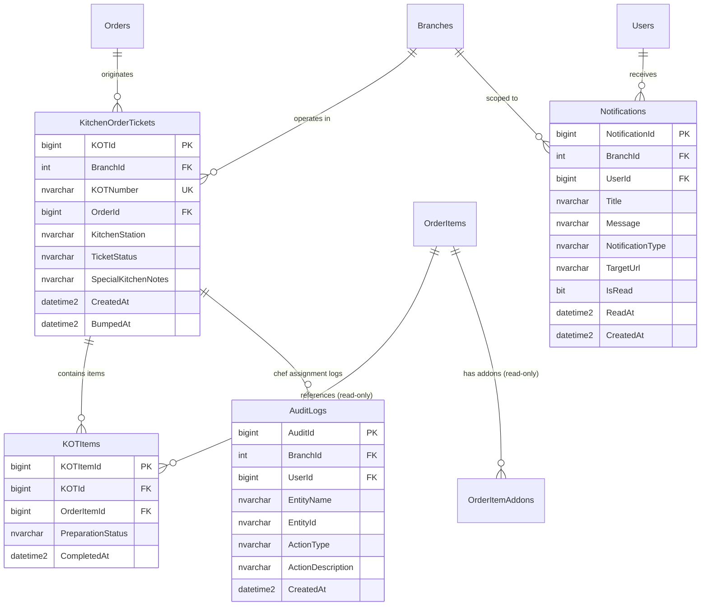
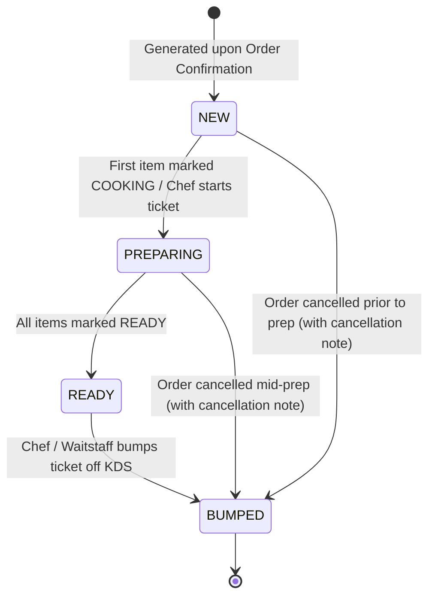

# Restaurant Management System (RMS)
## Phase 10: Kitchen & Notification Database Design & Stored Procedure Blueprint (Revised & Corrected)

---

### 1. Database Specifications & Environment

- **Database Engine**: Microsoft SQL Server 2022 (RTM-CU)
- **Target Database**: `RestaurantManagementDB` (Shared Database Model)
- **Isolated Testing Database**: `RestaurantManagementDB_IsolatedTest`
- **Host / Port**: `localhost:1435`
- **User / Credentials**: `sa` / Root Environment Config
- **ORM Decision**: **ZERO ORM / ZERO Sequelize Models**. 100% Parameterized T-SQL Stored Procedures.
- **Connection Layer**: Single global pool in `backend/shared/config/database.js`.
- **Database Boundary Rule**: Every microservice owns specific tables. Stored procedures authored for Phase 10 **strictly mutate only tables owned by Kitchen Service and Notification Service**. All cross-service tables (`Orders`, `OrderItems`, `OrderStatusHistory`, `MenuItems`, `Branches`, `Users`) are treated as **STRICTLY READ-ONLY**.

---

### 2. Entity Relationship Model & Table Architecture

---

### 3. Core Table Schemas & Constraints

#### 3.1 `dbo.KitchenOrderTickets` (Owned by `kitchen-service`)
Stores the master preparation ticket for a kitchen station or combined kitchen order display.

| Column Name | Data Type | Nullable | Default | Description & Business Rules |
| :--- | :--- | :---: | :--- | :--- |
| `KOTId` | `BIGINT IDENTITY(50001,1)` | **NO** | *Auto* | Clustered Primary Key. Starts at 50001 to distinguish clearly from Order IDs. |
| `BranchId` | `INT` | **NO** | - | Foreign Key $\rightarrow$ `dbo.Branches(BranchId)`. Segregates tickets by location. |
| `KOTNumber` | `NVARCHAR(35)` | **NO** | - | Unique business reference. Format: `KOT-YYYYMMDD-BRANCH-XXXXX`. |
| `OrderId` | `BIGINT` | **NO** | - | Foreign Key $\rightarrow$ `dbo.Orders(OrderId)` ON DELETE CASCADE. |
| `KitchenStation` | `NVARCHAR(40)` | **NO** | `'MAIN_KITCHEN'` | Target station: `'MAIN_KITCHEN'`, `'GRILL'`, `'FRYER'`, `'BAR'`, `'DESSERT'`, `'COLD_KITCHEN'`. |
| `TicketStatus` | `NVARCHAR(30)` | **NO** | `'NEW'` | Lifecycle status: `'NEW'`, `'PREPARING'`, `'READY'`, `'BUMPED'`. |
| `SpecialKitchenNotes`| `NVARCHAR(500)` | **YES** | `NULL` | Consolidated special preparation notes, guest allergies, and chef tags. |
| `CreatedAt` | `DATETIME2(3)` | **NO** | `SYSUTCDATETIME()` | Timestamp when ticket was generated and received by the kitchen. |
| `BumpedAt` | `DATETIME2(3)` | **YES** | `NULL` | Timestamp when ticket was completed and bumped off the active KDS screen. |

- **Constraints & Indexes**:
  - `PK_KitchenOrderTickets`: Clustered Primary Key on `KOTId`.
  - `UQ_KOT_Number`: Unique Non-Clustered Constraint on `KOTNumber`.
  - `FK_KitchenOrderTickets_Branches`: Foreign Key on `BranchId` (`ON DELETE NO ACTION`).
  - `FK_KitchenOrderTickets_Orders`: Foreign Key on `OrderId` (`ON DELETE CASCADE`).
  - `IX_KitchenOrderTickets_Active`: Non-Clustered Index on `(BranchId, TicketStatus, CreatedAt)` INCLUDE `(KOTId, KOTNumber, OrderId, KitchenStation)`.

> [!IMPORTANT]
> **Chef Assignment Architecture Decision**:
> In `database/02_CreateTables.sql`, `dbo.KitchenOrderTickets` does not have a dedicated `AssignedChefUserId` column. Since project rules strictly forbid modifying existing table structures via ALTER TABLE, chef assignment is formally preserved in **`dbo.AuditLogs`** (`EntityName = 'KitchenOrderTickets'`, `EntityId = CAST(@KOTId AS NVARCHAR)`, `ActionType = 'ASSIGN_CHEF'`) and updated in `SpecialKitchenNotes` (e.g. `[CHEF: Marco (ID: 5)] ...`). Active shifts are also cached in Redis (`kds:branch:{id}:station:{station}:chef`).

---

#### 3.2 `dbo.KOTItems` (Owned by `kitchen-service`)
Maintains granular, item-by-item preparation states linked directly to customer order line items.

| Column Name | Data Type | Nullable | Default | Description & Business Rules |
| :--- | :--- | :---: | :--- | :--- |
| `KOTItemId` | `BIGINT IDENTITY(1,1)` | **NO** | *Auto* | Clustered Primary Key. |
| `KOTId` | `BIGINT` | **NO** | - | Foreign Key $\rightarrow$ `dbo.KitchenOrderTickets(KOTId)` ON DELETE CASCADE. |
| `OrderItemId` | `BIGINT` | **NO** | - | Foreign Key $\rightarrow$ `dbo.OrderItems(OrderItemId)` ON DELETE NO ACTION. |
| `PreparationStatus`| `NVARCHAR(30)` | **NO** | `'PENDING'` | Item cooking status: `'PENDING'`, `'COOKING'`, `'READY'`. |
| `CompletedAt` | `DATETIME2(3)` | **YES** | `NULL` | Timestamp when chef marks the item as ready. |

- **Constraints & Indexes**:
  - `PK_KOTItems`: Clustered Primary Key on `KOTItemId`.
  - `FK_KOTItems_KitchenOrderTickets`: Foreign Key on `KOTId` (`ON DELETE CASCADE`).
  - `FK_KOTItems_OrderItems`: Foreign Key on `OrderItemId` (`ON DELETE NO ACTION`).
  - `IX_KOTItems_KOTId`: Non-Clustered Index on `(KOTId, PreparationStatus)` INCLUDE `(OrderItemId)`.

> [!NOTE]
> **Item Snapshots & Addon Resolution Strategy**:
> `dbo.KOTItems` intentionally does not duplicate dish names, portion variants, quantities, or addons. All KDS queries (`usp_KOT_GetById`, `usp_KOT_GetActiveBoard`) execute read-only joins against `dbo.OrderItems oi` and `dbo.OrderItemAddons oia`:
> - `oi.ItemNameSnapshot`, `oi.VariantNameSnapshot`, `oi.Quantity`, `oi.SpecialInstructions`
> - `STRING_AGG(oia.AddonNameSnapshot, ', ') AS AddonsList`
> This ensures that KDS screens display the historical price/portion snapshot and cooking instructions without redundant data duplication.

---

#### 3.3 `dbo.Notifications` (Owned by `notification-service`)
Stores cross-channel notification logs for in-app alert feeds and historical audit.

| Column Name | Data Type | Nullable | Default | Description & Business Rules |
| :--- | :--- | :---: | :--- | :--- |
| `NotificationId` | `BIGINT IDENTITY(1,1)` | **NO** | *Auto* | Clustered Primary Key. |
| `BranchId` | `INT` | **YES** | `NULL` | Foreign Key $\rightarrow$ `dbo.Branches(BranchId)`. NULL indicates system-wide. |
| `UserId` | `BIGINT` | **YES** | `NULL` | Foreign Key $\rightarrow$ `dbo.Users(UserId)` ON DELETE CASCADE. NULL for role broadcasts. |
| `Title` | `NVARCHAR(150)` | **NO** | - | Short display headline (e.g. `'New Order #ORD-0012'`). |
| `Message` | `NVARCHAR(1000)` | **NO** | - | Detailed notification message. |
| `NotificationType` | `NVARCHAR(40)` | **NO** | - | Categorization: `'NEW_ORDER'`, `'KDS_ALERT'`, `'ORDER_READY'`, `'ORDER_CANCELLED'`, `'LOW_STOCK'`. |
| `TargetUrl` | `NVARCHAR(255)` | **YES** | `NULL` | Deep link URL for web/mobile client navigation. |
| `IsRead` | `BIT` | **NO** | `0` | Unread flag (`0` = unread, `1` = read). |
| `ReadAt` | `DATETIME2(3)` | **YES** | `NULL` | Timestamp when user viewed or acknowledged the alert. |
| `CreatedAt` | `DATETIME2(3)` | **NO** | `SYSUTCDATETIME()` | Creation timestamp. |

- **Constraints & Indexes**:
  - `PK_Notifications`: Clustered Primary Key on `NotificationId`.
  - `FK_Notifications_Branches`: Foreign Key on `BranchId` (`ON DELETE NO ACTION`).
  - `FK_Notifications_Users`: Foreign Key on `UserId` (`ON DELETE CASCADE`).
  - `IX_Notifications_User_Unread`: Filtered Non-Clustered Index on `(UserId, IsRead, CreatedAt DESC)` INCLUDE `(Title, Message, NotificationType, TargetUrl)` WHERE `IsRead = 0`.

---

### 4. Lifecycle States & Status Transitions

#### 4.1 Kitchen Order Ticket State Machine

#### 4.2 State Validation Rules Enforced in Stored Procedures
1. **Valid KOT Transitions**:
   - `NEW` $\rightarrow$ `PREPARING`
   - `PREPARING` $\rightarrow$ `READY`
   - `READY` $\rightarrow$ `BUMPED`
   - `NEW` / `PREPARING` / `READY` $\rightarrow$ `BUMPED` (Order Cancellation)
   - Any attempt to transition from `BUMPED` to any status raises SQL Error `50001: Cannot transition bumped ticket`.
2. **Valid Item Transitions**:
   - `PENDING` $\rightarrow$ `COOKING`
   - `COOKING` $\rightarrow$ `READY`
   - Attempting to transition from `READY` to `PENDING` raises SQL Error `50002: Cannot reset completed cooking item`.
3. **Item-to-Ticket Status Rollup**:
   - When updating item status via `usp_KOT_UpdateItemStatus`:
     - If all items in the KOT are `READY`, the KOT status automatically advances to `READY`.
     - If at least one item is `COOKING` and the KOT is currently `NEW`, the KOT advances to `PREPARING`.

---

### 5. Final Stored Procedures Inventory (SPs 146–161)

A total of **16 single-responsibility stored procedures** will be authored in `database/14_KitchenNotificationStoredProcedures.sql`:

#### 5.1 Kitchen Display System & KOT Stored Procedures (SPs 146–155)

##### Procedure 146: `dbo.usp_KOT_Create`
- **Description**: Atomically generates a new KOT header and associates target order items into `dbo.KOTItems`.
- **Idempotency Guard**: Checks if an active KOT (`TicketStatus IN ('NEW', 'PREPARING', 'READY')`) already exists for `(@OrderId, @KitchenStation)`. If found, returns the existing record idempotently with `IsIdempotent = 1` without creating duplicate tickets or items.
- **Parameters**:
  - `@BranchId` INT
  - `@OrderId` BIGINT
  - `@KitchenStation` NVARCHAR(40) = 'MAIN_KITCHEN'
  - `@SpecialKitchenNotes` NVARCHAR(500) = NULL
  - `@ItemIdsJson` NVARCHAR(MAX) = NULL (JSON array of specific `OrderItemId` values for station splitting; NULL includes all order items)
  - `@KOTId` BIGINT OUTPUT
  - `@KOTNumber` NVARCHAR(35) OUTPUT

##### Procedure 147: `dbo.usp_KOT_GetById`
- **Description**: Multi-recordset fetch returning KOT header, parent order info (table number, order type, customer/guest name), and item details with portion variants and addons.
- **Parameters**: `@KOTId` BIGINT
- **Recordsets**:
  1. KOT Header & Order metadata (Table, Waiter, Elapsed Time, Notes).
  2. KOT Items list (Dish name snapshot, variant, quantity, instructions, addons list, prep status).

##### Procedure 148: `dbo.usp_KOT_GetByOrderId`
- **Description**: Returns all KOT tickets and items associated with a customer order across all kitchen stations.
- **Parameters**: `@OrderId` BIGINT

##### Procedure 149: `dbo.usp_KOT_GetActiveBoard`
- **Description**: Primary KDS screen query retrieving all active (`NEW`, `PREPARING`, `READY`) tickets for a branch and optional station. Computes elapsed minutes in real time.
- **Parameters**:
  - `@BranchId` INT
  - `@KitchenStation` NVARCHAR(40) = NULL (NULL returns all stations for master display)
  - `@TicketStatus` NVARCHAR(30) = NULL (NULL returns active: NEW, PREPARING, READY)

##### Procedure 150: `dbo.usp_KOT_UpdateStatus`
- **Description**: Transitions KOT status (`NEW` $\rightarrow$ `PREPARING` $\rightarrow$ `READY` $\rightarrow$ `BUMPED`). Enforces state machine validation. Updates `BumpedAt = SYSUTCDATETIME()` when status transitions to `BUMPED`.
- **Parameters**:
  - `@KOTId` BIGINT
  - `@NewStatus` NVARCHAR(30)
  - `@UpdatedByUserId` BIGINT = NULL

##### Procedure 151: `dbo.usp_KOT_UpdateItemStatus`
- **Description**: Updates individual item `PreparationStatus` (`PENDING` $\rightarrow$ `COOKING` $\rightarrow$ `READY`). Automatically sets `CompletedAt` when ready. Re-evaluates parent KOT ticket status (if all items are ready, advances KOT to `READY`).
- **Parameters**:
  - `@KOTItemId` BIGINT
  - `@NewPreparationStatus` NVARCHAR(30)

##### Procedure 152: `dbo.usp_KOT_Bump`
- **Description**: Bumps a completed ticket off the KDS screen, setting `TicketStatus = 'BUMPED'` and `BumpedAt = SYSUTCDATETIME()`.
- **Parameters**:
  - `@KOTId` BIGINT
  - `@BumpedByUserId` BIGINT = NULL

##### Procedure 153: `dbo.usp_KOT_CancelByOrderId`
- **Description**: Cancels and bumps all active KOT tickets for an order when cancelled or voided. Prepends `[ORDER CANCELLED]` to `SpecialKitchenNotes`.
- **Parameters**:
  - `@OrderId` BIGINT
  - `@Reason` NVARCHAR(255) = NULL

##### Procedure 154: `dbo.usp_KOT_GetMetrics`
- **Description**: Calculates KDS operational performance for a branch: average preparation turnaround minutes, total tickets today, active tickets, overdue tickets (>20 min), and station workload breakdown.
- **Parameters**:
  - `@BranchId` INT
  - `@Date` DATE = NULL (Defaults to today)

##### Procedure 155: `dbo.usp_KOT_AssignChef`
- **Description**: Records chef assignment in `dbo.AuditLogs` and updates chef note in `SpecialKitchenNotes`.
- **Parameters**:
  - `@KOTId` BIGINT
  - `@ChefUserId` BIGINT
  - `@AssignedByUserId` BIGINT = NULL

---

#### 5.2 Notification Stored Procedures (SPs 156–162)

##### Procedure 156: `dbo.usp_Notification_Create`
- **Description**: Persists an in-app notification in `dbo.Notifications`.
- **Idempotency Guard**: Checks if an identical notification was inserted within the last 60 seconds matching `(@UserId, @BranchId, @NotificationType, @Title)`. If found, returns existing record idempotently.
- **Parameters**:
  - `@BranchId` INT = NULL
  - `@UserId` BIGINT = NULL
  - `@Title` NVARCHAR(150)
  - `@Message` NVARCHAR(1000)
  - `@NotificationType` NVARCHAR(40)
  - `@TargetUrl` NVARCHAR(255) = NULL
  - `@NotificationId` BIGINT OUTPUT
  - `@IsDuplicate` BIT OUTPUT

##### Procedure 157: `dbo.usp_Notification_GetById`
- **Description**: Retrieves single notification record by `NotificationId`.
- **Parameters**:
  - `@NotificationId` BIGINT

##### Procedure 158: `dbo.usp_Notification_GetByUser`
- **Description**: Filtered, paginated listing of notifications for a user, including direct user alerts and role-relevant branch alerts.
- **Parameters**:
  - `@UserId` BIGINT
  - `@BranchId` INT = NULL
  - `@UnreadOnly` BIT = 0
  - `@Page` INT = 1
  - `@Limit` INT = 20

##### Procedure 159: `dbo.usp_Notification_MarkAsRead`
- **Description**: Marks a single notification as read (`IsRead = 1, ReadAt = SYSUTCDATETIME()`).
- **Parameters**:
  - `@NotificationId` BIGINT
  - `@UserId` BIGINT = NULL
  - `@RowsUpdated` INT OUTPUT

##### Procedure 160: `dbo.usp_Notification_MarkAllAsRead`
- **Description**: Marks all unread notifications for a specific user as read in a single atomic update.
- **Parameters**:
  - `@UserId` BIGINT
  - `@BranchId` INT = NULL
  - `@RowsUpdated` INT OUTPUT

##### Procedure 161: `dbo.usp_Notification_GetUnreadCount`
- **Description**: Fast lightweight query returning integer count of unread notifications for the user's bell icon badge.
- **Parameters**:
  - `@UserId` BIGINT
  - `@BranchId` INT = NULL
  - `@UnreadCount` INT OUTPUT

##### Procedure 162: `dbo.usp_Notification_DeleteOlderThan`
- **Description**: Maintenance retention procedure deleting read notifications older than `@DaysOld` days.
- **Parameters**:
  - `@DaysOld` INT = 30
  - `@DeletedCount` INT OUTPUT
