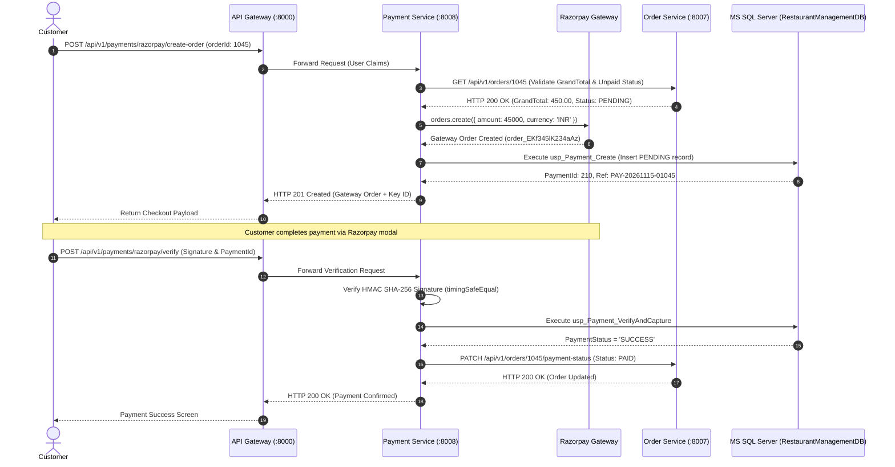
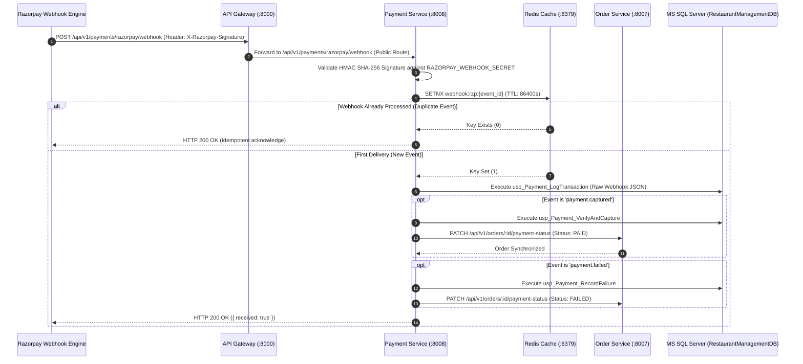
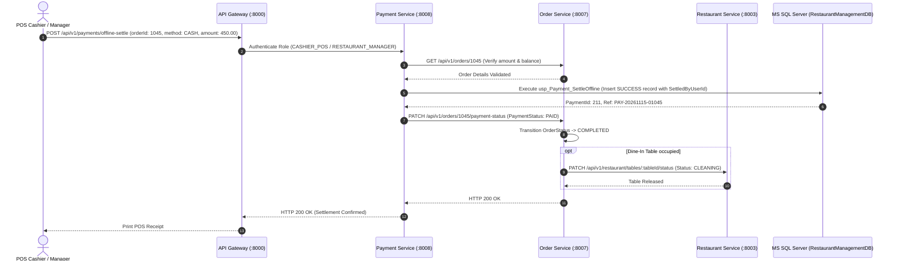

# Restaurant Management System (RMS)
## Phase 9: Payment Service — API Specification & Implementation Plan

**Document Reference:** `documentation/PAYMENT_API_IMPLEMENTATION_PLAN.md`  
**Date:** November 15, 2026  
**Author:** Senior Microservices Architect, Node.js Backend Developer & SQL Server Database Architect  
**Status:** **PLANNING COMPLETED — AWAITING USER REVIEW & SIGN-OFF**  

---

### 1. Service Overview & Ingress Topology

The **Payment Service** is responsible for all payment processing, gateway integrations (Razorpay), webhook handling, offline cash/card settlements, refund management, and financial reconciliation in the Restaurant Management System.

- **Microservice Directory**: `backend/payment-service/`
- **Internal Service Port**: `8008`
- **API Gateway Ingress**: `http://localhost:8000/api/v1/payments`
- **Technology Stack**: Node.js 22, Express.js, Microsoft SQL Server (100% Stored Procedures, `mssql` pool, zero ORM), Redis, Razorpay SDK (`^2.9.5`), Winston Logger, Axios HTTP Client.
- **Mutual Service Security**: `X-Internal-Service-Key` for mesh communication, `X-Correlation-ID` for distributed tracing.

---

### 2. Complete REST API Specifications

#### 2.1 Online Payment Order Creation (Razorpay Order)
- **Method & Path**: `POST /api/v1/payments/razorpay/create-order`
- **Authentication**: JWT Required
- **Authorized Roles**: `CUSTOMER`, `WAITSTAFF`, `CASHIER_POS`, `RESTAURANT_MANAGER`, `SUPER_ADMIN`
- **Purpose**: Validates the order against `order-service`, creates an official Razorpay order with currency in paise (`amount * 100`), inserts a pending record into `dbo.Payments`, and returns gateway order details to the frontend.
- **Request Payload**:
  ```json
  {
    "orderId": 1045,
    "paymentMethod": "RAZORPAY"
  }
  ```
- **Response Payload (HTTP 201 Created)**:
  ```json
  {
    "success": true,
    "statusCode": 201,
    "message": "Razorpay payment order initialized successfully",
    "data": {
      "paymentId": 210,
      "paymentReference": "PAY-20261115-01045",
      "orderId": 1045,
      "amount": 450.00,
      "currency": "INR",
      "gatewayOrderId": "order_EKf345lK234aAz",
      "razorpayKeyId": "rzp_test_your_key_id",
      "status": "PENDING"
    }
  }
  ```
- **Error Codes**: `400 BAD_REQUEST` (invalid payload, order already paid), `404 NOT_FOUND` (order does not exist), `500 INTERNAL_SERVER_ERROR`.

---

#### 2.2 Online Payment Signature Verification
- **Method & Path**: `POST /api/v1/payments/razorpay/verify`
- **Authentication**: JWT Required
- **Authorized Roles**: `CUSTOMER`, `WAITSTAFF`, `CASHIER_POS`, `RESTAURANT_MANAGER`, `SUPER_ADMIN`
- **Purpose**: Cryptographically verifies the Razorpay signature returned by the client checkout modal. Upon valid HMAC verification, executes `usp_Payment_VerifyAndCapture`, updates `dbo.Payments` to `SUCCESS`, logs transaction, and calls `order-service` to mark the order as `PAID`.
- **Request Payload**:
  ```json
  {
    "paymentId": 210,
    "gatewayOrderId": "order_EKf345lK234aAz",
    "gatewayPaymentId": "pay_EKf456mN789bBz",
    "gatewaySignature": "e3b0c44298fc1c149afbf4c8996fb92427ae41e4649b934ca495991b7852b855"
  }
  ```
- **Cryptographic Verification Algorithm**:
  $$\text{expected\_signature} = \text{crypto.createHmac}('sha256', \text{RAZORPAY\_KEY\_SECRET}).\text{update}(\text{gatewayOrderId} + '|' + \text{gatewayPaymentId}).\text{digest}('hex')$$
  Comparison must use `crypto.timingSafeEqual` to eliminate timing attack vectors.
- **Response Payload (HTTP 200 OK)**:
  ```json
  {
    "success": true,
    "statusCode": 200,
    "message": "Payment verified and captured successfully",
    "data": {
      "paymentId": 210,
      "paymentReference": "PAY-20261115-01045",
      "orderId": 1045,
      "amount": 450.00,
      "paymentStatus": "SUCCESS",
      "gatewayPaymentId": "pay_EKf456mN789bBz",
      "settledAt": "2026-11-15T12:00:00.000Z"
    }
  }
  ```
- **Error Codes**: `400 BAD_REQUEST` (invalid signature, verification failed), `404 NOT_FOUND` (payment record not found).

---

#### 2.3 Razorpay Webhook Ingress
- **Method & Path**: `POST /api/v1/payments/razorpay/webhook`
- **Authentication**: Public (Whitelisted in API Gateway `publicRoutePatterns`)
- **Headers Required**: `X-Razorpay-Signature`
- **Purpose**: Asynchronous gateway event notification (e.g. `payment.captured`, `payment.failed`, `refund.processed`). Validates webhook signature against `RAZORPAY_WEBHOOK_SECRET`, enforces idempotency, logs raw event payload in `dbo.PaymentTransactions`, and synchronizes order status.
- **Verification Algorithm**:
  $$\text{computed\_signature} = \text{crypto.createHmac}('sha256', \text{RAZORPAY\_WEBHOOK\_SECRET}).\text{update}(\text{rawRequestBody}).\text{digest}('hex')$$
- **Supported Events**:
  1. `payment.captured`: Calls `usp_Payment_VerifyAndCapture`, synchronizes order status to `PAID`.
  2. `payment.failed`: Calls `usp_Payment_RecordFailure`, synchronizes order failure.
  3. `refund.processed`: Calls `usp_Payment_Refund_Create` if not previously logged.
- **Response Payload (HTTP 200 OK)**:
  ```json
  {
    "status": "ok",
    "received": true,
    "event": "payment.captured",
    "idempotent": true
  }
  ```
- **Error Codes**: `400 BAD_REQUEST` (invalid webhook signature), `500 INTERNAL_SERVER_ERROR`.

---

#### 2.4 Offline Payment Settlement (POS Cash / Card / UPI)
- **Method & Path**: `POST /api/v1/payments/offline-settle`
- **Authentication**: JWT Required
- **Authorized Roles**: `CASHIER_POS`, `RESTAURANT_MANAGER`, `SUPER_ADMIN`
- **Purpose**: Records on-premise payment collected by staff at the register/POS. Executes `usp_Payment_SettleOffline`, captures staff `SettledByUserId`, writes transaction ledger, and calls `order-service` to complete the transaction.
- **Request Payload**:
  ```json
  {
    "orderId": 1045,
    "branchId": 1,
    "paymentMethod": "CASH",
    "amount": 450.00,
    "notes": "Exact cash received at POS counter 1"
  }
  ```
- **Response Payload (HTTP 200 OK)**:
  ```json
  {
    "success": true,
    "statusCode": 200,
    "message": "Offline payment settled successfully",
    "data": {
      "paymentId": 211,
      "paymentReference": "PAY-20261115-01045",
      "orderId": 1045,
      "amount": 450.00,
      "paymentMethod": "CASH",
      "paymentStatus": "SUCCESS",
      "settledByUserId": 14,
      "settledAt": "2026-11-15T12:05:00.000Z"
    }
  }
  ```
- **Error Codes**: `400 BAD_REQUEST` (invalid method, amount exceeds balance), `403 FORBIDDEN` (insufficient staff role).

---

#### 2.5 Process Refund (Online & Offline)
- **Method & Path**: `POST /api/v1/payments/refund`
- **Authentication**: JWT Required
- **Authorized Roles**: `RESTAURANT_MANAGER`, `SUPER_ADMIN`
- **Purpose**: Issues a partial or full refund against a previously successful payment. For Razorpay payments, invokes the Razorpay Refund API (`payments.refund(paymentId, { amount, notes })`). Transactionally executes `usp_Payment_Refund_Create`, records entry in `dbo.PaymentRefunds`, logs ledger event, and updates `order-service`.
- **Request Payload**:
  ```json
  {
    "paymentId": 210,
    "refundAmount": 150.00,
    "reason": "Customer cancelled one appetizer due to preparation delay"
  }
  ```
- **Response Payload (HTTP 200 OK)**:
  ```json
  {
    "success": true,
    "statusCode": 200,
    "message": "Refund processed successfully",
    "data": {
      "refundId": 15,
      "paymentId": 210,
      "gatewayRefundId": "rfnd_EKf789pQ123cCz",
      "refundAmount": 150.00,
      "totalRefunded": 150.00,
      "remainingBalance": 300.00,
      "status": "PROCESSED",
      "paymentStatus": "PARTIALLY_REFUNDED",
      "processedAt": "2026-11-15T12:10:00.000Z"
    }
  }
  ```
- **Error Codes**: `400 BAD_REQUEST` (refund exceeds paid amount, payment not in SUCCESS status), `403 FORBIDDEN` (unauthorized role), `502 BAD_GATEWAY` (Razorpay refund gateway failure).

---

#### 2.6 Get Payment by ID
- **Method & Path**: `GET /api/v1/payments/:id`
- **Authentication**: JWT Required
- **Authorized Roles**: `CUSTOMER` (own order), `WAITSTAFF`, `CASHIER_POS`, `RESTAURANT_MANAGER`, `SUPER_ADMIN`
- **Purpose**: Returns complete payment record including parent order details, transaction ledger entries, and refund history.
- **Response Payload (HTTP 200 OK)**:
  ```json
  {
    "success": true,
    "statusCode": 200,
    "data": {
      "paymentId": 210,
      "paymentReference": "PAY-20261115-01045",
      "orderId": 1045,
      "branchId": 1,
      "paymentMethod": "RAZORPAY",
      "amount": 450.00,
      "paymentStatus": "PARTIALLY_REFUNDED",
      "gatewayOrderId": "order_EKf345lK234aAz",
      "gatewayPaymentId": "pay_EKf456mN789bBz",
      "settledAt": "2026-11-15T12:00:00.000Z",
      "transactions": [
        {
          "transactionId": 501,
          "transactionType": "WEBHOOK_CAPTURE",
          "amount": 450.00,
          "status": "SUCCESS",
          "transactionDate": "2026-11-15T12:00:00.000Z"
        }
      ],
      "refunds": [
        {
          "refundId": 15,
          "refundAmount": 150.00,
          "reason": "Customer cancelled one appetizer",
          "status": "PROCESSED",
          "createdAt": "2026-11-15T12:10:00.000Z"
        }
      ],
      "summary": {
        "totalPaid": 450.00,
        "totalRefunded": 150.00,
        "netAmount": 300.00
      }
    }
  }
  ```

---

#### 2.7 Get Payments by Order ID
- **Method & Path**: `GET /api/v1/payments/order/:orderId`
- **Authentication**: JWT Required
- **Authorized Roles**: `CUSTOMER` (own order), `WAITSTAFF`, `CASHIER_POS`, `RESTAURANT_MANAGER`, `SUPER_ADMIN`
- **Purpose**: Retrieves all payments and refunds associated with a given order. Supports split billing where multiple payments satisfy one order.

---

#### 2.8 Payment List & History (Filtered & Paginated)
- **Method & Path**: `GET /api/v1/payments`
- **Authentication**: JWT Required
- **Authorized Roles**: `CASHIER_POS`, `RESTAURANT_MANAGER`, `SUPER_ADMIN`
- **Query Parameters**:
  - `branchId` (INT, optional)
  - `paymentStatus` (STRING: `PENDING`, `SUCCESS`, `FAILED`, `REFUNDED`, optional)
  - `paymentMethod` (STRING: `RAZORPAY`, `CASH`, `CREDIT_CARD`, `UPI_OFFLINE`, optional)
  - `startDate`, `endDate` (ISO 8601 Strings, optional)
  - `page` (INT, default 1)
  - `limit` (INT, default 20, max 100)

---

#### 2.9 Get Refund by ID
- **Method & Path**: `GET /api/v1/payments/refunds/:refundId`
- **Authentication**: JWT Required
- **Authorized Roles**: `CASHIER_POS`, `RESTAURANT_MANAGER`, `SUPER_ADMIN`

---

#### 2.10 Financial Reconciliation Report
- **Method & Path**: `GET /api/v1/payments/reports/reconciliation`
- **Authentication**: JWT Required
- **Authorized Roles**: `RESTAURANT_MANAGER`, `SUPER_ADMIN`
- **Query Parameters**: `branchId` (INT, optional), `startDate` (DATETIME), `endDate` (DATETIME)
- **Response Payload (HTTP 200 OK)**:
  ```json
  {
    "success": true,
    "statusCode": 200,
    "data": {
      "branchId": 1,
      "period": { "startDate": "2026-11-15T00:00:00.000Z", "endDate": "2026-11-15T23:59:59.000Z" },
      "metrics": {
        "totalTransactions": 142,
        "totalGrossCollections": 48250.00,
        "totalRefunds": 1250.00,
        "netCollections": 47000.00,
        "successCount": 138,
        "failedCount": 4
      },
      "breakdownByMethod": [
        { "method": "RAZORPAY", "totalAmount": 28400.00, "transactionCount": 82 },
        { "method": "CASH", "totalAmount": 12100.00, "transactionCount": 38 },
        { "method": "CREDIT_CARD", "totalAmount": 6500.00, "transactionCount": 18 }
      ]
    }
  }
  ```

---

### 3. Order Service Integration & Lifecycle

To preserve strict single-responsibility boundaries, `payment-service` never directly writes to `dbo.Orders`. Communication occurs strictly over internal HTTP REST calls.

#### 3.1 Proposed Order Service Endpoint
During Phase 9 execution, `order-service` will expose an internal route:
- **`PATCH /api/v1/orders/:orderId/payment-status`**
- **Security**: Validates `X-Internal-Service-Key` header.
- **Request Payload**:
  ```json
  {
    "paymentStatus": "PAID",
    "amountPaid": 450.00,
    "paymentMethod": "RAZORPAY",
    "paymentReference": "PAY-20261115-01045",
    "notes": "Payment captured via Razorpay checkout"
  }
  ```
- **Order Service State Reaction**:
  - Updates `dbo.Orders.PaymentStatus = @paymentStatus`.
  - Appends to `dbo.OrderStatusHistory`.
  - If the order is a completed dine-in or takeaway order that was pending payment, updates `dbo.Orders.OrderStatus = 'COMPLETED'` and frees the dining table (`CLEANING`).

---

### 4. Integration Sequence Diagrams

#### 4.1 Online Checkout & Payment Verification Workflow


---

#### 4.2 Asynchronous Razorpay Webhook Ingress Workflow


---

#### 4.3 POS Offline Settlement Workflow (Cash / Card)


---

### 5. Security Architecture & Sensitive Data Masking

1. **Secret Storage**:
   - `RAZORPAY_KEY_ID`, `RAZORPAY_KEY_SECRET`, `RAZORPAY_WEBHOOK_SECRET` reside strictly in the shared root `.env` file.
   - Microservices access them via `backend/shared/config/env.js`.
2. **Zero Credential Exposure**:
   - `RAZORPAY_KEY_SECRET` and `RAZORPAY_WEBHOOK_SECRET` are never exposed over API response payloads.
   - Winston logger formatters must scrub keys named `keySecret`, `webhookSecret`, `signature`, `password`, `cardNumber`, `cvv`.
3. **Cryptographic Integrity**:
   - All signatures are verified with constant-time equality comparisons (`crypto.timingSafeEqual`) preventing timing side-channel attacks.
4. **Internal Mesh Security**:
   - All inter-service calls (`order-service` $\to$ `payment-service` and vice versa) require header `X-Internal-Service-Key` and pass `X-Correlation-ID`.

---

### 6. Risk and Dependency Analysis

| Risk / Dependency | Impact | Mitigation Strategy |
| :--- | :---: | :--- |
| **Razorpay API Downtime** | High | Configured 10-second request timeout, Axios retry with exponential backoff; offline cash/card fallback available at POS. |
| **Race Condition: Client Verify vs Webhook Capture** | Medium | `usp_Payment_VerifyAndCapture` is fully idempotent using row-level locks `UPDLOCK, HOLDLOCK`. First arrival sets `SUCCESS`; subsequent calls return cleanly. |
| **Duplicate Webhook Delivery** | Medium | Redis distributed lock `webhook:rzp:{event_id}` with 24h TTL + database `GatewayPaymentId` uniqueness checks. |
| **Currency Floating Point Errors** | High | All currency arithmetic in SQL uses `DECIMAL(10,2)`. Node.js uses `Number(val.toFixed(2))` and paise conversions `Math.round(amount * 100)`. |
| **Partial Refund Overdraft** | High | `usp_Payment_Refund_Create` validates `RefundAmount <= (Payment.Amount - TotalPriorRefunds)` inside atomic database transaction. |

---

### 7. Phase 9 Implementation Checklist

- [ ] **Step 1: Stored Procedure Deployment (Isolated DB)**
  - Create `database/13_PaymentStoredProcedures.sql` containing SPs 132–143.
  - Deploy to `RestaurantManagementDB_IsolatedTest`.
  - Author and execute `database/tests/13_PaymentStoredProcedures_Test.sql` (100% pass rate required).
- [ ] **Step 2: Repository Layer Implementation (`backend/payment-service/src/repositories/`)**
  - Implement `payment.repository.js` (create, verify, settle offline, fetch by id/order/gateway).
  - Implement `transaction.repository.js` (log transaction, list transactions).
  - Implement `refund.repository.js` (create refund, get refund by id).
  - Export unified repository module in `src/repositories/index.js`.
- [ ] **Step 3: Service Layer Implementation (`backend/payment-service/src/services/`)**
  - Implement `razorpay.service.js` (Razorpay client, createOrder, verifySignature, verifyWebhookSignature, issueRefund).
  - Implement `payment.service.js` (online intent, verification, offline settlement, reporting).
  - Implement `webhook.service.js` (asynchronous event dispatch, idempotency).
  - Implement `refund.service.js` (refund orchestration).
- [ ] **Step 4: Request Validation Schemas (`backend/payment-service/src/validators/`)**
  - Create validators for order creation, signature verification, offline settlement, refund requests.
- [ ] **Step 5: Controller & Routing Layer (`backend/payment-service/src/controllers/`, `src/routes/`)**
  - Implement `payment.controller.js`, `refund.controller.js`, `webhook.controller.js`.
  - Mount routes on `src/routes/payment.routes.js`, `src/routes/refund.routes.js`, `src/routes/webhook.routes.js`.
  - Mount in `src/app.js`.
- [ ] **Step 6: Order Service Synchronization**
  - Implement `PATCH /api/v1/orders/:orderId/payment-status` in `order-service` to accept payment updates.
- [ ] **Step 7: API Gateway Configuration**
  - Verify route forwarding and configure RBAC roles for payments in `gatewayConfig.js`.
- [ ] **Step 8: Automated End-to-End Testing Suite**
  - Author `scripts/test_phase9.js` covering all online, offline, webhook, refund, and security flows.
- [ ] **Step 9: Full Regression Verification**
  - Execute 14-service health checks and test suites for Phases 4, 5, 6, 7, 8, and 9.
- [ ] **Step 10: Documentation & Milestone Progress Sign-off**
  - Update `DEVELOPMENT_PROGRESS.md` with completed Phase 9 metrics.

---

*End of Payment API Specification & Implementation Plan.*

