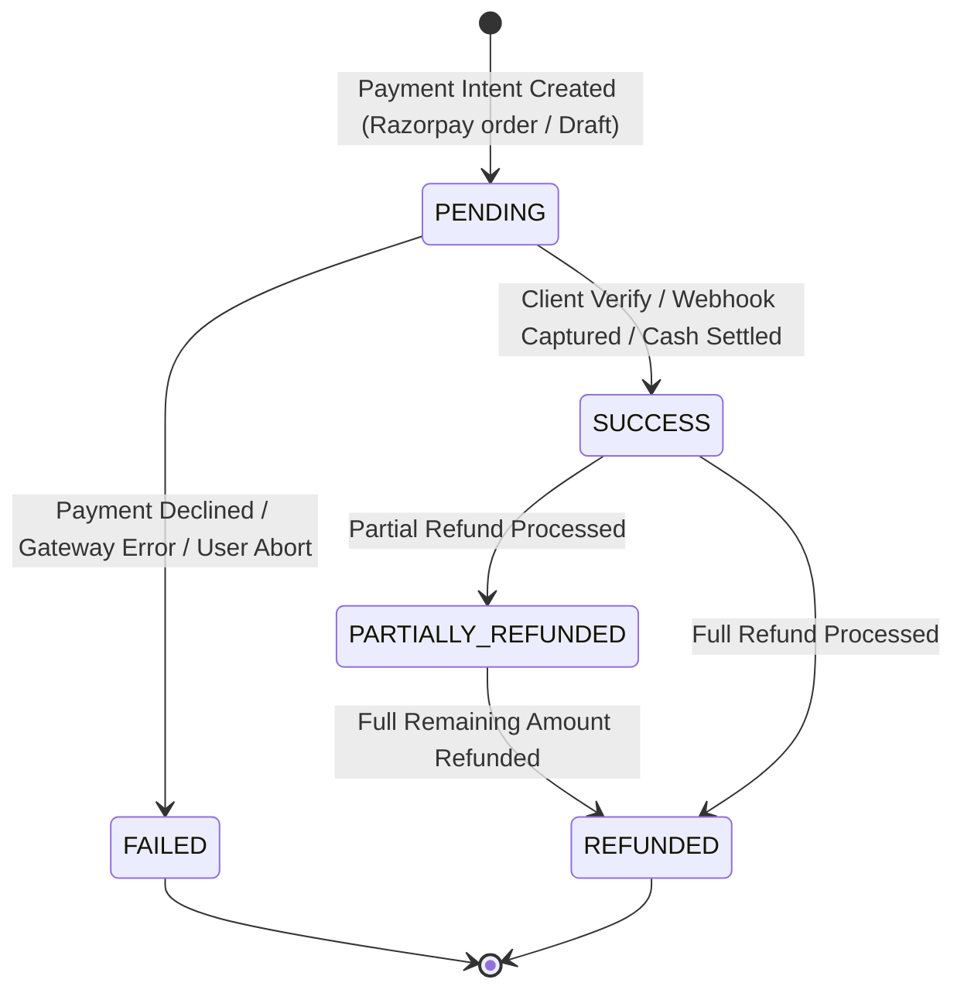

# Restaurant Management System (RMS)
## Phase 9: Payment Service — Database Architecture & Stored Procedure Design

**Document Reference:** `documentation/PAYMENT_DATABASE_DESIGN.md`  
**Date:** November 15, 2026  
**Author:** Senior Microservices Architect & SQL Server Database Architect  
**Status:** **DESIGN COMPLETED — AWAITING USER APPROVAL PRIOR TO SCRIPT CREATION**  

---

### 1. Database Architecture & Boundaries

The Restaurant Management System uses Microsoft SQL Server (`RestaurantManagementDB` on `localhost:1435`). In accordance with the project's strict architecture guidelines:
- **Zero ORM / Zero Sequelize models**: All database mutations and queries are performed through repository classes invoking SQL Server Stored Procedures via `executeProcedure` or `query` from `@rms/shared`.
- **Single Ownership Principle**: Microservices have exclusive ownership over their designated tables. No microservice may perform direct CRUD operations or join queries against tables owned by another service.
- **Microservices Table Ownership Mapping**:
  - `payment-service` exclusively owns **3 tables**:
    1. `dbo.Payments` (Table 31)
    2. `dbo.PaymentTransactions` (Table 32)
    3. `dbo.PaymentRefunds` (Table 33)
  - Referenced External Entities (Referenced via Foreign Keys, read-only/managed via REST):
    - `dbo.Orders` (`OrderId` owned by `order-service`)
    - `dbo.Branches` (`BranchId` owned by `restaurant-service`)
    - `dbo.Users` (`UserId` owned by `user-service`)

---

### 2. Comprehensive Data Dictionary (Owned Tables)

#### 2.1 Table: `dbo.Payments` (Table 31)
Stores the master record for every payment attempt, online transaction, and offline POS cash/card settlement.

| Column Name | Data Type | Nullable | Default | Description |
| :--- | :--- | :---: | :---: | :--- |
| `PaymentId` | `BIGINT IDENTITY(1,1)` | NO | - | Primary Key |
| `OrderId` | `BIGINT` | NO | - | Foreign Key to `dbo.Orders(OrderId)` |
| `BranchId` | `INT` | NO | - | Foreign Key to `dbo.Branches(BranchId)` |
| `PaymentReference` | `NVARCHAR(60)` | NO | - | Unique business receipt reference (`PAY-YYYYMMDD-XXXXX`) |
| `PaymentMethod` | `NVARCHAR(30)` | NO | - | `'RAZORPAY'`, `'CASH'`, `'CREDIT_CARD'`, `'DEBIT_CARD'`, `'UPI_OFFLINE'`, `'SPLIT'` |
| `Amount` | `DECIMAL(10,2)` | NO | - | Total payment transaction value |
| `GatewayOrderId` | `NVARCHAR(100)` | YES | NULL | Razorpay Order ID (`order_XXXXXXXXXXXXXX`) |
| `GatewayPaymentId` | `NVARCHAR(100)` | YES | NULL | Razorpay Payment ID (`pay_XXXXXXXXXXXXXX`) |
| `GatewaySignature` | `NVARCHAR(255)` | YES | NULL | Razorpay cryptographic HMAC SHA-256 signature |
| `PaymentStatus` | `NVARCHAR(30)` | NO | `'PENDING'` | `'PENDING'`, `'SUCCESS'`, `'FAILED'`, `'REFUNDED'` |
| `SettledByUserId` | `BIGINT` | YES | NULL | Staff Cashier/Manager who accepted offline payment (NULL for online customer) |
| `SettledAt` | `DATETIME2(3)` | YES | NULL | UTC Timestamp when payment was verified/settled |
| `CreatedAt` | `DATETIME2(3)` | NO | `SYSUTCDATETIME()` | UTC Record creation timestamp |
| `UpdatedAt` | `DATETIME2(3)` | NO | `SYSUTCDATETIME()` | UTC Last record update timestamp |

**Constraints & Indexes (`dbo.Payments`):**
- Primary Key: `PK_Payments` (CLUSTERED) on `(PaymentId)`
- Unique Key: `UQ_Payments_Reference` (NONCLUSTERED, UNIQUE) on `(PaymentReference)`
- Foreign Key: `FK_Payments_Orders` -> `dbo.Orders(OrderId) ON DELETE NO ACTION`
- Foreign Key: `FK_Payments_Branches` -> `dbo.Branches(BranchId) ON DELETE NO ACTION`
- Foreign Key: `FK_Payments_Users_SettledBy` -> `dbo.Users(UserId) ON DELETE NO ACTION`
- Index `IX_Payments_OrderId`: NONCLUSTERED on `(OrderId, PaymentStatus)` INCLUDE `(PaymentReference, Amount, PaymentMethod)`
- Filtered Index `IX_Payments_GatewayOrderId`: NONCLUSTERED on `(GatewayOrderId)` WHERE `GatewayOrderId IS NOT NULL`
- Filtered Index `IX_Payments_GatewayPaymentId`: NONCLUSTERED on `(GatewayPaymentId)` WHERE `GatewayPaymentId IS NOT NULL`

---

#### 2.2 Table: `dbo.PaymentTransactions` (Table 32)
Immutable transaction audit ledger tracking all gateway interactions, webhook events, captures, and refund payloads.

| Column Name | Data Type | Nullable | Default | Description |
| :--- | :--- | :---: | :---: | :--- |
| `TransactionId` | `BIGINT IDENTITY(1,1)` | NO | - | Primary Key |
| `PaymentId` | `BIGINT` | NO | - | Foreign Key to `dbo.Payments(PaymentId)` |
| `TransactionType` | `NVARCHAR(30)` | NO | - | `'CHARGE'`, `'WEBHOOK_CAPTURE'`, `'REFUND'`, `'FAILURE'` |
| `Amount` | `DECIMAL(10,2)` | NO | - | Amount processed in this event |
| `GatewayTransactionId`| `NVARCHAR(120)` | YES | NULL | Gateway transaction/event ID |
| `GatewayResponseCode` | `NVARCHAR(50)` | YES | NULL | Gateway response status or HTTP code |
| `GatewayPayloadJson` | `NVARCHAR(MAX)` | YES | NULL | Raw JSON payload from Razorpay webhook/response |
| `Status` | `NVARCHAR(30)` | NO | `'SUCCESS'` | `'SUCCESS'`, `'FAILED'` |
| `TransactionDate` | `DATETIME2(3)` | NO | `SYSUTCDATETIME()` | UTC Timestamp of transaction event |

**Constraints & Indexes (`dbo.PaymentTransactions`):**
- Primary Key: `PK_PaymentTransactions` (CLUSTERED) on `(TransactionId)`
- Foreign Key: `FK_PaymentTransactions_Payments` -> `dbo.Payments(PaymentId) ON DELETE CASCADE`
- Index: `IX_PaymentTransactions_PaymentId` on `(PaymentId, TransactionDate DESC)`

---

#### 2.3 Table: `dbo.PaymentRefunds` (Table 33)
Records all partial and full refund transactions against previously settled payments.

| Column Name | Data Type | Nullable | Default | Description |
| :--- | :--- | :---: | :---: | :--- |
| `RefundId` | `BIGINT IDENTITY(1,1)` | NO | - | Primary Key |
| `PaymentId` | `BIGINT` | NO | - | Foreign Key to `dbo.Payments(PaymentId)` |
| `GatewayRefundId` | `NVARCHAR(100)` | YES | NULL | Razorpay Refund ID (`rfnd_XXXXXXXXXXXXXX`) |
| `RefundAmount` | `DECIMAL(10,2)` | NO | - | Amount refunded to customer |
| `Reason` | `NVARCHAR(255)` | NO | - | Reason for refund (e.g. `'Order Cancelled'`, `'Item Unavailable'`) |
| `Status` | `NVARCHAR(30)` | NO | `'PROCESSED'`| `'INITIATED'`, `'PROCESSED'`, `'FAILED'` |
| `InitiatedByUserId` | `BIGINT` | NO | - | Staff/Manager User ID who approved/issued the refund |
| `ProcessedAt` | `DATETIME2(3)` | NO | `SYSUTCDATETIME()` | UTC Timestamp when refund was processed |
| `CreatedAt` | `DATETIME2(3)` | NO | `SYSUTCDATETIME()` | UTC Timestamp when refund record was created |

**Constraints & Indexes (`dbo.PaymentRefunds`):**
- Primary Key: `PK_PaymentRefunds` (CLUSTERED) on `(RefundId)`
- Foreign Key: `FK_PaymentRefunds_Payments` -> `dbo.Payments(PaymentId) ON DELETE NO ACTION`
- Foreign Key: `FK_PaymentRefunds_Users` -> `dbo.Users(UserId) ON DELETE NO ACTION`
- Index: `IX_PaymentRefunds_PaymentId` on `(PaymentId)`

---

### 3. Payment Status Lifecycle & State Machine

#### Order Payment Status Synchronization Matrix
When `payment-service` executes a transition, it synchronizes with `order-service` via internal HTTP REST:
- **`SUCCESS`**: If total paid $\ge$ Order GrandTotal, `order-service` updates `Orders.PaymentStatus = 'PAID'`. If total paid $<$ Order GrandTotal, `Orders.PaymentStatus = 'PARTIALLY_PAID'`.
- **`FAILED`**: `order-service` is notified of failure; if unrecoverable, marks `Orders.PaymentStatus = 'FAILED'`.
- **`REFUNDED`**: If all payments refunded, `order-service` updates `Orders.PaymentStatus = 'REFUNDED'`.

---

### 4. Transaction Isolation & Concurrency Control

1. **Double-Payment Guard**: When processing payments or refunds, queries against `dbo.Payments` use row-level locks `WITH (UPDLOCK, HOLDLOCK)` to prevent race conditions or duplicate concurrent capture attempts.
2. **Refund Overdraw Protection**: Before inserting into `dbo.PaymentRefunds`, the stored procedure checks:
   $$\text{RefundAmount} \le \text{Payment.Amount} - \sum(\text{PriorRefunds})$$
   If the proposed refund exceeds the remaining unsettled balance, the procedure raises an error and rolls back.
3. **Atomic Multi-Table Transactions**: Stored procedures wrap all mutations in `BEGIN TRANSACTION` with `SET XACT_ABORT ON` and `BEGIN TRY ... BEGIN CATCH` blocks ensuring zero partial state writes.

---

### 5. Stored Procedure Proposal: `database/13_PaymentStoredProcedures.sql`

A total of **12 specialized stored procedures** (SPs 132–143) are designed to provide complete payment operations:

| SP # | Stored Procedure Name | Purpose / Core Responsibility |
| :---: | :--- | :--- |
| **132** | `usp_Payment_Create` | Inserts a pending payment record with auto-generated reference (`PAY-YYYYMMDD-XXXXX`) and logs intent in `PaymentTransactions`. |
| **133** | `usp_Payment_VerifyAndCapture` | Updates payment to `SUCCESS`, records `GatewayPaymentId`, `GatewaySignature`, and `SettledAt`, and logs capture in ledger. |
| **134** | `usp_Payment_RecordFailure` | Marks payment as `FAILED`, records failure error codes, and stores raw gateway error payload in `PaymentTransactions`. |
| **135** | `usp_Payment_SettleOffline` | Immediately creates and settles an offline payment (`CASH`, `CREDIT_CARD`, `DEBIT_CARD`, `UPI_OFFLINE`), logging cashier ID and audit ledger. |
| **136** | `usp_Payment_GetById` | Multi-recordset fetch returning Payment details, Transactions history, and Refunds history. |
| **137** | `usp_Payment_GetByOrderId` | Multi-recordset fetch retrieving all payments, transactions, and aggregate balances for a specific order. |
| **138** | `usp_Payment_GetByGatewayOrderId`| Looks up payment header by Razorpay `GatewayOrderId` (used for webhook event correlation and client-side verification). |
| **139** | `usp_Payment_GetByGatewayPaymentId`| Looks up payment header by Razorpay `GatewayPaymentId` (used for webhook idempotency checks). |
| **140** | `usp_Payment_List` | Filtered, paginated listing of payments with branch, date range, payment method, and status filters. |
| **141** | `usp_Payment_LogTransaction` | Independent procedure to append raw gateway payloads and webhook event snapshots into `PaymentTransactions`. |
| **142** | `usp_Payment_Refund_Create` | Atomically validates refund balance, creates `PaymentRefunds` entry, logs refund in `PaymentTransactions`, and updates `PaymentStatus`. |
| **143** | `usp_Payment_GetReconciliationSummary` | Aggregates daily/periodic payment totals by method, total collections, total refunds, and success rates. |

> [!IMPORTANT]
> In accordance with user instructions, `database/13_PaymentStoredProcedures.sql` **HAS NOT BEEN CREATED OR EXECUTED YET**. It is strictly a design proposal awaiting formal review and sign-off.

---

### 6. Safe Deployment Protocol

Once approved by the user:
1. **Isolated Verification First**: The script will be applied to `RestaurantManagementDB_IsolatedTest` on port `1435`.
2. **Automated Unit Testing**: An automated SQL test script `database/tests/13_PaymentStoredProcedures_Test.sql` will execute 100% of the procedures to verify validations, transactions, and edge cases.
3. **Live Database Protection**: Deployment to live `RestaurantManagementDB` remains marked **PENDING APPROVAL** until the user explicitly requests production deployment. Zero existing database scripts (01–12) or seed records will be altered.

---

*End of Payment Database Architecture & Stored Procedure Design. Proceed to `PAYMENT_API_IMPLEMENTATION_PLAN.md`.*

