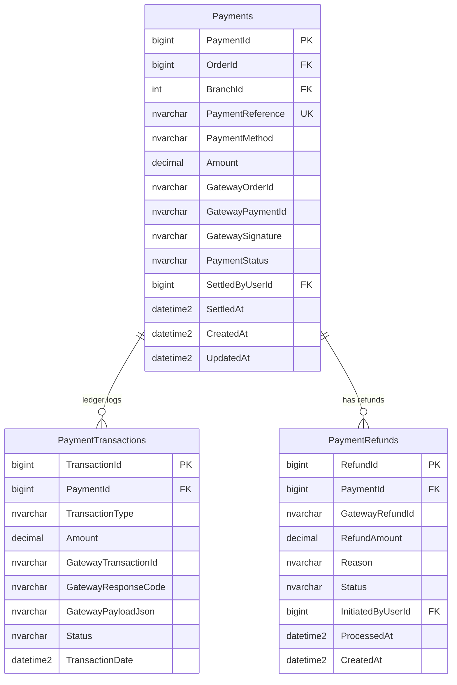
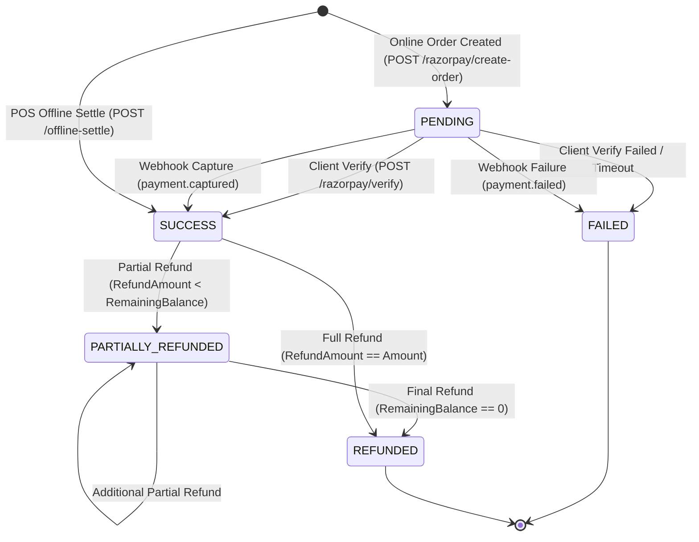
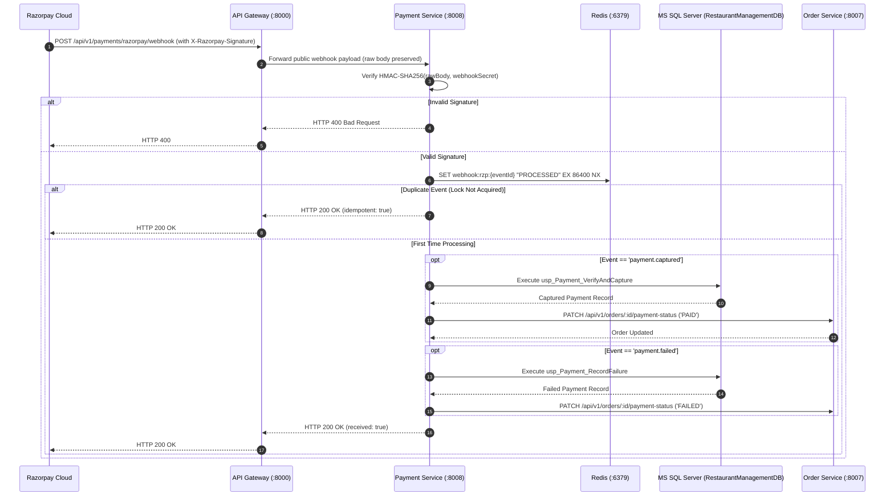
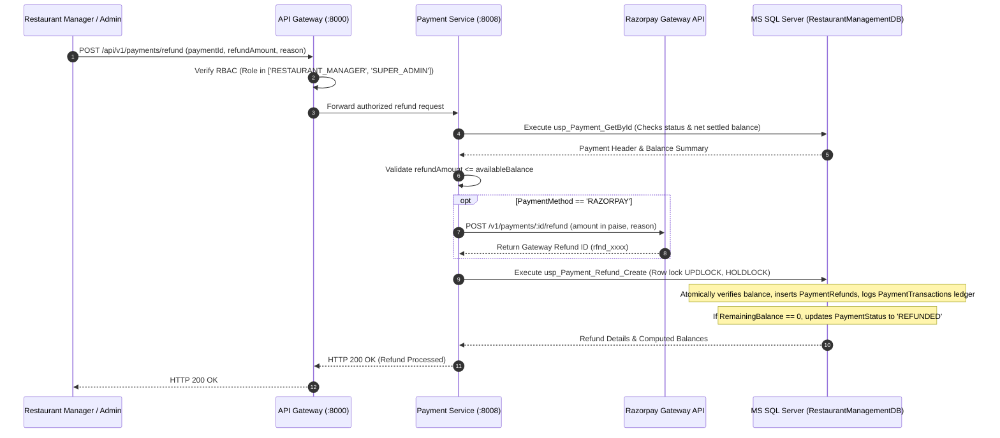

# Restaurant Management System (RMS)
## Payment Service Workflow & Financial Settlement Architecture

---

### 1. Architectural Overview

The **Payment Service** (`backend/payment-service`, internal port `8008`, API Gateway ingress `/api/v1/payments`) is the authoritative financial ledger and payment processing microservice for the Restaurant Management System (RMS).

It operates under strict architectural standards:
- **Pure Microservices Model**: Fully decoupled from other services; communicates exclusively via HTTP REST with internal service authentication (`X-Internal-Service-Key`) and correlation tracing (`X-Correlation-ID`).
- **Zero ORM / 100% Stored Procedures**: Every database interaction executes parameterized T-SQL stored procedures on Microsoft SQL Server 2022 via the shared connection pool (`backend/shared/config/database.js`).
- **Double-Entry Financial Ledger**: All monetary movements (charges, captures, failures, partial and full refunds) are recorded immutably in `dbo.PaymentTransactions` with associated raw payload snapshots.
- **Dual Payment Channels**: Supports both online customer payment via Razorpay Payment Gateway (Cards, UPI, Netbanking, Wallets) and on-premise cashier POS settlement (`CASH`, `CREDIT_CARD`, `DEBIT_CARD`, `UPI_OFFLINE`).
- **Distributed Idempotency**: Redis-backed distributed locks and database UNIQUE constraints prevent duplicate charges, repeated webhook events, and double refunds.
- **Saga Orchestration**: Synchronizes order status in `order-service` (:8007) without direct cross-database table mutation.

```
                      ┌───────────────────────────────────────────────┐
                      │              Customer / POS Client            │
                      └───────────────────────┬───────────────────────┘
                                              │
                                              ▼
                      ┌───────────────────────────────────────────────┐
                      │          API Gateway (Port 8000)              │
                      │  - JWT Authentication & RBAC Authorization    │
                      │  - Correlation ID Injection (X-Correlation-ID)│
                      │  - Ingress Routing -> /api/v1/payments        │
                      └───────────────────────┬───────────────────────┘
                                              │
                                              ▼
                      ┌───────────────────────────────────────────────┐
                      │        Payment Service (Port 8008)            │
                      │  - Online Intent & Capture (Razorpay SDK)     │
                      │  - Webhook Ingress (HMAC-SHA256 Validated)    │
                      │  - POS Counter Settlement (Cash, Card, UPI)   │
                      │  - Partial & Full Refund Engine               │
                      │  - Daily Reconciliation Reports               │
                      └───────────┬───────────────────────┬───────────┘
                                  │                       │
                 (Order Sync via  │                       │ (Stored Procedures via
             HTTP REST & Mesh Key)│                       │  mssql Connection Pool)
                                  ▼                       ▼
            ┌───────────────────────────┐   ┌───────────────────────────┐
            │  Order Service (Port 8007)│   │ Microsoft SQL Server 2022 │
            │  PATCH /:orderId/payment- │   │ RestaurantManagementDB    │
            │  status ('PAID'/'FAILED') │   │  - dbo.Payments           │
            └───────────────────────────┘   │  - dbo.PaymentTransactions│
                                            │  - dbo.PaymentRefunds     │
                                            └───────────────────────────┘
```

---

### 2. Database Schema & Ledger Design

The Payment Service owns three dedicated relational tables in `RestaurantManagementDB`:



#### 2.1 Table Responsibilities
1. **`dbo.Payments`**: Master financial header recording business payment references (`PAY-YYYYMMDD-ORDERID-RANDOM`), payment channel (`RAZORPAY`, `CASH`, `CREDIT_CARD`, `DEBIT_CARD`, `UPI_OFFLINE`), lifecycle status, and settling staff member.
2. **`dbo.PaymentTransactions`**: Immutable double-entry audit ledger recording all events (`CHARGE`, `WEBHOOK_CAPTURE`, `FAILURE`, `REFUND`) with timestamps and response codes.
3. **`dbo.PaymentRefunds`**: Detailed tracking of partial and full disbursements, reason codes, initiating manager user IDs, and gateway refund identifiers.

---

### 3. Payment State Machine & Lifecycle Transitions



| From Status | To Status | Trigger / Stored Procedure | Ledger Event Recorded |
| :--- | :--- | :--- | :--- |
| *(None)* | `PENDING` | `usp_Payment_Create` | `CHARGE` (`PENDING`) |
| `PENDING` | `SUCCESS` | `usp_Payment_VerifyAndCapture` | `CHARGE` or `WEBHOOK_CAPTURE` (`SUCCESS`) |
| `PENDING` | `FAILED` | `usp_Payment_RecordFailure` | `CHARGE_FAILED` (`FAILED`) |
| *(None)* | `SUCCESS` | `usp_Payment_SettleOffline` | `CHARGE` (`SETTLED_OFFLINE`) |
| `SUCCESS` | `PARTIALLY_REFUNDED` | `usp_Payment_Refund_Create` | `REFUND` (`REFUND_PROCESSED`) |
| `PARTIALLY_REFUNDED` | `REFUNDED` | `usp_Payment_Refund_Create` | `REFUND` (`REFUND_PROCESSED`) |
| `SUCCESS` | `REFUNDED` | `usp_Payment_Refund_Create` | `REFUND` (`REFUND_PROCESSED`) |

---

### 4. Online Payment Workflow (Razorpay Integration)

#### 4.1 Step 1: Order Intent Creation
1. Client initiates checkout via `POST /api/v1/payments/razorpay/create-order` with `{ orderId, branchId }`.
2. Payment Service verifies the order amount and status against `order-service` (:8007) via internal REST API.
3. Payment Service creates an order on Razorpay (`amountInPaise = amount * 100`, `currency = 'INR'`).
4. Stored procedure `dbo.usp_Payment_Create` inserts a row in `dbo.Payments` with `PaymentStatus = 'PENDING'` and generates a structured business reference (`PAY-YYYYMMDD-ORDERID-SUFFIX`).
5. Transaction ledger inserts initial `CHARGE` event with status `'SUCCESS'` (intent logged).
6. Response returns `{ paymentId, gatewayOrderId, razorpayKeyId, amount, currency }` to the client.

#### 4.2 Step 2: Client Verification & Cryptographic HMAC Capture
1. Client completes payment in Razorpay modal and receives `{ razorpay_payment_id, razorpay_order_id, razorpay_signature }`.
2. Client sends payload to `POST /api/v1/payments/razorpay/verify`.
3. Payment Service verifies the HMAC-SHA256 signature using `crypto.timingSafeEqual`:
   $$\text{GeneratedSignature} = \text{HMAC-SHA256}(\text{gatewayOrderId} + "|" + \text{gatewayPaymentId}, \text{keySecret})$$
4. If signature fails, returns HTTP 400 (`SIGNATURE_VERIFICATION_FAILED`).
5. If valid, executes `dbo.usp_Payment_VerifyAndCapture`:
   - Checks if already captured (`@CurrentStatus = 'SUCCESS'` and matching `@GatewayPaymentId`) $\rightarrow$ returns idempotent success.
   - Locks row using `(UPDLOCK, HOLDLOCK)`.
   - Updates `PaymentStatus = 'SUCCESS'`, `GatewayPaymentId`, `GatewaySignature`, and `SettledAt = SYSUTCDATETIME()`.
   - Inserts ledger entry into `dbo.PaymentTransactions`.
6. Payment Service invokes Order Service endpoint:
   `PATCH /api/v1/orders/:orderId/payment-status` with `{ paymentStatus: 'PAID', amount, paymentMethod, paymentReference }`.
7. Order Service updates `dbo.Orders.PaymentStatus = 'PAID'`. If the order is a dine-in order in `SERVED` or `READY` status, it auto-advances `OrderStatus` to `COMPLETED`.

---

### 5. Asynchronous Webhook Architecture & Idempotency

Webhooks provide an asynchronous, highly reliable guarantee that payments are captured even if the customer's browser drops connection, crashes, or closes before calling `/verify`.



#### Key Resilience Controls in Webhooks:
- **Raw Body Buffer Verification**: Configured in Express via `express.json({ verify: (req, res, buf) => { req.rawBody = buf.toString('utf8'); } })`. This ensures that JSON serialization differences do not invalidate the cryptographic HMAC-SHA256 signature check.
- **Distributed Redis Idempotency**: `SET webhook:rzp:${eventId} PROCESSED EX 86400 NX` prevents concurrent duplicate execution across multiple service instances.
- **Database Idempotency**: Stored procedure `usp_Payment_VerifyAndCapture` safely handles repeated captures without corrupting balances or recording redundant records.

---

### 6. Offline POS Settlement Workflow (Cash, Card, UPI)

On-premise POS billing handles counter payments settled directly by cashier or manager staff.

1. Cashier tenders cash, card, or scans UPI QR on POS terminal.
2. POS calls `POST /api/v1/payments/offline-settle` with:
   ```json
   {
     "orderId": 100012,
     "branchId": 1,
     "paymentMethod": "CASH",
     "amount": 210.00,
     "notes": "Tendered at Counter 1"
   }
   ```
3. API Gateway validates cashier token (`roles: ['CASHIER_POS', 'RESTAURANT_MANAGER', 'SUPER_ADMIN']`).
4. Payment Service executes stored procedure `dbo.usp_Payment_SettleOffline`:
   - Validates payment method (`CASH`, `CREDIT_CARD`, `DEBIT_CARD`, `UPI_OFFLINE`).
   - Inserts settled payment with `PaymentStatus = 'SUCCESS'`, `SettledByUserId = req.user.userId`, and `SettledAt = SYSUTCDATETIME()`.
   - Inserts ledger transaction with `TransactionType = 'CHARGE'` and `GatewayResponseCode = 'SETTLED_OFFLINE'`.
5. Payment Service synchronizes order status with Order Service (`PATCH /api/v1/orders/:id/payment-status`).
6. Returns HTTP 200 with settled payment reference and cashier staff ID.

---

### 7. Refund Management & Excess Guard Engine

Refunds require strict financial controls to prevent overdraws, negative balances, and race conditions.



#### Financial Safety Rules:
- **Pessimistic Row-Level Locking**: `SELECT ... FROM dbo.Payments WITH (UPDLOCK, HOLDLOCK)` ensures concurrent refund calls for the same payment are serialized and cannot over-refund.
- **Two-Decimal Financial Precision**: Balances are calculated using `DECIMAL(10,2)`:
  $$\text{RemainingBalance} = \text{OriginalAmount} - \sum \text{PriorRefunds} - \text{RefundAmount}$$
- **Status Advancement**:
  - If $\text{RemainingBalance} > 0 \rightarrow$ PaymentStatus becomes `PARTIALLY_REFUNDED`.
  - If $\text{RemainingBalance} = 0 \rightarrow$ PaymentStatus becomes `REFUNDED`.

---

### 8. Financial Reconciliation & Executive Reporting

Payment Service aggregates real-time settlement metrics via `GET /api/v1/payments/reports/reconciliation`:

- **Metrics Calculated**:
  - `GrossCollections`: $\sum \text{Amount}$ of all `SUCCESS` and `REFUNDED` payments.
  - `TotalRefunds`: $\sum \text{RefundAmount}$ of all `PROCESSED` refunds.
  - `NetCollections`: $\text{GrossCollections} - \text{TotalRefunds}$.
  - `TotalTransactions`: Count of successful payment transactions.
- **Breakdown by Payment Method**: Computes volume and gross collection totals grouped by `RAZORPAY`, `CASH`, `CREDIT_CARD`, `DEBIT_CARD`, and `UPI_OFFLINE`.
- **RBAC Guard**: Restricted to `RESTAURANT_MANAGER` and `SUPER_ADMIN` roles only. `CASHIER_POS` and customers are blocked with HTTP 403 Forbidden.

---

### 9. Complete Stored Procedure Inventory (SPs 132–145)

All 14 payment stored procedures deployed in `database/13_PaymentStoredProcedures.sql`:

| SP Number | Stored Procedure Name | Purpose |
| :---: | :--- | :--- |
| **132** | `dbo.usp_Payment_Create` | Generates structured payment reference and records initial `PENDING` online payment. |
| **133** | `dbo.usp_Payment_VerifyAndCapture` | Captures online payment to `SUCCESS`, records gateway payment ID, and logs ledger. |
| **134** | `dbo.usp_Payment_RecordFailure` | Marks payment as `FAILED` with error codes and descriptions. |
| **135** | `dbo.usp_Payment_SettleOffline` | Immediately settles counter POS payments (`CASH`, `CARD`, `UPI`) with cashier user ID. |
| **136** | `dbo.usp_Payment_GetById` | Multi-recordset fetch returning payment header, transaction ledger, refunds, and balance. |
| **137** | `dbo.usp_Payment_GetByOrderId` | Multi-recordset fetch returning all payments and refunds associated with an order. |
| **138** | `dbo.usp_Payment_GetByGatewayOrderId` | Looks up payment record by Razorpay order identifier (`order_xxxx`). |
| **139** | `dbo.usp_Payment_GetByGatewayPaymentId` | Looks up payment record by Razorpay payment identifier (`pay_xxxx`). |
| **140** | `dbo.usp_Payment_List` | Paginated listing of payments with branch, method, status, order, and date filters. |
| **141** | `dbo.usp_Payment_LogTransaction` | Appends an immutable audit entry to `dbo.PaymentTransactions` ledger. |
| **142** | `dbo.usp_Payment_Refund_Create` | Atomically executes partial/full refund with row locks and advances status. |
| **143** | `dbo.usp_Payment_Refund_GetById` | Retrieves refund details by `RefundId` including parent payment and initiator details. |
| **144** | `dbo.usp_Payment_GetReconciliationSummary`| Computes gross collections, total refunds, net balance, and method breakdown. |
| **145** | `dbo.usp_Payment_GetStatus` | Lightweight status query by `PaymentId` or `PaymentReference`. |

