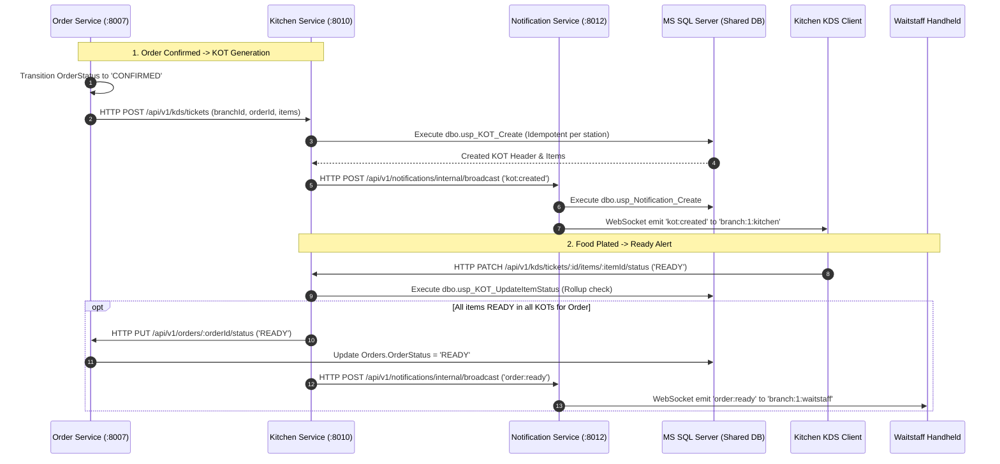

# Restaurant Management System (RMS)
## Phase 10: Kitchen & Notification Services API Implementation Plan (Revised & Corrected)

---

### 1. Service Port & Ingress Architecture

| Service | Internal Port | Ingress Prefix (via Gateway :8000) | Auth Strategy |
| :--- | :---: | :--- | :--- |
| **Kitchen Service** | **`8010`** | `/api/v1/kds` | JWT Bearer Token / Internal Mesh Key (`X-Internal-Service-Key`) |
| **Notification Service** | **`8012`** | `/api/v1/notifications` | JWT Bearer Token / Internal Mesh Key (`X-Internal-Service-Key`) |

---

### 2. Kitchen Service REST API Endpoints (`/api/v1/kds`)

#### 2.1 Endpoint Catalog

| Method | Endpoint | Allowed Roles | Description |
| :---: | :--- | :--- | :--- |
| `GET` | `/health/live` | Public | Process liveness check. |
| `GET` | `/health/ready` | Public | Database readiness probe. |
| `GET` | `/tickets/active` | `KITCHEN_CHEF`, `RESTAURANT_MANAGER`, `SUPER_ADMIN` | Retrieves active KDS tickets board for a branch/station. |
| `GET` | `/tickets/:id` | `KITCHEN_CHEF`, `RESTAURANT_MANAGER`, `SUPER_ADMIN`, `WAITSTAFF` | Full details for a single KOT ticket (including items & addons). |
| `GET` | `/tickets/order/:orderId` | `KITCHEN_CHEF`, `RESTAURANT_MANAGER`, `SUPER_ADMIN`, `WAITSTAFF` | All KOT tickets associated with an order across all stations. |
| `POST` | `/tickets` | `KITCHEN_CHEF`, `RESTAURANT_MANAGER`, `SUPER_ADMIN`, `SYSTEM` | Generates KOT ticket(s) with idempotency guard. |
| `PATCH` | `/tickets/:id/status` | `KITCHEN_CHEF`, `RESTAURANT_MANAGER`, `SUPER_ADMIN` | Updates KOT status (`PREPARING`, `READY`, `BUMPED`). |
| `PATCH` | `/tickets/:id/items/:itemId/status` | `KITCHEN_CHEF`, `RESTAURANT_MANAGER`, `SUPER_ADMIN` | Updates preparation status for an individual item. |
| `POST` | `/tickets/:id/bump` | `KITCHEN_CHEF`, `RESTAURANT_MANAGER`, `SUPER_ADMIN` | Bumps completed ticket off active KDS display. |
| `POST` | `/tickets/:id/assign` | `RESTAURANT_MANAGER`, `KITCHEN_CHEF`, `SUPER_ADMIN` | Assigns a specific chef to a ticket (logged to `AuditLogs`). |
| `POST` | `/tickets/order/:orderId/cancel`| `RESTAURANT_MANAGER`, `SUPER_ADMIN`, `SYSTEM` | Cancels all active KOT tickets for an order. |
| `GET` | `/metrics` | `RESTAURANT_MANAGER`, `KITCHEN_CHEF`, `SUPER_ADMIN` | KDS metrics: turnaround times, workload, bottleneck alerts. |

---

#### 2.2 Kitchen Request & Response Specifications

##### 1. `POST /api/v1/kds/tickets` (Idempotent KOT Generation)
- **Description**: Generates station KOT tickets for an order. If a ticket already exists for the station and order, returns the existing record idempotently.
- **Request Body**:
```json
{
  "branchId": 1,
  "orderId": 100015,
  "kitchenStation": "MAIN_KITCHEN",
  "specialKitchenNotes": "VIP guest at table 4, allergy to peanuts",
  "itemIds": [101, 102]
}
```
- **Response (201 Created or 200 OK if Idempotent)**:
```json
{
  "success": true,
  "data": {
    "kotId": 50001,
    "kotNumber": "KOT-20261115-001-0001",
    "orderId": 100015,
    "kitchenStation": "MAIN_KITCHEN",
    "ticketStatus": "NEW",
    "itemsCount": 2,
    "isIdempotent": false,
    "createdAt": "2026-11-15T17:20:00.000Z"
  },
  "message": "Kitchen Order Ticket generated successfully"
}
```

##### 2. `GET /api/v1/kds/tickets/active?branchId=1&station=MAIN_KITCHEN`
- **Response (200 OK)**:
```json
{
  "success": true,
  "data": [
    {
      "kotId": 50001,
      "kotNumber": "KOT-20261115-001-0001",
      "orderId": 100015,
      "orderNumber": "ORD-BLR1-20261115-0015",
      "orderType": "DINE_IN",
      "tableName": "T-04 (Indoor Ground)",
      "station": "MAIN_KITCHEN",
      "status": "PREPARING",
      "elapsedMinutes": 8,
      "specialNotes": "Extra spicy, no cilantro on pasta",
      "createdAt": "2026-11-15T17:20:00.000Z",
      "items": [
        {
          "kotItemId": 1,
          "orderItemId": 101,
          "itemName": "Truffle Tagliolini",
          "variantName": "Full Portion",
          "quantity": 2,
          "addons": "Extra Truffle Oil, Shaved Parmesan",
          "status": "COOKING",
          "specialInstructions": "No cilantro",
          "completedAt": null
        }
      ]
    }
  ],
  "meta": {
    "totalActiveTickets": 1,
    "stationFilter": "MAIN_KITCHEN",
    "branchId": 1
  },
  "message": "Active KDS tickets retrieved successfully"
}
```

##### 3. `PATCH /api/v1/kds/tickets/:id/items/:itemId/status`
- **Request Body**:
```json
{
  "status": "READY"
}
```
- **Response (200 OK)**:
```json
{
  "success": true,
  "data": {
    "kotItemId": 1,
    "kotId": 50001,
    "preparationStatus": "READY",
    "completedAt": "2026-11-15T17:28:00.000Z",
    "parentTicketStatus": "READY"
  },
  "message": "Item status updated to READY"
}
```

##### 4. `POST /api/v1/kds/tickets/:id/assign` (Chef Assignment)
- **Request Body**:
```json
{
  "chefUserId": 5
}
```
- **Response (200 OK)**:
```json
{
  "success": true,
  "data": {
    "kotId": 50001,
    "assignedChefUserId": 5,
    "chefName": "Chef Marco",
    "assignedAt": "2026-11-15T17:21:00.000Z"
  },
  "message": "Chef Marco assigned to Ticket #50001"
}
```

---

### 3. Notification Service REST API Endpoints (`/api/v1/notifications`)

#### 3.1 Endpoint Catalog

| Method | Endpoint | Allowed Roles | Description |
| :---: | :--- | :--- | :--- |
| `GET` | `/health/live` | Public | Liveness probe. |
| `GET` | `/health/ready` | Public | Readiness probe (DB + Socket.IO connection count). |
| `POST` | `/internal/broadcast` | `SYSTEM` (Service Mesh Key) | Internal microservice real-time broadcast and persist. |
| `GET` | `/` (List) | All Authenticated Users | User's in-app notifications feed with pagination and filters. |
| `GET` | `/unread-count` | All Authenticated Users | Lightweight unread counter for notification bell badge. |
| `PATCH` | `/:id/read` | All Authenticated Users | Marks a single notification as read. |
| `PATCH` | `/read-all` | All Authenticated Users | Marks all notifications as read for current user. |

---

#### 3.2 Notification Request & Response Specifications

##### 1. `POST /api/v1/notifications/internal/broadcast` (Internal Broadcast)
- **Headers Required**: `X-Internal-Service-Key: <secret>`
- **Request Body**:
```json
{
  "room": "branch:1:kitchen",
  "event": "kot:created",
  "persist": true,
  "notification": {
    "branchId": 1,
    "userId": null,
    "title": "New Kitchen Order #KOT-0001",
    "message": "Table 4 ordered 2x Truffle Tagliolini",
    "notificationType": "KDS_ALERT",
    "targetUrl": "/kds/tickets/50001"
  },
  "data": {
    "kotId": 50001,
    "kotNumber": "KOT-20261115-001-0001",
    "orderId": 100015,
    "table": "T-04"
  }
}
```
- **Response (200 OK)**:
```json
{
  "success": true,
  "data": {
    "room": "branch:1:kitchen",
    "event": "kot:created",
    "persisted": true,
    "notificationId": 101,
    "dispatchedAt": "2026-11-15T17:20:00.000Z"
  },
  "message": "Broadcast event 'kot:created' dispatched successfully"
}
```

##### 2. `GET /api/v1/notifications?unreadOnly=false&page=1&limit=10`
- **Response (200 OK)**:
```json
{
  "success": true,
  "data": [
    {
      "notificationId": 101,
      "title": "Order Ready for Pickup",
      "message": "Order #ORD-0015 is plated and hot at the pass.",
      "notificationType": "ORDER_READY",
      "targetUrl": "/orders/100015",
      "isRead": false,
      "readAt": null,
      "createdAt": "2026-11-15T17:28:00.000Z"
    }
  ],
  "pagination": {
    "page": 1,
    "limit": 10,
    "totalRecords": 1,
    "totalPages": 1,
    "unreadCount": 1
  },
  "message": "Notifications retrieved successfully"
}
```

---

### 4. Cross-Service Boundaries & Integration Contracts


