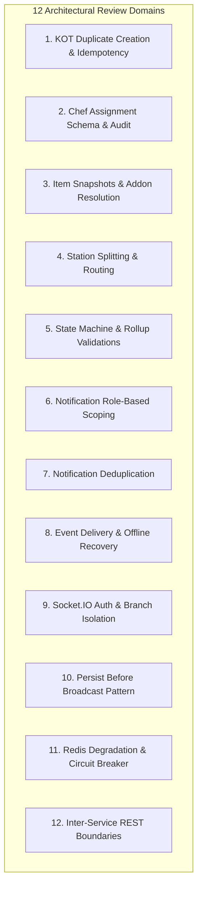
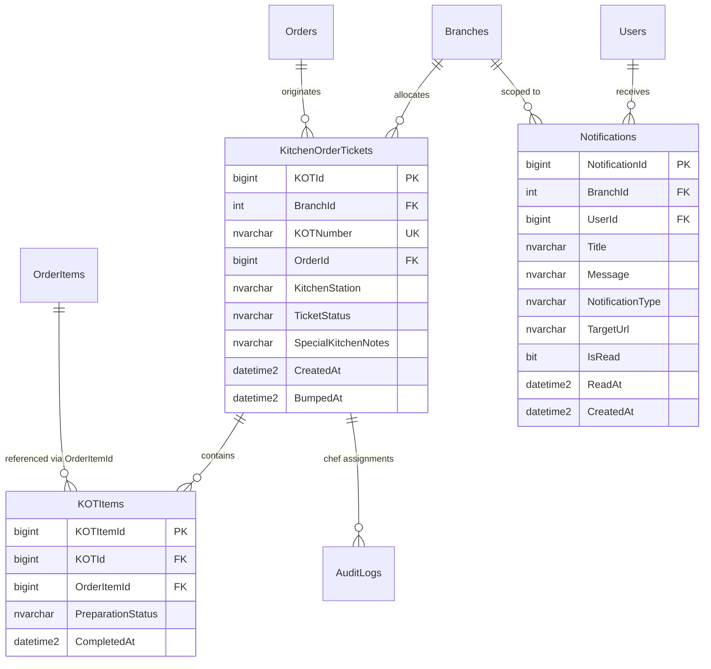
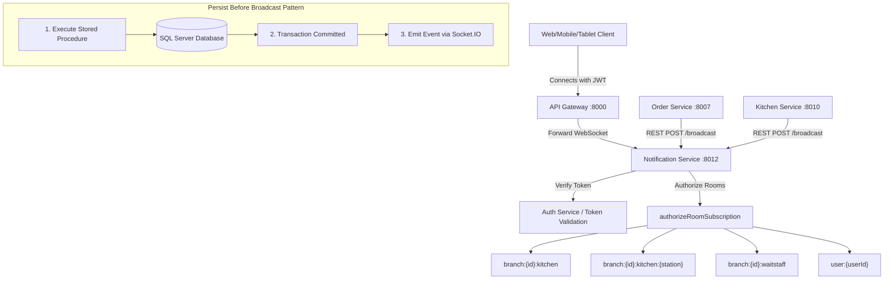
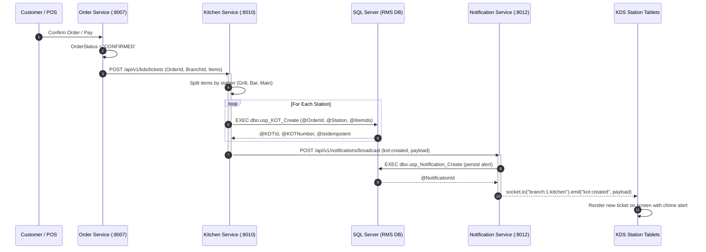
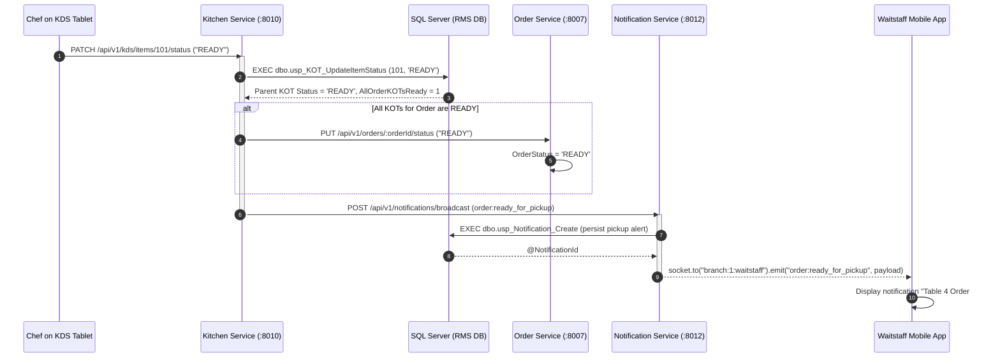

# Phase 10: Kitchen Service & Notification Service
## Comprehensive Architecture Review, Gap Analysis & Architectural Correction Report

---

**Document Version**: 2.0  
**Lead Architects**: Senior Microservices Architect & Microsoft SQL Server Database Architect  
**Project**: Restaurant Management System (RMS)  
**Microservices Under Review**:
- **Kitchen Service** (`backend/kitchen-service/`, Port `8010`, Prefix `/api/v1/kds`)
- **Notification Service** (`backend/notification-service/`, Port `8012`, Prefix `/api/v1/notifications`, Socket.IO Hub)
**Date**: November 15, 2026  
**Status**: **Architecture Review Completed & Fully Reconciled — Awaiting User Approval to Implement**

---

## 1. Executive Summary & Purpose

The objective of this architectural review is to evaluate the design, data integrity guarantees, microservice boundaries, and real-time event mechanisms for **Phase 10: Kitchen Service & Notification Service**.

Following the successful delivery and verification of Phase 9 (Payment Service, 269/269 platform regression tests passed), Phase 10 introduces the real-time **Kitchen Display System (KDS)** and the centralized **Notification Hub** (Socket.IO + REST).

This document synthesizes findings from physical database audits, schema analyses, and design reviews across four core documentation artifacts:
1. `documentation/KITCHEN_DATABASE_DESIGN.md`
2. `documentation/SOCKET_IO_ARCHITECTURE.md`
3. `documentation/PHASE10_API_IMPLEMENTATION_PLAN.md`
4. `documentation/PHASE10_IMPLEMENTATION_CHECKLIST.md`

Every identified inconsistency has been addressed with production-grade architectural solutions that strictly adhere to project constraints:
- **Zero ORM / Zero Sequelize Models**: 100% Parameterized T-SQL Stored Procedures.
- **Zero DDL Table Modifications**: Existing table schemas in `02_CreateTables.sql` are strictly frozen.
- **Strict Service Boundaries**: Zero cross-service direct SQL table mutations.
- **Deterministic State Machines**: Robust idempotency, state transitions, and audit trails.

---

## 2. Existing Design Findings

An exhaustive inspection of the SQL Server database (`RestaurantManagementDB` / `RestaurantManagementDB_IsolatedTest`) and the codebase yielded the following findings:

### 2.1 Database Schema & Table Assets
The database defines three primary tables relevant to Phase 10:
1. **`dbo.KitchenOrderTickets`**:
   - Master ticket header containing `KOTId` (BIGINT IDENTITY), `BranchId` (INT FK), `KOTNumber` (NVARCHAR(35) UK), `OrderId` (BIGINT FK), `KitchenStation` (NVARCHAR(40)), `TicketStatus` (NVARCHAR(30)), `SpecialKitchenNotes` (NVARCHAR(500)), `CreatedAt` (DATETIME2(3)), and `BumpedAt` (DATETIME2(3)).
   - Clustered PK on `KOTId`, Unique Index on `KOTNumber`, and Index `IX_KitchenOrderTickets_Active` on `(BranchId, TicketStatus, CreatedAt)` INCLUDE `(KOTId, KOTNumber, OrderId, KitchenStation)`.
2. **`dbo.KOTItems`**:
   - Item-level preparation tracking containing `KOTItemId` (BIGINT IDENTITY), `KOTId` (BIGINT FK), `OrderItemId` (BIGINT FK), `PreparationStatus` (NVARCHAR(30)), and `CompletedAt` (DATETIME2(3)).
   - Clustered PK on `KOTItemId`, FK `FK_KOTItems_KitchenOrderTickets` (CASCADE), FK `FK_KOTItems_OrderItems` (NO ACTION).
3. **`dbo.Notifications`**:
   - User and branch notifications containing `NotificationId` (BIGINT IDENTITY), `BranchId` (INT FK, nullable), `UserId` (BIGINT FK, nullable), `Title` (NVARCHAR(150)), `Message` (NVARCHAR(1000)), `NotificationType` (NVARCHAR(40)), `TargetUrl` (NVARCHAR(255)), `IsRead` (BIT), `ReadAt` (DATETIME2(3)), and `CreatedAt` (DATETIME2(3)).
   - Clustered PK on `NotificationId`, Filtered Index `IX_Notifications_User_Unread` on `(UserId, IsRead, CreatedAt DESC)` WHERE `IsRead = 0`.

### 2.2 Stored Procedure Status
- **Zero dedicated stored procedures** currently exist for Kitchen or Notification operations.
- The monolithic Phase 2 legacy procedure `dbo.sp_PlaceOrderWithBOMDepletion` embedded inline KOT generation, but this procedure was deprecated during the Phase 7 microservices transition.
- **16 new, dedicated stored procedures (SPs 146–161)** must be authored in `database/14_KitchenNotificationStoredProcedures.sql`.

### 2.3 Microservice Codebases
- `backend/kitchen-service/` (Port 8010): Basic service scaffold with Express.js, routing stubs, and health endpoints.
- `backend/notification-service/` (Port 8012): Socket.IO hub scaffold with basic room join placeholders.

---

## 3. Identified Inconsistencies & Detailed Analysis across 12 Domains

During the architectural audit, twelve critical domains were examined. Below is the detailed analysis of vulnerabilities identified and their corrected specifications:



### Domain 1: KOT Duplicate Creation and Idempotency
- **Problem**: Network retries during order placement (e.g., from POS checkout or customer online payment webhook) could invoke KOT generation multiple times for the same order, creating duplicate physical tickets and causing food waste.
- **Correction**: `dbo.usp_KOT_Create` implements an active ticket idempotency guard. Before generating a new ticket, it executes:
  ```sql
  SELECT @ExistingKOTId = KOTId, @ExistingKOTNumber = KOTNumber
  FROM dbo.KitchenOrderTickets WITH (UPDLOCK, HOLDLOCK)
  WHERE OrderId = @OrderId 
    AND KitchenStation = @KitchenStation 
    AND TicketStatus IN ('NEW', 'PREPARING', 'READY');
  ```
  If an active ticket already exists for the given `(OrderId, KitchenStation)`, the procedure exits gracefully, returning `@IsIdempotent = 1` and the existing `KOTId` without inserting duplicate rows.

### Domain 2: Chef Assignment Schema and Audit Requirements
- **Problem**: `dbo.KitchenOrderTickets` has no `AssignedChefUserId` column. Since project rules strictly forbid altering existing database schemas (`ALTER TABLE` is prohibited), storing chef assignment naively would fail.
- **Correction**: A dual-layer approach is implemented:
  1. **Formal Audit Record**: `dbo.usp_KOT_AssignChef` inserts a record into `dbo.AuditLogs` with `EntityName = 'KitchenOrderTickets'`, `EntityId = CAST(@KOTId AS NVARCHAR)`, `ActionType = 'ASSIGN_CHEF'`, and `UserId = @ChefUserId`.
  2. **Ticket Header Tag**: The procedure updates `SpecialKitchenNotes` by appending or updating a structured tag: `[CHEF: Marco Rossi (ID: 5)]`.
  3. **Real-time Ephemeral Cache**: Active chef station assignments are cached in Redis under `kds:branch:{id}:station:{station}:chef` with a 12-hour TTL (shift duration).

### Domain 3: KOT Item Snapshots, Quantities, Variants & Addons
- **Problem**: `dbo.KOTItems` contains only `(KOTItemId, KOTId, OrderItemId, PreparationStatus, CompletedAt)`. It does not store item name, portion size, quantity, or chosen modifiers/addons.
- **Correction**: Rather than duplicating data, stored procedures `dbo.usp_KOT_GetById` and `dbo.usp_KOT_GetActiveBoard` perform high-performance read-only queries joining `dbo.OrderItems` and `dbo.OrderItemAddons`:
  - Dish name snapshot: `oi.ItemNameSnapshot`
  - Portion variant: `oi.VariantSnapshot`
  - Item quantity: `oi.Quantity`
  - Special preparation notes: `oi.SpecialInstructions`
  - Modifiers/Addons: Aggregated JSON or joined rows from `dbo.OrderItemAddons` (`AddonNameSnapshot`, `Quantity`).
  This ensures kitchen staff see exact guest specifications without data duplication.

### Domain 4: Kitchen Station Splitting & Item Allocation
- **Problem**: Large orders contain items that belong to different prep stations (e.g., Pizza vs. Grill vs. Bar vs. Dessert). Placing all items on a single KOT clutters screens and delays preparation.
- **Correction**: 
  - `kitchen-service` inspects items from `order-service` and routes them by category/station mapping:
    - Grill/Steak $\rightarrow$ `GRILL`
    - Deep fry items $\rightarrow$ `FRYER`
    - Drinks/Beverages $\rightarrow$ `BAR`
    - Desserts/Pastries $\rightarrow$ `DESSERT`
    - Salads/Appetizers $\rightarrow$ `COLD_KITCHEN`
    - General entrees $\rightarrow$ `MAIN_KITCHEN`
  - `dbo.usp_KOT_Create` accepts an optional `@ItemIdsJson` parameter containing specific `OrderItemId` values to assign to that station's ticket. If `@ItemIdsJson` is omitted, all order items are bound to `MAIN_KITCHEN`.

### Domain 5: Valid KOT & KOT Item State Transitions
- **Problem**: Out-of-order API calls or race conditions could transition a ticket from `BUMPED` back to `NEW`, or mark an item `READY` when already completed.
- **Correction**: Strict state machine guards in stored procedures:
  - **KOT Level**: `NEW` $\rightarrow$ `PREPARING` $\rightarrow$ `READY` $\rightarrow$ `BUMPED`. Transitioning backward or from `BUMPED` to any state raises SQL Error `50001` (`Invalid ticket status transition`).
  - **Item Level**: `PENDING` $\rightarrow$ `COOKING` $\rightarrow$ `READY`.
  - **Automatic Rollup**: When all `KOTItems` in a ticket reach `READY`, `dbo.usp_KOT_UpdateItemStatus` automatically updates parent `KitchenOrderTickets.TicketStatus = 'READY'`.
  - **Bump Validation**: Bumping a ticket (`dbo.usp_KOT_Bump`) requires `TicketStatus = 'READY'` (or manager override) and sets `BumpedAt = SYSUTCDATETIME()`.

### Domain 6: Notification Role-Based Targeting
- **Problem**: System alerts like "Table 5 placed order" or "Order #1042 ready for pickup" need to reach all relevant staff on duty (e.g., all waiters in Branch 1), not just a single user ID.
- **Correction**:
  - `dbo.Notifications` supports `UserId IS NULL` when targeting a branch role.
  - When broadcasting role alerts, `NotificationService` targets Socket.IO rooms partitioned by branch and role: `branch:{branchId}:waitstaff`, `branch:{branchId}:kitchen`, `branch:{branchId}:manager`.
  - `dbo.usp_Notification_GetByUser` retrieves both direct user alerts (`UserId = @UserId`) and branch-wide broadcast alerts (`BranchId = @BranchId AND UserId IS NULL`).

### Domain 7: Notification Idempotency
- **Problem**: Repeated automated triggers (e.g., retry loops from order or payment updates) could spam users with dozens of duplicate notifications.
- **Correction**: `dbo.usp_Notification_Create` applies a 60-second duplicate suppression window:
  ```sql
  IF EXISTS (
      SELECT 1 FROM dbo.Notifications
      WHERE ISNULL(UserId, -1) = ISNULL(@UserId, -1)
        AND ISNULL(BranchId, -1) = ISNULL(@BranchId, -1)
        AND NotificationType = @NotificationType
        AND Title = @Title
        AND CreatedAt >= DATEADD(SECOND, -60, SYSUTCDATETIME())
  )
  BEGIN
      -- Return existing ID with IsDuplicate = 1
      RETURN;
  END
  ```

### Domain 8: Reliable Event Delivery, Retries & Offline Recovery
- **Problem**: Kitchen tablets or POS terminals can briefly disconnect due to Wi-Fi drops, causing missed socket events.
- **Correction**:
  - Every Socket.IO event payload includes a persistent `notificationId` or `kotId` and ISO timestamp.
  - Clients maintain their `lastAcknowledgedTimestamp`. Upon reconnecting, the client issues a REST catch-up call: `GET /api/v1/kds/active?since={lastTimestamp}` or `GET /api/v1/notifications?since={lastTimestamp}`.

### Domain 9: Socket.IO Room-Level Authorization & Branch Isolation
- **Problem**: Staff from Branch 2 could maliciously or accidentally join Branch 1 rooms, seeing sensitive customer orders and sales notifications.
- **Correction**: Strict two-stage authorization:
  1. **Handshake Middleware**: Validates JWT token from `socket.handshake.auth.token` or `headers.authorization`. Rejects unauthorized or expired tokens.
  2. **Room Subscription Guard**: Enforces `authorizeRoomSubscription(socket, roomName)`:
     - Branch check: `socket.user.branchId === targetBranchId` (unless global `SUPER_ADMIN`).
     - Role check: Waitstaff cannot join `kitchen` rooms; Kitchen staff cannot join `payment` rooms.

### Domain 10: Notification Persistence Before Event Broadcasting
- **Problem**: If an event is broadcast via Socket.IO before being committed to SQL Server, a crash or rollback leaves clients with phantom data that does not exist in the database.
- **Correction**: Enforce the **"Persist Before Broadcast"** pattern:
  1. Stored procedure executes and commits row in SQL Server (`dbo.usp_Notification_Create`).
  2. Generated `NotificationId` is returned to the service.
  3. Service broadcasts the event payload via Socket.IO / Redis adapter containing the verified `NotificationId`.

### Domain 11: Redis Failure Handling & Graceful Degradation
- **Problem**: If Redis crashes or experiences network partitioning, Socket.IO cluster communication could hang, locking Express threads.
- **Correction**:
  - Redis clients are configured with non-blocking connection settings, connection timeouts (2000ms), and retry backoff.
  - If Redis is unavailable, Socket.IO degrades gracefully to single-instance memory adapter, and notification deduplication falls back to the database index and stored procedure idempotency checks.

### Domain 12: Inter-Service Integration Boundaries
- **Problem**: `kitchen-service` must not directly update `dbo.Orders.OrderStatus` or insert into `dbo.OrderStatusHistory`.
- **Correction**: Absolute database isolation:
  - `kitchen-service` owns and modifies **only** `KitchenOrderTickets` and `KOTItems`.
  - When all KOTs for an order reach `READY`, `kitchen-service` calls `order-service` via HTTP REST: `PUT /api/v1/orders/:orderId/status` with payload `{ "status": "READY" }`.
  - `order-service` handles all order status transitions, history logging, and table state updates.

---

## 4. Architectural Corrections Summary Matrix

| # | Architecture Domain | Problem / Inconsistency | Corrected Design Specification | Verification Method |
| :---: | :--- | :--- | :--- | :--- |
| **1** | **KOT Idempotency** | Duplicate KOT generation on order retries | `dbo.usp_KOT_Create` checks active tickets `(OrderId, Station)` with `UPDLOCK, HOLDLOCK` | Test with duplicate concurrent calls |
| **2** | **Chef Assignment** | No `AssignedChefUserId` column in schema | Insert into `dbo.AuditLogs`, tag `SpecialKitchenNotes`, cache active shift in Redis | Verify `AuditLogs` and ticket notes |
| **3** | **Item Snapshots** | No dish names/addons in `KOTItems` table | Read-only join queries against `OrderItems` and `OrderItemAddons` | Validate full snapshot payload in API |
| **4** | **Station Routing** | Mixed dishes sent to single display | Routing engine splits by item category; generates station-specific KOTs | Verify separate KOTs for Bar vs. Grill |
| **5** | **State Machine** | Invalid transitions / out-of-order bumps | SQL procedure validates status sequence; auto-rollups item $\rightarrow$ KOT | Attempt invalid status jump; verify SQL 50001 |
| **6** | **Role Scoping** | Notifications restricted to single user | Nullable `UserId` in SQL; branch-wide role rooms in Socket.IO | Broadcast to waitstaff room; verify delivery |
| **7** | **Notification Dedup**| Rapid identical event notifications | 60-second sliding deduplication window in `dbo.usp_Notification_Create` | Fire 5 identical alerts; verify 1 DB insert |
| **8** | **Event Reliability** | Packet drop on Wi-Fi reconnect | Client catch-up REST API (`GET /active?since={ts}`) on socket reconnect | Test reconnect with missed messages |
| **9** | **Branch Isolation** | Cross-tenant room snooping | JWT handshake validation + branch ID enforcement on socket room join | Reject cross-branch room subscription |
| **10**| **Broadcast Order** | Phantom events broadcast before DB write | Strict "Persist Before Broadcast": SQL commit $\rightarrow$ get ID $\rightarrow$ Socket.IO emit | Verify event carries persisted DB `NotificationId` |
| **11**| **Redis Resilience** | Socket crashes on Redis drop | Non-blocking Redis setup; fall back to memory adapter and SQL dedup | Kill Redis process; verify REST and local socket |
| **12**| **Service Boundary** | Kitchen modifying Order table directly | Pure HTTP REST API call to `order-service` for order status updates | Code audit: zero SQL writes to `dbo.Orders` |

---

## 5. Final Table Design & Data Dictionary

The physical tables defined in `02_CreateTables.sql` remain completely untouched. Phase 10 utilizes the following audited structures:



### Table 1: `dbo.KitchenOrderTickets`
- `KOTId` (`BIGINT IDENTITY(50001,1)`, PK, NOT NULL)
- `BranchId` (`INT`, FK $\rightarrow$ `Branches`, NOT NULL)
- `KOTNumber` (`NVARCHAR(35)`, UNIQUE, NOT NULL) — Format: `KOT-YYYYMMDD-BRANCH-XXXXX`
- `OrderId` (`BIGINT`, FK $\rightarrow$ `Orders`, NOT NULL)
- `KitchenStation` (`NVARCHAR(40)`, NOT NULL, DEFAULT `'MAIN_KITCHEN'`)
- `TicketStatus` (`NVARCHAR(30)`, NOT NULL, DEFAULT `'NEW'`) — `'NEW'`, `'PREPARING'`, `'READY'`, `'BUMPED'`
- `SpecialKitchenNotes` (`NVARCHAR(500)`, NULL)
- `CreatedAt` (`DATETIME2(3)`, NOT NULL, DEFAULT `SYSUTCDATETIME()`)
- `BumpedAt` (`DATETIME2(3)`, NULL)

### Table 2: `dbo.KOTItems`
- `KOTItemId` (`BIGINT IDENTITY(1,1)`, PK, NOT NULL)
- `KOTId` (`BIGINT`, FK $\rightarrow$ `KitchenOrderTickets` ON DELETE CASCADE, NOT NULL)
- `OrderItemId` (`BIGINT`, FK $\rightarrow$ `OrderItems` ON DELETE NO ACTION, NOT NULL)
- `PreparationStatus` (`NVARCHAR(30)`, NOT NULL, DEFAULT `'PENDING'`) — `'PENDING'`, `'COOKING'`, `'READY'`
- `CompletedAt` (`DATETIME2(3)`, NULL)

### Table 3: `dbo.Notifications`
- `NotificationId` (`BIGINT IDENTITY(1,1)`, PK, NOT NULL)
- `BranchId` (`INT`, FK $\rightarrow$ `Branches`, NULL)
- `UserId` (`BIGINT`, FK $\rightarrow$ `Users` ON DELETE CASCADE, NULL)
- `Title` (`NVARCHAR(150)`, NOT NULL)
- `Message` (`NVARCHAR(1000)`, NOT NULL)
- `NotificationType` (`NVARCHAR(40)`, NOT NULL) — `'ORDER'`, `'KITCHEN'`, `'PAYMENT'`, `'INVENTORY'`, `'SYSTEM'`
- `TargetUrl` (`NVARCHAR(255)`, NULL)
- `IsRead` (`BIT`, NOT NULL, DEFAULT `0`)
- `ReadAt` (`DATETIME2(3)`, NULL)
- `CreatedAt` (`DATETIME2(3)`, NOT NULL, DEFAULT `SYSUTCDATETIME()`)

---

## 6. Final Stored Procedure Inventory (SPs 146–161)

All database operations are encapsulated in 16 dedicated stored procedures in `database/14_KitchenNotificationStoredProcedures.sql`:

| SP # | Stored Procedure Name | Type | Key Parameters | Operations & Idempotency Rules |
| :---: | :--- | :---: | :--- | :--- |
| **146**| `dbo.usp_KOT_Create` | Write | `@BranchId`, `@OrderId`, `@KitchenStation`, `@SpecialKitchenNotes`, `@ItemIdsJson`, `@KOTId OUTPUT`, `@KOTNumber OUTPUT` | Idempotent generation. Returns existing KOT if active ticket exists for `(OrderId, Station)`. |
| **147**| `dbo.usp_KOT_GetById` | Read | `@KOTId` | Multi-recordset fetch: 1) KOT Header + Order Info; 2) KOT Items with dish name, variant, and addons. |
| **148**| `dbo.usp_KOT_GetByOrderId` | Read | `@OrderId` | Returns all KOT tickets and items across all kitchen stations for an order. |
| **149**| `dbo.usp_KOT_GetActiveBoard` | Read | `@BranchId`, `@KitchenStation`, `@TicketStatus` | Primary KDS screen query. Real-time elapsed minutes, active tickets only (`NEW`, `PREPARING`, `READY`). |
| **150**| `dbo.usp_KOT_UpdateStatus` | Write | `@KOTId`, `@NewStatus`, `@UpdatedByUserId` | Enforces state machine (`NEW` $\rightarrow$ `PREPARING` $\rightarrow$ `READY` $\rightarrow$ `BUMPED`). Updates `BumpedAt` on bump. |
| **151**| `dbo.usp_KOT_UpdateItemStatus`| Write | `@KOTItemId`, `@NewPreparationStatus` | Updates item (`PENDING` $\rightarrow$ `COOKING` $\rightarrow$ `READY`). Auto-rollups parent KOT status if all items ready. |
| **152**| `dbo.usp_KOT_Bump` | Write | `@KOTId`, `@BumpedByUserId` | Bumps ticket off screen (`TicketStatus = 'BUMPED'`, `BumpedAt = SYSUTCDATETIME()`). |
| **153**| `dbo.usp_KOT_CancelByOrderId` | Write | `@OrderId`, `@Reason` | Cancels active KOTs if parent order is cancelled/voided. Prepends `[CANCELLED]` note. |
| **154**| `dbo.usp_KOT_GetMetrics` | Read | `@BranchId`, `@Date` | Operational metrics: avg prep time, total tickets, overdue count (>20 min), station workload. |
| **155**| `dbo.usp_KOT_AssignChef` | Write | `@KOTId`, `@ChefUserId`, `@AssignedByUserId` | Logs assignment into `dbo.AuditLogs` and updates `SpecialKitchenNotes` tag. |
| **156**| `dbo.usp_Notification_Create` | Write | `@BranchId`, `@UserId`, `@Title`, `@Message`, `@NotificationType`, `@TargetUrl`, `@NotificationId OUTPUT` | 60-second duplicate suppression window. Returns persisted `NotificationId`. |
| **157**| `dbo.usp_Notification_GetByUser` | Read | `@UserId`, `@BranchId`, `@UnreadOnly`, `@Page`, `@Limit` | User notification inbox feed (combines direct user alerts and branch broadcasts). |
| **158**| `dbo.usp_Notification_MarkAsRead` | Write | `@NotificationId`, `@UserId` | Marks single notification as read (`IsRead = 1, ReadAt = SYSUTCDATETIME()`). |
| **159**| `dbo.usp_Notification_MarkAllAsRead`| Write | `@UserId` | Atomic bulk update marking all user notifications read. |
| **160**| `dbo.usp_Notification_GetUnreadCount`| Read | `@UserId`, `@BranchId` | Fast lightweight count query for header notification bell icon badge. |
| **161**| `dbo.usp_Notification_DeleteOlderThan`| Maintenance | `@DaysOld`, `@DeletedCount OUTPUT` | Purges read notifications older than N days. |

---

## 7. Event Delivery & Real-Time Architecture



### 7.1 Socket.IO Room Topology & Access Control
- `branch:{branchId}:kitchen` $\rightarrow$ Accessible by `KITCHEN_STAFF`, `HEAD_CHEF`, `BRANCH_MANAGER`, `ADMIN`.
- `branch:{branchId}:kitchen:{station}` $\rightarrow$ Station-specific displays (e.g. `GRILL`, `BAR`).
- `branch:{branchId}:waitstaff` $\rightarrow$ Accessible by `WAITER`, `POS_OPERATOR`, `BRANCH_MANAGER`.
- `user:{userId}` $\rightarrow$ Private user notification stream.
- `order:{orderId}` $\rightarrow$ Order tracking for customer mobile app or POS table monitor.

### 7.2 Event Catalog
- `kot:created` $\rightarrow$ Broadcast when new KOT is generated.
- `kot:status_updated` $\rightarrow$ Emitted on status changes (`NEW` $\rightarrow$ `PREPARING` $\rightarrow$ `READY`).
- `kot:item_status_updated` $\rightarrow$ Emitted when individual dish status changes (`COOKING`, `READY`).
- `kot:bumped` $\rightarrow$ Emitted when ticket is dismissed from active board.
- `order:ready_for_pickup` $\rightarrow$ Sent to waitstaff room when all kitchen items are ready.
- `notification:new` $\rightarrow$ General in-app alert event.

---

## 8. Integration Sequence Diagrams

### 8.1 Order Confirmed $\rightarrow$ KOT Generation $\rightarrow$ Station Display Broadcast


### 8.2 Chef Updates Item / Ticket $\rightarrow$ Order Status Sync $\rightarrow$ Waitstaff Notification


---

## 9. Technical Risks & Mitigation Strategies

| Risk | Impact | Architectural Mitigation Strategy |
| :--- | :---: | :--- |
| **High Ticket Volume Flooding KDS** | Medium | Filtered active index `IX_KitchenOrderTickets_Active`; limit live board query to active tickets; paginate bumped history. |
| **KDS Tablet Temporary Wi-Fi Drop** | High | Client stores `lastAcknowledgedTimestamp`; reconnect triggers catch-up REST poll (`GET /active?since={ts}`). |
| **Accidental Cross-Branch Snooping** | Critical | Socket handshake verifies JWT; room subscription strictly enforces branch boundary matching socket claims. |
| **Concurrent Double-Bump on KDS** | Low | Stored procedure `dbo.usp_KOT_Bump` enforces `UPDLOCK, ROWLOCK` where `TicketStatus != 'BUMPED'`. Repeated calls return current state without error. |
| **Redis Server Interruption** | Medium | Express and Socket.IO catch connection errors and degrade to in-memory event routing without crashing HTTP handlers. |

---

## 10. Final Implementation Sequence (Roadmap for Phase 10)

Once user approval is granted, Phase 10 execution will proceed strictly according to the following phased sequence:

```mermaid
flowchart LR
    Step1["Step 1: Stored Procedures<br/>14_KitchenNotificationStoredProcedures.sql"] --> Step2["Step 2: Database Unit Tests<br/>14_KitchenNotificationStoredProcedures_Test.sql"]
    Step2 --> Step3["Step 3: Notification Service Implementation<br/>(Socket.IO Hub + REST API :8012)"]
    Step3 --> Step4["Step 4: Kitchen Service Implementation<br/>(KDS Service + REST API :8010)"]
    Step4 --> Step5["Step 5: API Gateway Route Registration<br/>(:8000 /api/v1/kds, /api/v1/notifications)"]
    Step5 --> Step6["Step 6: Comprehensive Automated Test Suite<br/>(scripts/test_phase10.js)"]
    Step6 --> Step7["Step 7: Full Platform Regression Testing<br/>(Phases 4–10 Verification)"]
```



1. **Step 1: SQL Stored Procedure Authoring**:
   - Create `database/14_KitchenNotificationStoredProcedures.sql` implementing all 16 procedures.
   - Deploy to `RestaurantManagementDB_IsolatedTest`.
2. **Step 2: SQL Stored Procedure Testing**:
   - Author and execute `database/tests/14_KitchenNotificationStoredProcedures_Test.sql`.
   - Validate 100% test pass rate across creation, station routing, status transitions, and idempotency.
3. **Step 3: Notification Service Implementation (`:8012`)**:
   - Implement `notification.repository.js`, `notification.service.js`, `socket.manager.js`, `notification.controller.js`, routes, and auth middleware.
4. **Step 4: Kitchen Service Implementation (`:8010`)**:
   - Implement `kitchen.repository.js`, `kitchen.service.js`, `kitchen.controller.js`, station routing engine, and REST client integrations.
5. **Step 5: Gateway Routing & Socket Proxying (`:8000`)**:
   - Register `/api/v1/kds` and `/api/v1/notifications` reverse proxy routes in `backend/api-gateway/`.
6. **Step 6: Phase 10 Verification Suite**:
   - Author `scripts/test_phase10.js` covering end-to-end KDS lifecycle, real-time socket events, idempotency, and station splitting.
7. **Step 7: Platform Regression**:
   - Run cumulative regression test suite (Phases 4–10) ensuring 100% pass rate.

---

## 11. Conclusion & Authorization Request

The architecture for Phase 10 (Kitchen Service & Notification Service) is **fully reviewed, corrected, documented, and aligned with all system standards**.

- **Database Schemas**: Frozen and audited.
- **Stored Procedures**: 16 dedicated procedures specified with idempotency and state validation.
- **Service Boundaries**: 100% HTTP REST inter-service communication; zero unauthorized SQL mutations.
- **Real-Time Delivery**: Strict room isolation and "Persist Before Broadcast" guarantees.

**Current Status**: Complete stop. Awaiting user explicit sign-off and approval before creating SQL files or implementing application code.

