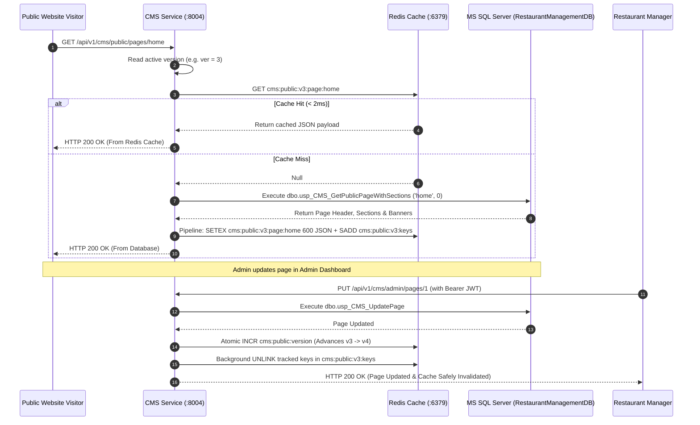

# Restaurant Management System (RMS)
## Phase 11: Dynamic Website CMS REST API Implementation Plan

---

### 1. Service Specification

- **Microservice**: `cms-service`
- **Internal Port**: `8004`
- **API Gateway Prefix**: `/api/v1/cms`
- **Authentication**: JWT Bearer Token (`Authorization: Bearer <token>`) for Admin routes; Public routes are unauthenticated.
- **Tracing Header**: `X-Correlation-ID` (UUID v4)
- **Database**: Microsoft SQL Server 2022 (`RestaurantManagementDB`, 100% Stored Procedures)
- **Cache Engine**: Redis (`localhost:6379`) with instant cache invalidation on admin content updates.

---

### 2. RBAC & Security Matrix

| Route Pattern | Method | Access Level | Allowed Roles | Description |
| :--- | :---: | :---: | :--- | :--- |
| `/health/live` | `GET` | Public | Anyone | Liveness probe |
| `/health/ready` | `GET` | Public | Anyone | Readiness probe (SQL & Redis checks) |
| `/api/v1/cms/public/settings` | `GET` | Public | Anyone | Website branding, color tokens, and contact coordinates |
| `/api/v1/cms/public/navigation` | `GET` | Public | Anyone | Header navbar, mobile drawer, and quick links trees |
| `/api/v1/cms/public/pages/:slug` | `GET` | Public / Staff | Anyone (Public) / Staff (`preview=true`) | Dynamic page with ordered modular section blocks |
| `/api/v1/cms/public/banners` | `GET` | Public | Anyone | Active hero carousel banners & promotional bars |
| `/api/v1/cms/public/testimonials` | `GET` | Public | Anyone | Featured customer and food critic reviews |
| `/api/v1/cms/public/faqs` | `GET` | Public | Anyone | Categorized FAQs |
| `/api/v1/cms/public/footer` | `GET` | Public | Anyone | Footer columns and social media icon links |
| `/api/v1/cms/public/contact` | `POST` | Public | Anyone | Guest contact form / event inquiry submission |
| `/api/v1/cms/admin/settings` | `GET`, `PUT` | Admin | `SUPER_ADMIN`, `RESTAURANT_MANAGER` | View / update global branding & contact info |
| `/api/v1/cms/admin/seo` | `GET`, `PUT` | Admin | `SUPER_ADMIN`, `RESTAURANT_MANAGER` | View / update SEO meta tags and structured data |
| `/api/v1/cms/admin/pages` | `GET`, `POST` | Admin | `SUPER_ADMIN`, `RESTAURANT_MANAGER` | List all pages (with drafts) / create new page |
| `/api/v1/cms/admin/pages/:id` | `GET`, `PUT`, `DELETE` | Admin | `SUPER_ADMIN`, `RESTAURANT_MANAGER` | View, edit, or soft-delete custom pages |
| `/api/v1/cms/admin/pages/:id/status` | `PATCH` | Admin | `SUPER_ADMIN`, `RESTAURANT_MANAGER` | Toggle page lifecycle (`DRAFT`, `PUBLISHED`, `ARCHIVED`) |
| `/api/v1/cms/admin/pages/:id/sections` | `POST` | Admin | `SUPER_ADMIN`, `RESTAURANT_MANAGER` | Add modular section block to page |
| `/api/v1/cms/admin/sections/:id` | `PUT`, `DELETE` | Admin | `SUPER_ADMIN`, `RESTAURANT_MANAGER` | Edit or delete a modular section block |
| `/api/v1/cms/admin/sections/reorder` | `PUT` | Admin | `SUPER_ADMIN`, `RESTAURANT_MANAGER` | Batch update display order via drag-and-drop |
| `/api/v1/cms/admin/banners` | `GET`, `POST` | Admin | `SUPER_ADMIN`, `RESTAURANT_MANAGER` | List all banners / create new banner |
| `/api/v1/cms/admin/banners/:id` | `PUT`, `DELETE` | Admin | `SUPER_ADMIN`, `RESTAURANT_MANAGER` | Update banner details / soft-delete banner |
| `/api/v1/cms/admin/navigation` | `GET`, `POST` | Admin | `SUPER_ADMIN`, `RESTAURANT_MANAGER` | Manage header and mobile navigation hierarchy |
| `/api/v1/cms/admin/navigation/:id` | `PUT`, `DELETE` | Admin | `SUPER_ADMIN`, `RESTAURANT_MANAGER` | Update or delete navigation menu item |
| `/api/v1/cms/admin/footer` | `GET`, `POST` | Admin | `SUPER_ADMIN`, `RESTAURANT_MANAGER` | Manage footer columns |
| `/api/v1/cms/admin/footer/:id` | `PUT`, `DELETE` | Admin | `SUPER_ADMIN`, `RESTAURANT_MANAGER` | Update or delete footer column |
| `/api/v1/cms/admin/faqs` | `GET`, `POST` | Admin | `SUPER_ADMIN`, `RESTAURANT_MANAGER` | Manage FAQs |
| `/api/v1/cms/admin/faqs/:id` | `PUT`, `DELETE` | Admin | `SUPER_ADMIN`, `RESTAURANT_MANAGER` | Update or delete FAQ |
| `/api/v1/cms/admin/testimonials` | `GET`, `POST` | Admin | `SUPER_ADMIN`, `RESTAURANT_MANAGER` | Manage testimonials |
| `/api/v1/cms/admin/testimonials/:id` | `PUT`, `DELETE` | Admin | `SUPER_ADMIN`, `RESTAURANT_MANAGER` | Update or delete testimonial |
| `/api/v1/cms/admin/social-links` | `GET`, `POST` | Admin | `SUPER_ADMIN`, `RESTAURANT_MANAGER` | List social links / upsert social media profile |
| `/api/v1/cms/admin/social-links/:id` | `DELETE` | Admin | `SUPER_ADMIN`, `RESTAURANT_MANAGER` | Delete social media profile link |
| `/api/v1/cms/admin/contact-messages` | `GET` | Admin | `SUPER_ADMIN`, `RESTAURANT_MANAGER` | List guest messages and booking inquiries |
| `/api/v1/cms/admin/contact-messages/:id` | `GET` | Admin | `SUPER_ADMIN`, `RESTAURANT_MANAGER` | View message detail and mark read |
| `/api/v1/cms/admin/contact-messages/:id/reply` | `PATCH` | Admin | `SUPER_ADMIN`, `RESTAURANT_MANAGER` | Record staff resolution notes and mark replied |
| `/api/v1/cms/admin/media/sign-upload` | `POST` | Admin | `SUPER_ADMIN`, `RESTAURANT_MANAGER` | Generate secure Cloudinary direct-upload signature |

---

### 3. API Endpoints & Stored Procedure Mapping

#### 3.1 Public Customer Endpoints (High-Speed Cached via Redis)

##### 1. `GET /api/v1/cms/public/settings`
- **Stored Procedure**: `dbo.usp_CMS_GetWebsiteSettings`
- **Redis Cache Key**: `cms:public:settings` (TTL: 600s)
- **Response (200 OK)**:
```json
{
  "success": true,
  "data": {
    "siteTitle": "Antigravity Gourmet Bistro",
    "tagline": "Artisanal Wood-Fired Gastronomy & Craft Cocktails",
    "headerLogoUrl": "https://res.cloudinary.com/demo/image/upload/v1/restaurant/logo.png",
    "footerLogoUrl": "https://res.cloudinary.com/demo/image/upload/v1/restaurant/logo-footer.png",
    "faviconUrl": "https://res.cloudinary.com/demo/image/upload/v1/restaurant/favicon.ico",
    "primaryColor": "#D90429",
    "secondaryColor": "#2B2D42",
    "accentColor": "#EDF2F4",
    "fontFamily": "Plus Jakarta Sans, sans-serif",
    "contactEmail": "contact@antigravitybistro.com",
    "contactPhone": "+91 80 4123 4567",
    "whatsappNumber": "+91 98765 43210",
    "addressLine": "#42, 100ft Road, Indiranagar, Bangalore - 560038",
    "googleMapsEmbedUrl": "https://www.google.com/maps/embed?pb=..."
  }
}
```

---

##### 2. `GET /api/v1/cms/public/navigation`
- **Stored Procedure**: `dbo.usp_CMS_GetPublicNavigation`
- **Redis Cache Key**: `cms:public:navigation` (TTL: 600s)
- **Response (200 OK)**:
```json
{
  "success": true,
  "data": {
    "header": [
      { "menuId": 1, "title": "Home", "targetUrl": "/", "openInNewTab": false, "children": [] },
      { "menuId": 2, "title": "Menu", "targetUrl": "/menu", "openInNewTab": false, "children": [] },
      { "menuId": 3, "title": "About Us", "targetUrl": "/about", "openInNewTab": false, "children": [] },
      { "menuId": 4, "title": "Reservations", "targetUrl": "/reserve", "openInNewTab": false, "children": [] },
      { "menuId": 5, "title": "Contact", "targetUrl": "/contact", "openInNewTab": false, "children": [] }
    ],
    "quickLinks": [
      { "menuId": 6, "title": "Table Reservations", "targetUrl": "/reserve" },
      { "menuId": 7, "title": "Order Online", "targetUrl": "/menu" }
    ],
    "mobileDrawer": [...]
  }
}
```

---

##### 3. `GET /api/v1/cms/public/pages/:slug?preview=false`
- **Stored Procedure**: `dbo.usp_CMS_GetPublicPageWithSections` (SP 167)
- **Redis Cache Key**: `cms:public:v{ver}:page:{slug}` (TTL: 600s, strictly bypassed when `preview=true`)
- **Query Parameters**:
  - `preview` (boolean, default: false).
- **Security Policy for Preview Mode**:
  - If `preview=true` is requested, the request **MUST** supply a valid Bearer JWT access token in the `Authorization` header with role `SUPER_ADMIN` or `RESTAURANT_MANAGER`.
  - If unauthenticated or token role is unauthorized, the API immediately rejects the request with **HTTP 401 Unauthorized** (or **HTTP 403 Forbidden**).
  - Draft (`DRAFT`) or archived (`ARCHIVED`) pages and unapproved sections are **NEVER** exposed to public visitors or unauthenticated callers.
- **Response (200 OK)**:
```json
{
  "success": true,
  "data": {
    "pageId": 1,
    "pageTitle": "Home",
    "pageSlug": "home",
    "heroBannerTitle": "Artisanal Wood-Fired Gastronomy",
    "heroBannerSubtitle": "Crafted with passion, fired by tradition.",
    "heroImageUrl": "https://res.cloudinary.com/demo/image/upload/v1/restaurant/hero-home.jpg",
    "status": "PUBLISHED",
    "seo": {
      "metaTitle": "Antigravity Bistro | Artisanal Dining in Bangalore",
      "metaDescription": "Experience artisanal wood-fired gastronomy, craft cocktails, and authentic sourdough pizzas.",
      "ogImageUrl": "https://res.cloudinary.com/demo/image/upload/v1/restaurant/og-banner.jpg",
      "structuredDataJson": "{\"@context\":\"https://schema.org\",\"@type\":\"Restaurant\",...}"
    },
    "sections": [
      {
        "sectionId": 1,
        "sectionKey": "home_hero",
        "componentType": "HERO_SLIDER",
        "sectionTitle": null,
        "contentData": { "autoPlay": true, "intervalMs": 5000 },
        "displayOrder": 1
      },
      {
        "sectionId": 2,
        "sectionKey": "home_about",
        "componentType": "ABOUT_STORY",
        "sectionTitle": "Our Sourdough Legacy",
        "sectionSubtitle": "Fermented for 48 hours with wild culture",
        "contentData": { "highlightText": "Ancient grains & modern technique", "ctaUrl": "/about" },
        "displayOrder": 2
      },
      {
        "sectionId": 3,
        "sectionKey": "home_featured",
        "componentType": "FEATURED_MENU",
        "sectionTitle": "Signature Creations",
        "contentData": { "limit": 6 },
        "displayOrder": 3
      }
    ],
    "banners": [...]
  }
}
```

---

##### 4. `GET /api/v1/cms/public/banners?location=HOME_HERO`
- **Stored Procedure**: `dbo.usp_CMS_GetActiveBanners`
- **Redis Cache Key**: `cms:public:banners:{location}` (TTL: 600s)
- **Response (200 OK)**:
```json
{
  "success": true,
  "data": [
    {
      "bannerId": 1,
      "bannerTitle": "Artisanal Wood-Fired Gastronomy",
      "subtitle": "48-Hour Fermented Sourdough Pizzas & Handcrafted Cocktails",
      "badgeText": "Chef's Winter Selection",
      "buttonText": "Explore Menu",
      "buttonLink": "/menu",
      "secondaryButtonText": "Reserve a Table",
      "secondaryButtonLink": "/reserve",
      "imageUrl": "https://res.cloudinary.com/demo/image/upload/v1/restaurant/banner-hero-1.jpg",
      "mobileImageUrl": "https://res.cloudinary.com/demo/image/upload/v1/restaurant/banner-hero-1-mobile.jpg",
      "bannerLocation": "HOME_HERO",
      "displayOrder": 1
    }
  ]
}
```

---

##### 5. `GET /api/v1/cms/public/testimonials?featured=true`
- **Stored Procedure**: `dbo.usp_CMS_GetPublicTestimonials`
- **Redis Cache Key**: `cms:public:testimonials` (TTL: 600s)

---

##### 6. `GET /api/v1/cms/public/faqs?category=ALL`
- **Stored Procedure**: `dbo.usp_CMS_GetPublicFAQs`
- **Redis Cache Key**: `cms:public:faqs` (TTL: 600s)

---

##### 7. `GET /api/v1/cms/public/footer`
- **Stored Procedure**: `dbo.usp_CMS_GetPublicFooter`
- **Redis Cache Key**: `cms:public:footer` (TTL: 600s)

---

##### 8. `POST /api/v1/cms/public/contact`
- **Stored Procedure**: `dbo.usp_CMS_SubmitContactMessage` (SP 206)
- **Database Boundary Rule**: Stored procedure writes **ONLY** to `dbo.ContactMessages`. Zero writes to `dbo.Notifications`.
- **Inter-Service Communication Sequence**:
  1. `cms-service` executes `dbo.usp_CMS_SubmitContactMessage` to persist the inquiry in `dbo.ContactMessages` and retrieve `@NewMessageId`.
  2. `cms-service` Node.js domain service asynchronously dispatches an internal REST notification to `notification-service` (:8012):
     - **URL**: `POST /api/v1/notifications/internal/broadcast`
     - **Headers**:
       - `X-Internal-Service-Key`: Pre-shared mutual mesh secret (`config.security.internalServiceKey`)
       - `X-Correlation-ID`: Active request correlation ID
     - **Payload**:
       ```json
       {
         "branchId": 1,
         "targetRoom": "branch:1:pos",
         "eventName": "contact:new_inquiry",
         "title": "New Guest Inquiry: Private Dining Terrace Booking",
         "message": "Inquiry from Aarav Sharma (aarav.sharma@example.com)",
         "notificationType": "CONTACT_MESSAGE",
         "targetUrl": "/admin/cms/contact-messages/42"
       }
       ```
- **Rate Limit**: Max 5 submissions per IP per 10 minutes.
- **Request Body**:
```json
{
  "branchId": 1,
  "senderName": "Aarav Sharma",
  "senderEmail": "aarav.sharma@example.com",
  "senderPhone": "+91 98450 12345",
  "subject": "Private Dining Terrace Booking for 25 Guests",
  "inquiryType": "PRIVATE_EVENT",
  "messageBody": "We would like to book the garden terrace for an anniversary dinner on Saturday, Dec 12th."
}
```
- **Response (201 Created)**:
```json
{
  "success": true,
  "data": {
    "messageId": 42,
    "status": "UNREAD"
  },
  "message": "Thank you for contacting us! Our team will get back to you shortly."
}
```

---

#### 3.2 Admin CMS Management Endpoints (Protected by JWT + RBAC)

##### 1. `PUT /api/v1/cms/admin/settings`
- **Stored Procedure**: `dbo.usp_CMS_UpdateWebsiteSettings`
- **Side Effect**: Flushes Redis cache pattern `cms:public:*`.

##### 2. `PUT /api/v1/cms/admin/seo`
- **Stored Procedure**: `dbo.usp_CMS_UpdateSEOSettings`
- **Side Effect**: Flushes Redis cache pattern `cms:public:*`.

##### 3. `GET /api/v1/cms/admin/pages`
- **Stored Procedure**: `dbo.usp_CMS_ListPages`
- **Response (200 OK)**:
```json
{
  "success": true,
  "data": [
    {
      "pageId": 1,
      "pageTitle": "Home",
      "pageSlug": "home",
      "pageType": "HOME",
      "status": "PUBLISHED",
      "isSystemPage": true,
      "sectionCount": 7,
      "publishedAt": "2026-11-15T10:00:00.000Z"
    },
    {
      "pageId": 5,
      "pageTitle": "Winter Truffle Festival",
      "pageSlug": "winter-truffle-festival",
      "pageType": "CUSTOM",
      "status": "DRAFT",
      "isSystemPage": false,
      "sectionCount": 3,
      "publishedAt": null
    }
  ]
}
```

##### 4. `POST /api/v1/cms/admin/pages`
- **Stored Procedure**: `dbo.usp_CMS_CreatePage`

##### 5. `GET /api/v1/cms/admin/pages/:id`
- **Stored Procedure**: `dbo.usp_CMS_GetPageById`

##### 6. `PUT /api/v1/cms/admin/pages/:id`
- **Stored Procedure**: `dbo.usp_CMS_UpdatePage`

##### 7. `PATCH /api/v1/cms/admin/pages/:id/status`
- **Stored Procedure**: `dbo.usp_CMS_SetPageStatus`
- **Request Body**: `{ "status": "PUBLISHED" }`

##### 8. `DELETE /api/v1/cms/admin/pages/:id`
- **Stored Procedure**: `dbo.usp_CMS_DeletePage`

##### 9. `POST /api/v1/cms/admin/pages/:id/sections`
- **Stored Procedure**: `dbo.usp_CMS_CreatePageSection`

##### 10. `PUT /api/v1/cms/admin/sections/:id`
- **Stored Procedure**: `dbo.usp_CMS_UpdatePageSection`

##### 11. `PUT /api/v1/cms/admin/sections/reorder`
- **Stored Procedure**: `dbo.usp_CMS_ReorderPageSections`
- **Request Body**:
```json
{
  "pageId": 1,
  "sectionsOrder": [
    { "sectionId": 1, "displayOrder": 1 },
    { "sectionId": 3, "displayOrder": 2 },
    { "sectionId": 2, "displayOrder": 3 }
  ]
}
```

##### 12. `DELETE /api/v1/cms/admin/sections/:id`
- **Stored Procedure**: `dbo.usp_CMS_DeletePageSection`

##### 13. `GET /api/v1/cms/admin/banners` & `POST /api/v1/cms/admin/banners`
- **Stored Procedures**: `dbo.usp_CMS_ListBanners`, `dbo.usp_CMS_CreateBanner`

##### 14. `PUT /api/v1/cms/admin/banners/:id` & `DELETE /api/v1/cms/admin/banners/:id`
- **Stored Procedures**: `dbo.usp_CMS_UpdateBanner`, `dbo.usp_CMS_DeleteBanner`

##### 15. `GET /api/v1/cms/admin/social-links`, `POST /api/v1/cms/admin/social-links` & `DELETE /api/v1/cms/admin/social-links/:id`
- **Stored Procedures**:
  - `GET /`: `dbo.usp_CMS_ListSocialLinks` (SP 203)
  - `POST /`: `dbo.usp_CMS_SaveSocialMediaLink` (SP 204)
  - `DELETE /:id`: `dbo.usp_CMS_DeleteSocialMediaLink` (SP 205)

##### 16. `GET /api/v1/cms/admin/contact-messages?status=UNREAD`
- **Stored Procedure**: `dbo.usp_CMS_ListContactMessages` (SP 207)

##### 17. `GET /api/v1/cms/admin/contact-messages/:id`
- **Stored Procedure**: `dbo.usp_CMS_GetContactMessageById` (SP 208)
- **Description**: Returns inquiry details and automatically marks `Status = 'READ'` if previously `UNREAD`.

##### 18. `PATCH /api/v1/cms/admin/contact-messages/:id/reply`
- **Stored Procedure**: `dbo.usp_CMS_ReplyContactMessage` (SP 209)
- **Request Body**:
```json
{
  "adminReplyNotes": "Spoke with guest over phone. Confirmed 25-seat garden terrace booking for Dec 12th."
}
```
- **Response (200 OK)**:
```json
{
  "success": true,
  "data": {
    "messageId": 42,
    "status": "REPLIED"
  },
  "message": "Contact message reply notes recorded successfully"
}
```

##### 19. `POST /api/v1/cms/admin/media/sign-upload`
- **Description**: Generates secure Cloudinary signature using `CLOUDINARY_API_SECRET` for direct client-to-cloud upload.
- **Request Body**: `{ "folder": "restaurant/banners" }`
- **Response (200 OK)**:
```json
{
  "success": true,
  "data": {
    "timestamp": 1794751200,
    "signature": "3b55159ad6824b059f9b33a2332e3c04...",
    "apiKey": "123456789012345",
    "cloudName": "demo",
    "folder": "restaurant/banners"
  }
}
```

---

### 4. Redis Caching & Non-Blocking Invalidation Architecture

#### 4.1 Safe Invalidation Strategy (Eliminating Blocking `KEYS` Operations)
In high-throughput environments, executing `KEYS cms:public:*` synchronously freezes Redis's single-threaded event loop. To guarantee zero-latency spikes and non-blocking performance, the CMS service implements a **Dual-Tier Non-Blocking Invalidation Engine**:

1. **Tier 1 — Version Counter Namespace (`O(1)` Atomic Roll)**:
   - All public cache keys incorporate an active version identifier: `cms:public:v{version}:{resource}` (e.g., `cms:public:v3:page:home`, `cms:public:v3:navigation`).
   - The current version integer is read once on service start from Redis key `cms:public:version` (cached locally in Node process memory with a 60-second refresh).
   - On any administrative mutation (page update, banner schedule, settings change), the service executes an atomic `INCR cms:public:version`.
   - All subsequent public requests immediately begin populating and reading from the new version namespace (`v4`). Previous version keys (`v3`) safely expire naturally via their configured 600-second TTL without any blocking deletes.

2. **Tier 2 — Tracked Key Set Purge (`O(K)` Pipeline `UNLINK`)**:
   - As each cache entry is written, its key name is added to a Redis set: `SADD cms:public:v{version}:keys {keyName}`.
   - When an admin mutation triggers cache invalidation, the service fetches set members via `SMEMBERS cms:public:v{oldVersion}:keys` and dispatches an asynchronous, non-blocking `UNLINK` command across the batch using an `ioredis` pipeline, followed by `DEL cms:public:v{oldVersion}:keys`.
   - `UNLINK` releases memory asynchronously on background threads, preventing event-loop stalls.

#### 4.2 Sequence Diagram: Cache-Aside & Atomic Invalidation



#### 4.3 Concurrency & Race Condition Guarantees
- **Write-Write Serialization**: Redis `INCR` is atomic; concurrent admin edits increment the version counter sequentially without lost updates.
- **Read-Write Isolation**: If a reader fetches from the database while an admin writes, the reader's subsequent `SETEX` will be scoped to the old version key and will simply expire without polluting the newly incremented version namespace.
- **Fallback Resilience**: If Redis is temporarily down, the `cms-service` logs a warning and transparently degrades to direct database queries, ensuring zero disruption to customer browsing.


