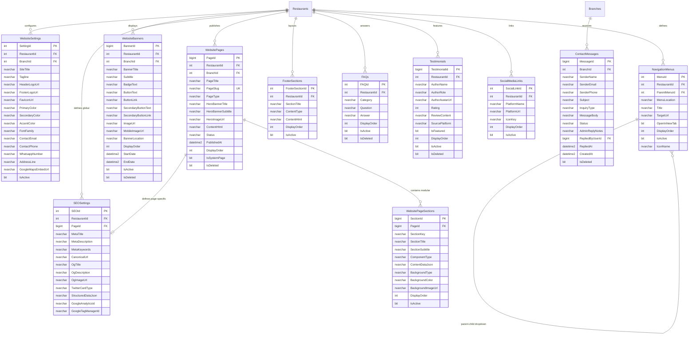

# Restaurant Management System (RMS)
## Phase 11: Dynamic Website CMS Database Design & Stored Procedure Blueprint

---

### 1. Database Specifications & Architectural Context

- **Database Engine**: Microsoft SQL Server 2022
- **Target Database**: `RestaurantManagementDB` (Shared Database Model)
- **Isolated Testing Database**: `RestaurantManagementDB_IsolatedTest`
- **Host / Port**: `localhost:1435`
- **ORM Decision**: **ZERO ORM / ZERO Sequelize Models**. 100% Parameterized T-SQL Stored Procedures.
- **Connection Layer**: Singleton connection pool via `backend/shared/config/database.js` using `mssql` / `tedious`.
- **Database Boundary Rule**: `cms-service` is the sole writer to the 11 CMS tables. All cross-service data from `Restaurants`, `Branches`, and `MenuItems` are queried read-only.
- **Deployment Script**: `database/15_CMSStoredProcedures.sql` (Procedures 163 through 209 - 47 Procedures).

---

### 2. Entity Relationship Model & Table Architecture

---

### 3. Core Table Schemas & Constraints

#### 3.1 `dbo.WebsiteSettings`
- **Primary Key**: `SettingId` (INT IDENTITY).
- **Foreign Keys**: `RestaurantId` $\rightarrow$ `dbo.Restaurants`, `BranchId` $\rightarrow$ `dbo.Branches` (NULL for global settings).
- **Attributes**: `SiteTitle`, `Tagline`, `HeaderLogoUrl`, `HeaderLogoPublicId`, `FooterLogoUrl`, `FooterLogoPublicId`, `FaviconUrl`, `PrimaryColor`, `SecondaryColor`, `AccentColor`, `FontFamily`, `ContactEmail`, `ContactPhone`, `WhatsappNumber`, `AddressLine`, `GoogleMapsEmbedUrl`, `IsActive`, `CreatedAt`, `UpdatedAt`.

#### 3.2 `dbo.WebsitePages`
- **Primary Key**: `PageId` (BIGINT IDENTITY).
- **Unique Constraint**: `UQ_WebsitePages_Slug` on `PageSlug` (e.g. `'home'`, `'about-us'`, `'private-dining'`).
- **Attributes**: `PageTitle`, `PageSlug`, `PageType` (`HOME`, `ABOUT`, `SERVICES`, `CONTACT`, `CUSTOM`), `HeroBannerTitle`, `HeroBannerSubtitle`, `HeroImageUrl`, `HeroImagePublicId`, `ContentHtml`, `Status` (`DRAFT`, `PUBLISHED`, `ARCHIVED`), `PublishedAt`, `DisplayOrder`, `IsSystemPage`, `CreatedAt`, `UpdatedAt`, `IsDeleted`, `DeletedAt`.

#### 3.3 `dbo.WebsitePageSections`
- **Primary Key**: `SectionId` (BIGINT IDENTITY).
- **Unique Constraint**: `UQ_WebsitePageSections_Page_Key` on `(PageId, SectionKey)`.
- **Attributes**: `PageId`, `SectionKey`, `SectionTitle`, `SectionSubtitle`, `ComponentType` (`HERO_SLIDER`, `ABOUT_STORY`, `FEATURED_MENU`, `CHEF_FEATURE`, `SERVICES_LIST`, `STATS_COUNTER`, `TESTIMONIALS_GRID`, `FAQ_ACCORDION`, `RESERVATION_CTA`, `NEWSLETTER_FORM`, `MAP_CONTACT`, `CUSTOM_HTML`), `ContentDataJson`, `BackgroundType` (`COLOR`, `IMAGE`, `VIDEO`), `BackgroundColor`, `BackgroundImageUrl`, `BackgroundImagePublicId`, `DisplayOrder`, `IsActive`, `CreatedAt`, `UpdatedAt`.

#### 3.4 `dbo.WebsiteBanners`
- **Primary Key**: `BannerId` (BIGINT IDENTITY).
- **Attributes**: `RestaurantId`, `BranchId`, `BannerTitle`, `Subtitle`, `BadgeText`, `ButtonText`, `ButtonLink`, `SecondaryButtonText`, `SecondaryButtonLink`, `ImageUrl`, `ImagePublicId`, `MobileImageUrl`, `MobileImagePublicId`, `BannerLocation` (`HOME_HERO`, `MENU_HEADER`, `PROMO_BAR`, `POPUP`), `DisplayOrder`, `StartDate`, `EndDate`, `IsActive`, `CreatedAt`, `UpdatedAt`, `IsDeleted`, `DeletedAt`.

#### 3.5 `dbo.NavigationMenus`
- **Primary Key**: `MenuId` (INT IDENTITY).
- **Foreign Key**: `ParentMenuId` $\rightarrow$ `dbo.NavigationMenus(MenuId)` for multi-level nested menus.
- **Attributes**: `RestaurantId`, `ParentMenuId`, `MenuLocation` (`HEADER`, `HEADER_QUICK`, `FOOTER_EXPLORE`, `MOBILE_DRAWER`), `Title`, `TargetUrl`, `OpenInNewTab`, `DisplayOrder`, `IsActive`, `IconName`, `CreatedAt`, `UpdatedAt`.

#### 3.6 `dbo.FooterSections`
- **Primary Key**: `FooterSectionId` (INT IDENTITY).
- **Attributes**: `RestaurantId`, `SectionTitle`, `ContentType` (`LINKS`, `RICH_TEXT`, `HOURS`, `NEWSLETTER`), `ContentHtml`, `DisplayOrder`, `IsActive`, `CreatedAt`, `UpdatedAt`.

#### 3.7 `dbo.FAQs`
- **Primary Key**: `FAQId` (INT IDENTITY).
- **Attributes**: `RestaurantId`, `Category` (`GENERAL`, `RESERVATIONS`, `DELIVERY`, `DIETARY`, `EVENTS`), `Question`, `Answer`, `DisplayOrder`, `IsActive`, `CreatedAt`, `UpdatedAt`, `IsDeleted`, `DeletedAt`.

#### 3.8 `dbo.Testimonials`
- **Primary Key**: `TestimonialId` (BIGINT IDENTITY).
- **Check Constraint**: `Rating BETWEEN 1 AND 5`.
- **Attributes**: `RestaurantId`, `AuthorName`, `AuthorRole`, `AuthorAvatarUrl`, `AuthorAvatarPublicId`, `Rating`, `ReviewContent`, `SourcePlatform` (`GOOGLE`, `TRIPADVISOR`, `PRESS`), `IsFeatured`, `DisplayOrder`, `IsActive`, `CreatedAt`, `UpdatedAt`, `IsDeleted`, `DeletedAt`.

#### 3.9 `dbo.SocialMediaLinks`
- **Primary Key**: `SocialLinkId` (INT IDENTITY).
- **Attributes**: `RestaurantId`, `PlatformName` (`INSTAGRAM`, `FACEBOOK`, `TWITTER_X`, `YOUTUBE`, `TRIPADVISOR`), `PlatformUrl`, `IconKey`, `DisplayOrder`, `IsActive`, `CreatedAt`, `UpdatedAt`.

#### 3.10 `dbo.ContactMessages`
- **Primary Key**: `MessageId` (BIGINT IDENTITY).
- **Foreign Keys**: `BranchId` $\rightarrow$ `dbo.Branches`, `RepliedByUserId` $\rightarrow$ `dbo.Users`.
- **Attributes**: `BranchId`, `SenderName`, `SenderEmail`, `SenderPhone`, `Subject`, `InquiryType` (`GENERAL`, `PRIVATE_EVENT`, `FEEDBACK`, `CATERING`), `MessageBody`, `Status` (`UNREAD`, `READ`, `REPLIED`, `ARCHIVED`), `AdminReplyNotes`, `RepliedByUserId`, `RepliedAt`, `CreatedAt`, `IsDeleted`, `DeletedAt`.

#### 3.11 `dbo.SEOSettings`
- **Primary Key**: `SEOId` (INT IDENTITY).
- **Foreign Keys**: `RestaurantId` $\rightarrow$ `dbo.Restaurants`, `PageId` $\rightarrow$ `dbo.WebsitePages` (NULL represents global default).
- **Attributes**: `RestaurantId`, `PageId`, `MetaTitle`, `MetaDescription`, `MetaKeywords`, `CanonicalUrl`, `OgTitle`, `OgDescription`, `OgImageUrl`, `OgImagePublicId`, `TwitterCardType`, `StructuredDataJson`, `GoogleAnalyticsId`, `GoogleTagManagerId`, `CreatedAt`, `UpdatedAt`.

---

### 4. Stored Procedure Blueprint (`database/15_CMSStoredProcedures.sql`)

The implementation plans **47 single-responsibility, ACID-compliant stored procedures** (SPs 163 through 209):

#### Category A: Website Branding & SEO (SPs 163–166)
1. **SP 163: `dbo.usp_CMS_GetWebsiteSettings`**:
   - **Parameters**: `@RestaurantId INT = 1`, `@BranchId INT = NULL`
   - **Description**: Returns active global or branch-scoped website branding, color palette tokens, contact info, WhatsApp link, and Google Maps embed URL.
   - **Table Access**: `dbo.WebsiteSettings` (READ-ONLY).
2. **SP 164: `dbo.usp_CMS_UpdateWebsiteSettings`**:
   - **Parameters**: `@RestaurantId INT`, `@BranchId INT = NULL`, `@SiteTitle NVARCHAR(150)`, `@Tagline NVARCHAR(255)`, `@HeaderLogoUrl NVARCHAR(500)`, `@HeaderLogoPublicId NVARCHAR(150)`, `@FooterLogoUrl NVARCHAR(500)`, `@FooterLogoPublicId NVARCHAR(150)`, `@FaviconUrl NVARCHAR(500)`, `@PrimaryColor NVARCHAR(20)`, `@SecondaryColor NVARCHAR(20)`, `@AccentColor NVARCHAR(20)`, `@FontFamily NVARCHAR(80)`, `@ContactEmail NVARCHAR(120)`, `@ContactPhone NVARCHAR(25)`, `@WhatsappNumber NVARCHAR(25)`, `@AddressLine NVARCHAR(255)`, `@GoogleMapsEmbedUrl NVARCHAR(1000)`
   - **Description**: Admin procedure updating site title, branding logos, colors, fonts, and contact coordinates with atomic transaction.
   - **Table Access**: `dbo.WebsiteSettings` (UPSERT).
3. **SP 165: `dbo.usp_CMS_GetSEOSettings`**:
   - **Parameters**: `@RestaurantId INT = 1`, `@PageId BIGINT = NULL`, `@PageSlug NVARCHAR(150) = NULL`
   - **Description**: Retrieves global or page-specific SEO tags, OpenGraph previews, Twitter cards, and Schema.org structured data. If `@PageSlug` is provided, resolves `@PageId` via `dbo.WebsitePages`.
   - **Table Access**: `dbo.SEOSettings`, `dbo.WebsitePages` (READ-ONLY).
4. **SP 166: `dbo.usp_CMS_UpdateSEOSettings`**:
   - **Parameters**: `@RestaurantId INT`, `@PageId BIGINT = NULL`, `@MetaTitle NVARCHAR(150)`, `@MetaDescription NVARCHAR(500)`, `@MetaKeywords NVARCHAR(500)`, `@CanonicalUrl NVARCHAR(500)`, `@OgTitle NVARCHAR(150)`, `@OgDescription NVARCHAR(500)`, `@OgImageUrl NVARCHAR(500)`, `@OgImagePublicId NVARCHAR(150)`, `@TwitterCardType NVARCHAR(30)`, `@StructuredDataJson NVARCHAR(MAX)`, `@GoogleAnalyticsId NVARCHAR(50)`, `@GoogleTagManagerId NVARCHAR(50)`
   - **Description**: Admin procedure upserting global or page-specific SEO metadata.
   - **Table Access**: `dbo.SEOSettings` (UPSERT).

#### Category B: Dynamic Pages & Section Component Registry (SPs 167–177)
5. **SP 167: `dbo.usp_CMS_GetPublicPageWithSections`**:
   - **Parameters**: `@PageSlug NVARCHAR(150)`, `@PreviewMode BIT = 0`
   - **Description**: Multi-recordset customer query returning:
     - Recordset 1: Page Header & SEO Metadata (filtered by `Status = 'PUBLISHED'` unless `@PreviewMode = 1`).
     - Recordset 2: Ordered, active sections with parsed JSON parameters (`WHERE IsActive = 1` unless `@PreviewMode = 1`).
     - Recordset 3: If `@PageSlug = 'home'`, active scheduled hero banners.
   - **Security Note**: `@PreviewMode = 1` requires caller to be pre-authenticated with `SUPER_ADMIN` or `RESTAURANT_MANAGER` JWT token in service layer. Unauthorized preview requests are rejected at the API tier.
   - **Table Access**: `dbo.WebsitePages`, `dbo.SEOSettings`, `dbo.WebsitePageSections`, `dbo.WebsiteBanners` (READ-ONLY).
6. **SP 168: `dbo.usp_CMS_ListPages`**:
   - **Parameters**: `@RestaurantId INT = 1`, `@Status NVARCHAR(20) = NULL`, `@Search NVARCHAR(100) = NULL`, `@Page INT = 1`, `@Limit INT = 20`
   - **Description**: Admin paginated listing of pages with search, status filters (`DRAFT`, `PUBLISHED`, `ARCHIVED`), and active section counts.
   - **Table Access**: `dbo.WebsitePages`, `dbo.WebsitePageSections` (READ-ONLY).
7. **SP 169: `dbo.usp_CMS_GetPageById`**:
   - **Parameters**: `@PageId BIGINT`
   - **Description**: Multi-recordset admin query returning:
     - Recordset 1: Page header metadata.
     - Recordset 2: Attached SEO settings.
     - Recordset 3: All page sections (both active and inactive) ordered by `DisplayOrder`.
   - **Table Access**: `dbo.WebsitePages`, `dbo.SEOSettings`, `dbo.WebsitePageSections` (READ-ONLY).
8. **SP 170: `dbo.usp_CMS_CreatePage`**:
   - **Parameters**: `@RestaurantId INT`, `@BranchId INT = NULL`, `@PageTitle NVARCHAR(150)`, `@PageSlug NVARCHAR(150)`, `@PageType NVARCHAR(50) = 'CUSTOM'`, `@HeroBannerTitle NVARCHAR(200) = NULL`, `@HeroBannerSubtitle NVARCHAR(500) = NULL`, `@HeroImageUrl NVARCHAR(500) = NULL`, `@HeroImagePublicId NVARCHAR(150) = NULL`, `@ContentHtml NVARCHAR(MAX) = NULL`, `@Status NVARCHAR(20) = 'DRAFT'`, `@DisplayOrder INT = 0`, `@NewPageId BIGINT OUTPUT`
   - **Description**: Atomic page creation with unique slug validation and optional default SEO record setup.
   - **Table Access**: `dbo.WebsitePages` (INSERT).
9. **SP 171: `dbo.usp_CMS_UpdatePage`**:
   - **Parameters**: `@PageId BIGINT`, `@PageTitle NVARCHAR(150)`, `@HeroBannerTitle NVARCHAR(200)`, `@HeroBannerSubtitle NVARCHAR(500)`, `@HeroImageUrl NVARCHAR(500)`, `@HeroImagePublicId NVARCHAR(150)`, `@ContentHtml NVARCHAR(MAX)`, `@DisplayOrder INT`
   - **Description**: Updates page title, hero banner, rich HTML body, and display order.
   - **Table Access**: `dbo.WebsitePages` (UPDATE).
10. **SP 172: `dbo.usp_CMS_SetPageStatus`**:
    - **Parameters**: `@PageId BIGINT`, `@NewStatus NVARCHAR(20)`
    - **Description**: Validates and transitions page lifecycle (`DRAFT` $\rightarrow$ `PUBLISHED` $\rightarrow$ `ARCHIVED`), automatically setting `PublishedAt = SYSUTCDATETIME()` when published.
    - **Table Access**: `dbo.WebsitePages` (UPDATE).
11. **SP 173: `dbo.usp_CMS_DeletePage`**:
    - **Parameters**: `@PageId BIGINT`, `@DeletedByUserId BIGINT = NULL`
    - **Description**: Soft-deletes a custom page (`IsDeleted = 1, DeletedAt = SYSUTCDATETIME()`). Enforces guard prohibiting deletion of system pages (`IsSystemPage = 1`).
    - **Table Access**: `dbo.WebsitePages` (UPDATE).
12. **SP 174: `dbo.usp_CMS_CreatePageSection`**:
    - **Parameters**: `@PageId BIGINT`, `@SectionKey NVARCHAR(80)`, `@SectionTitle NVARCHAR(150) = NULL`, `@SectionSubtitle NVARCHAR(255) = NULL`, `@ComponentType NVARCHAR(50)`, `@ContentDataJson NVARCHAR(MAX) = NULL`, `@BackgroundType NVARCHAR(30) = 'COLOR'`, `@BackgroundColor NVARCHAR(30) = NULL`, `@BackgroundImageUrl NVARCHAR(500) = NULL`, `@BackgroundImagePublicId NVARCHAR(150) = NULL`, `@DisplayOrder INT = NULL`, `@NewSectionId BIGINT OUTPUT`
    - **Description**: Adds a modular section block. Auto-computes next `DisplayOrder` if omitted.
    - **Table Access**: `dbo.WebsitePageSections` (INSERT).
13. **SP 175: `dbo.usp_CMS_UpdatePageSection`**:
    - **Parameters**: `@SectionId BIGINT`, `@SectionTitle NVARCHAR(150)`, `@SectionSubtitle NVARCHAR(255)`, `@ComponentType NVARCHAR(50)`, `@ContentDataJson NVARCHAR(MAX)`, `@BackgroundType NVARCHAR(30)`, `@BackgroundColor NVARCHAR(30)`, `@BackgroundImageUrl NVARCHAR(500)`, `@BackgroundImagePublicId NVARCHAR(150)`, `@IsActive BIT`
    - **Description**: Updates section title, subtitle, component type, JSON parameters, background styling, and active visibility.
    - **Table Access**: `dbo.WebsitePageSections` (UPDATE).
14. **SP 176: `dbo.usp_CMS_ReorderPageSections`**:
    - **Parameters**: `@PageId BIGINT`, `@SectionsOrderJson NVARCHAR(MAX)`
    - **Description**: Atomic batch update of `DisplayOrder` parsed from JSON array `[{"sectionId": 10, "displayOrder": 1}, ...]`.
    - **Table Access**: `dbo.WebsitePageSections` (UPDATE).
15. **SP 177: `dbo.usp_CMS_DeletePageSection`**:
    - **Parameters**: `@SectionId BIGINT`
    - **Description**: Deletes a section block from a page.
    - **Table Access**: `dbo.WebsitePageSections` (DELETE).

#### Category C: Banners & Promotional Sliders (SPs 178–182)
16. **SP 178: `dbo.usp_CMS_GetActiveBanners`**:
    - **Parameters**: `@RestaurantId INT = 1`, `@BranchId INT = NULL`, `@BannerLocation NVARCHAR(50) = 'HOME_HERO'`
    - **Description**: High-speed customer query returning active banners filtered by datetime schedule (`StartDate <= SYSUTCDATETIME()` and `EndDate >= SYSUTCDATETIME()`).
    - **Table Access**: `dbo.WebsiteBanners` (READ-ONLY).
17. **SP 179: `dbo.usp_CMS_ListBanners`**:
    - **Parameters**: `@RestaurantId INT = 1`, `@BannerLocation NVARCHAR(50) = NULL`, `@Page INT = 1`, `@Limit INT = 20`
    - **Description**: Admin paginated query listing all banners with active/schedule status.
    - **Table Access**: `dbo.WebsiteBanners` (READ-ONLY).
18. **SP 180: `dbo.usp_CMS_CreateBanner`**:
    - **Parameters**: `@RestaurantId INT`, `@BranchId INT = NULL`, `@BannerTitle NVARCHAR(150)`, `@Subtitle NVARCHAR(300) = NULL`, `@BadgeText NVARCHAR(60) = NULL`, `@ButtonText NVARCHAR(60) = NULL`, `@ButtonLink NVARCHAR(255) = NULL`, `@SecondaryButtonText NVARCHAR(60) = NULL`, `@SecondaryButtonLink NVARCHAR(255) = NULL`, `@ImageUrl NVARCHAR(500)`, `@ImagePublicId NVARCHAR(150) = NULL`, `@MobileImageUrl NVARCHAR(500) = NULL`, `@MobileImagePublicId NVARCHAR(150) = NULL`, `@BannerLocation NVARCHAR(50) = 'HOME_HERO'`, `@DisplayOrder INT = 0`, `@StartDate DATETIME2(3) = NULL`, `@EndDate DATETIME2(3) = NULL`, `@NewBannerId BIGINT OUTPUT`
    - **Description**: Creates a new banner slide with CTA button links, desktop/mobile images, and scheduling dates.
    - **Table Access**: `dbo.WebsiteBanners` (INSERT).
19. **SP 181: `dbo.usp_CMS_UpdateBanner`**:
    - **Parameters**: `@BannerId BIGINT`, `@BannerTitle NVARCHAR(150)`, `@Subtitle NVARCHAR(300)`, `@BadgeText NVARCHAR(60)`, `@ButtonText NVARCHAR(60)`, `@ButtonLink NVARCHAR(255)`, `@SecondaryButtonText NVARCHAR(60)`, `@SecondaryButtonLink NVARCHAR(255)`, `@ImageUrl NVARCHAR(500)`, `@ImagePublicId NVARCHAR(150)`, `@MobileImageUrl NVARCHAR(500)`, `@MobileImagePublicId NVARCHAR(150)`, `@BannerLocation NVARCHAR(50)`, `@DisplayOrder INT`, `@StartDate DATETIME2(3)`, `@EndDate DATETIME2(3)`, `@IsActive BIT`
    - **Description**: Updates banner copy, CTA links, images, display order, schedule, and active status.
    - **Table Access**: `dbo.WebsiteBanners` (UPDATE).
20. **SP 182: `dbo.usp_CMS_DeleteBanner`**:
    - **Parameters**: `@BannerId BIGINT`
    - **Description**: Soft-deletes a banner record (`IsDeleted = 1, DeletedAt = SYSUTCDATETIME()`).
    - **Table Access**: `dbo.WebsiteBanners` (UPDATE).

#### Category D: Navigation Menus (SPs 183–187)
21. **SP 183: `dbo.usp_CMS_GetPublicNavigation`**:
    - **Parameters**: `@RestaurantId INT = 1`
    - **Description**: Retrieves active navigation trees for `HEADER`, `HEADER_QUICK`, `FOOTER_EXPLORE`, and `MOBILE_DRAWER`, structured hierarchically via `ParentMenuId`.
    - **Table Access**: `dbo.NavigationMenus` (READ-ONLY).
22. **SP 184: `dbo.usp_CMS_ListNavigationMenus`**:
    - **Parameters**: `@RestaurantId INT = 1`, `@MenuLocation NVARCHAR(40) = NULL`
    - **Description**: Admin listing of all navigation links and dropdown parents.
    - **Table Access**: `dbo.NavigationMenus` (READ-ONLY).
23. **SP 185: `dbo.usp_CMS_CreateNavigationMenu`**:
    - **Parameters**: `@RestaurantId INT`, `@ParentMenuId INT = NULL`, `@MenuLocation NVARCHAR(40) = 'HEADER'`, `@Title NVARCHAR(80)`, `@TargetUrl NVARCHAR(255)`, `@OpenInNewTab BIT = 0`, `@DisplayOrder INT = 0`, `@IconName NVARCHAR(50) = NULL`, `@NewMenuId INT OUTPUT`
    - **Description**: Adds a menu item with target URL, optional parent dropdown, and display order.
    - **Table Access**: `dbo.NavigationMenus` (INSERT).
24. **SP 186: `dbo.usp_CMS_UpdateNavigationMenu`**:
    - **Parameters**: `@MenuId INT`, `@ParentMenuId INT = NULL`, `@MenuLocation NVARCHAR(40)`, `@Title NVARCHAR(80)`, `@TargetUrl NVARCHAR(255)`, `@OpenInNewTab BIT`, `@DisplayOrder INT`, `@IsActive BIT`, `@IconName NVARCHAR(50)`
    - **Description**: Updates menu title, target URL, icon, and display sequence.
    - **Table Access**: `dbo.NavigationMenus` (UPDATE).
25. **SP 187: `dbo.usp_CMS_DeleteNavigationMenu`**:
    - **Parameters**: `@MenuId INT`
    - **Description**: Deletes a menu item and safely clears `ParentMenuId` on any child dropdown items.
    - **Table Access**: `dbo.NavigationMenus` (DELETE).

#### Category E: Footer Layout Sections (SPs 188–192)
26. **SP 188: `dbo.usp_CMS_GetPublicFooter`**:
    - **Parameters**: `@RestaurantId INT = 1`
    - **Description**: Multi-recordset customer query returning active footer columns and social media links.
    - **Table Access**: `dbo.FooterSections`, `dbo.SocialMediaLinks` (READ-ONLY).
27. **SP 189: `dbo.usp_CMS_ListFooterSections`**:
    - **Parameters**: `@RestaurantId INT = 1`
    - **Description**: Admin listing of all footer columns.
    - **Table Access**: `dbo.FooterSections` (READ-ONLY).
28. **SP 190: `dbo.usp_CMS_CreateFooterSection`**:
    - **Parameters**: `@RestaurantId INT`, `@SectionTitle NVARCHAR(80)`, `@ContentType NVARCHAR(40) = 'LINKS'`, `@ContentHtml NVARCHAR(MAX) = NULL`, `@DisplayOrder INT = 0`, `@NewFooterSectionId INT OUTPUT`
    - **Description**: Adds a footer column (`LINKS`, `RICH_TEXT`, `HOURS`, `NEWSLETTER`).
    - **Table Access**: `dbo.FooterSections` (INSERT).
29. **SP 191: `dbo.usp_CMS_UpdateFooterSection`**:
    - **Parameters**: `@FooterSectionId INT`, `@SectionTitle NVARCHAR(80)`, `@ContentType NVARCHAR(40)`, `@ContentHtml NVARCHAR(MAX)`, `@DisplayOrder INT`, `@IsActive BIT`
    - **Description**: Updates footer section title, content type, HTML body, and display order.
    - **Table Access**: `dbo.FooterSections` (UPDATE).
30. **SP 192: `dbo.usp_CMS_DeleteFooterSection`**:
    - **Parameters**: `@FooterSectionId INT`
    - **Description**: Deletes a footer section column.
    - **Table Access**: `dbo.FooterSections` (DELETE).

#### Category F: FAQs & Testimonials (SPs 193–202)
31. **SP 193: `dbo.usp_CMS_GetPublicFAQs`**:
    - **Parameters**: `@RestaurantId INT = 1`, `@Category NVARCHAR(60) = NULL`
    - **Description**: Returns active FAQs grouped by category with display ordering.
    - **Table Access**: `dbo.FAQs` (READ-ONLY).
32. **SP 194: `dbo.usp_CMS_ListFAQs`**:
    - **Parameters**: `@RestaurantId INT = 1`, `@Category NVARCHAR(60) = NULL`, `@Search NVARCHAR(100) = NULL`
    - **Description**: Admin listing with category filtering and search.
    - **Table Access**: `dbo.FAQs` (READ-ONLY).
33. **SP 195: `dbo.usp_CMS_CreateFAQ`**:
    - **Parameters**: `@RestaurantId INT`, `@Category NVARCHAR(60) = 'GENERAL'`, `@Question NVARCHAR(300)`, `@Answer NVARCHAR(MAX)`, `@DisplayOrder INT = 0`, `@NewFAQId INT OUTPUT`
    - **Description**: Adds a new FAQ entry with category and question/answer copy.
    - **Table Access**: `dbo.FAQs` (INSERT).
34. **SP 196: `dbo.usp_CMS_UpdateFAQ`**:
    - **Parameters**: `@FAQId INT`, `@Category NVARCHAR(60)`, `@Question NVARCHAR(300)`, `@Answer NVARCHAR(MAX)`, `@DisplayOrder INT`, `@IsActive BIT`
    - **Description**: Updates FAQ question, answer, category, and display order.
    - **Table Access**: `dbo.FAQs` (UPDATE).
35. **SP 197: `dbo.usp_CMS_DeleteFAQ`**:
    - **Parameters**: `@FAQId INT`
    - **Description**: Soft-deletes an FAQ entry (`IsDeleted = 1, DeletedAt = SYSUTCDATETIME()`).
    - **Table Access**: `dbo.FAQs` (UPDATE).
36. **SP 198: `dbo.usp_CMS_GetPublicTestimonials`**:
    - **Parameters**: `@RestaurantId INT = 1`, `@FeaturedOnly BIT = 1`
    - **Description**: Returns featured active customer and critic reviews.
    - **Table Access**: `dbo.Testimonials` (READ-ONLY).
37. **SP 199: `dbo.usp_CMS_ListTestimonials`**:
    - **Parameters**: `@RestaurantId INT = 1`, `@Page INT = 1`, `@Limit INT = 20`
    - **Description**: Admin listing of all testimonials.
    - **Table Access**: `dbo.Testimonials` (READ-ONLY).
38. **SP 200: `dbo.usp_CMS_CreateTestimonial`**:
    - **Parameters**: `@RestaurantId INT`, `@AuthorName NVARCHAR(100)`, `@AuthorRole NVARCHAR(80) = NULL`, `@AuthorAvatarUrl NVARCHAR(500) = NULL`, `@AuthorAvatarPublicId NVARCHAR(150) = NULL`, `@Rating INT = 5`, `@ReviewContent NVARCHAR(1000)`, `@SourcePlatform NVARCHAR(50) = 'GOOGLE'`, `@IsFeatured BIT = 1`, `@DisplayOrder INT = 0`, `@NewTestimonialId BIGINT OUTPUT`
    - **Description**: Adds a review with rating (1–5), critic attribution, and avatar.
    - **Table Access**: `dbo.Testimonials` (INSERT).
39. **SP 201: `dbo.usp_CMS_UpdateTestimonial`**:
    - **Parameters**: `@TestimonialId BIGINT`, `@AuthorName NVARCHAR(100)`, `@AuthorRole NVARCHAR(80)`, `@AuthorAvatarUrl NVARCHAR(500)`, `@AuthorAvatarPublicId NVARCHAR(150)`, `@Rating INT`, `@ReviewContent NVARCHAR(1000)`, `@SourcePlatform NVARCHAR(50)`, `@IsFeatured BIT`, `@DisplayOrder INT`, `@IsActive BIT`
    - **Description**: Updates review content, rating, featured flag, and display order.
    - **Table Access**: `dbo.Testimonials` (UPDATE).
40. **SP 202: `dbo.usp_CMS_DeleteTestimonial`**:
    - **Parameters**: `@TestimonialId BIGINT`
    - **Description**: Soft-deletes a testimonial (`IsDeleted = 1, DeletedAt = SYSUTCDATETIME()`).
    - **Table Access**: `dbo.Testimonials` (UPDATE).

#### Category G: Social Media Links (SPs 203–205)
41. **SP 203: `dbo.usp_CMS_ListSocialLinks`**:
    - **Parameters**: `@RestaurantId INT = 1`, `@ActiveOnly BIT = 0`
    - **Description**: Lists all configured social media profiles, handles, icon keys, and URLs.
    - **Table Access**: `dbo.SocialMediaLinks` (READ-ONLY).
42. **SP 204: `dbo.usp_CMS_SaveSocialMediaLink`**:
    - **Parameters**: `@RestaurantId INT`, `@SocialLinkId INT = NULL`, `@PlatformName NVARCHAR(50)`, `@PlatformUrl NVARCHAR(500)`, `@IconKey NVARCHAR(50)`, `@DisplayOrder INT = 0`, `@IsActive BIT = 1`, `@ResultSocialLinkId INT OUTPUT`
    - **Description**: Atomic upsert creating or updating a social media link entry.
    - **Table Access**: `dbo.SocialMediaLinks` (UPSERT).
43. **SP 205: `dbo.usp_CMS_DeleteSocialMediaLink`**:
    - **Parameters**: `@SocialLinkId INT`
    - **Description**: Deletes a social media profile link.
    - **Table Access**: `dbo.SocialMediaLinks` (DELETE).

#### Category H: Contact Messages & Guest Inquiries (SPs 206–209)
44. **SP 206: `dbo.usp_CMS_SubmitContactMessage`**:
    - **Parameters**: `@BranchId INT = NULL`, `@SenderName NVARCHAR(100)`, `@SenderEmail NVARCHAR(120)`, `@SenderPhone NVARCHAR(25) = NULL`, `@Subject NVARCHAR(150)`, `@InquiryType NVARCHAR(50) = 'GENERAL'`, `@MessageBody NVARCHAR(2000)`, `@NewMessageId BIGINT OUTPUT`
    - **Description**: Inserts guest contact message into `dbo.ContactMessages` and returns the generated `MessageId`.
    - **Strict Boundary Rule**: Inserts **ONLY** into `dbo.ContactMessages`. Zero writes to `dbo.Notifications`. Staff notification alert is dispatched via HTTP REST `POST /api/v1/notifications/internal/broadcast` from Node.js service layer.
    - **Table Access**: `dbo.ContactMessages` (INSERT).
45. **SP 207: `dbo.usp_CMS_ListContactMessages`**:
    - **Parameters**: `@BranchId INT = NULL`, `@Status NVARCHAR(30) = NULL`, `@InquiryType NVARCHAR(50) = NULL`, `@Page INT = 1`, `@Limit INT = 20`
    - **Description**: Admin paginated listing of inquiries with status filters (`UNREAD`, `READ`, `REPLIED`, `ARCHIVED`) and branch context.
    - **Table Access**: `dbo.ContactMessages` (READ-ONLY).
46. **SP 208: `dbo.usp_CMS_GetContactMessageById`**:
    - **Parameters**: `@MessageId BIGINT`
    - **Description**: Retrieves single message detail and marks `Status = 'READ'` if currently `UNREAD`.
    - **Table Access**: `dbo.ContactMessages` (SELECT & UPDATE).
47. **SP 209: `dbo.usp_CMS_ReplyContactMessage`**:
    - **Parameters**: `@MessageId BIGINT`, `@AdminReplyNotes NVARCHAR(1000)`, `@RepliedByUserId BIGINT`
    - **Description**: Updates inquiry with staff resolution notes, sets `Status = 'REPLIED'`, `RepliedByUserId = @RepliedByUserId`, and `RepliedAt = SYSUTCDATETIME()`.
    - **Table Access**: `dbo.ContactMessages` (UPDATE).

