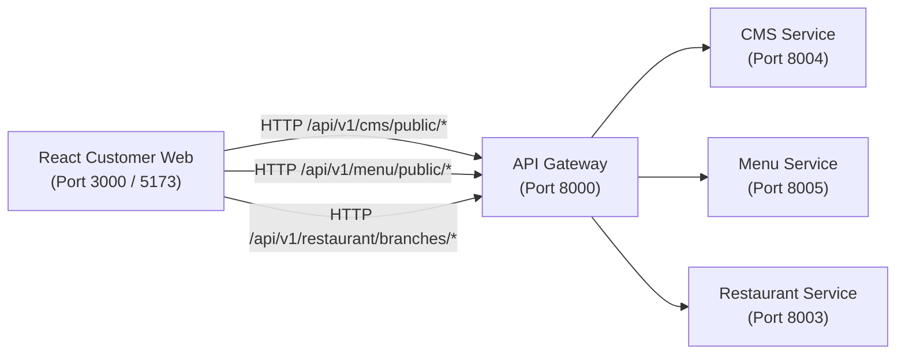

# Restaurant Management System (RMS)
## Phase 11: Public Customer Frontend & Section Component Architecture

---

### 1. Executive Summary & Design Vision

The **Public Customer Frontend** is an ultra-fast, mobile-responsive, SEO-optimized digital web application designed for restaurant diners, food critics, and event organizers. 

Rather than hardcoding restaurant copy, promotional slides, chef bios, or menu items, the application employs a **100% Data-Driven Section Component Registry Architecture**. Pages are rendered dynamically from modular JSON blocks retrieved from `cms-service` (:8004), enabling non-technical restaurant managers to restructure homepages, launch seasonal specials, and swap out branding assets in real time without redeploying frontend code.

---

### 2. Technology Stack

- **Core Framework**: React.js 18.x with Vite (Lightning-fast HMR and optimized ES modules build).
- **Styling & Design System**: Tailwind CSS (Mobile-first utility CSS) + Ant Design / Lucide Icons.
- **Server State & Caching**: TanStack Query (React Query v5) implementing Stale-While-Revalidate (SWR) for instantaneous page transitions.
- **Routing**: `react-router-dom` v6 with dynamic slug catch-all routing (`/:slug`).
- **SEO & Social Cards**: `react-helmet-async` for client-side injection of Open Graph, Twitter cards, and Schema.org `Restaurant` JSON-LD structured data.
- **HTTP Client**: Axios with automatic `X-Correlation-ID` injection and unified response unwrapping.
- **Media Delivery**: Cloudinary CDN with dynamic WebP/AVIF auto-formatting and responsive width transformations (`f_auto,q_auto,w_auto`).

---

### 3. Proposed Frontend Workspace Structure (`frontend/customer-web/`)

```
frontend/customer-web/
├── public/
│   ├── favicon.ico
│   └── robots.txt
├── src/
│   ├── api/
│   │   ├── axiosClient.js          # Axios singleton with correlation ID
│   │   ├── cmsApi.js               # Calls /api/v1/cms/public/*
│   │   ├── menuApi.js              # Calls /api/v1/menu/public/*
│   │   └── restaurantApi.js        # Calls /api/v1/restaurant/branches/*
│   ├── components/
│   │   ├── common/
│   │   │   ├── Navbar.jsx          # Dynamic header with dropdowns & mobile drawer
│   │   │   ├── Footer.jsx          # Multi-column footer & social links
│   │   │   ├── SEOHelmet.jsx       # Dynamic meta & Schema.org JSON-LD
│   │   │   ├── ImageWithFallback.jsx
│   │   │   ├── LoadingSpinner.jsx
│   │   │   └── SectionErrorBoundary.jsx
│   │   └── sections/               # The Section Component Registry
│   │       ├── HeroSliderSection.jsx
│   │       ├── AboutStorySection.jsx
│   │       ├── FeaturedMenuSection.jsx
│   │       ├── ChefShowcaseSection.jsx
│   │       ├── ServicesGridSection.jsx
│   │       ├── StatisticsCounterSection.jsx
│   │       ├── TestimonialsSection.jsx
│   │       ├── FaqAccordionSection.jsx
│   │       ├── ReservationCtaSection.jsx
│   │       ├── NewsletterSection.jsx
│   │       ├── MapContactSection.jsx
│   │       └── CustomHtmlSection.jsx
│   ├── context/
│   │   ├── ThemeContext.jsx        # Injects backend primary/secondary colors
│   │   └── BranchContext.jsx       # Active restaurant location switcher
│   ├── hooks/
│   │   ├── useCmsPage.js           # TanStack Query hook for page & sections
│   │   ├── useWebsiteSettings.js   # Fetches global site branding
│   │   ├── useNavigation.js        # Fetches header & footer links
│   │   └── useMenuHighlights.js    # Fetches star dishes
│   ├── pages/
│   │   ├── DynamicPageView.jsx     # Master dynamic page renderer
│   │   ├── MenuCatalogPage.jsx     # Full category & food menu with filters
│   │   ├── DishDetailsModal.jsx    # Portion sizes, ingredients, addons
│   │   ├── ContactPage.jsx         # Guest contact & event booking form
│   │   ├── LocationsPage.jsx       # Branch locator & operating hours
│   │   └── NotFoundPage.jsx
│   ├── styles/
│   │   ├── index.css
│   │   └── theme.css               # Dynamic CSS variables (:root)
│   ├── App.jsx                     # Route definitions & TanStack Provider
│   ├── main.jsx                    # Vite entry point
│   └── index.html
├── package.json
├── tailwind.config.js
└── vite.config.js
```

---

### 4. The Section Component Registry Pattern

When a visitor navigates to any URL (e.g. `/` for Home, or `/private-dining`), the `DynamicPageView` component requests `GET /api/v1/cms/public/pages/:slug`. The backend returns an array of ordered section blocks. The registry dynamically resolves each `ComponentType` string to its React implementation:

```javascript
// src/components/sections/index.js
import HeroSliderSection from './HeroSliderSection';
import AboutStorySection from './AboutStorySection';
import FeaturedMenuSection from './FeaturedMenuSection';
import ChefShowcaseSection from './ChefShowcaseSection';
import ServicesGridSection from './ServicesGridSection';
import StatisticsCounterSection from './StatisticsCounterSection';
import TestimonialsSection from './TestimonialsSection';
import FaqAccordionSection from './FaqAccordionSection';
import ReservationCtaSection from './ReservationCtaSection';
import NewsletterSection from './NewsletterSection';
import MapContactSection from './MapContactSection';
import CustomHtmlSection from './CustomHtmlSection';

export const SECTION_COMPONENTS = {
  HERO_SLIDER: HeroSliderSection,
  ABOUT_STORY: AboutStorySection,
  FEATURED_MENU: FeaturedMenuSection,
  CHEF_FEATURE: ChefShowcaseSection,
  SERVICES_LIST: ServicesGridSection,
  STATS_COUNTER: StatisticsCounterSection,
  TESTIMONIALS_GRID: TestimonialsSection,
  FAQ_ACCORDION: FaqAccordionSection,
  RESERVATION_CTA: ReservationCtaSection,
  NEWSLETTER_FORM: NewsletterSection,
  MAP_CONTACT: MapContactSection,
  CUSTOM_HTML: CustomHtmlSection,
};
```

#### Dynamic Rendering Loop:
```jsx
// src/pages/DynamicPageView.jsx
export function DynamicPageView() {
  const { slug = 'home' } = useParams();
  const [searchParams] = useSearchParams();
  const isPreview = searchParams.get('preview') === 'true';
  const { data: page, isLoading, isError } = useCmsPage(slug, { preview: isPreview });

  if (isLoading) return <PageSkeletonLoader />;
  if (isError || !page) return <NotFoundPage />;

  return (
    <div className="min-h-screen bg-neutral-50 text-neutral-900">
      {isPreview && (
        <div className="bg-amber-500 text-white text-xs font-semibold px-4 py-1.5 text-center sticky top-0 z-50 shadow-md">
          ⚠️ Preview Mode: Viewing unpublished draft content. Only visible to authenticated staff.
        </div>
      )}
      <SEOHelmet seo={page.seo} pageTitle={page.pageTitle} />
      
      {page.sections.map((section) => {
        const Component = SECTION_COMPONENTS[section.componentType];
        if (!Component) return null;

        return (
          <SectionErrorBoundary key={section.sectionId} sectionKey={section.sectionKey}>
            <Component
              title={section.sectionTitle}
              subtitle={section.sectionSubtitle}
              content={section.contentData}
              background={{
                type: section.backgroundType,
                color: section.backgroundColor,
                imageUrl: section.backgroundImageUrl,
              }}
              banners={page.banners}
            />
          </SectionErrorBoundary>
        );
      })}
    </div>
  );
}
```

---

### 5. Dynamic Theming Engine

To ensure visual consistency with backend database settings:
1. On app boot, `useWebsiteSettings()` fetches `dbo.WebsiteSettings`.
2. The `ThemeContext` writes dynamic CSS variables into `:root`:
   ```javascript
   document.documentElement.style.setProperty('--primary-color', settings.primaryColor);
   document.documentElement.style.setProperty('--secondary-color', settings.secondaryColor);
   document.documentElement.style.setProperty('--accent-color', settings.accentColor);
   document.documentElement.style.setProperty('--font-family', settings.fontFamily);
   ```
3. Tailwind config references these CSS variables:
   ```javascript
   // tailwind.config.js
   module.exports = {
     theme: {
       extend: {
         colors: {
           brand: {
             primary: 'var(--primary-color, #D90429)',
             secondary: 'var(--secondary-color, #2B2D42)',
             accent: 'var(--accent-color, #EDF2F4)',
           },
         },
         fontFamily: {
           sans: ['var(--font-family)', 'Inter', 'sans-serif'],
         },
       },
     },
   };
   ```

---

### 6. Search Engine Optimization (SEO) & Schema.org Structured Data

`SEOHelmet.jsx` dynamically mounts document metadata inside `<head>` via `react-helmet-async`:
- **Standard Tags**: `<title>`, `<meta name="description">`, `<meta name="keywords">`, `<link rel="canonical">`.
- **OpenGraph Protocol**: `og:title`, `og:description`, `og:image`, `og:type` (`website` / `restaurant.menu`), `og:url`.
- **Twitter Cards**: `twitter:card` (`summary_large_image`), `twitter:title`, `twitter:description`, `twitter:image`.
- **Schema.org Rich Snippets**:
  ```html
  <script type="application/ld+json">
  {
    "@context": "https://schema.org",
    "@type": "Restaurant",
    "name": "Antigravity Gourmet Bistro",
    "image": "https://res.cloudinary.com/demo/image/upload/v1/restaurant/og-banner.jpg",
    "servesCuisine": ["Italian", "Artisanal Wood-Fired", "Contemporary"],
    "priceRange": "$$",
    "telephone": "+918041234567",
    "address": {
      "@type": "PostalAddress",
      "streetAddress": "#42, 100ft Road, Indiranagar",
      "addressLocality": "Bangalore",
      "postalCode": "560038",
      "addressCountry": "IN"
    },
    "hasMenu": "https://antigravitybistro.com/menu"
  }
  </script>
  ```

---

### 7. Mobile-Responsive Layout & Accessibility

- **Desktop View**: Sticky header with glassmorphism backdrop (`backdrop-blur-md`), dropdown navigation menus, quick table reservation button, and phone link.
- **Mobile View**: Accessible hamburger drawer button opening full-height slide-over drawer with:
  - Categorized navigation links.
  - Social media icon row (`Instagram`, `Facebook`, `YouTube`).
  - Contact button with direct WhatsApp chat integration (`https://wa.me/...`).
  - Active restaurant branch switcher.
- **Responsive Media**: `ImageWithFallback` uses Cloudinary auto-formatting and responsive width scaling (`srcset="w_400 400w, w_800 800w, w_1600 1600w"`).

---

### 8. Microservice Integration Blueprint



- **Live Menu Integration**: In `FeaturedMenuSection.jsx` and `MenuCatalogPage.jsx`, the frontend invokes `/api/v1/menu/public/catalog` to render real-time dish items, portion variants, addon choices, and "86" out-of-stock badges.
- **Branch Locations Integration**: In `LocationsPage.jsx` and `MapContactSection.jsx`, the frontend invokes `/api/v1/restaurant/branches` to display active dining locations, operating hours, and floor seating capacities.

