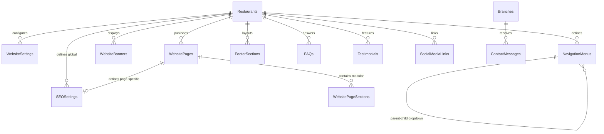

# Restaurant Management System (RMS)
## Phase 11: Dynamic Website CMS Service & Public Customer Frontend
### Inspection & Architecture Audit Report

---

### 1. Executive Summary & Phase Scope

**Phase 11** initiates the digital customer storefront and Content Management System (CMS) of the Restaurant Management System (RMS). The primary objectives are:
1. **Dynamic Customer-Facing Web Application**: A modern, mobile-responsive React.js application where 100% of website content (branding, hero sliders, seasonal banners, menu highlights, chef biographies, dining locations, reviews, FAQs, footer columns, and SEO tags) is dynamically driven by backend microservices rather than hardcoded code.
2. **Dynamic CMS Microservice (`cms-service`, Port `8004`, Gateway Prefix `/api/v1/cms`)**: A specialized Node.js + Express microservice delivering high-speed cached public APIs for customer portals and secure, authenticated management APIs for administrators.
3. **Database Layer (100% Stored Procedures)**: Operating against the 11 dedicated, normalized CMS tables already provisioned in `RestaurantManagementDB`, utilizing parameterized T-SQL procedures for all operations with ZERO Sequelize models.
4. **Cloudinary Asset Pipeline**: Secure, signed direct-from-client uploads with CDN transformations (WebP/AVIF, responsive widths) and automated asset deletion.
5. **Zero-Code Content Authoring**: Empowering restaurant managers and marketing staff to update homepages, reorder page sections via drag-and-drop, schedule seasonal banners, manage navigation links, and respond to customer inquiries in real time.

---

### 2. Codebase & Service Inspection

#### 2.1 Existing CMS Service (`backend/cms-service/`)
Inspection of `backend/cms-service/` reveals:
- **Port Assignment**: Port `8004` (configured in `.env` as `PORT_CMS_SERVICE=8004`, `URL_CMS_SERVICE=http://localhost:8004`).
- **Dependencies (`package.json`)**:
  - `express: ^4.21.2`, `cors: ^2.8.5`, `helmet: ^8.0.0`
  - `cloudinary: ^2.5.1` (installed and ready for media signing and asset destruction)
  - `ioredis: ^5.4.2` (for distributed page and navigation caching)
  - `multer: ^1.4.5-lts.1` (for file processing)
  - `tedious: ^18.6.1`, `sequelize: ^6.37.5` (used solely for database connection pooling via `@rms/shared`)
  - `winston: ^3.17.0`, `uuid: ^11.0.5`
- **Application Structure**:
  - `src/app.js`: Express application setup with Helmet, CORS, correlation ID middleware, request logger, and basic 404/error handlers.
  - `src/index.js`: Server bootloader listening on `PORT_CMS_SERVICE` (8004) with graceful shutdown hooks (`SIGTERM`, `SIGINT`).
  - `src/routes/health.js`: Standard health probes (`/health`, `/health/live`, `/health/ready`).
  - `src/controllers/`, `src/services/`, `src/repositories/`, `src/validators/`: Directory scaffolding exists with empty placeholder `index.js` files. No business logic or endpoints are currently implemented.

#### 2.2 API Gateway Integration (`backend/api-gateway/`)
Inspection of `backend/api-gateway/src/config/gatewayConfig.js` confirms:
- **Route Forwarding**:
  ```javascript
  {
    prefix: '/api/v1/cms',
    target: config.urls.cmsService, // http://localhost:8004
    name: 'cms-service',
  }
  ```
- **Public Whitelist Route Pattern**:
  ```javascript
  /^\/api\/v1\/cms\/public(\/.*)?$/
  ```
  Permits unauthenticated guest traffic to access public website settings, banners, navigation, pages, and contact forms without a JWT token.
- **Admin RBAC Route Pattern**:
  ```javascript
  {
    pattern: /^\/api\/v1\/cms\/admin(\/.*)?$/,
    allowedRoles: ['SUPER_ADMIN', 'RESTAURANT_MANAGER'],
  }
  ```
  Strictly blocks unauthorized callers and enforces that only users with `SUPER_ADMIN` or `RESTAURANT_MANAGER` roles can mutate website content.

#### 2.3 Shared Library Integration (`backend/shared/`)
- `backend/shared/config/database.js`: Singleton connection pool and stored procedure executor using `mssql` / `tedious`.
- `backend/shared/config/redis.js`: Singleton Redis client on `localhost:6379`.
- `backend/shared/utils/logger.js`: Winston structured logging with `X-Correlation-ID` tracing.
- `backend/shared/middlewares/serviceAuth.js`: Validates `X-Internal-Service-Key` for internal inter-service calls.

---

### 3. Database Inspection & Table-to-Function Mapping

#### 3.1 Existing Database Schema (`database/02_CreateTables.sql`)
The shared `RestaurantManagementDB` already defines **11 dedicated, normalized CMS tables** (tables 45 through 55 of the 55-table architecture):



#### 3.2 Complete Table-to-Function Mapping Matrix

| # | Table Name | Key Columns | Business Function & Public Feature | Admin CMS Feature |
| :---: | :--- | :--- | :--- | :--- |
| **1** | `dbo.WebsiteSettings` | `SettingId`, `RestaurantId`, `BranchId`, `SiteTitle`, `Tagline`, `HeaderLogoUrl`, `FooterLogoUrl`, `FaviconUrl`, `PrimaryColor`, `SecondaryColor`, `AccentColor`, `FontFamily`, `ContactEmail`, `ContactPhone`, `WhatsappNumber`, `AddressLine`, `GoogleMapsEmbedUrl`, `IsActive` | Delivers site-wide branding, dynamic CSS theme variables, header/footer logos, global contact phone, WhatsApp chat link, address, and interactive Google Map embed. | General Settings Console: update branding logos via Cloudinary, adjust theme hex color tokens, manage restaurant contact coordinates. |
| **2** | `dbo.SEOSettings` | `SEOId`, `RestaurantId`, `PageId`, `MetaTitle`, `MetaDescription`, `MetaKeywords`, `CanonicalUrl`, `OgTitle`, `OgDescription`, `OgImageUrl`, `TwitterCardType`, `StructuredDataJson`, `GoogleAnalyticsId`, `GoogleTagManagerId` | Provides search engine tags, Open Graph preview cards for Facebook/WhatsApp/LinkedIn, Twitter cards, and Schema.org `Restaurant` JSON-LD rich snippets. Supports global default and per-page overrides. | SEO Management Console: edit meta tags, upload custom social sharing images, configure Google Analytics/GTM IDs, validate Schema.org JSON-LD. |
| **3** | `dbo.WebsitePages` | `PageId`, `RestaurantId`, `BranchId`, `PageTitle`, `PageSlug`, `PageType`, `HeroBannerTitle`, `HeroBannerSubtitle`, `HeroImageUrl`, `ContentHtml`, `Status` (`DRAFT`, `PUBLISHED`, `ARCHIVED`), `PublishedAt`, `DisplayOrder`, `IsSystemPage`, `IsDeleted` | Powers standalone dynamic pages (`home`, `about-us`, `private-dining`, `catering`, `terms`, `privacy`). Delivers hero headers, rich HTML body, and publishing state filter. | Page Builder: create/edit custom landing pages, toggle Draft vs Published status, view live preview (`?preview=true`), protect system pages from deletion. |
| **4** | `dbo.WebsitePageSections` | `SectionId`, `PageId`, `SectionKey`, `SectionTitle`, `SectionSubtitle`, `ComponentType`, `ContentDataJson`, `BackgroundType`, `BackgroundColor`, `BackgroundImageUrl`, `DisplayOrder`, `IsActive` | Powers the Section Component Registry (`HERO_SLIDER`, `ABOUT_STORY`, `FEATURED_MENU`, `CHEF_FEATURE`, `SERVICES_LIST`, `STATS_COUNTER`, `TESTIMONIALS_GRID`, `FAQ_ACCORDION`, `RESERVATION_CTA`, `NEWSLETTER_FORM`, `MAP_CONTACT`, `CUSTOM_HTML`). Holds structured JSON configurations. | Drag-and-Drop Page Section Manager: add/remove modular sections, configure section parameters (JSON), reorder display sequence, toggle visibility. |
| **5** | `dbo.WebsiteBanners` | `BannerId`, `RestaurantId`, `BranchId`, `BannerTitle`, `Subtitle`, `BadgeText`, `ButtonText`, `ButtonLink`, `SecondaryButtonText`, `SecondaryButtonLink`, `ImageUrl`, `MobileImageUrl`, `BannerLocation`, `DisplayOrder`, `StartDate`, `EndDate`, `IsActive`, `IsDeleted` | Powers the Hero Carousel, promotional banner bars, and seasonal popup modals. Supports separate mobile images, dual CTA buttons, and start/end datetime scheduling. | Banner Management Console: upload desktop/mobile banners, schedule promotional campaigns with auto-expiry, reorder slide sequence, define CTA target links. |
| **6** | `dbo.NavigationMenus` | `MenuId`, `RestaurantId`, `ParentMenuId`, `MenuLocation`, `Title`, `TargetUrl`, `OpenInNewTab`, `DisplayOrder`, `IsActive`, `IconName` | Delivers structured navigation trees for Header Navbar, Quick Links, and Mobile Drawer Menu. Supports multi-level dropdowns via `ParentMenuId`. | Navigation Menu Builder: construct header and mobile navigation hierarchies, reorder menu items, configure external links (`OpenInNewTab`). |
| **7** | `dbo.FooterSections` | `FooterSectionId`, `RestaurantId`, `SectionTitle`, `ContentType` (`LINKS`, `RICH_TEXT`, `HOURS`, `NEWSLETTER`), `ContentHtml`, `DisplayOrder`, `IsActive` | Renders multi-column footer layouts: "About Bistro", "Operating Hours & Kitchen Timings", "Explore Links", and "Newsletter Signup". | Footer Layout Manager: edit footer columns, update operating hours text, customize links and disclaimer copy. |
| **8** | `dbo.FAQs` | `FAQId`, `RestaurantId`, `Category` (`GENERAL`, `RESERVATIONS`, `DELIVERY`, `DIETARY`, `EVENTS`), `Question`, `Answer`, `DisplayOrder`, `IsActive`, `IsDeleted` | Powers the FAQ Accordion section on Homepage and dedicated FAQ page, categorized for easy customer navigation. | FAQ Management Console: add/edit/categorize FAQs, reorder display order, soft-delete questions. |
| **9** | `dbo.Testimonials` | `TestimonialId`, `RestaurantId`, `AuthorName`, `AuthorRole`, `AuthorAvatarUrl`, `Rating` (1–5), `ReviewContent`, `SourcePlatform` (`GOOGLE`, `TRIPADVISOR`, `PRESS`), `IsFeatured`, `DisplayOrder`, `IsActive`, `IsDeleted` | Displays verified customer quotes, critic reviews, star ratings, and publication badges in carousel or grid layouts. | Testimonials Console: curate positive diner feedback and critic reviews, manage ratings, upload critic avatars. |
| **10** | `dbo.SocialMediaLinks` | `SocialLinkId`, `RestaurantId`, `PlatformName` (`INSTAGRAM`, `FACEBOOK`, `TWITTER_X`, `YOUTUBE`, `TRIPADVISOR`), `PlatformUrl`, `IconKey`, `DisplayOrder`, `IsActive` | Renders social media icon links in header bar, mobile drawer, and footer. | Social Media Manager: update restaurant social profiles and handle links. |
| **11** | `dbo.ContactMessages` | `MessageId`, `BranchId`, `SenderName`, `SenderEmail`, `SenderPhone`, `Subject`, `InquiryType` (`GENERAL`, `PRIVATE_EVENT`, `FEEDBACK`, `CATERING`), `MessageBody`, `Status` (`UNREAD`, `READ`, `REPLIED`, `ARCHIVED`), `AdminReplyNotes`, `RepliedByUserId`, `RepliedAt`, `CreatedAt`, `IsDeleted` | Ingestion table for guest contact messages, event booking inquiries, and catering requests from the public site. Automatically triggers staff notifications. | Guest Inquiries Console: view unread messages, filter by branch/type, record internal reply notes, update resolution status. |

#### 3.3 Foreign Keys & Indexing State
- Foreign keys in `database/03_CreateRelationships.sql` (lines 476–561):
  - `FK_WebsiteSettings_Restaurants` (CASCADE), `FK_WebsiteSettings_Branches` (NO ACTION).
  - `FK_WebsitePages_Restaurants` (CASCADE), `FK_WebsitePages_Branches` (NO ACTION).
  - `FK_SEOSettings_Restaurants` (CASCADE), `FK_SEOSettings_WebsitePages` (NO ACTION).
  - `FK_WebsitePageSections_WebsitePages` (CASCADE).
  - `FK_WebsiteBanners_Restaurants` (CASCADE), `FK_WebsiteBanners_Branches` (NO ACTION).
  - `FK_NavigationMenus_Restaurants` (CASCADE), `FK_NavigationMenus_Parent` (NO ACTION).
  - `FK_FooterSections_Restaurants` (CASCADE).
  - `FK_FAQs_Restaurants` (CASCADE).
  - `FK_Testimonials_Restaurants` (CASCADE).
  - `FK_SocialMediaLinks_Restaurants` (CASCADE).
  - `FK_ContactMessages_Branches` (SET NULL), `FK_ContactMessages_Users_RepliedBy` (NO ACTION).
- High-Performance Non-Clustered Indexes in `database/04_CreateIndexes.sql` (lines 263–345):
  - `IX_WebsiteSettings_Restaurant_Branch`
  - `IX_WebsitePages_Slug` (Filtered `WHERE IsDeleted = 0`)
  - `IX_WebsitePages_Status_Display` (Filtered `WHERE IsDeleted = 0`)
  - `IX_WebsitePageSections_Page_Display` (Filtered `WHERE IsActive = 1`)
  - `IX_WebsiteBanners_Location_Display` (Filtered `WHERE IsDeleted = 0 AND IsActive = 1`)
  - `IX_NavigationMenus_Location_Display` (Filtered `WHERE IsActive = 1`)
  - `IX_FooterSections_Display` (Filtered `WHERE IsActive = 1`)
  - `IX_FAQs_Category_Display` (Filtered `WHERE IsDeleted = 0 AND IsActive = 1`)
  - `IX_Testimonials_Featured_Display` (Filtered `WHERE IsDeleted = 0 AND IsActive = 1`)
  - `IX_SocialMediaLinks_Display` (Filtered `WHERE IsActive = 1`)
  - `IX_ContactMessages_Status_Date` (Filtered `WHERE IsDeleted = 0`)
  - `IX_SEOSettings_PageId`

#### 3.4 Stored Procedure Inventory Audit
In `database/06_StoredProcedures.sql`, 3 procedures were authored during Phase 2:
1. `dbo.sp_GetPublicPageWithSections`: Multi-recordset query returning page metadata + SEO tags, ordered active sections, and active hero banners for home.
2. `dbo.sp_ReorderPageSections`: Atomic transaction reordering sections from JSON.
3. `dbo.sp_SubmitContactMessage`: Inserts guest message and dispatches notification.

**Audit Finding**: While these 3 legacy procedures exist, the CMS requires **39 additional single-responsibility stored procedures** (SPs 163 through 204) to provide complete admin CRUD operations, drafting/publishing toggles, banner scheduling, navigation tree manipulation, footer editing, FAQ management, testimonial curation, and message resolution. These will be authored in `database/15_CMSStoredProcedures.sql`.

---

### 4. Frontend Workspace & React Architecture Inspection

#### 4.1 Current Repository State
- No `frontend/` directory currently exists in the root workspace.
- The project structure currently houses:
  - `backend/` (14 microservices + shared library)
  - `database/` (SQL scripts and unit tests)
  - `documentation/` (system and API specifications)
  - `infrastructure/` (Nginx and Redis configurations)
  - `scripts/` (startup and automated test suites)

#### 4.2 Frontend Architecture Recommendation
To fulfill Phase 11 without disrupting the microservices backend structure:
- **Location**: `frontend/customer-web/` (Vite + React.js 18 + Tailwind CSS).
- **Architecture Pattern**:
  - **Section Component Registry**: Dynamic page rendering from backend JSON blocks.
  - **Data Fetching & Cache**: TanStack Query (React Query v5) with Stale-While-Revalidate (SWR) for instant page rendering.
  - **Routing**: `react-router-dom` v6 supporting `/`, `/menu`, `/menu/:itemId`, `/about`, `/contact`, `/locations`, and dynamic slug catch-all `/:slug`.
  - **SEO & Meta**: `react-helmet-async` injecting dynamic titles, OpenGraph meta tags, and Schema.org JSON-LD scripts.
  - **Theme System**: Dynamic CSS custom properties (`--primary-color`, `--secondary-color`, `--font-family`) populated on load from `GET /api/v1/cms/public/settings`.

---

### 5. Media Pipeline & Cloudinary Configuration

- **Environment Config**: Root `.env` contains:
  ```env
  CLOUDINARY_CLOUD_NAME=demo
  CLOUDINARY_API_KEY=123456789012345
  CLOUDINARY_API_SECRET=abcdefghijklmnopqrstuvwxyz1234
  ```
- **Operational Pattern**:
  - **Upload Signing**: Frontend calls `POST /api/v1/cms/admin/media/sign-upload` with folder name. Backend uses `cloudinary.utils.api_sign_request()` with API secret to return a timestamp and HMAC signature. Frontend uploads directly to Cloudinary CDN via multipart form data.
  - **Asset Destruction**: When a banner, page hero, or avatar is replaced or deleted, the backend invokes `cloudinary.v2.uploader.destroy(publicId)` to prevent orphaned cloud storage costs.

---

### 6. Architectural Checklist & Guardrails

- [x] Service Port `8004` strictly preserved.
- [x] API Gateway prefix `/api/v1/cms` verified.
- [x] Zero Sequelize ORM models or associations; 100% Parameterized Stored Procedures.
- [x] Zero direct database writes across service boundaries.
- [x] Shared `RestaurantManagementDB` on `localhost:1435` preserved.
- [x] Shared Redis caching on `localhost:6379` preserved.
- [x] Single root `.env` configuration preserved.
- [x] Stopped after inspection; awaiting user sign-off before implementation.

