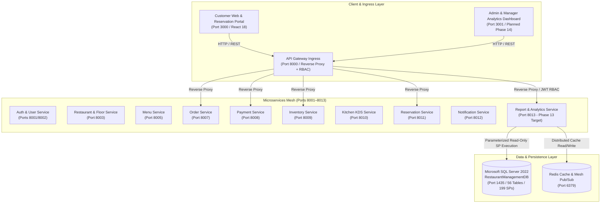
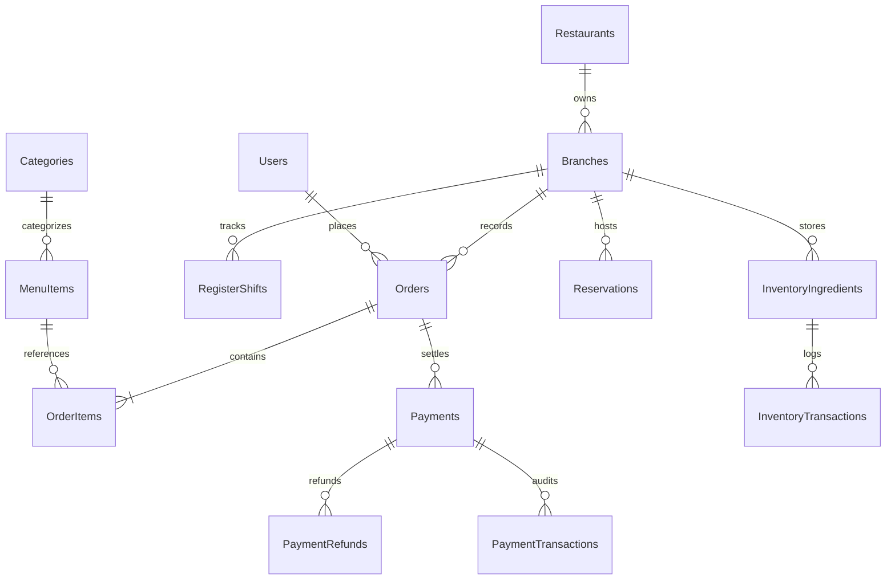
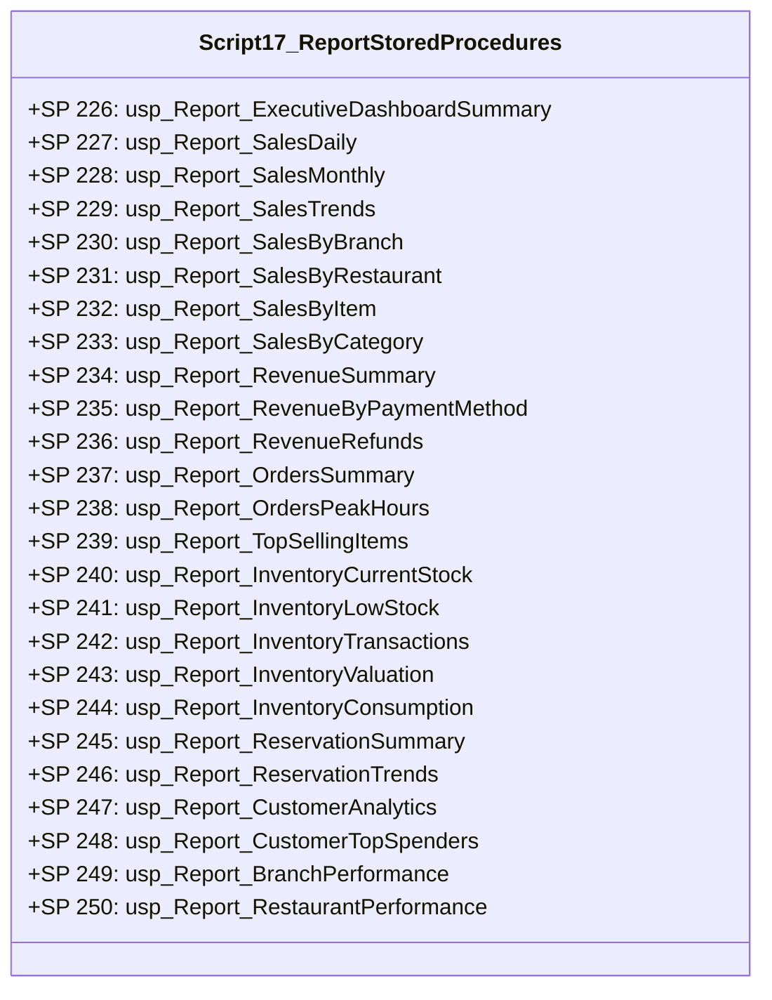
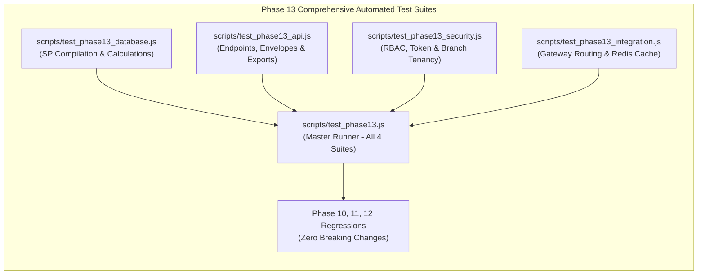
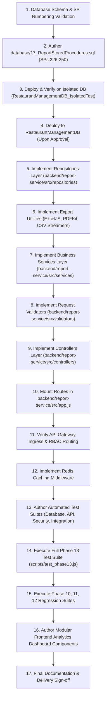

# PHASE 13 – REPORT SERVICE & ANALYTICS DASHBOARD
## Comprehensive Architecture Inspection, System Audit & Corrected Implementation Plan

**Document Version:** 1.1.0 (Corrected Pre-Implementation Architecture Plan)  
**Status:** ARCHITECTURE AUDITED & CORRECTED – PENDING FINAL USER APPROVAL  
**Author:** Senior Microservices Architect, SQL Server Database Architect & Full Stack Analytics Engineer  
**Date:** November 17, 2026  
**Target Microservice:** `rms-report-service` (Port 8013)  
**Ingress Gateway Prefix:** `/api/v1/reports`  
**Shared Database:** `RestaurantManagementDB` (Microsoft SQL Server 2022)  
**Isolated Test Target:** `RestaurantManagementDB_IsolatedTest`  
**Distributed Cache:** Redis 7 (Port 6379)  

---

## 1. Existing Architecture Summary & Service Ownership Boundaries

The Restaurant Management System (RMS) is built on an enterprise-grade, distributed, pure microservices architecture. All services operate as independent Node.js Express daemons communicating with clients and external systems through a unified API Gateway.



### Architectural Tenets & Service Demarcation
1. **Shared Database Architecture:** All 14 microservices connect to `RestaurantManagementDB` via the shared connection pool defined in `backend/shared/config/database.js`.
2. **Zero Sequelize ORM Models:** Database interactions are executed strictly through 100% Parameterized Stored Procedures using `executeProcedure()` and native `mssql` connection pooling. There are **zero** ORM models, zero entity associations, and zero runtime table-generation scripts.
3. **Layered Pattern:** Every service strictly adheres to `Routes -> Middleware -> Controllers -> Services -> Repositories -> Database Stored Procedures`.
4. **Inter-Service Communication:** Strict HTTP REST communication authenticated via `X-Internal-Service-Key` and tracked by `X-Correlation-ID`. No message broker (Kafka, RabbitMQ) is permitted.
5. **Strict Service Ownership & Permitted Reporting Access:**
   - Operational microservices (`order-service`, `payment-service`, `inventory-service`, etc.) maintain sole authority for mutating their respective operational tables.
   - `report-service` acts strictly as an **analytical consumer**. It possesses **zero mutation rights** over transactional operational tables (`Orders`, `Payments`, `InventoryIngredients`, `Reservations`, `Users`).
   - Under our shared database architecture, cross-domain reporting queries are **permitted exclusively via dedicated, read-only stored procedures** named `dbo.usp_Report_*`.
   - `report-service` will **never** issue direct `INSERT`, `UPDATE`, `DELETE`, or `ALTER TABLE` statements against any database object.
   - Any proposed cross-service access outside the approved read-only `dbo.usp_Report_*` catalog requires formal architectural sign-off.

---

## 2. Report Service Status

A thorough inspection of `backend/report-service/` was performed to identify existing files, dependencies, configurations, and stubs:

| Component / Artifact | Current File Path | Status | Analysis & Findings |
|---|---|---|---|
| Service Manifest | `backend/report-service/package.json` | **PARTIALLY IMPLEMENTED** | Name `rms-report-service`, version `1.0.0`. Contains `exceljs: ^4.4.0`, `pdfkit: ^0.16.0`, `express: ^4.21.2`, `helmet: ^8.0.0`, `cors: ^2.8.5`, `dotenv: ^16.4.7`, `winston: ^3.17.0`, `uuid: ^11.0.5`, `axios: ^1.7.9`. |
| Container Config | `backend/report-service/Dockerfile` | **ALREADY IMPLEMENTED** | Standard Node.js 20 Alpine container setup copying shared packages and report service. |
| Application Bootloader | `backend/report-service/src/index.js` | **ALREADY IMPLEMENTED** | Listens on `config.ports.reportService` (8013). Handles graceful SIGTERM/SIGINT shutdown. |
| Express App Config | `backend/report-service/src/app.js` | **PARTIALLY IMPLEMENTED** | Configured with Helmet, CORS, Correlation ID, and Request Logger. Only mounts health routes. Lacks reporting routes. |
| Health Probes | `backend/report-service/src/routes/health.js` | **PARTIALLY IMPLEMENTED** | Implements `/health`, `/health/live`, `/health/ready`. `/health/ready` stub will be updated during Phase 13 implementation to verify DB connection pool readiness. |
| API Gateway Routing | `backend/api-gateway/src/config/gatewayConfig.js` | **ALREADY IMPLEMENTED** | Ingress prefix `/api/v1/reports` mapped to port 8013. RBAC restricted to `['SUPER_ADMIN', 'RESTAURANT_MANAGER']`. |
| Shared Environment | `backend/shared/config/env.js` | **ALREADY IMPLEMENTED** | Configured with `ports.reportService = 8013` and `urls.reportService = 'http://localhost:8013'`. |
| Controllers Layer | `backend/report-service/src/controllers/` | **NOT IMPLEMENTED** | Directory exists; empty. |
| Services Layer | `backend/report-service/src/services/` | **NOT IMPLEMENTED** | Directory exists; empty. |
| Repositories Layer | `backend/report-service/src/repositories/` | **NOT IMPLEMENTED** | Contains empty stub `index.js`. No reporting repository implemented. |
| Validators Layer | `backend/report-service/src/validators/` | **NOT IMPLEMENTED** | Contains empty stub `index.js`. No query param validation implemented. |
| Export Generators | `backend/report-service/src/utils/` | **NOT IMPLEMENTED** | Contains empty stub `index.js`. ExcelJS/PDFKit export formatters not yet authored. |
| Stored Procedures | `database/17_ReportStoredProcedures.sql` | **NOT IMPLEMENTED** | File does not yet exist. Procedures SP 226–SP 250 will be authored in this script. |

---

## 3. Database Table Inventory & Schema Inspection

Inspection of `database/02_CreateTables.sql`, `database/03_CreateRelationships.sql`, `database/04_CreateIndexes.sql`, and completed phase migrations reveals 56 operational tables. Below is the comprehensive inventory of tables relevant to analytics, their column specifications, constraints, and analytical indexing:



### Table 1: `dbo.Orders`
- **Owning Microservice:** Order Service (`rms-order-service`, port 8007)
- **Primary Key:** `OrderId BIGINT IDENTITY(100001,1)`
- **Core Columns:**
  - `BranchId INT NOT NULL` (FK -> `dbo.Branches`)
  - `OrderNumber NVARCHAR(35) NOT NULL` (Unique)
  - `OrderType NVARCHAR(30) NOT NULL DEFAULT 'DINE_IN'` ('DINE_IN', 'TAKEAWAY', 'DELIVERY')
  - `TableId INT NULL` (FK -> `dbo.RestaurantTables`)
  - `CustomerId BIGINT NULL` (FK -> `dbo.Users`, nullable for walk-ins)
  - `GuestName NVARCHAR(100) NULL`
  - `GuestPhone NVARCHAR(25) NULL`
  - `WaitstaffUserId BIGINT NULL` (FK -> `dbo.Users`)
  - `OrderStatus NVARCHAR(30) NOT NULL DEFAULT 'PLACED'` ('PLACED', 'ACCEPTED', 'PREPARING', 'READY', 'SERVED', 'COMPLETED', 'CANCELLED', 'VOIDED')
  - `PaymentStatus NVARCHAR(30) NOT NULL DEFAULT 'PENDING'` ('PENDING', 'PARTIALLY_PAID', 'PAID', 'REFUNDED')
  - `SubTotal DECIMAL(10,2) NOT NULL DEFAULT 0.00`
  - `TaxTotal DECIMAL(10,2) NOT NULL DEFAULT 0.00`
  - `ServiceCharge DECIMAL(10,2) NOT NULL DEFAULT 0.00`
  - `PackagingCharge DECIMAL(10,2) NOT NULL DEFAULT 0.00`
  - `DiscountTotal DECIMAL(10,2) NOT NULL DEFAULT 0.00`
  - `TipAmount DECIMAL(10,2) NOT NULL DEFAULT 0.00`
  - `GrandTotal DECIMAL(10,2) NOT NULL DEFAULT 0.00`
  - `CreatedAt DATETIME2(3) NOT NULL DEFAULT SYSUTCDATETIME()`
  - `UpdatedAt DATETIME2(3) NOT NULL DEFAULT SYSUTCDATETIME()`
  - `IsDeleted BIT NOT NULL DEFAULT 0`
- **Existing Indexes:**
  - `PK_Orders` (Clustered on `OrderId`)
  - `UQ_Orders_OrderNumber` (Unique on `OrderNumber`)
  - `IX_Orders_Branch_Status_Date` on `(BranchId, OrderStatus, CreatedAt DESC) INCLUDE (OrderId, OrderNumber, OrderType, TableId, CustomerId, GrandTotal, PaymentStatus) WHERE IsDeleted = 0`
  - `IX_Orders_Customer_History` on `(CustomerId, CreatedAt DESC) WHERE CustomerId IS NOT NULL AND IsDeleted = 0`

### Table 2: `dbo.OrderItems`
- **Owning Microservice:** Order Service (`rms-order-service`, port 8007)
- **Primary Key:** `OrderItemId BIGINT IDENTITY(1,1)`
- **Core Columns:**
  - `OrderId BIGINT NOT NULL` (FK -> `dbo.Orders`)
  - `MenuItemId BIGINT NOT NULL` (FK -> `dbo.MenuItems`)
  - `VariantId BIGINT NULL` (FK -> `dbo.MenuItemVariants`)
  - `ItemNameSnapshot NVARCHAR(120) NOT NULL` (Historical price/name lock)
  - `VariantNameSnapshot NVARCHAR(60) NULL`
  - `UnitPrice DECIMAL(10,2) NOT NULL`
  - `Quantity INT NOT NULL DEFAULT 1`
  - `ItemTotal DECIMAL(10,2) NOT NULL`
  - `ItemStatus NVARCHAR(30) NOT NULL DEFAULT 'PENDING'`
  - `CreatedAt DATETIME2(3) NOT NULL DEFAULT SYSUTCDATETIME()`
- **Existing Indexes:**
  - `PK_OrderItems` (Clustered on `OrderItemId`)
  - `IX_OrderItems_OrderId` on `(OrderId) INCLUDE (OrderItemId, MenuItemId, VariantId, ItemNameSnapshot, Quantity, ItemTotal, ItemStatus)`

### Table 3: `dbo.Payments`
- **Owning Microservice:** Payment Service (`rms-payment-service`, port 8008)
- **Primary Key:** `PaymentId BIGINT IDENTITY(1,1)`
- **Core Columns:**
  - `OrderId BIGINT NOT NULL` (FK -> `dbo.Orders`)
  - `BranchId INT NOT NULL` (FK -> `dbo.Branches`)
  - `PaymentReference NVARCHAR(60) NOT NULL` (Unique)
  - `PaymentMethod NVARCHAR(30) NOT NULL` ('RAZORPAY', 'CASH', 'CREDIT_CARD', 'DEBIT_CARD', 'UPI_OFFLINE', 'SPLIT')
  - `Amount DECIMAL(10,2) NOT NULL`
  - `PaymentStatus NVARCHAR(30) NOT NULL DEFAULT 'PENDING'` ('PENDING', 'SUCCESS', 'FAILED', 'REFUNDED')
  - `SettledByUserId BIGINT NULL`
  - `SettledAt DATETIME2(3) NULL`
  - `CreatedAt DATETIME2(3) NOT NULL DEFAULT SYSUTCDATETIME()`
- **Existing Indexes:**
  - `PK_Payments` (Clustered on `PaymentId`)
  - `IX_Payments_OrderId` on `(OrderId, PaymentStatus) INCLUDE (PaymentReference, Amount, PaymentMethod)`

### Table 4: `dbo.PaymentTransactions`
- **Owning Microservice:** Payment Service (`rms-payment-service`, port 8008)
- **Primary Key:** `TransactionId BIGINT IDENTITY(1,1)`
- **Core Columns:**
  - `PaymentId BIGINT NOT NULL` (FK -> `dbo.Payments`)
  - `TransactionType NVARCHAR(30) NOT NULL` ('CHARGE', 'WEBHOOK_CAPTURE', 'REFUND')
  - `Amount DECIMAL(10,2) NOT NULL`
  - `GatewayTransactionId NVARCHAR(120) NULL`
  - `Status NVARCHAR(30) NOT NULL DEFAULT 'SUCCESS'`
  - `TransactionDate DATETIME2(3) NOT NULL DEFAULT SYSUTCDATETIME()`
- **Existing Indexes:**
  - `PK_PaymentTransactions` (Clustered on `TransactionId`)

### Table 5: `dbo.PaymentRefunds`
- **Owning Microservice:** Payment Service (`rms-payment-service`, port 8008)
- **Primary Key:** `RefundId BIGINT IDENTITY(1,1)`
- **Core Columns:**
  - `PaymentId BIGINT NOT NULL` (FK -> `dbo.Payments`)
  - `GatewayRefundId NVARCHAR(100) NULL`
  - `RefundAmount DECIMAL(10,2) NOT NULL`
  - `Reason NVARCHAR(255) NOT NULL`
  - `Status NVARCHAR(30) NOT NULL DEFAULT 'PROCESSED'` ('INITIATED', 'PROCESSED', 'FAILED')
  - `InitiatedByUserId BIGINT NOT NULL`
  - `ProcessedAt DATETIME2(3) NOT NULL DEFAULT SYSUTCDATETIME()`
  - `CreatedAt DATETIME2(3) NOT NULL DEFAULT SYSUTCDATETIME()`

### Table 6: `dbo.RegisterShifts`
- **Owning Microservice:** Restaurant / POS Service (`rms-restaurant-service`, port 8003)
- **Primary Key:** `ShiftId BIGINT IDENTITY(1,1)`
- **Core Columns:**
  - `BranchId INT NOT NULL`, `CashierUserId BIGINT NOT NULL`
  - `OpenedAt DATETIME2(3) NOT NULL`, `ClosedAt DATETIME2(3) NULL`
  - `OpeningFloat DECIMAL(10,2) NOT NULL DEFAULT 0.00`
  - `TotalCashSales DECIMAL(10,2) NOT NULL DEFAULT 0.00`
  - `TotalCardSales DECIMAL(10,2) NOT NULL DEFAULT 0.00`
  - `TotalUpiSales DECIMAL(10,2) NOT NULL DEFAULT 0.00`
  - `TotalRefunds DECIMAL(10,2) NOT NULL DEFAULT 0.00`
  - `ExpectedCash DECIMAL(10,2) NOT NULL DEFAULT 0.00`
  - `ActualCashCounted DECIMAL(10,2) NOT NULL DEFAULT 0.00`
  - `CashDifference DECIMAL(10,2) NOT NULL DEFAULT 0.00` (Cash Over / Short)
  - `Status NVARCHAR(20) NOT NULL DEFAULT 'OPEN'` ('OPEN', 'CLOSED')

---

## 4. Existing Stored Procedure Inventory & Reuse Analysis

An audit of all 16 existing SQL migration scripts was conducted to identify any reporting or summary procedures already deployed:

| Stored Procedure Name | Script / Number | Current Owning Service | Purpose & Tables Accessed | Reuse Assessment |
|---|---|---|---|---|
| `dbo.usp_Payment_GetReconciliationSummary` | Script 13 (SP 144) | `rms-payment-service` | Aggregates payment collections and refunds for a single date/branch from `Payments` and `PaymentRefunds`. | **PARTIAL REUSE:** Good for payment settlement audit, but does not join order discounts, line items, or tax categories. |
| `dbo.usp_Inventory_GetValuationReport` | Script 12 (SP 124) | `rms-inventory-service` | Aggregates category valuation and overall low stock count from `InventoryIngredients`. | **FULL REUSE:** Reusable directly for `GET /api/v1/reports/inventory/valuation`. |
| `dbo.usp_Inventory_GetConsumptionReport` | Script 12 (SP 125) | `rms-inventory-service` | Computes 30-day ingredient consumption and wastage cost from `InventoryTransactions`. | **FULL REUSE:** Reusable directly for `GET /api/v1/reports/inventory/consumption`. |
| `dbo.usp_Inventory_GetLowStockAlerts` | Script 12 (SP 122) | `rms-inventory-service` | Returns ingredients where `CurrentStock <= ReorderLevel`. | **FULL REUSE:** Reusable directly for `GET /api/v1/reports/inventory/low-stock`. |
| `dbo.usp_Reservation_GetDashboardSummary` | Script 16 (SP 221) | `rms-reservation-service` | Summarizes bookings, seated covers, and no-shows for a single branch and single target date. | **PARTIAL REUSE:** Limited to single-day branch summary. Does not support date-range trend lines or cross-branch rollups. |

---

## 5. Reporting Data Availability Matrix

| Reporting Metric / Dimension | Source Table(s) | Availability Status | Notes & Constraints |
|---|---|---|---|
| **Gross Sales (`SubTotal`)** | `dbo.Orders` | **AVAILABLE** | Complete. Value before discounts, taxes, and fees. |
| **Total Discounts** | `dbo.Orders` | **AVAILABLE** | Complete. Billed discounts and coupons. |
| **Total Taxes (GST/VAT)** | `dbo.Orders` | **AVAILABLE** | Complete. Item-level tax rollup. |
| **Net Sales (`GrandTotal`)** | `dbo.Orders` | **AVAILABLE** | Complete. Final bill value payable by diner. |
| **Collected Revenue** | `dbo.Payments` | **AVAILABLE** | Realized collections (`SUCCESS` or `REFUNDED`). |
| **Processed Refunds** | `dbo.PaymentRefunds` | **AVAILABLE** | Realized refunds (`PROCESSED`). |
| **Order Volume by Hour** | `dbo.Orders` | **AVAILABLE** | Accurate via `Orders.CreatedAt`. |
| **Menu Item Velocity** | `dbo.OrderItems` | **AVAILABLE** | Historical snapshot preserved. |
| **Table Turn Times** | `dbo.OrderStatusHistory` | **PARTIALLY AVAILABLE** | Timestamps from `PLACED` to `SERVED`/`COMPLETED`. |
| **Inventory Stock & Valuation** | `dbo.InventoryIngredients` | **AVAILABLE** | Current units multiplied by unit cost. |
| **Ingredient Depletion & Spoilage**| `dbo.InventoryTransactions` | **AVAILABLE** | Automated recipe BOM depletion. |
| **Reservation Covers & No-shows** | `dbo.Reservations` | **AVAILABLE** | Covers and lifecycle tracked. |
| **Customer Order Frequency** | `dbo.Orders`, `dbo.Users` | **AVAILABLE (Registered)** | Accurate for registered users (`CustomerId IS NOT NULL`). |
| **Website Page Views / Clicks** | *None* | **NOT IMPLEMENTED** | No telemetry or session tracking tables exist. |

---

## 6. Data Ownership & Boundary Analysis

Under the RMS pure microservices architecture:
1. Operational table mutation is strictly reserved for the domain service owning the table.
2. The Report Service is granted **read-only database access** across `RestaurantManagementDB` exclusively through dedicated stored procedures (`dbo.usp_Report_*`).
3. Report Service executes **zero** mutations (`INSERT`, `UPDATE`, `DELETE`) on operational tables.
4. Cross-domain queries (e.g. correlating Orders with Payments, Menu Items, and Branches) are executed server-side in SQL Server to provide sub-millisecond aggregations without requiring distributed HTTP joins.
5. All cross-service reporting queries are formally registered in the architecture catalog and approved under the shared database governance policy.

---

## 7. Reporting Gaps & Constraints

1. **CMS & Web Telemetry Tracking:** `RestaurantManagementDB` contains static CMS content tables, but **zero web tracking tables** (no page views, clickstreams, or visitor sessions). Web visitor analytics is marked **NOT IMPLEMENTED / BLOCKED BY MISSING TRACKING DATA**. CMS reporting is strictly limited to published content counts and contact message inquiry counts.
2. **Anonymous Walk-In Customer Analytics:** Walk-in POS orders have `CustomerId = NULL`. Customer lifetime value (LTV) and repeat-visit metrics are calculated strictly on registered accounts (`CustomerId IS NOT NULL`) or phone-deduplicated guest records.
3. **Food Delivery Transit Time:** Only `EstimatedDeliveryMinutes` exists on `Orders`; actual driver GPS transit times are unrecorded.

---

## 8. Executive Dashboard Requirements

The Executive Dashboard consolidates critical operational KPIs into a single response:
- **Total Net Revenue:** Realized cash collected minus processed refunds during the target window.
- **Total Orders Placed:** Valid orders (`OrderStatus NOT IN ('CANCELLED', 'VOIDED')`).
- **Average Order Value (AOV):** `Net Sales / Total Valid Orders`.
- **Order Completion Rate:** `(Completed Orders / Total Valid Orders) * 100`.
- **Total Covers / Guests:** Sum of seated and completed covers across Dine-In orders and reservations.
- **Low Stock Alerts Count:** Number of active ingredients at or below `MinimumStockLevel`.
- **Cash Drawer Discrepancy:** Net cash over/short variance across register shifts.

---

## 9. Sales Reporting Plan

1. **Daily Sales (`GET /api/v1/reports/sales/daily`):** Date, Order Count, Gross Sales, Discounts, Taxes, Delivery Fees, Tips, Net Sales, AOV.
2. **Monthly Sales (`GET /api/v1/reports/sales/monthly`):** Year, Month, Orders, Net Sales, Month-over-Month Growth %.
3. **Sales Trends (`GET /api/v1/reports/sales/trends`):** Grouped by `HOUR`, `DAY`, `WEEK`, or `MONTH`.
4. **Sales by Branch (`GET /api/v1/reports/sales/branches`):** Cross-branch comparative revenue, order volume, and contribution %.
5. **Sales by Menu Item (`GET /api/v1/reports/sales/items`):** Quantity sold, revenue contribution, and average selling price.
6. **Sales by Category (`GET /api/v1/reports/sales/categories`):** Category volume and revenue share.

---

## 10. Financial Accuracy, Exact Formulas & Cartesian Join Prevention

### Detailed Financial KPI Definitions

| Financial Metric | Exact Business Formula | Source Tables & Columns | Inclusion & Filter Rules |
|---|---|---|---|
| **Gross Sales** | $\sum(\text{SubTotal})$ | `dbo.Orders.SubTotal` | Valid orders: `OrderStatus NOT IN ('CANCELLED', 'VOIDED')` AND `IsDeleted = 0`. Filtered on `Orders.CreatedAt`. |
| **Total Discounts** | $\sum(\text{DiscountTotal})$ | `dbo.Orders.DiscountTotal` | Valid orders: `OrderStatus NOT IN ('CANCELLED', 'VOIDED')` AND `IsDeleted = 0`. Filtered on `Orders.CreatedAt`. |
| **Total Taxes** | $\sum(\text{TaxTotal})$ | `dbo.Orders.TaxTotal` | Valid orders: `OrderStatus NOT IN ('CANCELLED', 'VOIDED')` AND `IsDeleted = 0`. Filtered on `Orders.CreatedAt`. |
| **Total Additional Charges** | $\sum(\text{ServiceCharge} + \text{PackagingCharge} + \text{TipAmount})$ | `dbo.Orders.ServiceCharge`, `PackagingCharge`, `TipAmount` | Valid orders: `OrderStatus NOT IN ('CANCELLED', 'VOIDED')` AND `IsDeleted = 0`. Filtered on `Orders.CreatedAt`. |
| **Net Sales (Billed Total)** | $\sum(\text{GrandTotal})$ | `dbo.Orders.GrandTotal` | Valid orders: `OrderStatus NOT IN ('CANCELLED', 'VOIDED')` AND `IsDeleted = 0`. Equal to `Gross Sales - Discounts + Taxes + Charges`. |
| **Collected Revenue (Gross Inflow)**| $\sum(\text{Amount})$ | `dbo.Payments.Amount` | Realized payments: `PaymentStatus IN ('SUCCESS', 'REFUNDED')`. Filtered on `Payments.SettledAt` (or `CreatedAt`) within target window. |
| **Processed Refunds (Cash Outflow)**| $\sum(\text{RefundAmount})$ | `dbo.PaymentRefunds.RefundAmount` | Completed refunds: `Status = 'PROCESSED'`. Filtered on `PaymentRefunds.ProcessedAt` (or `CreatedAt`) within target window. |
| **Net Revenue (Net Cash Flow)** | $\text{Collected Revenue} - \text{Processed Refunds}$ | Derived from `Payments` and `PaymentRefunds` | Net cash retained in business during target period. |
| **Average Order Value (AOV)** | $\frac{\text{Net Sales}}{\text{Total Valid Orders}}$ | `dbo.Orders.GrandTotal`, `dbo.Orders.OrderId` | Computed strictly over orders with `OrderStatus NOT IN ('CANCELLED', 'VOIDED')`. |
| **Reconciliation Discrepancy** | $\text{Net Sales} - \text{Net Revenue}$ | `Orders`, `Payments`, `PaymentRefunds` | Measures uncollected balances, pending settlements, or payment timing differences. |

### Handling Refunded Payments Correctly
When a payment is refunded:
- In `dbo.Payments`: A payment originally captured for ₹1,000 has `Amount = 1000.00`. If fully refunded, its `PaymentStatus` transitions from `'SUCCESS'` to `'REFUNDED'`.
- In `dbo.PaymentRefunds`: A corresponding refund record is inserted with `RefundAmount = 1000.00` and `Status = 'PROCESSED'`.
- **Accounting Rule:** A payment that transitions to `'REFUNDED'` must **NOT** be treated as a newly collected payment in the refund period.
  - If a payment occurred in Window A and was refunded in Window B:
    - Window A: `Collected Revenue = 1000`, `Refunds = 0`, `Net Revenue = 1000`.
    - Window B: `Collected Revenue = 0` (no new payment), `Refunds = 1000`, `Net Revenue = -1000` (correct cash outflow).
  - If a payment occurred in Window A and was refunded in Window A:
    - Window A: `Collected Revenue = 1000`, `Refunds = 1000`, `Net Revenue = 0` (net zero cash impact).

### Prevention of Cartesian Joins & Duplicate Counting
In relational reporting, joining `Orders` directly to child collections (`OrderItems`, `Payments`, `PaymentTransactions`) produces a Cartesian product ($M \times N \times P$ rows). For example, an order with 4 items and 2 payments results in 8 joined rows, causing `SUM(GrandTotal)` to be multiplied by 8 and `SUM(ItemTotal)` to be multiplied by 2.

**Mandatory Query Pattern in all Phase 13 Stored Procedures:**
1. **Never perform multi-level child joins without pre-aggregation.**
2. **Use independent Common Table Expressions (CTEs) or derived subqueries** to aggregate each child domain to the `OrderId` or `BranchId` grain before joining:

```sql
-- Exemplary Non-Cartesian Financial Aggregation Pattern:
WITH OrderTotals AS (
    SELECT 
        o.BranchId,
        COUNT(1) AS TotalOrders,
        SUM(o.SubTotal) AS GrossSales,
        SUM(o.DiscountTotal) AS TotalDiscounts,
        SUM(o.TaxTotal) AS TotalTaxes,
        SUM(o.GrandTotal) AS NetSales
    FROM dbo.Orders o
    WHERE o.OrderStatus NOT IN ('CANCELLED', 'VOIDED') 
      AND o.IsDeleted = 0
      AND (@BranchId IS NULL OR o.BranchId = @BranchId)
      AND (@StartDate IS NULL OR o.CreatedAt >= @StartDate)
      AND (@EndDate IS NULL OR o.CreatedAt <= @EndDate)
    GROUP BY o.BranchId
),
PaymentTotals AS (
    SELECT 
        p.BranchId,
        SUM(CASE WHEN p.PaymentStatus IN ('SUCCESS', 'REFUNDED') THEN p.Amount ELSE 0.00 END) AS CollectedRevenue
    FROM dbo.Payments p
    WHERE (@BranchId IS NULL OR p.BranchId = @BranchId)
      AND (@StartDate IS NULL OR p.CreatedAt >= @StartDate)
      AND (@EndDate IS NULL OR p.CreatedAt <= @EndDate)
    GROUP BY p.BranchId
),
RefundTotals AS (
    SELECT 
        p.BranchId,
        SUM(pr.RefundAmount) AS TotalRefunds
    FROM dbo.PaymentRefunds pr
    JOIN dbo.Payments p ON pr.PaymentId = p.PaymentId
    WHERE pr.Status = 'PROCESSED'
      AND (@BranchId IS NULL OR p.BranchId = @BranchId)
      AND (@StartDate IS NULL OR pr.ProcessedAt >= @StartDate)
      AND (@EndDate IS NULL OR pr.ProcessedAt <= @EndDate)
    GROUP BY p.BranchId
)
SELECT 
    b.BranchId,
    b.BranchName,
    ISNULL(ot.TotalOrders, 0) AS TotalOrders,
    ISNULL(ot.GrossSales, 0.00) AS GrossSales,
    ISNULL(ot.TotalDiscounts, 0.00) AS TotalDiscounts,
    ISNULL(ot.TotalTaxes, 0.00) AS TotalTaxes,
    ISNULL(ot.NetSales, 0.00) AS NetSales,
    ISNULL(pt.CollectedRevenue, 0.00) AS CollectedRevenue,
    ISNULL(rt.TotalRefunds, 0.00) AS TotalRefunds,
    ISNULL(pt.CollectedRevenue, 0.00) - ISNULL(rt.TotalRefunds, 0.00) AS NetRevenue
FROM dbo.Branches b
LEFT JOIN OrderTotals ot ON b.BranchId = ot.BranchId
LEFT JOIN PaymentTotals pt ON b.BranchId = pt.BranchId
LEFT JOIN RefundTotals rt ON b.BranchId = rt.BranchId
WHERE (@BranchId IS NULL OR b.BranchId = @BranchId)
  AND b.IsActive = 1;
```

---

## 11. Order Reporting Plan

- **Order Status Funnel:** Count and percentage breakdown across `PLACED`, `ACCEPTED`, `PREPARING`, `READY`, `SERVED`, `COMPLETED`, `CANCELLED`, `VOIDED`.
- **Order Channel Distribution:** Dine-In vs Takeaway vs Delivery volume and revenue share.
- **Peak Order Hours:** 24-hour histogram (00:00 to 23:00) identifying kitchen rush periods.
- **Top-Selling Dishes:** Ranking top dishes by volume and revenue contribution.

---

## 12. Payment Reporting Plan

- **Payment Method Distribution:** Breakdown across Razorpay, Cash, Card, UPI.
- **Payment Gateway Performance:** Success vs Failure vs Pending rates.
- **Register Shift Balancing:** Physical cash counted vs Expected cash in drawer, highlighting cashier over/short discrepancies.

---

## 13. Inventory Reporting Plan

- **Stock On Hand & Valuation:** Current units and capital valuation per category.
- **Low Stock & Reorder Alerts:** Actionable procurement list for ingredients below reorder thresholds.
- **BOM Consumption & Wastage:** Quantity consumed via automated recipe depletion on completed orders.
- **Wastage Audits:** Financial tracking of stock adjustments marked as `WASTAGE`.

---

## 14. Reservation Reporting Plan

- **Booking Volume & Status:** Breakdown across `CONFIRMED`, `SEATED`, `COMPLETED`, `CANCELLED`, `NO_SHOW`.
- **Covers & Capacity Utilization:** Total expected covers vs seated covers.
- **Peak Reservation Time Slots:** Distribution of bookings across lunch and dinner slots.

---

## 15. Customer Analytics Plan

- **Customer Acquisition:** New user registrations over time.
- **Diner Loyalty & Frequency:** One-time vs Repeat vs VIP diners.
- **Top Spending Customers:** High-value diners ranked by cumulative spend, with sensitive customer PII strictly masked.

---

## 16. Restaurant & Branch Performance Plan

- **Multi-Branch Comparative Matrix:** Side-by-side ranking of all branches by Total Revenue, Order Volume, AOV, and Table Utilization.
- **Restaurant Entity Rollup:** Enterprise-wide consolidated totals for multi-unit restaurant operators.

---

## 17. Stored Procedure Plan (`database/17_ReportStoredProcedures.sql`)

### Stored Procedure Numbering Verification
- Script 14 (`14_KitchenNotificationStoredProcedures.sql`): SPs 146–162.
- Script 15 (`15_CMSStoredProcedures.sql`): SPs 163–209.
- Script 16 (`16_ReservationStoredProcedures.sql`): SPs 210–225.
- **Confirmed:** SP numbering **226–250** has **zero conflicts** with existing scripts or the live database catalog.

### Transaction Isolation Strategy by Report Category
To guarantee financial accuracy and prevent dirty reads while preserving system throughput, isolation strategies are explicitly allocated per report category:

| Report Category | Procedures | Chosen Isolation Strategy | Architectural Justification |
|---|---|---|---|
| **Financial & Revenue Reports** | SP 226, 227, 228, 230, 231, 234, 235, 236 | **`READ COMMITTED` (RCSI Snapshot Consistency)** | Financial reports must **never** return dirty or uncommitted data (`WITH (NOLOCK)` prohibited). Readers see point-in-time committed transactions without blocking live POS checkout writers. In `RestaurantManagementDB`, RCSI is verified ON. In `RestaurantManagementDB_IsolatedTest`, standard `READ COMMITTED` is verified. Both execute cleanly with zero database configuration modifications. |
| **Shift Reconciliation & Cash Balancing**| SP 234 | **`READ COMMITTED`** | Strictly committed register drawer counts and cash totals to prevent balancing against uncommitted drawer adjustments. |
| **Inventory Stock & Valuation** | SP 240, 241, 242, 243, 244 | **`READ COMMITTED`** | Guarantees accurate physical stock and monetary valuation without dirty stock deductions. |
| **Operational & Menu Item Analytics** | SP 232, 233, 237, 238, 239 | **`READ COMMITTED`** | Consistent menu item quantities and category distribution without lock contention. |
| **Reservations & Customer Analytics** | SP 245, 246, 247, 248, 250 | **`READ COMMITTED`** | Reliable customer and cover aggregations. |
| **Enterprise Management & Branch Scorecard** | SP 249 | **`READ COMMITTED`** | Multi-branch performance scorecard ranking branches by revenue, order volume, AOV, and customer covers. (Corrected: Dedicated enterprise scorecard category, not shift balancing). |

### Complete Stored Procedure Catalog (SPs 226–250)



1. **SP 226: `dbo.usp_Report_ExecutiveDashboardSummary`**
   - *Inputs:* `@BranchId INT = NULL`, `@StartDate DATETIME2(3) = NULL`, `@EndDate DATETIME2(3) = NULL`
   - *Recordset 1 (KPIs):* TotalOrders, CompletedOrders, CancelledOrders, GrossSales, NetSales, TotalDiscounts, TotalTaxes, CollectedRevenue, TotalRefunds, NetRevenue, AverageOrderValue, TotalReservations, ExpectedCovers, LowStockAlertCount.
   - *Recordset 2 (Trend Preview):* Last 7 days daily NetSales and OrderCount.
   - *Recordset 3 (Recent Activity):* Top 5 latest orders.
2. **SP 227: `dbo.usp_Report_SalesDaily`**
   - *Inputs:* `@BranchId INT = NULL`, `@StartDate DATETIME2(3) = NULL`, `@EndDate DATETIME2(3) = NULL`
   - *Recordset:* SaleDate, OrderCount, GrossSales, DiscountTotal, TaxTotal, DeliveryFee, TipAmount, NetSales, AverageOrderValue.
3. **SP 228: `dbo.usp_Report_SalesMonthly`**
   - *Inputs:* `@BranchId INT = NULL`, `@Year INT = NULL`
   - *Recordset:* SalesYear, SalesMonth, MonthName, OrderCount, NetSales, AverageOrderValue.
4. **SP 229: `dbo.usp_Report_SalesTrends`**
   - *Inputs:* `@BranchId INT = NULL`, `@Interval NVARCHAR(10) = 'DAY'`, `@StartDate DATETIME2(3) = NULL`, `@EndDate DATETIME2(3) = NULL`
   - *Recordset:* TimeBucket, OrderCount, TotalRevenue.
5. **SP 230: `dbo.usp_Report_SalesByBranch`**
   - *Inputs:* `@RestaurantId INT = NULL`, `@StartDate DATETIME2(3) = NULL`, `@EndDate DATETIME2(3) = NULL`
   - *Recordset:* BranchId, BranchCode, BranchName, OrderCount, GrossSales, NetSales, AOV, ContributionPercent.
6. **SP 231: `dbo.usp_Report_SalesByRestaurant`**
   - *Inputs:* `@StartDate DATETIME2(3) = NULL`, `@EndDate DATETIME2(3) = NULL`
   - *Recordset:* RestaurantId, RestaurantName, ActiveBranchesCount, TotalOrders, TotalNetSales.
7. **SP 232: `dbo.usp_Report_SalesByItem`**
   - *Inputs:* `@BranchId INT = NULL`, `@CategoryId INT = NULL`, `@StartDate DATETIME2(3) = NULL`, `@EndDate DATETIME2(3) = NULL`, `@TopN INT = 50`
   - *Recordset:* MenuItemId, ItemName, CategoryName, QuantitySold, TotalRevenue, AveragePrice.
8. **SP 233: `dbo.usp_Report_SalesByCategory`**
   - *Inputs:* `@BranchId INT = NULL`, `@StartDate DATETIME2(3) = NULL`, `@EndDate DATETIME2(3) = NULL`
   - *Recordset:* CategoryId, CategoryName, ItemsCount, QuantitySold, TotalRevenue, SharePercentage.
9. **SP 234: `dbo.usp_Report_RevenueSummary`**
   - *Inputs:* `@BranchId INT = NULL`, `@StartDate DATETIME2(3) = NULL`, `@EndDate DATETIME2(3) = NULL`
   - *Recordset:* GrossSales, TotalDiscounts, NetSales, TotalTaxes, DeliveryFees, Tips, GrossCollections, TotalRefunds, NetCashRevenue, ReconciliationDiscrepancy.
10. **SP 235: `dbo.usp_Report_RevenueByPaymentMethod`**
    - *Inputs:* `@BranchId INT = NULL`, `@StartDate DATETIME2(3) = NULL`, `@EndDate DATETIME2(3) = NULL`
    - *Recordset:* PaymentMethod, TransactionCount, GrossAmount, RefundAmount, NetAmount, PercentageShare.
11. **SP 236: `dbo.usp_Report_RevenueRefunds`**
    - *Inputs:* `@BranchId INT = NULL`, `@StartDate DATETIME2(3) = NULL`, `@EndDate DATETIME2(3) = NULL`
    - *Recordset:* RefundId, PaymentReference, OrderNumber, RefundAmount, Reason, InitiatedByUser, ProcessedAt.
12. **SP 237: `dbo.usp_Report_OrdersSummary`**
    - *Inputs:* `@BranchId INT = NULL`, `@StartDate DATETIME2(3) = NULL`, `@EndDate DATETIME2(3) = NULL`
    - *Recordset:* TotalOrders, CompletedCount, CancelledCount, VoidedCount, DineInCount, TakeawayCount, DeliveryCount, CompletionRatePercent, CancellationRatePercent.
13. **SP 238: `dbo.usp_Report_OrdersPeakHours`**
    - *Inputs:* `@BranchId INT = NULL`, `@StartDate DATETIME2(3) = NULL`, `@EndDate DATETIME2(3) = NULL`
    - *Recordset:* OrderHour (0–23), OrderCount, TotalSales, AverageOrderValue.
14. **SP 239: `dbo.usp_Report_TopSellingItems`**
    - *Inputs:* `@BranchId INT = NULL`, `@TopN INT = 10`, `@StartDate DATETIME2(3) = NULL`, `@EndDate DATETIME2(3) = NULL`
    - *Recordset:* Rank, MenuItemId, ItemName, CategoryName, UnitsSold, TotalRevenue.
15. **SP 240: `dbo.usp_Report_InventoryCurrentStock`**
    - *Inputs:* `@BranchId INT = NULL`, `@Category NVARCHAR(50) = NULL`
    - *Recordset:* IngredientId, BranchName, IngredientCode, IngredientName, Category, CurrentStock, UnitOfMeasure, CostPerUnit, TotalValue, StockStatus.
16. **SP 241: `dbo.usp_Report_InventoryLowStock`**
    - *Inputs:* `@BranchId INT = NULL`
    - *Recordset:* IngredientId, IngredientName, CurrentStock, ReorderLevel, ShortageQuantity, PrimarySupplierName.
17. **SP 242: `dbo.usp_Report_InventoryTransactions`**
    - *Inputs:* `@BranchId INT = NULL`, `@IngredientId BIGINT = NULL`, `@TransactionType NVARCHAR(30) = NULL`, `@StartDate DATETIME2(3) = NULL`, `@EndDate DATETIME2(3) = NULL`
    - *Recordset:* TransactionId, IngredientName, TransactionType, QuantityChanged, UnitCost, BalanceAfter, CreatedAt.
18. **SP 243: `dbo.usp_Report_InventoryValuation`**
    - *Inputs:* `@BranchId INT = NULL`
    - *Recordsets:* Recordset 1 (Category Valuation), Recordset 2 (Grand Total Valuation).
19. **SP 244: `dbo.usp_Report_InventoryConsumption`**
    - *Inputs:* `@BranchId INT = NULL`, `@StartDate DATETIME2(3) = NULL`, `@EndDate DATETIME2(3) = NULL`
    - *Recordsets:* Recordset 1 (Per-Ingredient Consumption & Wastage), Recordset 2 (Totals).
20. **SP 245: `dbo.usp_Report_ReservationSummary`**
    - *Inputs:* `@BranchId INT = NULL`, `@StartDate DATE = NULL`, `@EndDate DATE = NULL`
    - *Recordset:* TotalBookings, ConfirmedCount, SeatedCount, CompletedCount, CancelledCount, NoShowCount, ExpectedCovers, SeatedCovers, NoShowRatePercent.
21. **SP 246: `dbo.usp_Report_ReservationTrends`**
    - *Inputs:* `@BranchId INT = NULL`, `@StartDate DATE = NULL`, `@EndDate DATE = NULL`
    - *Recordset:* ReservationDate, TotalBookings, TotalCovers, CompletedCovers.
22. **SP 247: `dbo.usp_Report_CustomerAnalytics`**
    - *Inputs:* `@BranchId INT = NULL`, `@StartDate DATETIME2(3) = NULL`, `@EndDate DATETIME2(3) = NULL`
    - *Recordset:* TotalRegisteredCustomers, NewCustomersCount, RepeatCustomersCount, AverageCustomerLifetimeSpend, OrderFrequencyDistribution.
23. **SP 248: `dbo.usp_Report_CustomerTopSpenders`**
    - *Inputs:* `@BranchId INT = NULL`, `@TopN INT = 20`
    - *Recordset:* CustomerId, CustomerName, MaskedPhone, TotalOrdersPlaced, TotalAmountSpent, LastOrderDate.
24. **SP 249: `dbo.usp_Report_BranchPerformance`**
    - *Inputs:* `@RestaurantId INT = NULL`, `@StartDate DATETIME2(3) = NULL`, `@EndDate DATETIME2(3) = NULL`
    - *Recordset:* BranchId, BranchName, City, TotalOrders, TotalRevenue, AOV, TotalCovers, Rank.
25. **SP 250: `dbo.usp_Report_RestaurantPerformance`**
    - *Inputs:* `@StartDate DATETIME2(3) = NULL`, `@EndDate DATETIME2(3) = NULL`
    - *Recordset:* RestaurantId, RestaurantName, TotalBranches, GrossSales, NetSales, CollectedRevenue.

---

## 18. REST API Endpoint Specification

All endpoints are exposed under base route `/api/v1/reports`, proxied through the API Gateway (port 8000) to Report Service (port 8013).

| Category | HTTP Method | Endpoint Route | Query Parameters | Stored Procedure | RBAC Allowed Roles | Description |
|---|---|---|---|---|---|---|
| **Dashboard** | `GET` | `/dashboard/summary` | `branchId, startDate, endDate` | SP 226 | `SUPER_ADMIN`, `RESTAURANT_MANAGER` | Executive KPI dashboard snapshot |
| **Sales** | `GET` | `/sales/daily` | `branchId, startDate, endDate` | SP 227 | `SUPER_ADMIN`, `RESTAURANT_MANAGER` | Daily time-series sales report |
| **Sales** | `GET` | `/sales/monthly` | `branchId, year` | SP 228 | `SUPER_ADMIN`, `RESTAURANT_MANAGER` | Monthly sales report |
| **Sales** | `GET` | `/sales/trends` | `branchId, interval, startDate, endDate` | SP 229 | `SUPER_ADMIN`, `RESTAURANT_MANAGER` | Dynamic sales trend aggregations |
| **Sales** | `GET` | `/sales/branches` | `restaurantId, startDate, endDate` | SP 230 | `SUPER_ADMIN` | Branch sales comparison matrix |
| **Sales** | `GET` | `/sales/items` | `branchId, categoryId, startDate, endDate, topN` | SP 232 | `SUPER_ADMIN`, `RESTAURANT_MANAGER` | Menu item sales velocity & revenue |
| **Sales** | `GET` | `/sales/categories` | `branchId, startDate, endDate` | SP 233 | `SUPER_ADMIN`, `RESTAURANT_MANAGER` | Category sales distribution |
| **Revenue** | `GET` | `/revenue/summary` | `branchId, startDate, endDate` | SP 234 | `SUPER_ADMIN`, `RESTAURANT_MANAGER` | Financial waterfall reconciliation |
| **Revenue** | `GET` | `/revenue/payment-methods` | `branchId, startDate, endDate` | SP 235 | `SUPER_ADMIN`, `RESTAURANT_MANAGER` | Payment method distribution |
| **Revenue** | `GET` | `/revenue/refunds` | `branchId, startDate, endDate` | SP 236 | `SUPER_ADMIN`, `RESTAURANT_MANAGER` | Audit trail of processed refunds |
| **Orders** | `GET` | `/orders/summary` | `branchId, startDate, endDate` | SP 237 | `SUPER_ADMIN`, `RESTAURANT_MANAGER` | Order completion & channel funnel |
| **Orders** | `GET` | `/orders/peak-hours` | `branchId, startDate, endDate` | SP 238 | `SUPER_ADMIN`, `RESTAURANT_MANAGER` | Hourly order volume distribution |
| **Orders** | `GET` | `/orders/top-items` | `branchId, topN, startDate, endDate` | SP 239 | `SUPER_ADMIN`, `RESTAURANT_MANAGER` | Top-selling dishes ranking |
| **Inventory** | `GET` | `/inventory/summary` | `branchId, category` | SP 240 | `SUPER_ADMIN`, `RESTAURANT_MANAGER` | Current stock on hand |
| **Inventory** | `GET` | `/inventory/low-stock` | `branchId` | SP 241 | `SUPER_ADMIN`, `RESTAURANT_MANAGER` | Critical reorder list |
| **Inventory** | `GET` | `/inventory/transactions` | `branchId, ingredientId, type, startDate, endDate` | SP 242 | `SUPER_ADMIN`, `RESTAURANT_MANAGER` | Stock movements audit trail |
| **Inventory** | `GET` | `/inventory/valuation` | `branchId` | SP 243 | `SUPER_ADMIN`, `RESTAURANT_MANAGER` | Inventory capital valuation |
| **Inventory** | `GET` | `/inventory/consumption` | `branchId, startDate, endDate` | SP 244 | `SUPER_ADMIN`, `RESTAURANT_MANAGER` | BOM consumption & wastage costs |
| **Reservations** | `GET` | `/reservations/summary` | `branchId, startDate, endDate` | SP 245 | `SUPER_ADMIN`, `RESTAURANT_MANAGER` | Reservation booking & cover stats |
| **Reservations** | `GET` | `/reservations/trends` | `branchId, startDate, endDate` | SP 246 | `SUPER_ADMIN`, `RESTAURANT_MANAGER` | Daily booking trend lines |
| **Customers** | `GET` | `/customers/summary` | `branchId, startDate, endDate` | SP 247 | `SUPER_ADMIN`, `RESTAURANT_MANAGER` | Diner frequency & retention stats |
| **Customers** | `GET` | `/customers/top-customers` | `branchId, topN` | SP 248 | `SUPER_ADMIN` | Top spending VIP customers |
| **Performance** | `GET` | `/branches/performance` | `restaurantId, startDate, endDate` | SP 249 | `SUPER_ADMIN` | Branch scorecard ranking |
| **Performance** | `GET` | `/restaurants/performance` | `startDate, endDate` | SP 250 | `SUPER_ADMIN` | Multi-restaurant brand rollup |
| **Exports** | `GET` | `/export/:reportType` | `format (excel,csv,pdf) + report params` | Multiple | `SUPER_ADMIN`, `RESTAURANT_MANAGER` | Streaming file export downloads |

---

## 19. Microservice Integration & Boundary Safeguards

- **Direct Ingress:** Ingress requests pass through API Gateway with JWT validation. The Gateway attaches `X-User-Id`, `X-User-Role`, `X-Branch-Id`, and `X-Correlation-ID` headers.
- **Tenancy Enforcement:** For `RESTAURANT_MANAGER`, the backend extracts `branchId` strictly from server-side authenticated claims, completely ignoring or overriding any client-supplied query parameters.
- **Shared DB Isolation:** The Report Service only uses read operations. Parameterized inputs via `@rms/shared` database helper guarantee query isolation and prevent SQL injection.

---

## 20. Admin Frontend Architecture & Placement Analysis

### Frontend Structure Audit
Inspection of `frontend/` reveals a single existing application:
- `frontend/customer-web`: React 18 + Vite application designed exclusively for public diners, dynamic CMS content, and reservation bookings.
- **Roadmap Verification:** In `documentation/MICROSERVICES_DEVELOPMENT_ROADMAP.md`, **Phase 14** is explicitly designated: `Phase 14: Client Portals Integration (POS, KDS, Admin)`.

### Architecture Decision: Preventing Customer App Contamination
Exposing admin analytics directly in `frontend/customer-web` carries architectural and security disadvantages:
1. Public bundle bloat from administrative charting and export dependencies.
2. Exposure of admin routes and internal endpoints in public client-side JavaScript.
3. Violation of single-responsibility separation between customer and staff applications.

### Recommended Implementation Strategy
1. **Phase 13 Scope:** Complete 100% of the Report Service backend, all 25 stored procedures, all REST APIs, Redis caching, Excel/CSV/PDF export streamers, and automated testing suites.
2. **Frontend Analytics Component Preparation:** Author the Analytics Dashboard as a **modular, standalone, portable package** (`frontend/customer-web/src/admin/` or `frontend/admin-web/`) that is dynamically loaded via code-splitting only if authenticated as staff. Public customer navigation will have **zero links or awareness** of administrative components.
3. **Phase 14 Migration:** In Phase 14, this modular package will be seamlessly adopted as the core Analytics view of the dedicated Back-Office Admin Portal.
4. **Backend Perimeter Defense:** Regardless of client bundle, the backend API Gateway and Report Service strictly reject non-staff tokens with `403 Forbidden`.

---

## 21. Charting & Data Visualization Planning

- **Chart Library Selection:** `recharts` (React 18 compatible, declarative SVG charting).
- **Component Visualizations:**
  - `SalesTrendChart.jsx`: Responsive SVG line chart with dual axes (Revenue and Order Count) and tooltip formatting.
  - `PaymentMethodPieChart.jsx`: Donut chart displaying payment channel distribution.
  - `TopItemsBarChart.jsx`: Horizontal ranked bar chart for top 10 dishes.
  - `OrderFunnelChart.jsx`: Radial bar or categorized progress bars for order completion vs cancellation.
- **Standardized States:**
  - Skeleton loading placeholders during API retrieval.
  - Informative empty states (`No sales recorded for the selected date range`).
  - Graceful error boundaries with retry buttons.

---

## 22. Report Export & Download Architecture

- **Excel Export (`ExcelJS ^4.4.0`):** Styled multi-sheet workbooks with bold header styling, background fill, autowidth columns, and formatted currency cells.
- **PDF Export (`PDFKit ^0.16.0`):** Formatted printable executive reports with restaurant logo header, table grid layout, pagination footers, and timestamp.
- **CSV Export:** Native RFC-4180 streaming for high-speed spreadsheet ingestion.
- **Safe Export Limits:** Streaming responses with hard limit of 10,000 rows and maximum date range of 365 days to prevent Node.js heap exhaustion.

---

## 23. Security, RBAC & Customer PII Data Masking

1. **Role Access Control:**
   - `SUPER_ADMIN`: Unrestricted cross-restaurant and cross-branch analytics access.
   - `RESTAURANT_MANAGER`: Scoped strictly to their assigned branch.
   - Unauthorized roles (`CUSTOMER`, `WAITSTAFF`, `KITCHEN_CHEF`): Return `403 Forbidden`.
2. **Server-Side Branch Claim Derivation:**
   - If user role is `RESTAURANT_MANAGER`: The backend **overwrites or ignores** `req.query.branchId` and enforces `branchId = req.user.branchId`. If no branch ID exists on the token, access is denied.
3. **Customer PII Masking:**
   - In all customer analytics endpoints, top spender rankings, and exports:
     - Phone numbers: Masked as `+91 98****1234` (retaining only first 4 and last 4 characters).
     - Email addresses: Masked as `j***e@domain.com`.
     - Passwords, PINs, auth secrets, and gateway payment credentials: **Zero query exposure.**

---

## 24. Redis Caching, Invalidation & Data Freshness Strategy

### Preventing Stale Financial Reports
A primary financial risk is presenting stale cached data as real-time ledger truth:
1. **Real-Time Reports (Today / Current Shift / Live Status):**
   - **No Cache (TTL = 0)** or maximum **30–60 seconds TTL**.
   - Emits `Cache-Control: no-cache, must-revalidate` HTTP headers.
   - Response envelope metadata includes `dataFreshness: "REAL_TIME"` and exact `generatedAt: "ISO_TIMESTAMP"`.
   - Supports query parameter `?refresh=true` to force a live database fetch.
2. **Historical Reports (Closed Dates / Previous Months / Past Years):**
   - Cache TTL = **86,400 seconds (24 hours)**.
   - Closed financial periods are immutable and safe to cache long-term.
3. **Safe Invalidation:**
   - Non-blocking Redis `SCAN` cursor iteration.
   - Zero blocking `KEYS *` operations.

---

## 25. Complete Testing Strategy



1. **`test_phase13_database.js`:**
   - Validates existence, compilation, and execution of all 25 stored procedures (SP 226–250).
   - Validates mathematical correctness of Gross vs Net sales formulas.
   - Verifies zero Cartesian multiplication during multi-item and multi-payment joins.
2. **`test_phase13_api.js`:**
   - Validates all 25 REST endpoints return status 200 with standard `@rms/shared` JSON envelopes.
   - Validates Excel, CSV, and PDF streaming export downloads.
3. **`test_phase13_security.js`:**
   - Verifies 401 on missing token, 403 on customer role.
   - Verifies branch tenant isolation prevents branch hopping by managers.
   - Verifies customer PII masking.
4. **`test_phase13_integration.js`:**
   - Gateway `/api/v1/reports` reverse proxy verification.
   - Redis cache HIT / MISS verification.
5. **Phase 10, 11, 12 Regression Testing:**
   - Re-execution of `scripts/test_phase10.js`, `scripts/test_phase11.js`, `scripts/test_phase12.js` to guarantee 100% backward compatibility.

---

## 26. Performance Considerations & Database Optimizations

1. **Snapshot Read Consistency:** All reporting stored procedures use `READ COMMITTED` (with RCSI snapshot isolation) to eliminate lock contention on live POS/Kitchen transactional tables without returning dirty data.
2. **Covering Indexes:** Existing indexes (`IX_Orders_Branch_Status_Date` and `IX_OrderItems_OrderId`) cover primary aggregation columns, preventing full table scans.
3. **Pagination & Limits:** All listing endpoints enforce default `limit=20` and max `limit=100`.
4. **Streaming Exports:** Large date range exports stream row-by-row via `exceljs` stream writer to avoid Node.js V8 heap out-of-memory crashes.

---

## 27. Risks & Mitigation Plan

| Risk | Impact | Likelihood | Mitigation Strategy |
|---|---|---|---|
| Cartesian product causing inflated financial metrics | CRITICAL | LOW | Enforce pre-aggregated CTEs; separate domain recordsets; automated join verification tests. |
| Dirty reads returning uncommitted payment data | HIGH | LOW | Enforce `READ COMMITTED` with RCSI; prohibit `WITH (NOLOCK)` on financial procedures. |
| Presentation of stale financial data as real-time | HIGH | MEDIUM | Restrict real-time caching to 0–60s; attach `generatedAt` timestamps; provide manual refresh toggle. |
| Manager snooping across other branches | CRITICAL | LOW | Derive `branchId` strictly from authenticated server-side JWT claims. |
| Large exports exhausting Node.js heap memory | HIGH | MEDIUM | Enforce 10,000 rows ceiling, 365-day date span maximum, and streaming chunk writers. |

---

## 28. Ordered Implementation Roadmap

The implementation will follow a rigorous 17-step sequence upon receiving user approval:



---

## 29. Estimated Complexity & Task Sizing

| Workstream | Scope / Files | Estimated Effort | Risk Level |
|---|---|---|---|
| **Database Stored Procedures** | `database/17_ReportStoredProcedures.sql` (25 SPs) | 6.0 Hours | Medium |
| **Isolated DB Deployment & Testing** | `RestaurantManagementDB_IsolatedTest` verification | 1.5 Hours | Low |
| **Report Service Backend Core** | Repositories, Services, Controllers, Routes | 5.0 Hours | Medium |
| **Export Engines (Excel/PDF/CSV)** | `src/utils/excelExporter.js`, `pdfExporter.js` | 3.0 Hours | Medium |
| **Redis Caching & Gateway Integration**| Cache helper, TTL keys, gateway pass-through | 1.5 Hours | Low |
| **Automated Testing Suites** | 4 Test Suites + Master Runner (`test_phase13.js`) | 3.5 Hours | Low |
| **Frontend Analytics Dashboard** | KPI Cards, Recharts, Filters, Table Views | 4.5 Hours | Medium |
| **Regressions & Documentation** | Phase 10–12 verification, API docs | 2.0 Hours | Low |
| **Total Estimated Effort** | End-to-End Phase 13 Delivery | **26.5 Hours** | Managed |

---

## 30. Open Questions & Dependencies for Final User Approval

1. **Frontend Architecture Alignment:** Confirm approval of our recommended strategy: authoring the Analytics Dashboard as a self-contained, modular package with zero customer-facing exposure in Phase 13, prepared for direct migration into the dedicated Back-Office Client Portal in Phase 14.
2. **Chart Library Approval:** Confirm approval for adding `recharts: ^2.13.0` to the project for rendering SVG analytical charts.
3. **Database Deployment Clearance:** Confirm that initial deployment and automated tests will run strictly against `RestaurantManagementDB_IsolatedTest`, and that deployment to `RestaurantManagementDB` will only occur after isolated test verification.

---

## Strict Compliance Confirmation

- [x] **No application source code, controllers, services, repositories, or routes were modified or created.**
- [x] **No SQL scripts or stored procedures were created or deployed.**
- [x] **No database tables, columns, or schemas were altered.**
- [x] **Shared root `.env` and `backend/shared/config/database.js` remain completely untouched.**
- [x] **Zero ORM models or associations were introduced.**
- [x] **Phase 10, Phase 11, and Phase 12 implementations remain completely untouched and intact.**
- [x] **Phase 14 has not been started.**

---

**The Phase 13 Architecture Review & Implementation Plan has been fully updated and corrected. The system has stopped and is waiting for your explicit approval before proceeding with implementation.**
