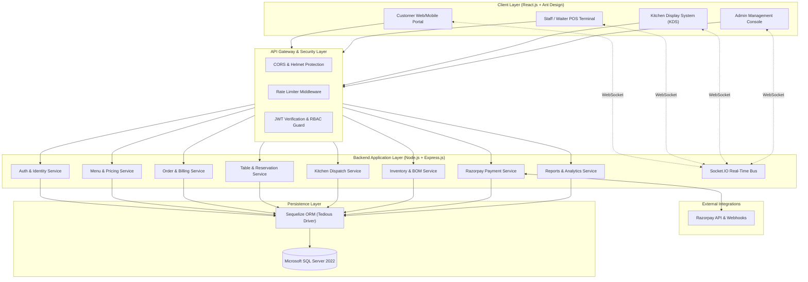

# Restaurant Management System (RMS)
## Executive Project Overview & System Charter

---

### 1. Executive Summary

The **Restaurant Management System (RMS)** is an enterprise-grade, omnichannel food service management and point-of-sale platform. The system is engineered to unify front-of-house customer experiences, dining room staff operations, back-of-house kitchen workflows, inventory consumption, and executive administrative intelligence into a cohesive, real-time ecosystem.

Traditional restaurant operations suffer from disconnected systems: physical table orders get delayed, kitchen order tickets (KOTs) are lost or miscommunicated, inventory leakage goes undetected until month-end audits, and online/offline payment reconciliations demand manual intervention. The RMS solves these challenges through real-time event-driven architecture, automated recipe-level stock depletion, dynamic table reservation and floor management, and secure multi-channel digital payments.

---

### 2. Core Strategic Objectives

1. **Seamless Guest Journey**: Provide zero-friction digital ordering via mobile QR codes at tables, online takeaway/dine-in ordering, and fast automated checkout.
2. **Operational Speed & Accuracy**: Eliminate paper bottlenecks through real-time Kitchen Display Systems (KDS) and high-speed Waiter/Cashier POS terminals.
3. **Financial Precision**: End-to-end integration with Razorpay (UPI, Cards, Netbanking) with automated webhook-driven reconciliation and split-billing support.
4. **Waste & Inventory Control**: Automated Bill of Materials (BOM) stock deduction per order item prepared, with automated low-stock warnings and vendor purchase tracking.
5. **Data-Driven Governance**: Actionable reporting across sales velocity, table turnover rates, staff performance, revenue trends, and food margin analysis.

---

### 3. Technology Stack Specification

| Tier / Component | Technology | Version / Specification | Architectural Purpose |
| :--- | :--- | :--- | :--- |
| **Frontend Framework** | React.js | v18.x (SPA / PWA) | High-performance, component-based user interfaces across responsive mobile and desktop viewports. |
| **UI Design System** | Ant Design (AntD) | v5.x | Enterprise design system providing robust data tables, form controls, modals, and customizable themes. |
| **State Management** | Zustand + TanStack Query | v4 / v5 | High-speed global client state (Cart, User, Table context) paired with server-state caching and synchronization. |
| **Backend Runtime** | Node.js | v20.x LTS | Event-driven, asynchronous I/O runtime optimized for high-concurrency order processing. |
| **API Framework** | Express.js | v4.x / v5.x | Minimalist RESTful API framework structured with clean layered architecture. |
| **Real-Time Engine** | Socket.IO | v4.x | Bidirectional WebSocket communication for instant KDS ticket dispatch, order status updates, and table status changes. |
| **Database Engine** | Microsoft SQL Server | 2022 / Azure SQL | ACID-compliant enterprise relational database engine handling complex joins, strict constraints, and transaction safety. |
| **Object-Relational Mapper** | Sequelize ORM | v6.x | Strongly-typed schema definition, migrations, associations, transactions, and connection pooling. |
| **MSSQL Driver** | Tedious | v16.x+ | Native Node.js TDS (Tabular Data Stream) protocol connector for Microsoft SQL Server. |
| **Authentication & AuthZ** | JWT + bcrypt | Access / Refresh Tokens | Stateless JSON Web Tokens, cryptographically signed with granular Role-Based Access Control (RBAC). |
| **Payment Gateway** | Razorpay SDK | Official Node.js SDK | Seamless payment orders, payment link generation, checkout modals, and cryptographically verified webhook handlers. |
| **Data Validation** | Zod / Joi | Latest | Strict schema validation for incoming HTTP request bodies, route parameters, and socket payloads. |
| **Logging & Telemetry** | Winston & Morgan | Latest | Structured JSON application logging, HTTP access logs, and audit trail capture. |

---

### 4. Target User Personas & Subsystem Portals

The application provides four specialized operational interfaces:

```
+-----------------------------------------------------------------------------------+
|                           Restaurant Management System                            |
+---------------------+---------------------+-------------------+-------------------+
|  1. Customer WebApp |  2. POS & Staff App | 3. Kitchen (KDS)  | 4. Admin Portal   |
|   (Mobile & Tablet) |   (Waiter & Cashier)|   (Kitchen Staff) |   (Managers/Owner)|
+---------------------+---------------------+-------------------+-------------------+
| • QR Dine-In Menu   | • Floor / Table Map | • Real-Time KOTs  | • System Analytics|
| • Customizations    | • Fast Order Entry  | • Ticket Bump/Prep| • Menu Engineering|
| • Cart & Checkout   | • Split Billing     | • Color Urgency   | • Inventory & BOM |
| • Online Razorpay   | • Cash / Card / UPI | • Item Readiness  | • Staff & RBAC    |
| • Live Status Track | • KOT Printing/Send | • Cooking Timers  | • Financial P&L   |
+---------------------+---------------------+-------------------+-------------------+
```

#### Subsystem 1: Customer Application
- **Context**: Mobile browsers (via table QR code scan) or desktop/mobile web for takeaway and dine-in pre-ordering.
- **Key Capabilities**: Digital menu browsing with rich imagery, dietary tags (Veg, Non-Veg, Vegan, Gluten-Free, Allergens), add-on and variant modifiers, cart management, instant Razorpay checkout, live order tracking with status milestones, and table reservation booking.

#### Subsystem 2: Staff / POS Dashboard
- **Context**: Tablets for floor waitstaff; touchscreen desktop terminals for front-desk cashiers.
- **Key Capabilities**: Visual floor map reflecting real-time table states (Available, Reserved, Occupied, Billing, Cleaning), rapid order entry, modifier selections, Kitchen Order Ticket (KOT) generation and split-ticket routing, order amendments, discount management, split billing by seats or custom amounts, and cash/card/UPI settlement.

#### Subsystem 3: Kitchen Display System (KDS)
- **Context**: Heavy-duty kitchen wall-mounted displays and preparation station monitors.
- **Key Capabilities**: Real-time ticket dispatching categorized by station (e.g., Grill, Appetizer, Bar, Main Course), color-coded ticket aging indicators (Green: < 10 mins, Yellow: 10–20 mins, Red: > 20 mins), item-by-item completion marks, one-click order fulfillment notifications pushed directly to waitstaff and customers.

#### Subsystem 4: Admin & Executive Dashboard
- **Context**: Desktop workstations for restaurant owners, general managers, and inventory controllers.
- **Key Capabilities**: Full CRUD menu engineering (categories, variants, add-ons, dynamic pricing), raw material inventory catalog, multi-level Bill of Materials (BOM) linking menu items to ingredient usage, automatic stock reordering alerts, vendor management, reservation configuration, comprehensive financial and operational reporting, and role-based staff administration.

---

### 5. High-Level System Architecture Preview



---

### 6. Architectural Principles & Standards

1. **Transactional Integrity**: All financial charges, order placements, and inventory stock deductions execute within strict database transactions (`READ COMMITTED` or `SERIALIZABLE` isolation) to prevent race conditions and inventory drift.
2. **Loose Coupling via Real-Time Events**: Order status transitions emit domain events via Socket.IO rooms, enabling decoupled notifications across POS, KDS, and customer clients without expensive HTTP polling.
3. **Idempotency & Reconciliation**: All payment callbacks and external webhook payloads from Razorpay are verified using HMAC SHA256 signatures and recorded with idempotent keys to prevent double-billing.
4. **Defense in Depth**: Endpoints enforce role-based authorization at the route and service layers, parameterized SQL queries via Sequelize to negate SQL injection, and strict input validation via schemas.
5. **Auditability**: Critical business actions (discounts, order cancellations, refunds, manual stock adjustments) write immutable records to an audit log table with user identity and timestamp stamps.

---

### 7. Document Organization

- [REQUIREMENTS.md](file:///c:/Projects/restaurant-management-system/restaurant-management-system/documentation/REQUIREMENTS.md): Comprehensive functional, non-functional requirements, RBAC matrix, and detailed operational workflows.
- [SYSTEM_ARCHITECTURE.md](file:///c:/Projects/restaurant-management-system/restaurant-management-system/documentation/SYSTEM_ARCHITECTURE.md): Database schema definitions, ER diagrams, REST API specs, WebSocket event catalog, and frontend component architecture.
- [DEVELOPMENT_ROADMAP.md](file:///c:/Projects/restaurant-management-system/restaurant-management-system/documentation/DEVELOPMENT_ROADMAP.md): Phased implementation strategy, deliverables, milestones, risks, and mitigations.
- [DEVELOPMENT_PROGRESS.md](file:///c:/Projects/restaurant-management-system/restaurant-management-system/DEVELOPMENT_PROGRESS.md): Live phase tracking and milestone execution dashboard.

