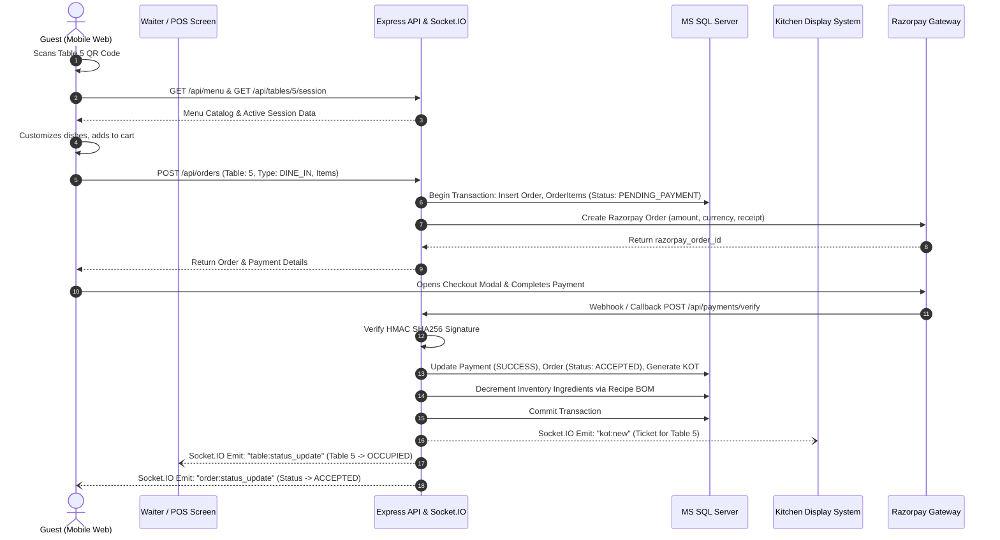
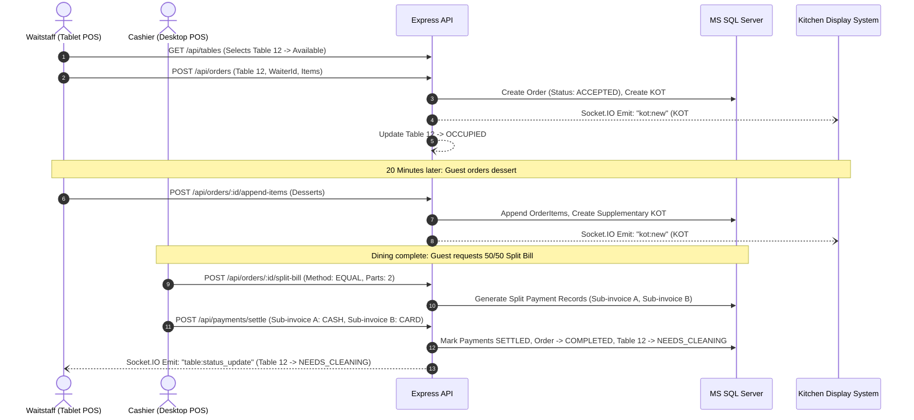
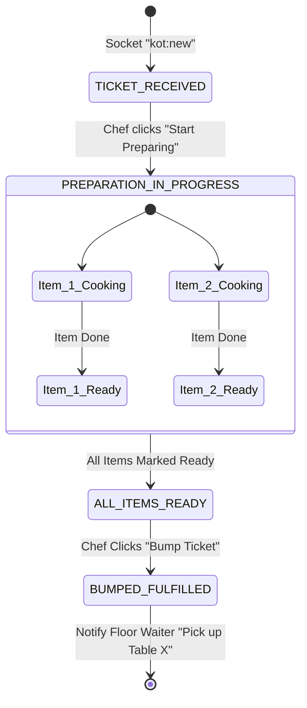
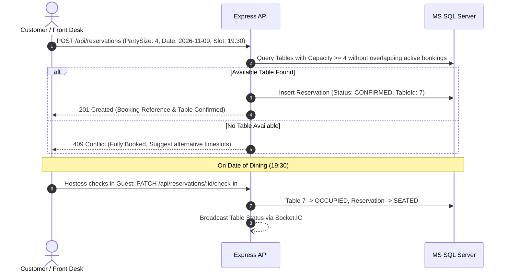
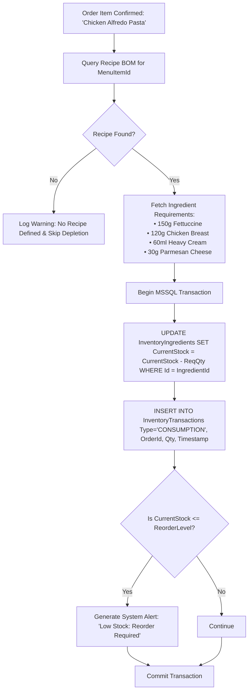

# Restaurant Management System (RMS)
## Comprehensive Software Requirements Specification (SRS) & Operational Workflows

---

### 1. Functional Requirements (FR) by Module

#### Module 1: Customer Portal & Digital Ordering
- **FR-1.1 QR-Code Dine-In**: The system shall generate unique QR codes for each physical table. Scanning the code opens the customer portal pre-bound to the active table session.
- **FR-1.2 Menu Browsing & Filtering**: Customers can filter by category, dietary preferences (`Vegetarian`, `Non-Vegetarian`, `Vegan`, `Gluten-Free`), allergens, and spicy levels.
- **FR-1.3 Item Customization & Modifiers**: Customers can select item variants (e.g., Small, Medium, Large) and optional add-ons (e.g., Extra Cheese, Sauce, Gluten-Free Crust) with real-time price calculation.
- **FR-1.4 Digital Cart Management**: Dynamic cart with ability to increment/decrement quantities, attach special cooking notes (e.g., "Mild spice, sauce on side"), and review itemized pricing including taxes and service charges.
- **FR-1.5 Checkout & Payment**: Seamless checkout via Razorpay modal for instant online settlement or selection of "Pay at Counter / Cash" (if permitted by policy).
- **FR-1.6 Real-Time Order Tracking**: Once submitted, customers can monitor order progress through real-time states (`Placed`, `Confirmed`, `Preparing`, `Ready`, `Served`) via WebSocket updates without refreshing.
- **FR-1.7 Digital Invoicing & Receipts**: Instant downloadable or viewable digital tax invoice upon payment completion.

#### Module 2: Staff / POS Terminal & Dining Floor Management
- **FR-2.1 Interactive Table Layout**: Visual representation of restaurant floor sections (e.g., Main Dining, Patio, Bar, Private Room) with dynamic status color-coding:
  - `Available` (Green)
  - `Occupied` (Blue)
  - `Billed / Payment Pending` (Orange)
  - `Reserved` (Purple)
  - `Needs Cleaning` (Gray)
- **FR-2.2 Rapid Order Entry (Quick POS)**: High-speed touch-friendly search and category browsing for quick dine-in or takeaway entry.
- **FR-2.3 Running Order Amendments**: Waitstaff can append additional items or beverages to an active table tab; only newly added items generate supplementary KOTs.
- **FR-2.4 Table Operations**: Table transfer (moving a party from Table 4 to Table 9) and table merging (combining two tables for a large party) with automatic bill consolidation.
- **FR-2.5 Split Billing Engine**: Supports splitting the final check:
  - Equally across $N$ guests.
  - By specific ordered items per guest.
  - By custom arbitrary amounts.
- **FR-2.6 Multi-Tender Payment Settlement**: Cashier can accept payments via Cash, Credit/Debit Card, UPI QR, Razorpay Dynamic Payment Link, or Gift Vouchers with change calculation.
- **FR-2.7 Order Voiding & Discounts**: Restrict item voiding and complimentary/percentage discounts to authorized manager PINs or roles, requiring mandatory reason logging.

#### Module 3: Kitchen Display System (KDS) & KOT Lifecycle
- **FR-3.1 Real-Time Ticket Routing**: Kitchen Order Tickets (KOT) are pushed instantaneously to KDS screens upon order placement via Socket.IO.
- **FR-3.2 Station-Based Routing**: System can route tickets to specific kitchen stations (e.g., Station 1: Grill, Station 2: Fryer/Appetizers, Station 3: Beverage Bar).
- **FR-3.3 Ticket Aging & Urgency Visuals**: Tickets automatically update visual styling based on elapsed cooking time:
  - *Normal* (0–10 mins): Green border.
  - *Warning* (11–18 mins): Yellow border with flashing timer.
  - *Critical / Delayed* (> 18 mins): Red border with audio chime.
- **FR-3.4 Item Bump & Completion**: Chefs can mark individual items as "Preparing" or "Ready", or "Bump" (complete) the entire ticket when all dishes are ready.
- **FR-3.5 Service Dispatch Alerts**: When a ticket is bumped, an automated real-time notification alerts the assigned floor waiter that Table $X$ order is ready for pickup.

#### Module 4: Menu, Category & Variant Engineering
- **FR-4.1 Hierarchical Taxonomy**: Support Categories, Subcategories, Menu Items, Variant Groups (Size, Portion), and Add-on Groups (Toppings, Dressings).
- **FR-4.2 Real-Time Availability Toggling ("86"ing)**: Instant toggle to mark ingredients or menu items as "Out of Stock" (86), immediately propagating to customer and POS menus via WebSockets.
- **FR-4.3 Tax Configuration**: Flexible GST/VAT rules (e.g., 5% Food GST, 18% Alcoholic Beverages) linked at category or item levels.
- **FR-4.4 Scheduled Dayparting**: Menu availability rules based on time of day (e.g., Breakfast Menu 07:00–11:00, Lunch 12:00–16:00, Dinner 19:00–23:30).

#### Module 5: Cart, Tax, Discount & Checkout Engine
- **FR-5.1 Complex Tax & Surcharge Computation**: Automatic calculation of CGST, SGST/IGST, configurable Service Charge (optional/mandatory), and packaging charges for takeaway orders.
- **FR-5.2 Coupon & Promotion Engine**: Support coupon codes with conditions (minimum cart value, category exclusions, maximum discount cap, usage limits per customer).
- **FR-5.3 Rounding & Currency Precision**: Mathematical rounding rules adhering to statutory financial guidelines (two decimal places with nearest whole currency rounding).

#### Module 6: Order Lifecycle State Machine
- **FR-6.1 Strict State Transition**: Orders adhere to an enforced finite-state machine (FSM):
  ```
  DRAFT -> PLACED -> ACCEPTED -> PREPARING -> READY -> SERVED -> COMPLETED
     \        \          \           \
      +--------+----------+-----------+-----> CANCELLED / VOIDED
  ```
- **FR-6.2 State Guard Rules**: An order cannot transition to `COMPLETED` without a settled payment record; an order cannot be cancelled once cooking has commenced without managerial override.
- **FR-6.3 Audit Trail**: Every status transition, timestamp, and responsible user ID is persisted in the `OrderAuditLogs` table.

#### Module 7: Payment Gateway & Settlement (Razorpay)
- **FR-7.1 Razorpay Order Creation**: Backend creates a unique `razorpay_order_id` with exact order amount in smallest currency unit (paise for INR).
- **FR-7.2 Client-Side Checkout**: Secure checkout modal rendering supported payment methods (UPI, Cards, Netbanking, Wallets).
- **FR-7.3 Webhook Verification**: High-priority webhook endpoint verifying Razorpay HMAC SHA256 signature to handle asynchronous payment success or failure.
- **FR-7.4 Refund Management**: Admin-initiated partial or full refunds processed via Razorpay API, recording reference transaction IDs and updating order ledger.

#### Module 8: Inventory, Bill of Materials (BOM) & Stock Depletion
- **FR-8.1 Raw Ingredient Management**: Master catalog of ingredients with unit of measure (UOM: kg, grams, liters, ml, pieces), purchase costs, and reorder thresholds.
- **FR-8.2 Recipe / BOM Definition**: Association of menu items with exact ingredient quantities (e.g., 1 Margherita Pizza requires 200g Flour, 80g Tomato Sauce, 120g Mozzarella, 5g Basil).
- **FR-8.3 Automatic Stock Depletion**: When an order transitions to `ACCEPTED` or `PREPARING`, the system automatically deducts corresponding raw materials from current stock.
- **FR-8.4 Wastage Tracking**: Staff can record spoiled or dropped ingredients/items with classified reasons (spoilage, burning, spilled, expired).
- **FR-8.5 Low Stock Notifications**: System flags ingredients dropping below safety buffer levels and surfaces alerts on the Admin and Manager dashboards.

#### Module 9: Table Reservation & Floor Planning
- **FR-9.1 Reservation Booking**: Customers or front-desk staff can book tables for specific dates, timeslots, and guest party sizes.
- **FR-9.2 Conflict & Overbooking Prevention**: Reservation engine checks table capacity and existing reservations within a configured buffer window (e.g., 90 minutes per seating).
- **FR-9.3 Auto-Release Policy**: If guests fail to arrive within 15 minutes of reservation time, the table status reverts to available or waitlisted.

#### Module 10: Reporting, Business Intelligence & Financial Analytics
- **FR-10.1 Sales & Revenue Dashboards**: Gross sales, net revenue, tax collected, discounts granted, and average order value (AOV) across hourly, daily, weekly, and monthly periods.
- **FR-10.2 Menu Engineering Matrix**: BCG-style menu analysis categorizing dishes into Stars (high profit, high volume), Plowhorses (low profit, high volume), Puzzles (high profit, low volume), and Dogs (low profit, low volume).
- **FR-10.3 Table Turnover Analytics**: Average dining duration per table and revenue generated per seat hour (RevPASH).
- **FR-10.4 Staff Performance Reports**: Sales generated per waiter, order entry speed, and table coverage metrics.
- **FR-10.5 Data Export**: All financial and inventory reports exportable to Excel (XLSX) and PDF formats.

---

### 2. Non-Functional Requirements (NFR)

#### NFR-1: Performance & Latency
- **API Response Time**: 95% of read requests must respond within 150ms; 95% of write requests (order placement, billing) must complete within 300ms under standard load.
- **Real-Time Push Latency**: KDS and POS WebSocket message delivery latency must be under 400ms from database commit.
- **Database Indexing**: Full index coverage on foreign keys, status columns, order dates, and table IDs to maintain sub-50ms query execution times.

#### NFR-2: Scalability & Concurrency
- **Concurrency Support**: System must support 100+ concurrent table sessions and POS terminals without locking deadlocks.
- **Database Connection Pooling**: Sequelize pool configured with min 10, max 50 connections, recycling idle connections after 10,000ms.
- **Transaction Isolation**: Order checkout and inventory updates must run under `READ COMMITTED` or `SERIALIZABLE` transaction blocks with optimistic/pessimistic locking where appropriate.

#### NFR-3: Reliability, Availability & Fault Tolerance
- **Offline Resilience for POS**: In case of transient network drops, the POS frontend must buffer actions and retry with exponential backoff.
- **Socket.IO Reconnection**: Automatic client reconnection with token re-authentication and state resynchronization.
- **Health Checks**: Dedicated `/api/health` endpoint monitoring MSSQL database connectivity and memory usage.

#### NFR-4: Security & Compliance
- **Authentication**: JWT authentication with short-lived Access Tokens (15 minutes) and rotating Refresh Tokens (7 days) stored in secure HTTP-only cookies.
- **Password Security**: Passwords hashed with `bcrypt` (work factor 12).
- **Payment Compliance**: Zero credit card numbers or CVVs stored in the database. All card data tokenized directly by Razorpay SDK adhering to PCI-DSS Level 1 standards.
- **Webhook Integrity**: Razorpay webhook requests validated using HMAC SHA256 signature verification before any order state change is acknowledged.
- **Protection**: Middleware protection including CORS whitelisting, Helmet security headers, and Express rate limiting to prevent brute-force attacks.

#### NFR-5: Usability & User Experience
- **Responsive Layout**: Ant Design 5 responsive grid optimized for desktop (1920x1080), tablet (1024x768), and mobile viewports (375x812).
- **Kitchen Ergonomics**: High-contrast, dark-mode-first KDS interface with minimum 48px touch targets and distinct acoustic cues for incoming tickets.

---

### 3. User Personas & Role-Based Access Control (RBAC)

#### User Roles:
1. `SUPER_ADMIN`: Franchise owner / IT Administrator with absolute privileges.
2. `RESTAURANT_MANAGER`: Operations manager overseeing daily operations, discounts, inventory, voids, and staff.
3. `CASHIER_POS`: Front desk staff handling order taking, table billing, bill splitting, and payment settlement.
4. `WAITSTAFF`: Floor waiters taking table orders, requesting table transfers, and viewing order readiness.
5. `KITCHEN_CHEF`: Kitchen staff interacting exclusively with the Kitchen Display System (KDS).
6. `CUSTOMER`: Public guest browsing menu, placing self-orders, booking reservations, and paying online.

#### Detailed Permission Matrix:

| Module / Action | Super Admin | Restaurant Manager | Cashier / POS | Waitstaff | Kitchen Chef | Customer |
| :--- | :---: | :---: | :---: | :---: | :---: | :---: |
| **System Settings & DB** | Full | None | None | None | None | None |
| **Staff & User Management** | Full | Read / Update | None | None | None | None |
| **Menu CRUD & Pricing** | Full | Full | Read | Read | Read | Read |
| **Toggle Item Availability (86)**| Full | Full | Read | Read | Update | None |
| **Table Layout & Config** | Full | Full | Read | Read | None | None |
| **Table Status Updates** | Full | Full | Full | Full | None | None |
| **Create Dine-In / POS Order**| Full | Full | Full | Full | None | Own Order |
| **Modify Active Order Items** | Full | Full | Full | Add Only | None | None |
| **Void Items / Cancel Order** | Full | With Reason | Auth PIN Req | None | None | Before Prep |
| **Apply Custom Discounts** | Full | Full | Limited (<=10%)| None | None | Promo Codes |
| **Split & Settle Bills** | Full | Full | Full | None | None | Self Pay |
| **Kitchen KDS View & Bump** | Full | Full | Read | Read | Full | None |
| **Inventory CRUD & POs** | Full | Full | None | None | Read Stock | None |
| **Inventory Spoilage Entry** | Full | Full | None | None | Create | None |
| **Financial & Sales Reports** | Full | Full | Shift Summary | None | None | None |
| **Audit Log Viewing** | Full | Read Only | None | None | None | None |

---

### 4. End-to-End Operational Workflows

#### Workflow 1: Customer Self-Service QR Dine-in Order & Online Payment


#### Workflow 2: Waiter-Assisted Dine-In Order, KOT Creation & Split Bill Settlement


#### Workflow 3: Kitchen Display System (KDS) Preparation & Bump Lifecycle


#### Workflow 4: Table Reservation & Seating Workflow


#### Workflow 5: Automatic Recipe-Based Inventory Stock Depletion


#### Workflow 6: Razorpay Payment, Webhook Verification & Refund Handling
```mermaid
flowchart TD
    A[Client Submits Payment via Razorpay UI] --> B{Payment Outcome}
    B -- Success --> C[Client Sends Success Payload:
    • razorpay_payment_id
    • razorpay_order_id
    • razorpay_signature]
    B -- Failed/Abandoned --> D[Client Logs Error & Retries]
    
    C --> E[Backend POST /api/payments/verify]
    F[Razorpay Webhook: payment.captured] --> G[Backend POST /api/payments/webhook]
    
    E & G --> H[Compute HMAC SHA256 of order_id + '|' + payment_id using Secret]
    H --> I{Computed == Received Signature?}
    I -- Invalid --> J[HTTP 400: Signature Verification Failed & Flag Security Incident]
    I -- Valid --> K{Is Payment Already Recorded?}
    K -- Yes --> L[Idempotent Return: 200 OK Already Processed]
    K -- No --> M[UPDATE Payments SET Status='SUCCESS', GatewayTxnId=payment_id]
    M --> N[UPDATE Orders SET Status='ACCEPTED', PaymentStatus='PAID']
    N --> O[Trigger KOT Generation & Broadcast Socket.IO Events]
    O --> P[HTTP 200 OK]
```

