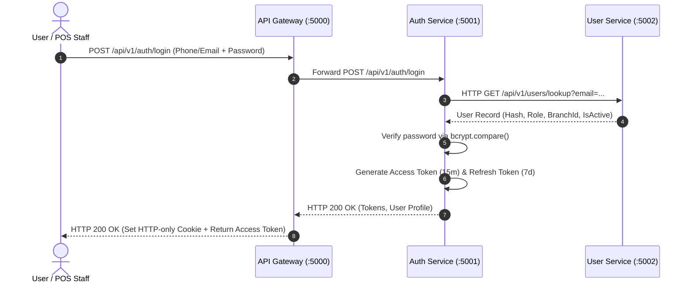
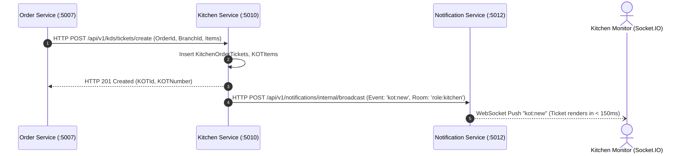
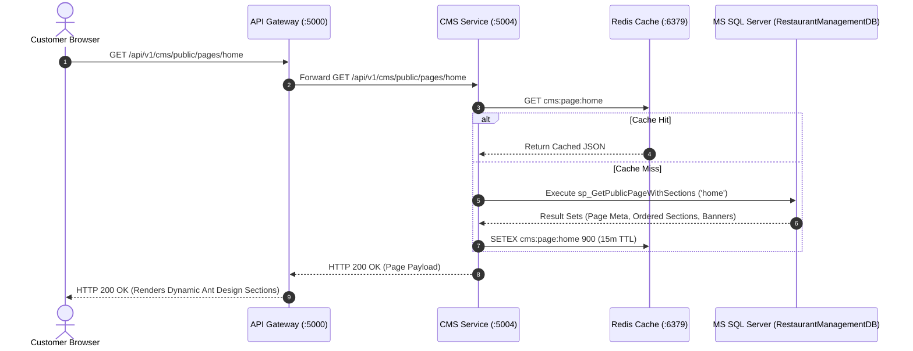

# Restaurant Management System (RMS)
## Inter-Service Communication & REST Protocol Specification

---

### 1. Inter-Service Communication Philosophy

The Restaurant Management System strictly enforces **HTTP REST communication** across all microservices. Message brokers (RabbitMQ, Apache Kafka), event buses, and gRPC are explicitly excluded from this architecture.

Every inter-service transaction operates as an HTTP/1.1 or HTTP/2 REST request managed through resilient client libraries (Axios with custom interceptors) implementing:
- **Service-to-Service Mutual Authentication**
- **Distributed Request Tracing via Correlation IDs (`X-Correlation-ID`)**
- **Idempotency Guarantees (`X-Idempotency-Key`)**
- **Strict Network Timeouts & Exponential Backoff Retries**
- **Circuit Breaker Protection**
- **Standardized API Response Envelopes**

```
[ Ingress Client ]
        │
        ▼
[ API Gateway (Port 5000) ] ── (Injects X-Correlation-ID, verifies JWT)
        │
        ├── HTTP GET /api/v1/orders/:id
        ▼
[ Order Service (Port 5007) ]
        │
        ├── HTTP GET /api/v1/menu/items/:id ──► [ Menu Service (Port 5005) ]
        ├── HTTP POST /api/v1/inventory/bom/deplete ──► [ Inventory Service (Port 5009) ]
        ├── HTTP POST /api/v1/kds/tickets ──► [ Kitchen Service (Port 5010) ]
        └── HTTP POST /api/v1/notifications/broadcast ──► [ Notification Service (Port 5012) ]
```

---

### 2. Standard Inter-Service HTTP Headers

Every inter-service request transmitted across microservices must include the following standardized headers:

| Header Name | Type | Generation Source | Purpose |
| :--- | :--- | :--- | :--- |
| `X-Correlation-ID` | UUID v4 | API Gateway | Traces a single user action across multiple downstream service hops in application logs. |
| `X-Idempotency-Key` | String / UUID | Client / Originating Service | Guarantees that retrying a state-changing operation (Order, Payment, Inventory Depletion) does not result in duplicate records. |
| `X-Internal-Service-Key` | Secret Hash | Originating Service | Shared secret validating that the caller is an authenticated internal microservice, not an external public actor. |
| `X-User-ID` | BIGINT | API Gateway | Authenticated user ID extracted from validated JWT token. |
| `X-User-Role` | String | API Gateway | Primary role of caller (`SUPER_ADMIN`, `WAITSTAFF`, `CUSTOMER`). |
| `X-Branch-ID` | INT | API Gateway | Active restaurant branch context. |

---

### 3. Resilience, Timeouts & Circuit Breakers

#### 3.1 Strict Request Timeouts
To prevent thread starvation and cascading service failure when a downstream microservice is slow:
- **Default Inter-Service Timeout**: `5000ms` (5 seconds).
- **Payment & External Gateway Timeout**: `10000ms` (10 seconds for Razorpay API).
- **Report & Analytics Aggregation Timeout**: `15000ms` (15 seconds).

#### 3.2 Retry Policy with Exponential Backoff
- **Eligible Requests**: Only safe, idempotent requests (`GET`, `PUT`, `DELETE`, or `POST` equipped with `X-Idempotency-Key`).
- **Maximum Retries**: 3 attempts.
- **Backoff Formula**: $t_{\text{wait}} = 2^{\text{attempt}} \times 200\,\text{ms} + \text{jitter}$ (Attempt 1: ~400ms, Attempt 2: ~800ms, Attempt 3: ~1600ms).
- **Non-Retryable Errors**: HTTP 400 (Bad Request), 401 (Unauthorized), 403 (Forbidden), 404 (Not Found), 422 (Unprocessable Entity).

#### 3.3 Circuit Breaker Pattern (Opossum / Custom Wrapper)
To protect services from continuous failed calls when a dependency is down:
- **Failure Threshold**: 5 consecutive 5xx errors within 10 seconds.
- **Open Circuit Window**: 10 seconds (calls immediately fail fast with a cached fallback or HTTP 503 Service Unavailable).
- **Half-Open Test**: Sends 1 probe request; if successful, circuit resets to Closed.

---

### 4. Standard API Response Structure

Every microservice returns responses conforming to a universal JSON envelope:

```json
// Successful Response (HTTP 200 / 201)
{
  "success": true,
  "data": { ... },
  "message": "Resource retrieved / operation successful",
  "meta": {
    "page": 1,
    "limit": 20,
    "totalCount": 140
  },
  "correlationId": "c8a41df2-421b-4f91-8841-39d2c25345a9",
  "timestamp": "2026-11-08T16:15:00.000Z"
}

// Error Response (HTTP 4xx / 5xx)
{
  "success": false,
  "error": {
    "code": "INSUFFICIENT_STOCK",
    "message": "Cannot prepare Margherita Classica: insufficient Caputo Flour.",
    "details": [
      {
        "ingredientId": 1,
        "ingredientName": "Caputo '00' Pizza Flour",
        "currentStock": 0.1000,
        "requiredQuantity": 0.2200
      }
    ]
  },
  "correlationId": "c8a41df2-421b-4f91-8841-39d2c25345a9",
  "timestamp": "2026-11-08T16:15:00.000Z"
}
```

---

### 5. Key Inter-Service Interaction Workflows

#### 5.1 Authentication & Profile Lookup Workflow


#### 5.2 Real-Time Kitchen Ticket Dispatch Workflow


#### 5.3 Public Dynamic CMS Page Fetch Workflow


