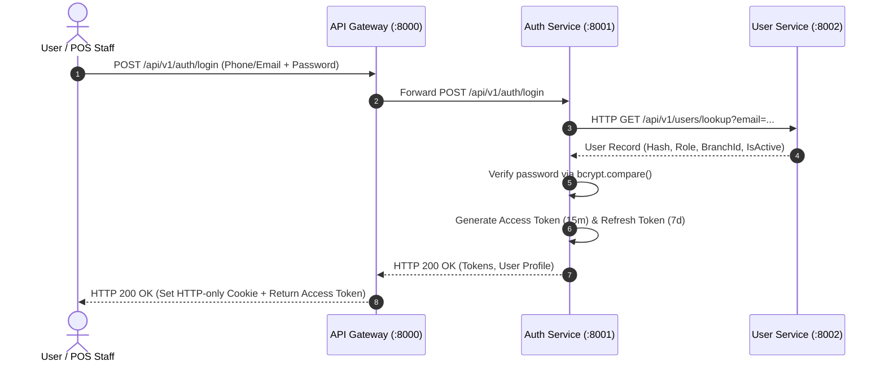
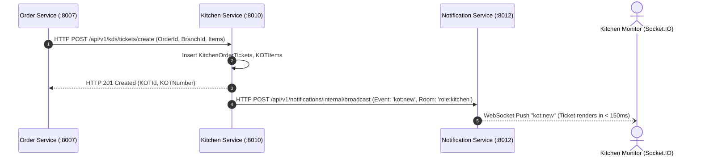
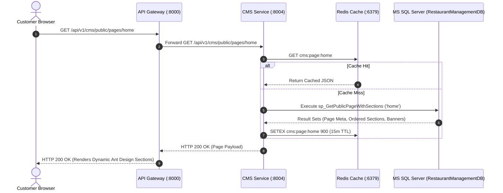
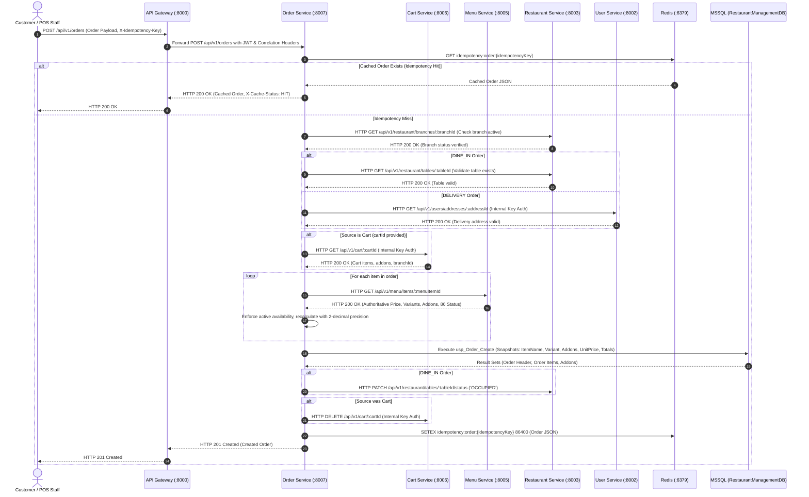
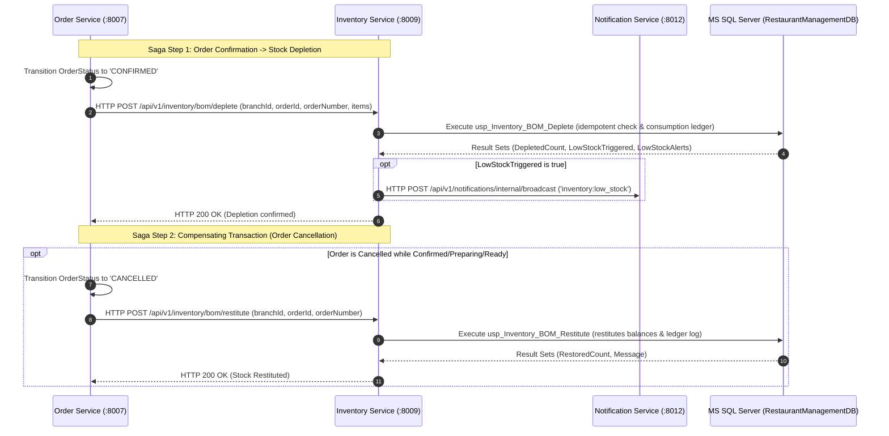
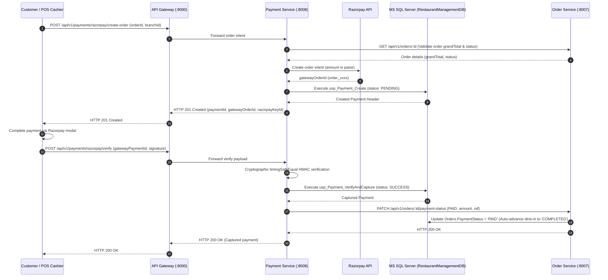
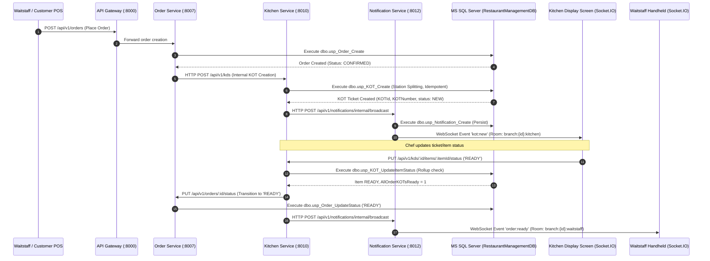

# Restaurant Management System (RMS)
## Inter-Service Communication & REST Protocol Specification

---

### 1. Inter-Service Communication Philosophy

The Restaurant Management System strictly enforces **HTTP REST communication** across all microservices. Message brokers (RabbitMQ, Apache Kafka), event buses, and gRPC are explicitly excluded from this architecture.

Every inter-service transaction operates as an HTTP/1.1 or HTTP/2 REST request managed through resilient client libraries (Axios with custom interceptors) implementing:
- **Service-to-Service Mutual Authentication**
- **Distributed Request Tracing via Correlation IDs (`X-Correlation-ID`)**
- **Idempotency Guarantees (`X-Idempotency-Key`)**
- **Strict Network Timeouts & Exponential Backoff Retries**
- **Circuit Breaker Protection**
- **Standardized API Response Envelopes**

```
[ Ingress Client ]
        │
        ▼
[ API Gateway (Port 8000) ] ── (Injects X-Correlation-ID, verifies JWT)
        │
        ├── HTTP GET /api/v1/orders/:id
        ▼
[ Order Service (Port 8007) ]
        │
        ├── HTTP GET /api/v1/menu/items/:id ──► [ Menu Service (Port 8005) ]
        ├── HTTP POST /api/v1/inventory/bom/deplete ──► [ Inventory Service (Port 8009) ]
        ├── HTTP POST /api/v1/kds/tickets ──► [ Kitchen Service (Port 8010) ]
        └── HTTP POST /api/v1/notifications/broadcast ──► [ Notification Service (Port 8012) ]
```

---

### 2. Standard Inter-Service HTTP Headers

Every inter-service request transmitted across microservices must include the following standardized headers:

| Header Name | Type | Generation Source | Purpose |
| :--- | :--- | :--- | :--- |
| `X-Correlation-ID` | UUID v4 | API Gateway | Traces a single user action across multiple downstream service hops in application logs. |
| `X-Idempotency-Key` | String / UUID | Client / Originating Service | Guarantees that retrying a state-changing operation (Order, Payment, Inventory Depletion) does not result in duplicate records. |
| `X-Internal-Service-Key` | Secret Hash | Originating Service | Shared secret validating that the caller is an authenticated internal microservice, not an external public actor. |
| `X-User-ID` | BIGINT | API Gateway | Authenticated user ID extracted from validated JWT token. |
| `X-User-Role` | String | API Gateway | Primary role of caller (`SUPER_ADMIN`, `WAITSTAFF`, `CUSTOMER`). |
| `X-Branch-ID` | INT | API Gateway | Active restaurant branch context. |

---

### 3. Resilience, Timeouts & Circuit Breakers

#### 3.1 Strict Request Timeouts
To prevent thread starvation and cascading service failure when a downstream microservice is slow:
- **Default Inter-Service Timeout**: `5000ms` (5 seconds).
- **Payment & External Gateway Timeout**: `10000ms` (10 seconds for Razorpay API).
- **Report & Analytics Aggregation Timeout**: `15000ms` (15 seconds).

#### 3.2 Retry Policy with Exponential Backoff
- **Eligible Requests**: Only safe, idempotent requests (`GET`, `PUT`, `DELETE`, or `POST` equipped with `X-Idempotency-Key`).
- **Maximum Retries**: 3 attempts.
- **Backoff Formula**: $t_{\text{wait}} = 2^{\text{attempt}} \times 200\,\text{ms} + \text{jitter}$ (Attempt 1: ~400ms, Attempt 2: ~800ms, Attempt 3: ~1600ms).
- **Non-Retryable Errors**: HTTP 400 (Bad Request), 401 (Unauthorized), 403 (Forbidden), 404 (Not Found), 422 (Unprocessable Entity).

#### 3.3 Circuit Breaker Pattern (Opossum / Custom Wrapper)
To protect services from continuous failed calls when a dependency is down:
- **Failure Threshold**: 5 consecutive 5xx errors within 10 seconds.
- **Open Circuit Window**: 10 seconds (calls immediately fail fast with a cached fallback or HTTP 503 Service Unavailable).
- **Half-Open Test**: Sends 1 probe request; if successful, circuit resets to Closed.

---

### 4. Standard API Response Structure

Every microservice returns responses conforming to a universal JSON envelope:

```json
// Successful Response (HTTP 200 / 201)
{
  "success": true,
  "data": { ... },
  "message": "Resource retrieved / operation successful",
  "meta": {
    "page": 1,
    "limit": 20,
    "totalCount": 140
  },
  "correlationId": "c8a41df2-421b-4f91-8841-39d2c25345a9",
  "timestamp": "2026-11-08T16:15:00.000Z"
}

// Error Response (HTTP 4xx / 5xx)
{
  "success": false,
  "error": {
    "code": "INSUFFICIENT_STOCK",
    "message": "Cannot prepare Margherita Classica: insufficient Caputo Flour.",
    "details": [
      {
        "ingredientId": 1,
        "ingredientName": "Caputo '00' Pizza Flour",
        "currentStock": 0.1000,
        "requiredQuantity": 0.2200
      }
    ]
  },
  "correlationId": "c8a41df2-421b-4f91-8841-39d2c25345a9",
  "timestamp": "2026-11-08T16:15:00.000Z"
}
```

---

### 5. Key Inter-Service Interaction Workflows

#### 5.1 Authentication & Profile Lookup Workflow


#### 5.2 Real-Time Kitchen Ticket Dispatch Workflow


#### 5.3 Public Dynamic CMS Page Fetch Workflow


#### 5.4 Cart Validation & Order Placement Workflow


---

#### 5.5 Order -> Inventory BOM Depletion & Restitution Saga Workflow


---

### 6. Phase 7 & 8 Inter-Service REST API Contracts

#### 6.1 Cart Service Contracts (`cart-service` :8006)
- **Downstream Dependency**: Calls `menu-service` (:8005) via `GET /api/v1/menu/items/:id` to authoritatively validate dish prices, variants, addon pricing, and item availability before mutating cart records.
- **Inbound Mesh Access**: Accepts internal mesh calls equipped with `X-Internal-Service-Key` header, granting `SYSTEM` internal service bypass for order placement cart extraction (`GET /api/v1/cart/:id`) and post-checkout cleanup (`DELETE /api/v1/cart/:id`).

#### 6.2 Order Service Contracts (`order-service` :8007)
- **Calls `cart-service` (:8006)**:
  - `GET /api/v1/cart/:cartId`: Extracts active items, portion variants, and addons.
  - `DELETE /api/v1/cart/:cartId`: Clears shopping cart upon successful order placement.
- **Calls `menu-service` (:8005)**:
  - `GET /api/v1/menu/items/:id`: Validates live item pricing, variant pricing, addon pricing, and active status.
- **Calls `restaurant-service` (:8003)**:
  - `GET /api/v1/restaurant/branches/:branchId`: Verifies branch active status.
  - `GET /api/v1/restaurant/tables/:tableId`: Validates dining table existence and association.
  - `PATCH /api/v1/restaurant/tables/:tableId/status`: Updates table status to `OCCUPIED` upon dine-in placement, and `AVAILABLE` upon completion or cancellation.
- **Calls `user-service` (:8002)**:
  - `GET /api/v1/users/addresses/:addressId`: Validates customer delivery address ownership and active status.
- **Calls `inventory-service` (:8009)**:
  - `POST /api/v1/inventory/bom/deplete`: Deducts ingredient stock when order transitions to `CONFIRMED` or `PREPARING`.
  - `POST /api/v1/inventory/bom/restitute`: Restores consumed ingredients when order transitions to `CANCELLED`.

#### 6.3 Inventory Service Contracts (`inventory-service` :8009)
- **Inbound Mesh Endpoints**:
  - `POST /api/v1/inventory/bom/check`: Pre-flight check validating ingredient inventory availability for draft or placing orders.
  - `POST /api/v1/inventory/bom/deplete`: Idempotent stock depletion invoked by `order-service` upon order confirmation.
  - `POST /api/v1/inventory/bom/restitute`: Compensating saga transaction restoring stock for cancelled orders.
- **Outbound Calls**:
  - Calls `notification-service` (:8012) via `POST /api/v1/notifications/internal/broadcast` when an ingredient's balance breaches its configured `ReorderLevel` or `MinimumStockLevel`.

---

#### 5.6 Payment Lifecycle & Order Settlement Saga Workflow


---

#### 6.4 Payment Service Contracts (`payment-service` :8008)
- **Downstream Dependency**: Calls `order-service` (:8007) via `GET /api/v1/orders/:id` to authoritatively validate order amounts before online intent creation.
- **Outbound Mesh Update**: Invokes `PATCH /api/v1/orders/:orderId/payment-status` on `order-service` (:8007) with internal mesh header `X-Internal-Service-Key` to synchronize payment state (`PAID`, `FAILED`) and auto-complete dine-in orders upon settlement.
- **Inbound Public Webhook Ingress**: Receives unauthenticated Razorpay cloud notifications at `POST /api/v1/payments/razorpay/webhook`, verified via `X-Razorpay-Signature` with Redis distributed idempotency guards.
- **Internal Ledger Ownership**: Exclusive owner of `dbo.Payments`, `dbo.PaymentTransactions`, and `dbo.PaymentRefunds`. No external service may directly mutate or query these tables.

---

#### 5.7 Kitchen Order Workflow & Real-Time Event Dispatch


---

#### 6.5 Kitchen Service Contracts (`kitchen-service` :8010)
- **Downstream Dependency (`order-service` :8007)**:
  - Invokes `PUT /api/v1/orders/:id/status` using `X-Internal-Service-Key` to advance parent order to `READY` when all kitchen tickets and items for an order have completed preparation.
  - Never directly executes UPDATE queries against `dbo.Orders` or `dbo.OrderStatusHistory`.
- **Downstream Dependency (`notification-service` :8012)**:
  - Invokes `POST /api/v1/notifications/internal/broadcast` with `X-Internal-Service-Key` on every KOT lifecycle event (`kot:new`, `kot:item_update`, `kot:status`, `kot:bumped`, `order:ready`).
- **Inbound Mesh Endpoints**:
  - `POST /api/v1/kds`: Invoked by `order-service` to atomically create KOT tickets upon order confirmation.
  - `POST /api/v1/kds/cancel-by-order`: Invoked by `order-service` to cancel and bump active tickets when an order is cancelled or voided.
- **Internal Ledger Ownership**: Exclusive owner of `dbo.KitchenOrderTickets` and `dbo.KOTItems`.

---

#### 6.6 Notification Service Contracts (`notification-service` :8012)
- **Role**: Centralized real-time event aggregation and Socket.IO distribution hub.
- **Inbound Mesh Endpoints**:
  - `POST /api/v1/notifications/internal/broadcast`: Universal dispatch endpoint accepting target room, event name, notification payload, and metadata.
  - `POST /api/v1/notifications/internal/order-status`: Order status change dispatch.
  - `POST /api/v1/notifications/internal/kot-event`: KOT creation and preparation updates.
  - `POST /api/v1/notifications/internal/low-stock`: Inventory threshold warnings.
  - `POST /api/v1/notifications/internal/maintenance/cleanup`: Data retention cleanup.
- **Persistence Guarantees**: Persists to `dbo.Notifications` with 60-second duplicate suppression before broadcasting to WebSocket rooms.
- **WebSocket Gateway**: Manages authenticated client connections, JWT validation, and room-level authorization (`branch:{id}:kitchen`, `branch:{id}:waitstaff`, `user:{id}`).
- **Internal Ledger Ownership**: Exclusive owner of `dbo.Notifications`.

---

#### 6.7 Dynamic Website CMS Service Contracts (`cms-service` :8004)
- **Role**: Headless content management system, dynamic layout authoring, branding & theme tokens, SEO management, media CDN signing, and guest inquiries.
- **Inbound Public Endpoints (Whitelisted on API Gateway)**:
  - `GET /api/v1/cms/public/settings`: Branding tokens, active hours, contact details, dynamic color themes.
  - `GET /api/v1/cms/public/seo`: Global meta tags, OpenGraph images, and tracking identifiers.
  - `GET /api/v1/cms/public/banners`: Active promotional banners and hero slides.
  - `GET /api/v1/cms/public/navigation`: Hierarchical navigation tree.
  - `GET /api/v1/cms/public/footer`: Footer multi-column structure and social channels.
  - `GET /api/v1/cms/public/faqs`: Help center and dining FAQs.
  - `GET /api/v1/cms/public/testimonials`: Curated guest and critic reviews.
  - `GET /api/v1/cms/public/social-links`: Social media channels.
  - `GET /api/v1/cms/public/pages/:slug`: Dynamic page layout with ordered section component definitions.
  - `POST /api/v1/cms/public/contact`: Guest inquiry submission.
- **Inbound Administrative Endpoints (RBAC: `SUPER_ADMIN`, `RESTAURANT_MANAGER`)**:
  - Full CRUD operations for settings, SEO, pages, sections, banners, navigation, footers, FAQs, reviews, and social links.
  - `GET /api/v1/cms/admin/media/sign`: Cryptographic Cloudinary signature generation for direct CDN asset upload.
  - `POST /api/v1/cms/admin/contact/:id/reply`: Staff inquiry resolution.
- **Downstream Dependency (`notification-service` :8012)**:
  - Invokes `POST /api/v1/notifications/internal/broadcast` with `X-Internal-Service-Key` upon new guest contact submission to alert managers without violating database ownership boundaries.
- **Internal Ledger Ownership**: Exclusive owner of `dbo.WebsitePages`, `dbo.WebsitePageSections`, `dbo.WebsiteSettings`, `dbo.SEOSettings`, `dbo.PromotionalBanners`, `dbo.NavigationMenus`, `dbo.FooterSections`, `dbo.FAQs`, `dbo.CustomerTestimonials`, `dbo.SocialMediaLinks`, and `dbo.ContactMessages`.


