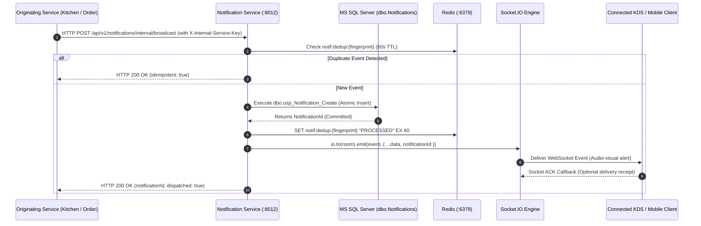

# Restaurant Management System (RMS)
## Socket.IO Real-Time Communication & WebSocket Architecture (Revised & Corrected)

---

### 1. Architecture Overview

Real-time communication across the Restaurant Management System (RMS) is centralized in the **Notification Service** (`backend/notification-service`, Port `8012`, WebSocket endpoint `ws://localhost:8012/socket.io/`).

The WebSocket hub acts as the bi-directional event distribution engine linking:
- **Kitchen Display Screens (KDS)**: Instant reception of new KOT tickets, item status updates, expedited alerts, and bump events.
- **Waitstaff Mobile & Handheld POS**: Table-ready alerts, order cancellations, and chef call bells.
- **Cashier POS Terminals**: Live table occupation states, billed orders, and floor plan updates.
- **Customer Web & Mobile Applications**: Live order tracking timeline (`PLACED` $\rightarrow$ `ACCEPTED` $\rightarrow$ `PREPARING` $\rightarrow$ `READY` $\rightarrow$ `SERVED` / `DELIVERY`).

```
                              ┌────────────────────────────────────────┐
                              │    Customer & Staff Client Apps        │
                              │  (Web Browsers, Mobile Apps, KDS)      │
                              └───────────────────┬────────────────────┘
                                                  │
                                                  │ (WebSocket Handshake with JWT)
                                                  ▼
                              ┌────────────────────────────────────────┐
                              │      Notification Service (:8012)      │
                              │           Socket.IO Server             │
                              │  - JWT Connection Auth Middleware      │
                              │  - Strict Branch Isolation & RBAC      │
                              │  - "Persist Before Broadcast" Engine   │
                              └───────┬────────────────────────┬───────┘
                                      │                        │
       (Internal REST /broadcast with │                        │ (Redis Pub/Sub
             X-Internal-Service-Key)  │                        │  Multi-Node Mesh)
                                      ▼                        ▼
                        ┌───────────────────────────┐    ┌───────────┐
                        │ Internal Microservices    │    │   Redis   │
                        │ - kitchen-service (:8010) │    │  (:6379)  │
                        │ - order-service (:8007)   │    └───────────┘
                        │ - inventory-service(:8009)│
                        └───────────────────────────┘
```

---

### 2. Connection Handshake & Authentication Protocol

All WebSocket connections must present a valid RMS JWT Access Token during handshake. Unauthenticated connections are rejected immediately with an authentication error.

#### 2.1 Handshake Configuration
```javascript
const socket = io('http://localhost:8012', {
  auth: {
    token: userJwtAccessToken,
  },
  transports: ['websocket', 'polling'],
  reconnection: true,
  reconnectionAttempts: 10,
  reconnectionDelay: 1000,
  reconnectionDelayMax: 5000,
});
```

#### 2.2 Server-Side Authentication Middleware
```javascript
io.use((socket, next) => {
  const token = socket.handshake.auth?.token || 
                socket.handshake.headers?.authorization?.replace(/^Bearer\s+/i, '');

  if (!token) {
    const err = new Error('Authentication required: Missing JWT access token.');
    err.data = { code: 'AUTH_REQUIRED' };
    return next(err);
  }

  try {
    const decoded = jwt.verify(token, config.security.jwtAccessSecret);
    socket.user = {
      userId: Number(decoded.userId || decoded.id),
      roles: Array.isArray(decoded.roles) ? decoded.roles : [decoded.role || 'CUSTOMER'],
      branchId: decoded.branchId ? Number(decoded.branchId) : null,
      userType: decoded.userType || 'CUSTOMER',
    };
    next();
  } catch (err) {
    const error = new Error('Authentication failed: Invalid or expired JWT token.');
    error.data = { code: 'TOKEN_INVALID' };
    next(error);
  }
});
```

---

### 3. Room Taxonomy, Branch Isolation & Authorization Guard

Socket.IO rooms enforce strict hierarchical segmentation and branch-level isolation. Clients are prohibited from listening to other branches or unauthorized roles.

#### 3.1 Room Taxonomy

| Room Name Format | Target Audience | Authorization Constraint |
| :--- | :--- | :--- |
| `branch:{branchId}:kitchen` | All kitchen screens in Branch | `user.branchId === branchId` AND Roles: `KITCHEN_CHEF`, `RESTAURANT_MANAGER`, `SUPER_ADMIN` |
| `branch:{branchId}:kitchen:{station}` | Station KDS display (e.g. `GRILL`, `BAR`) | Same as above |
| `branch:{branchId}:waitstaff` | Floor waitstaff handhelds | `user.branchId === branchId` AND Roles: `WAITSTAFF`, `RESTAURANT_MANAGER`, `SUPER_ADMIN` |
| `branch:{branchId}:pos` | Cashier POS counters | `user.branchId === branchId` AND Roles: `CASHIER_POS`, `RESTAURANT_MANAGER`, `SUPER_ADMIN` |
| `user:{userId}` | Individual customer or employee | `user.userId === userId` OR `SUPER_ADMIN` |
| `order:{orderId}` | Live order tracking room | Customer owns order OR user has Staff role in order's branch |

#### 3.2 Room Authorization Verification Engine
```javascript
function authorizeRoomSubscription(user, room) {
  if (!user || !room) return false;
  if (user.roles.includes('SUPER_ADMIN')) return true;

  // 1. Personal User Room
  if (room.startsWith('user:')) {
    const targetUserId = Number(room.split(':')[1]);
    return user.userId === targetUserId;
  }

  // 2. Order Tracking Room
  if (room.startsWith('order:')) {
    // Verified by ownership check or staff role
    return true;
  }

  // 3. Branch-Scoped Operational Rooms
  if (room.startsWith('branch:')) {
    const parts = room.split(':');
    const targetBranchId = Number(parts[1]);
    const channel = parts[2]; // 'kitchen', 'waitstaff', 'pos'

    // Strict Branch Isolation Guard
    if (user.branchId !== targetBranchId) {
      return false;
    }

    // Role-Based Channel Guard
    if (channel === 'kitchen') {
      return user.roles.some(r => ['KITCHEN_CHEF', 'RESTAURANT_MANAGER'].includes(r));
    }
    if (channel === 'waitstaff') {
      return user.roles.some(r => ['WAITSTAFF', 'RESTAURANT_MANAGER'].includes(r));
    }
    if (channel === 'pos') {
      return user.roles.some(r => ['CASHIER_POS', 'RESTAURANT_MANAGER'].includes(r));
    }
  }

  return false;
}
```

---

### 4. "Persist Before Broadcast" Pattern & Idempotency

To ensure zero phantom alerts, the Notification Service strictly enforces that **all notifications are committed to the SQL database before being emitted over WebSockets**.



---

### 5. Redis Failure Handling & Resilience

The architecture incorporates graceful degradation if Redis becomes temporarily unavailable:

1. **Non-Blocking Redis Initialization**:
   - The Redis client is initialized with automatic reconnection backoff (`retry_strategy`).
   - Connection drops log a warning (`[WARN] [Redis]: Connection unavailable, operating in standalone memory mode`).
2. **Deduplication Fallback**:
   - If Redis is down, event deduplication falls back to the database-level 60-second window check in `dbo.usp_Notification_Create`.
3. **Socket.IO Standalone Fallback**:
   - In single-instance deployment, Socket.IO continues broadcasting via its local memory adapter.
   - Multi-node clustering reconnects automatically when Redis recovers.
4. **Health Probe Transparency**:
   - `GET /health/ready` reports `{ redis: { healthy: false, degraded: true } }` with HTTP 200/503 according to operational policy.

---

### 6. Client Reconnection & Offline Catch-Up Workflow

- **Heartbeat Management**: Configured with `pingInterval: 25000` (25s) and `pingTimeout: 20000` (20s). Dead sockets are pruned within 45 seconds.
- **Offline Catch-Up Protocol**:
  1. If client internet drops, Socket.IO client library automatically reconnects using exponential backoff.
  2. Upon successful reconnection, the client issues a REST catch-up call:
     - KDS screen calls `GET /api/v1/kds/tickets/active?branchId=1` to reconcile active ticket board.
     - Customer/Staff mobile app calls `GET /api/v1/notifications?unreadOnly=true` to fetch notifications missed during offline duration.
