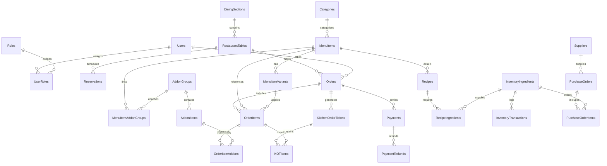

# Restaurant Management System (RMS)
## Enterprise Microservices System Architecture & Technical Specifications

---

### 1. High-Level Architectural Topology

The Restaurant Management System is architectured as an **Enterprise Microservices Architecture** consisting of **14 independently deployable, loosely coupled microservices** coordinated via an **API Gateway**, communicating through resilient **HTTP REST APIs**, and persisting state to a single shared Microsoft SQL Server database (`RestaurantManagementDB`) governed by strict table ownership boundaries.

```mermaid
flowchart TB
    subgraph ClientTiers["Client Applications (React.js + Ant Design)"]
        direction LR
        CUST["Customer Web Portal\n(:3000)"]
        ADMIN["Admin Management Suite\n(:3001)"]
        KDS["Kitchen Display (KDS)\n(:3002)"]
        POS["Staff / POS Terminal\n(:3003)"]
    end

    subgraph GatewayPerimeter["Ingress & Edge Perimeter"]
        direction TB
        NGINX["Nginx Reverse Proxy & SSL Termination\n(:80 / :443)"]
        GATEWAY["API Gateway Service (:5000)\n• JWT Verification & RBAC Guards\n• Rate Limiting (Redis Store)\n• Request Correlation IDs (X-Correlation-ID)\n• Reverse Proxy Routing"]
    end

    subgraph ServiceMesh["Microservices Domain Mesh (HTTP REST Inter-Service Fabric)"]
        direction TB
        AUTH_SVC["Auth Service (:5001)"]
        USER_SVC["User Service (:5002)"]
        REST_SVC["Restaurant Service (:5003)"]
        CMS_SVC["CMS Service (:5004)"]
        MENU_SVC["Menu Service (:5005)"]
        CART_SVC["Cart Service (:5006)"]
        ORDER_SVC["Order Service (:5007)"]
        PAY_SVC["Payment Service (:5008)"]
        INV_SVC["Inventory Service (:5009)"]
        KITCHEN_SVC["Kitchen Service (:5010)"]
        RES_SVC["Reservation Service (:5011)"]
        NOTIF_SVC["Notification Service (:5012 / Socket.IO)"]
        REP_SVC["Report Service (:5013)"]
    end

    subgraph Persistence["Persistence & State Layer"]
        MSSQL[("Microsoft SQL Server 2022\n'RestaurantManagementDB' (:1433)\n(55 Tables with Strict Service Ownership)")]
        REDIS[("Redis Cache & Rate Limiting (:6379)\n(CMS, Menu, Sessions & Buckets)")]
        RZP_EXT["Razorpay Gateway API\n(Payments & Webhooks)"]
        CLOUDINARY["Cloudinary Media CDN\n(Asset Transforms)"]
    end

    ClientTiers --> NGINX --> GATEWAY
    ClientTiers <-->|WebSockets WSS| NOTIF_SVC

    GATEWAY --> AUTH_SVC & USER_SVC & REST_SVC & CMS_SVC & MENU_SVC & CART_SVC & ORDER_SVC & PAY_SVC & INV_SVC & KITCHEN_SVC & RES_SVC & NOTIF_SVC & REP_SVC

    ORDER_SVC <-->|HTTP REST Saga| MENU_SVC & INV_SVC & KITCHEN_SVC & PAY_SVC & NOTIF_SVC
    CART_SVC <-->|HTTP REST| MENU_SVC
    PAY_SVC <-->|HTTP REST| ORDER_SVC & NOTIF_SVC
    RES_SVC <-->|HTTP REST| REST_SVC & NOTIF_SVC
    REP_SVC <-->|HTTP REST| ORDER_SVC & PAY_SVC & INV_SVC

    PAY_SVC <--> RZP_EXT
    CMS_SVC <--> CLOUDINARY

    CMS_SVC & MENU_SVC & CART_SVC & GATEWAY <--> REDIS
    ServiceMesh -->|Sequelize ORM\n(Owns Assigned Tables Only)| MSSQL
```

#### Core Microservices Principles
1. **Independent Service Boundaries**: Every microservice maintains its own `package.json`, source directory, controllers, services, models, routes, validation schemas, and health-check endpoint.
2. **Shared Database with Strict Table Ownership**: All services connect to the single enterprise database `RestaurantManagementDB`. Each table has exactly **one owner service**; no service may execute queries against tables owned by another service. Cross-service data is accessed strictly via documented HTTP REST endpoints.
3. **HTTP REST Inter-Service Communication**: Zero message broker (no RabbitMQ, no Kafka, no gRPC). Services interact using Axios HTTP clients with correlation IDs (`X-Correlation-ID`), internal service keys (`X-Internal-Service-Key`), request timeouts, and retry policies.
4. **Single Global Environment Configuration**: Configuration is centralized in a single root `.env` file (`restaurant-management-system/.env`). Individual services do not have local `.env` files.
5. **Distributed Transaction Management (REST Saga)**: Multi-service workflows (such as order checkout, inventory depletion, payment verification, and KOT generation) are orchestrated through an HTTP-based Saga with compensating transactions and idempotency keys (`X-Idempotency-Key`).
6. **Centralized Real-Time WebSocket Hub**: `Notification Service` is the sole Socket.IO server; domain services trigger live broadcasts via internal HTTP POST calls to `notification-service`.

---

### 2. Microservice Clean Layered Architecture

Each of the 14 microservices strictly follows an isolated clean layered architecture:

```
[ Ingress HTTP Request via API Gateway / Inter-Service Call ]
                          │
                          ▼
┌────────────────────────────────────────────────────────┐
│                   Route Layer                          │  --> Express Router (e.g. /api/v1/orders)
└─────────────────────────┬──────────────────────────────┘
                          │
                          ▼
┌────────────────────────────────────────────────────────┐
│         Validation & Internal Auth Guard               │  --> Zod Schema Validation, Internal Key Check
└─────────────────────────┬──────────────────────────────┘
                          │
                          ▼
┌────────────────────────────────────────────────────────┐
│                Controller Layer                        │  --> Request DTO extraction, HTTP status codes,
└─────────────────────────┬──────────────────────────────┘      standard response envelope formatting
                          │
                          ▼
┌────────────────────────────────────────────────────────┐
│                 Service Layer                          │  --> Core business logic, inter-service REST
└───────────┬──────────────────────────────┬─────────────┘      calls (Axios), Saga orchestration
            │                              │
            ▼                              ▼
┌───────────────────────────┐  ┌─────────────────────────┐
│     Sequelize Models      │  │  Inter-Service Client   │  --> HTTP REST calls to other microservices
│  (Owned DB Tables Only)   │  │  (Axios + Correlation)  │      with timeouts & idempotency headers
└───────────┬───────────────┘  └─────────────────────────┘
            │
            ▼
┌───────────────────────────┐
│  MS SQL Server (Shared)   │  --> Executes queries only on service-owned tables
└───────────────────────────┘
```
            │
            ▼
┌───────────────────────────┐
│     Controller Layer      │  --> Extracts DTO, formats response envelope, delegates to service
└───────────┬───────────────┘
            │
            ▼
┌───────────────────────────┐
│       Service Layer       │  --> Encapsulates business logic, orchestrates transactions,
└───────────┬───────────────┘      emits Socket.IO events, handles payment gateway logic
            │
            ▼
┌───────────────────────────┐
│ Data Access / Repositories│  --> Sequelize Models, Raw MSSQL queries, Index utilization
└───────────┬───────────────┘
            │
            ▼
┌───────────────────────────┐
│   Microsoft SQL Server    │  --> ACID Storage, Stored Procedures, Foreign Key Constraints
└───────────────────────────┘
```

---

### 3. Database Architecture & Schema Design (Microsoft SQL Server)

#### Dialect & Connection Specification
- **Engine**: Microsoft SQL Server 2022 / Azure SQL Database
- **Dialect**: `mssql` via `tedious` driver
- **Sequelize Pool Configuration**:
  - `max`: 50
  - `min`: 10
  - `acquire`: 30000ms
  - `idle`: 10000ms
- **Data Types Mapping**:
  - String identifiers: `NVARCHAR(50)` / `UNIQUEIDENTIFIER`
  - Long text / Descriptions: `NVARCHAR(500)` or `NVARCHAR(MAX)`
  - Financial amounts & Quantities: `DECIMAL(10, 2)` or `DECIMAL(12, 4)` for high-precision recipe measurements
  - Booleans: `BIT`
  - Dates & Timestamps: `DATETIME2(3)` (millisecond precision, ISO-8601 compatible)

#### Entity Relationship Diagram (ERD)



#### Detailed Database Schema Specifications

##### 1. Identity & Access Management
```sql
-- Roles Table
CREATE TABLE Roles (
    RoleId INT IDENTITY(1,1) PRIMARY KEY,
    RoleCode NVARCHAR(30) NOT NULL UNIQUE, -- 'SUPER_ADMIN', 'RESTAURANT_MANAGER', 'CASHIER_POS', 'WAITSTAFF', 'KITCHEN_CHEF', 'CUSTOMER'
    RoleName NVARCHAR(60) NOT NULL,
    Description NVARCHAR(255) NULL,
    CreatedAt DATETIME2(3) NOT NULL DEFAULT SYSUTCDATETIME(),
    UpdatedAt DATETIME2(3) NOT NULL DEFAULT SYSUTCDATETIME()
);

-- Users Table
CREATE TABLE Users (
    UserId BIGINT IDENTITY(1,1) PRIMARY KEY,
    FirstName NVARCHAR(60) NOT NULL,
    LastName NVARCHAR(60) NULL,
    Email NVARCHAR(120) NULL UNIQUE,
    PhoneNumber NVARCHAR(20) NOT NULL UNIQUE,
    PasswordHash NVARCHAR(255) NULL, -- Nullable for guest accounts
    PasscodePin NVARCHAR(255) NULL,   -- Quick 4-digit PIN for POS staff
    IsActive BIT NOT NULL DEFAULT 1,
    LastLoginAt DATETIME2(3) NULL,
    CreatedAt DATETIME2(3) NOT NULL DEFAULT SYSUTCDATETIME(),
    UpdatedAt DATETIME2(3) NOT NULL DEFAULT SYSUTCDATETIME()
);

-- UserRoles Junction Table
CREATE TABLE UserRoles (
    UserRoleId BIGINT IDENTITY(1,1) PRIMARY KEY,
    UserId BIGINT NOT NULL FOREIGN KEY REFERENCES Users(UserId) ON DELETE CASCADE,
    RoleId INT NOT NULL FOREIGN KEY REFERENCES Roles(RoleId) ON DELETE CASCADE,
    AssignedAt DATETIME2(3) NOT NULL DEFAULT SYSUTCDATETIME(),
    CONSTRAINT UQ_User_Role UNIQUE (UserId, RoleId)
);
```

##### 2. Floor, Tables & Reservations
```sql
-- Dining Sections Table
CREATE TABLE DiningSections (
    SectionId INT IDENTITY(1,1) PRIMARY KEY,
    SectionName NVARCHAR(60) NOT NULL, -- 'Main Dining', 'Patio Deck', 'Rooftop Bar'
    FloorLevel INT NOT NULL DEFAULT 1,
    IsActive BIT NOT NULL DEFAULT 1,
    CreatedAt DATETIME2(3) NOT NULL DEFAULT SYSUTCDATETIME()
);

-- Restaurant Tables
CREATE TABLE RestaurantTables (
    TableId INT IDENTITY(1,1) PRIMARY KEY,
    SectionId INT NOT NULL FOREIGN KEY REFERENCES DiningSections(SectionId),
    TableNumber NVARCHAR(20) NOT NULL UNIQUE, -- 'T-01', 'BAR-03'
    SeatingCapacity INT NOT NULL DEFAULT 4,
    CurrentStatus NVARCHAR(30) NOT NULL DEFAULT 'AVAILABLE', -- 'AVAILABLE', 'OCCUPIED', 'RESERVED', 'BILLED', 'CLEANING'
    ActiveOrderId BIGINT NULL, -- Nullable pointer to running order
    QrCodeHash NVARCHAR(100) NOT NULL UNIQUE, -- Token for customer QR URL
    PosX INT NOT NULL DEFAULT 0, -- Canvas coordinates for visual floor plan
    PosY INT NOT NULL DEFAULT 0,
    IsActive BIT NOT NULL DEFAULT 1,
    UpdatedAt DATETIME2(3) NOT NULL DEFAULT SYSUTCDATETIME()
);

-- Table Reservations
CREATE TABLE Reservations (
    ReservationId BIGINT IDENTITY(1,1) PRIMARY KEY,
    GuestName NVARCHAR(100) NOT NULL,
    GuestPhone NVARCHAR(20) NOT NULL,
    GuestEmail NVARCHAR(120) NULL,
    PartySize INT NOT NULL,
    TableId INT NULL FOREIGN KEY REFERENCES RestaurantTables(TableId),
    ReservationDate DATE NOT NULL,
    StartTime TIME(0) NOT NULL,
    EndTime TIME(0) NOT NULL,
    Status NVARCHAR(30) NOT NULL DEFAULT 'CONFIRMED', -- 'CONFIRMED', 'SEATED', 'CANCELLED', 'NO_SHOW'
    SpecialNotes NVARCHAR(500) NULL,
    DepositAmount DECIMAL(10,2) NOT NULL DEFAULT 0.00,
    CreatedByUserId BIGINT NULL FOREIGN KEY REFERENCES Users(UserId),
    CreatedAt DATETIME2(3) NOT NULL DEFAULT SYSUTCDATETIME()
);
CREATE INDEX IX_Reservations_Date_Time ON Reservations(ReservationDate, StartTime, Status);
```

##### 3. Menu Engineering & Pricing
```sql
-- Categories Table
CREATE TABLE Categories (
    CategoryId INT IDENTITY(1,1) PRIMARY KEY,
    ParentCategoryId INT NULL FOREIGN KEY REFERENCES Categories(CategoryId),
    CategoryName NVARCHAR(80) NOT NULL,
    Description NVARCHAR(255) NULL,
    DisplayOrder INT NOT NULL DEFAULT 0,
    ImageUrl NVARCHAR(500) NULL,
    IsActive BIT NOT NULL DEFAULT 1,
    CreatedAt DATETIME2(3) NOT NULL DEFAULT SYSUTCDATETIME()
);

-- Menu Items Table
CREATE TABLE MenuItems (
    MenuItemId BIGINT IDENTITY(1,1) PRIMARY KEY,
    CategoryId INT NOT NULL FOREIGN KEY REFERENCES Categories(CategoryId),
    ItemCode NVARCHAR(30) NOT NULL UNIQUE,
    ItemName NVARCHAR(120) NOT NULL,
    Description NVARCHAR(1000) NULL,
    BasePrice DECIMAL(10,2) NOT NULL,
    TaxPercentage DECIMAL(5,2) NOT NULL DEFAULT 5.00, -- e.g. 5% GST
    DietaryType NVARCHAR(30) NOT NULL DEFAULT 'VEG', -- 'VEG', 'NON_VEG', 'VEGAN', 'EGG'
    SpicyLevel INT NOT NULL DEFAULT 0, -- 0 to 3
    PreparationTimeMinutes INT NOT NULL DEFAULT 15,
    ImageUrl NVARCHAR(500) NULL,
    IsAvailable BIT NOT NULL DEFAULT 1, -- '86' toggle
    IsFeatured BIT NOT NULL DEFAULT 0,
    CreatedAt DATETIME2(3) NOT NULL DEFAULT SYSUTCDATETIME(),
    UpdatedAt DATETIME2(3) NOT NULL DEFAULT SYSUTCDATETIME()
);

-- Menu Item Variants (Size, Portions)
CREATE TABLE MenuItemVariants (
    VariantId BIGINT IDENTITY(1,1) PRIMARY KEY,
    MenuItemId BIGINT NOT NULL FOREIGN KEY REFERENCES MenuItems(MenuItemId) ON DELETE CASCADE,
    VariantName NVARCHAR(60) NOT NULL, -- 'Regular', 'Large', 'Half', 'Full'
    PriceAdjustment DECIMAL(10,2) NOT NULL DEFAULT 0.00, -- Extra cost or alternative price
    IsDefault BIT NOT NULL DEFAULT 0,
    IsAvailable BIT NOT NULL DEFAULT 1
);

-- Addon Groups (e.g. 'Extra Cheese', 'Choice of Dressing')
CREATE TABLE AddonGroups (
    AddonGroupId INT IDENTITY(1,1) PRIMARY KEY,
    GroupName NVARCHAR(80) NOT NULL,
    MinSelections INT NOT NULL DEFAULT 0,
    MaxSelections INT NOT NULL DEFAULT 10,
    IsActive BIT NOT NULL DEFAULT 1
);

-- Addon Items
CREATE TABLE AddonItems (
    AddonItemId BIGINT IDENTITY(1,1) PRIMARY KEY,
    AddonGroupId INT NOT NULL FOREIGN KEY REFERENCES AddonGroups(AddonGroupId) ON DELETE CASCADE,
    ItemName NVARCHAR(80) NOT NULL,
    Price DECIMAL(10,2) NOT NULL DEFAULT 0.00,
    IsAvailable BIT NOT NULL DEFAULT 1
);

-- Junction: Menu Items to Addon Groups
CREATE TABLE MenuItemAddonGroups (
    MenuItemId BIGINT NOT NULL FOREIGN KEY REFERENCES MenuItems(MenuItemId) ON DELETE CASCADE,
    AddonGroupId INT NOT NULL FOREIGN KEY REFERENCES AddonGroups(AddonGroupId) ON DELETE CASCADE,
    PRIMARY KEY (MenuItemId, AddonGroupId)
);
```

##### 4. Orders, Order Items & Kitchen Order Tickets (KOT)
```sql
-- Orders Table
CREATE TABLE Orders (
    OrderId BIGINT IDENTITY(100001,1) PRIMARY KEY,
    OrderNumber NVARCHAR(30) NOT NULL UNIQUE, -- 'ORD-20261108-0001'
    OrderType NVARCHAR(30) NOT NULL DEFAULT 'DINE_IN', -- 'DINE_IN', 'TAKEAWAY', 'ONLINE'
    TableId INT NULL FOREIGN KEY REFERENCES RestaurantTables(TableId),
    CustomerId BIGINT NULL FOREIGN KEY REFERENCES Users(UserId),
    WaitstaffUserId BIGINT NULL FOREIGN KEY REFERENCES Users(UserId),
    OrderStatus NVARCHAR(30) NOT NULL DEFAULT 'PLACED', -- 'PLACED', 'ACCEPTED', 'PREPARING', 'READY', 'SERVED', 'COMPLETED', 'CANCELLED'
    PaymentStatus NVARCHAR(30) NOT NULL DEFAULT 'PENDING', -- 'PENDING', 'PARTIALLY_PAID', 'PAID', 'REFUNDED'
    SubTotal DECIMAL(10,2) NOT NULL DEFAULT 0.00,
    TaxTotal DECIMAL(10,2) NOT NULL DEFAULT 0.00,
    ServiceCharge DECIMAL(10,2) NOT NULL DEFAULT 0.00,
    DiscountTotal DECIMAL(10,2) NOT NULL DEFAULT 0.00,
    GrandTotal DECIMAL(10,2) NOT NULL DEFAULT 0.00,
    CustomerNotes NVARCHAR(500) NULL,
    VoidReason NVARCHAR(255) NULL,
    CreatedAt DATETIME2(3) NOT NULL DEFAULT SYSUTCDATETIME(),
    UpdatedAt DATETIME2(3) NOT NULL DEFAULT SYSUTCDATETIME()
);
CREATE INDEX IX_Orders_Table_Status ON Orders(TableId, OrderStatus);
CREATE INDEX IX_Orders_CreatedAt ON Orders(CreatedAt);

-- Order Items Table
CREATE TABLE OrderItems (
    OrderItemId BIGINT IDENTITY(1,1) PRIMARY KEY,
    OrderId BIGINT NOT NULL FOREIGN KEY REFERENCES Orders(OrderId) ON DELETE CASCADE,
    MenuItemId BIGINT NOT NULL FOREIGN KEY REFERENCES MenuItems(MenuItemId),
    VariantId BIGINT NULL FOREIGN KEY REFERENCES MenuItemVariants(VariantId),
    ItemPrice DECIMAL(10,2) NOT NULL,
    Quantity INT NOT NULL DEFAULT 1,
    ItemTotal DECIMAL(10,2) NOT NULL,
    SpecialInstructions NVARCHAR(255) NULL,
    ItemStatus NVARCHAR(30) NOT NULL DEFAULT 'PENDING', -- 'PENDING', 'COOKING', 'READY', 'SERVED', 'VOIDED'
    CreatedAt DATETIME2(3) NOT NULL DEFAULT SYSUTCDATETIME()
);

-- Order Item Addons Junction Table
CREATE TABLE OrderItemAddons (
    OrderItemAddonId BIGINT IDENTITY(1,1) PRIMARY KEY,
    OrderItemId BIGINT NOT NULL FOREIGN KEY REFERENCES OrderItems(OrderItemId) ON DELETE CASCADE,
    AddonItemId BIGINT NOT NULL FOREIGN KEY REFERENCES AddonItems(AddonItemId),
    AddonPrice DECIMAL(10,2) NOT NULL DEFAULT 0.00
);

-- Kitchen Order Tickets (KOT)
CREATE TABLE KitchenOrderTickets (
    KOTId BIGINT IDENTITY(50001,1) PRIMARY KEY,
    KOTNumber NVARCHAR(30) NOT NULL UNIQUE, -- 'KOT-20261108-01'
    OrderId BIGINT NOT NULL FOREIGN KEY REFERENCES Orders(OrderId),
    KitchenStation NVARCHAR(40) NOT NULL DEFAULT 'MAIN_KITCHEN', -- 'GRILL', 'FRYER', 'BAR'
    TicketStatus NVARCHAR(30) NOT NULL DEFAULT 'NEW', -- 'NEW', 'PREPARING', 'READY', 'BUMPED'
    CreatedAt DATETIME2(3) NOT NULL DEFAULT SYSUTCDATETIME(),
    BumpedAt DATETIME2(3) NULL
);

-- KOT Items
CREATE TABLE KOTItems (
    KOTItemId BIGINT IDENTITY(1,1) PRIMARY KEY,
    KOTId BIGINT NOT NULL FOREIGN KEY REFERENCES KitchenOrderTickets(KOTId) ON DELETE CASCADE,
    OrderItemId BIGINT NOT NULL FOREIGN KEY REFERENCES OrderItems(OrderItemId),
    PreparationStatus NVARCHAR(30) NOT NULL DEFAULT 'PENDING'
);
```

##### 5. Payments, Transactions & Split Billing
```sql
-- Payments Table
CREATE TABLE Payments (
    PaymentId BIGINT IDENTITY(1,1) PRIMARY KEY,
    OrderId BIGINT NOT NULL FOREIGN KEY REFERENCES Orders(OrderId),
    PaymentReference NVARCHAR(60) NOT NULL UNIQUE, -- Internal receipt ref
    PaymentMethod NVARCHAR(30) NOT NULL, -- 'RAZORPAY', 'CASH', 'CREDIT_CARD', 'DEBIT_CARD', 'UPI_OFFLINE'
    Amount DECIMAL(10,2) NOT NULL,
    GatewayOrderId NVARCHAR(100) NULL, -- Razorpay order_id
    GatewayPaymentId NVARCHAR(100) NULL, -- Razorpay payment_id
    GatewaySignature NVARCHAR(255) NULL,
    PaymentStatus NVARCHAR(30) NOT NULL DEFAULT 'PENDING', -- 'PENDING', 'SUCCESS', 'FAILED', 'REFUNDED'
    SettledByUserId BIGINT NULL FOREIGN KEY REFERENCES Users(UserId),
    SettledAt DATETIME2(3) NULL,
    CreatedAt DATETIME2(3) NOT NULL DEFAULT SYSUTCDATETIME()
);

-- Payment Refunds
CREATE TABLE PaymentRefunds (
    RefundId BIGINT IDENTITY(1,1) PRIMARY KEY,
    PaymentId BIGINT NOT NULL FOREIGN KEY REFERENCES Payments(PaymentId),
    GatewayRefundId NVARCHAR(100) NULL, -- Razorpay refund_id
    RefundAmount DECIMAL(10,2) NOT NULL,
    Reason NVARCHAR(255) NOT NULL,
    Status NVARCHAR(30) NOT NULL DEFAULT 'PROCESSED',
    InitiatedByUserId BIGINT NOT NULL FOREIGN KEY REFERENCES Users(UserId),
    CreatedAt DATETIME2(3) NOT NULL DEFAULT SYSUTCDATETIME()
);
```

##### 6. Inventory & Bill of Materials (BOM)
```sql
-- Suppliers Table
CREATE TABLE Suppliers (
    SupplierId INT IDENTITY(1,1) PRIMARY KEY,
    SupplierName NVARCHAR(100) NOT NULL,
    ContactPerson NVARCHAR(80) NULL,
    Phone NVARCHAR(20) NOT NULL,
    Email NVARCHAR(120) NULL,
    Address NVARCHAR(255) NULL,
    IsActive BIT NOT NULL DEFAULT 1,
    CreatedAt DATETIME2(3) NOT NULL DEFAULT SYSUTCDATETIME()
);

-- Inventory Ingredients
CREATE TABLE InventoryIngredients (
    IngredientId BIGINT IDENTITY(1,1) PRIMARY KEY,
    IngredientCode NVARCHAR(30) NOT NULL UNIQUE,
    IngredientName NVARCHAR(100) NOT NULL,
    UnitOfMeasure NVARCHAR(20) NOT NULL, -- 'KG', 'GRAM', 'LITER', 'ML', 'PIECE'
    CurrentStock DECIMAL(12,4) NOT NULL DEFAULT 0.0000,
    ReorderLevel DECIMAL(12,4) NOT NULL DEFAULT 5.0000,
    CostPerUnit DECIMAL(10,2) NOT NULL DEFAULT 0.00,
    SupplierId INT NULL FOREIGN KEY REFERENCES Suppliers(SupplierId),
    UpdatedAt DATETIME2(3) NOT NULL DEFAULT SYSUTCDATETIME()
);

-- Recipes (BOM header)
CREATE TABLE Recipes (
    RecipeId BIGINT IDENTITY(1,1) PRIMARY KEY,
    MenuItemId BIGINT NOT NULL UNIQUE FOREIGN KEY REFERENCES MenuItems(MenuItemId),
    YieldPortions INT NOT NULL DEFAULT 1,
    PreparationInstructions NVARCHAR(MAX) NULL,
    IsActive BIT NOT NULL DEFAULT 1,
    CreatedAt DATETIME2(3) NOT NULL DEFAULT SYSUTCDATETIME()
);

-- Recipe Ingredients (BOM detail)
CREATE TABLE RecipeIngredients (
    RecipeIngredientId BIGINT IDENTITY(1,1) PRIMARY KEY,
    RecipeId BIGINT NOT NULL FOREIGN KEY REFERENCES Recipes(RecipeId) ON DELETE CASCADE,
    IngredientId BIGINT NOT NULL FOREIGN KEY REFERENCES InventoryIngredients(IngredientId),
    RequiredQuantity DECIMAL(12,4) NOT NULL, -- Amount needed per 1 dish
    CONSTRAINT UQ_Recipe_Ingredient UNIQUE (RecipeId, IngredientId)
);

-- Inventory Transactions (Stock audit log)
CREATE TABLE InventoryTransactions (
    TransactionId BIGINT IDENTITY(1,1) PRIMARY KEY,
    IngredientId BIGINT NOT NULL FOREIGN KEY REFERENCES InventoryIngredients(IngredientId),
    TransactionType NVARCHAR(30) NOT NULL, -- 'CONSUMPTION', 'PURCHASE', 'WASTAGE', 'ADJUSTMENT'
    QuantityChanged DECIMAL(12,4) NOT NULL, -- Negative for consumption/spoilage, positive for receipt
    RemainingBalance DECIMAL(12,4) NOT NULL,
    ReferenceOrderId BIGINT NULL FOREIGN KEY REFERENCES Orders(OrderId),
    ReasonNotes NVARCHAR(255) NULL,
    RecordedByUserId BIGINT NULL FOREIGN KEY REFERENCES Users(UserId),
    CreatedAt DATETIME2(3) NOT NULL DEFAULT SYSUTCDATETIME()
);
CREATE INDEX IX_InvTx_Ingredient_Date ON InventoryTransactions(IngredientId, CreatedAt);
```

##### 7. Audit Logging & System Settings
```sql
-- Audit Logs
CREATE TABLE AuditLogs (
    AuditId BIGINT IDENTITY(1,1) PRIMARY KEY,
    UserId BIGINT NULL FOREIGN KEY REFERENCES Users(UserId),
    ActionCategory NVARCHAR(50) NOT NULL, -- 'BILLING', 'SECURITY', 'INVENTORY', 'MENU_PRICING'
    ActionDescription NVARCHAR(500) NOT NULL,
    IpAddress NVARCHAR(50) NULL,
    OldValues NVARCHAR(MAX) NULL, -- JSON snapshot
    NewValues NVARCHAR(MAX) NULL, -- JSON snapshot
    CreatedAt DATETIME2(3) NOT NULL DEFAULT SYSUTCDATETIME()
);

-- System Settings
CREATE TABLE SystemSettings (
    SettingKey NVARCHAR(60) PRIMARY KEY,
    SettingValue NVARCHAR(MAX) NOT NULL,
    ValueType NVARCHAR(20) NOT NULL DEFAULT 'STRING', -- 'STRING', 'NUMBER', 'BOOLEAN', 'JSON'
    Description NVARCHAR(255) NULL,
    UpdatedAt DATETIME2(3) NOT NULL DEFAULT SYSUTCDATETIME()
);
```

---

### 4. API Architecture & RESTful Endpoint Design

#### Standard Response Format
All REST API endpoints conform to a standardized JSON response envelope:

```json
// Success Response (HTTP 200 / 201)
{
  "success": true,
  "data": { ... },
  "message": "Resource retrieved / operation successful",
  "meta": {
    "page": 1,
    "limit": 20,
    "totalCount": 128
  }
}

// Error Response (HTTP 4xx / 5xx)
{
  "success": false,
  "error": {
    "code": "RESOURCE_NOT_FOUND",
    "message": "Menu item with ID 402 does not exist",
    "details": [ ... ]
  }
}
```

#### API Endpoint Inventory

| Domain | Method | Endpoint Path | Role Allowed | Description |
| :--- | :--- | :--- | :--- | :--- |
| **Auth** | `POST` | `/api/v1/auth/register` | Public / Customer | Register new customer account |
| **Auth** | `POST` | `/api/v1/auth/login` | Public | Staff/Customer credentials login |
| **Auth** | `POST` | `/api/v1/auth/pos-pin-login` | POS / Waiter | Fast PIN-based login for POS terminals |
| **Auth** | `POST` | `/api/v1/auth/refresh-token` | Authenticated | Rotate JWT access token |
| **Auth** | `POST` | `/api/v1/auth/logout` | Authenticated | Invalidate refresh session |
| **Users** | `GET` | `/api/v1/users` | Admin, Manager | List staff members with roles |
| **Users** | `POST` | `/api/v1/users` | Admin | Create staff user profile |
| **Tables** | `GET` | `/api/v1/tables` | All Staff, Customer | Fetch all tables with current occupancy status |
| **Tables** | `POST` | `/api/v1/tables` | Admin, Manager | Add physical table to layout |
| **Tables** | `PATCH`| `/api/v1/tables/:id/status` | All Staff | Update table status (e.g. Needs Cleaning) |
| **Tables** | `GET` | `/api/v1/tables/qr/:hash` | Public | Validate table QR code session |
| **Reservations** | `POST` | `/api/v1/reservations` | Customer, Staff | Book new table reservation slot |
| **Reservations** | `GET` | `/api/v1/reservations` | Manager, Staff | Query reservations by date and status |
| **Reservations** | `PATCH`| `/api/v1/reservations/:id/check-in` | Manager, Staff | Mark guest seated and update table |
| **Categories** | `GET` | `/api/v1/categories` | Public | List hierarchical categories |
| **Categories** | `POST` | `/api/v1/categories` | Admin, Manager | Create menu category |
| **Menu Items** | `GET` | `/api/v1/menu-items` | Public | Browse menu with variants and add-ons |
| **Menu Items** | `POST` | `/api/v1/menu-items` | Admin, Manager | Create menu item with recipe link |
| **Menu Items** | `PATCH`| `/api/v1/menu-items/:id/availability` | Chef, Manager, Admin | Toggle "86" out-of-stock status |
| **Orders** | `POST` | `/api/v1/orders` | Customer, Staff | Submit new order (Dine-in / Takeaway) |
| **Orders** | `GET` | `/api/v1/orders/active` | Staff, Manager | View live orders by table or type |
| **Orders** | `GET` | `/api/v1/orders/:id` | Authenticated | Retrieve detailed order breakdown |
| **Orders** | `POST` | `/api/v1/orders/:id/items` | Staff | Append additional items to active tab |
| **Orders** | `PATCH`| `/api/v1/orders/:id/void` | Manager, Admin | Void order or item with reason |
| **Orders** | `POST` | `/api/v1/orders/:id/split` | Cashier, Manager | Generate split payment shares |
| **KDS** | `GET` | `/api/v1/kds/tickets` | Chef, Manager | Fetch active KOT queue |
| **KDS** | `PATCH`| `/api/v1/kds/items/:id/status`| Chef | Update preparation state of item |
| **KDS** | `POST` | `/api/v1/kds/tickets/:id/bump`| Chef | Bump ticket to complete |
| **Payments** | `POST` | `/api/v1/payments/razorpay/create-order` | Customer, Cashier | Generate Razorpay order ID |
| **Payments** | `POST` | `/api/v1/payments/razorpay/verify` | Public / Customer | Verify HMAC signature & settle |
| **Payments** | `POST` | `/api/v1/payments/webhook` | Razorpay Gateway | Automated async capture webhook |
| **Payments** | `POST` | `/api/v1/payments/offline-settle` | Cashier, Manager | Record Cash, Card or offline UPI |
| **Inventory** | `GET` | `/api/v1/inventory/ingredients`| Manager, Admin | List ingredients with stock levels |
| **Inventory** | `POST` | `/api/v1/inventory/spoilage` | Chef, Manager | Record wastage and deduct stock |
| **Reports** | `GET` | `/api/v1/reports/sales-summary`| Admin, Manager | Aggregate sales, tax and discounts |
| **Reports** | `GET` | `/api/v1/reports/menu-velocity`| Admin, Manager | Item popularity and profit margins |

---

### 5. Real-Time WebSocket Architecture (Socket.IO)

#### Connection & Handshake Security
- Socket connections authenticate using JWT sent via `auth: { token: '...' }` in handshake.
- Unauthenticated guest customer sockets are allowed into restricted table-specific rooms only via valid `qrToken`.

#### Room Segmentation
- `role:admin`: System alerts, revenue milestones, critical low-stock warnings.
- `role:kitchen`: Kitchen display tickets, station-specific KOT updates.
- `role:pos`: Table status updates, bill payment alerts, waiter pickup calls.
- `table:{tableId}`: Order status updates for guests at a specific table.
- `order:{orderId}`: Fine-grained tracking updates for a specific order.

#### Socket Event Specifications

| Event Name | Direction | Payload Structure | Architectural Purpose |
| :--- | :--- | :--- | :--- |
| `kot:new` | Server -> Kitchen | `{ kotId, tableNumber, items: [...], notes, timestamp }` | Instantly populates new ticket on KDS |
| `kot:bump` | Client -> Server | `{ kotId, bumpedByUserId }` | Chef marks entire ticket ready |
| `table:status_change`| Server -> POS/Admin| `{ tableId, tableNumber, newStatus, activeOrderId }` | Updates floor plan color-code in real time |
| `order:status_update`| Server -> Customer/POS| `{ orderId, status, estimatedMinutes }` | Live progress bar milestone trigger |
| `waiter:pickup_call` | Server -> POS/Waitstaff| `{ tableNumber, kotNumber, stationName }` | Visual & audio notification that food is plated |
| `inventory:low_stock`| Server -> Admin | `{ ingredientId, ingredientName, currentStock, uom }` | Real-time warning of ingredient depletion |
| `menu:availability_toggle`| Server -> All | `{ menuItemId, isAvailable }` | Immediate live menu sync ("86" item) |

---

### 6. Frontend Page & Component Architecture (React.js + Ant Design)

#### Modular Client Architecture
The frontend code is structured by feature modules, sharing standard design primitives from Ant Design:

```
frontend/src/
├── app/
│   ├── routes.jsx             # React Router v6 tree with ProtectedRoute RBAC guards
│   ├── store.js               # Zustand global store configuration
│   └── queryClient.js         # TanStack Query client configuration
├── assets/                    # Static branding, sounds, icons
├── components/common/         # Shared AntD wrappers (StatCard, DataTable, StatusBadge)
├── context/
│   ├── AuthContext.jsx        # Current user profile, tokens, role helpers
│   └── SocketContext.jsx      # Socket.IO connection manager & room listeners
├── layouts/
│   ├── CustomerLayout.jsx     # Mobile-first header, bottom navigation bar
│   ├── PosLayout.jsx          # Full-screen touch layout, table switcher, quick keypad
│   ├── KdsLayout.jsx          # High-contrast dark theme layout, station tabs
│   └── AdminLayout.jsx        # AntD Pro-style Sider navigation, top breadcrumbs
├── modules/
│   ├── customer/              # Menu browsing, Cart Drawer, Razorpay Modal, Live Tracker
│   ├── pos/                   # Floor Canvas, POS Order Matrix, Split Bill Modal
│   ├── kitchen/               # KDS Kanban Column Grid, Ticket Card, Cooking Timer
│   ├── admin/                 # Menu CRUD, Inventory BOM, Staff List, Sales Charts
│   └── reservations/          # Calendar View, Slot Selector, Booking Form
└── services/                  # Axios HTTP client instances & API methods
```

#### Screen & Route Breakdown by Portal

##### Portal 1: Customer Mobile Web (`/m/...`)
- `/m/table/:qrHash`: Dine-in landing, stores table session, auto-redirects to menu.
- `/m/menu`: Category tabs, dietary filters, search bar, item cards with image and price.
- `/m/cart`: Ant Design `Drawer` showing itemizations, variant selections, add-ons, cooking note input.
- `/m/checkout`: Price summary, Razorpay payment trigger, order confirmation.
- `/m/track/:orderId`: Visual milestone stepper (`Placed` -> `Accepted` -> `Cooking` -> `Ready`).
- `/m/reserve`: Public table reservation form with date/time pickers.

##### Portal 2: Staff / POS Terminal (`/pos/...`)
- `/pos/tables`: Interactive SVG/grid floor plan with live table cards colored by state.
- `/pos/terminal/:tableId`: Split view: Left = Category pills + Menu item grid; Right = Running cart & quick modifiers.
- `/pos/orders`: List of active orders with filters (Dine-in, Takeaway).
- `/pos/billing/:orderId`: Ant Design Modal for Split Bill (Equal / By Item / Custom), multi-tender cash/card settlement.

##### Portal 3: Kitchen Display System (`/kds/...`)
- `/kds/board`: Fullscreen dark-mode grid displaying active KOT cards.
  - Header: Station selector (`All`, `Grill`, `Fryer`, `Bar`).
  - Card: Table #, Order #, elapsed time counter (color shifts green -> yellow -> red), item checklist with checkboxes, "Bump" button.

##### Portal 4: Admin Management Console (`/admin/...`)
- `/admin/dashboard`: AntD `Row`/`Col` with KPI cards (Today's Revenue, Total Orders, Average Dining Time, Low Stock Items), sales velocity line chart, category donut chart.
- `/admin/menu`: AntD `Table` with pagination, filters, inline edit, image preview, add-on group manager modal.
- `/admin/inventory`: Master stock table, reorder indicator tag, recipe builder modal (linking menu item to multiple raw ingredients).
- `/admin/staff`: User accounts, role assignment tags, PIN management.
- `/admin/reports`: Date range picker, export buttons (Excel, PDF), tabular financial summaries.

